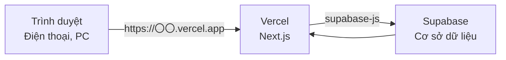
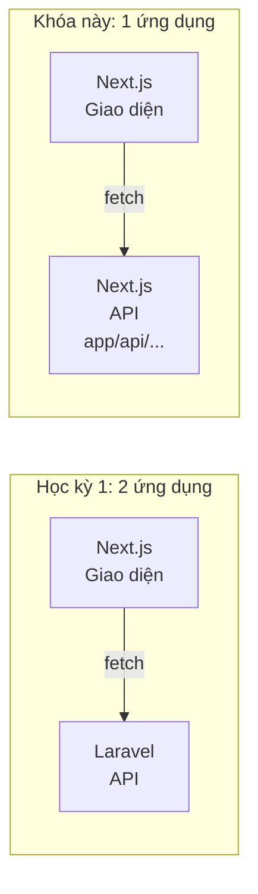
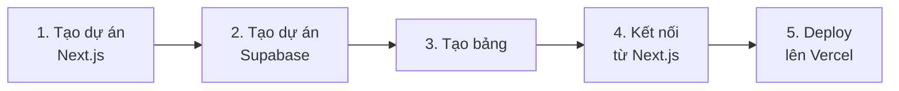
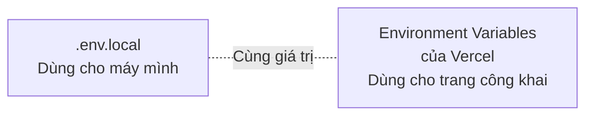

# Sản phẩm tự do A. Khóa deploy — Next.js + Vercel + Supabase

> 🇯🇵 Bản gốc (tiếng Nhật): [2026_10_09_資料2.md](<../../../2年生_システム開発実践/後期/2026_10_09/2026_10_09_資料2.md>) <!-- original-ja-link -->

Đây là khóa học giúp bạn **công khai ứng dụng đã làm lên Internet**, để có thể dùng cả từ điện thoại hay máy tính của bạn bè.

> 💰 **Có thể làm hoàn toàn miễn phí**
> | Dịch vụ | Gói sử dụng |
> |---------|----------|
> | Next.js | Miễn phí (mã nguồn mở) |
> | Vercel | **Hobby** (miễn phí, dùng cho cá nhân, phi thương mại) |
> | Supabase | **Free** (miễn phí) |
>
> Không cần đăng ký thẻ tín dụng. Kể cả khi được gợi ý nâng cấp lên gói trả phí, cũng đừng chọn nhé.

[Quay lại Sản phẩm tự do: Hãy phát triển thứ mình thích](./2026_10_09_資料1.md)

---

## 1. Cơ chế hoạt động

Ở học kỳ 1, Laravel phụ trách xử lý dữ liệu, còn MySQL phụ trách lưu trữ dữ liệu.
Trong khóa này, chúng ta sẽ dùng **Supabase** thay cho cả 2 thứ đó.



| Tên | Là gì? | Nếu so với học kỳ 1 thì |
|------|-----------|------------|
| **Next.js** | Tạo giao diện (**cũng có thể tạo cả backend API**) | school-frontend (+ Laravel API) |
| **Vercel** | Công khai Next.js lên Internet | (không có) |
| **Supabase** | Cơ sở dữ liệu trên mạng. Đồng thời tự động cung cấp sẵn API | Laravel API + MySQL |

### Next.js là một full-stack framework

Ở học kỳ 1, chúng ta đã chia thành 2 ứng dụng: "giao diện là Next.js, API là Laravel".
Nhưng vì Next.js là một **full-stack framework**, nên **có thể làm cả giao diện (frontend) và API (backend) trong cùng một dự án.**



Khi tạo `route.ts` bên trong `app/api/`, file đó sẽ trở thành một API (gọi là **Route Handler**).

```ts
// app/api/hello/route.ts
export async function GET() {
  return Response.json({ message: "こんにちは" });
}
```

Khởi động bằng `npm run dev` rồi mở http://localhost:3000/api/hello, bạn sẽ nhận được JSON.

| | Học kỳ 1 (Laravel) | Next.js |
|---|---|---|
| Quyết định URL | Viết trong `routes/api.php` | Được quyết định bởi **vị trí thư mục** `app/api/〇〇/route.ts` |
| Viết xử lý | Method của controller | Các hàm như `GET` / `POST` |
| Trả về JSON | `return response()->json([...])` | `return Response.json({...})` |

**Dùng API của Next.js trong những trường hợp như sau**

- Khi dùng API bên ngoài (AI...), **không muốn để lộ API key ra trình duyệt**
  (Xử lý bên trong API chạy trên server, nên có thể dùng an toàn các biến môi trường không có tiền tố `NEXT_PUBLIC_`)
- Muốn kiểm tra ở phía server trước khi lưu dữ liệu

> Với việc đọc/ghi dữ liệu đơn giản, chỉ cần kết nối trực tiếp từ giao diện tới Supabase là OK.
> Khi có "việc muốn xử lý ở phía server", hãy tạo API bằng Next.js nhé.

## 2. Quy trình chuẩn bị



### 2-1. Tạo dự án Next.js

Tạo bằng `create-next-app` giống như ứng dụng dự báo thời tiết, rồi push lên GitHub.
→ [Tài liệu ứng dụng dự báo thời tiết](../2026_10_02/2026_10_02_資料2.md)

### 2-2. Tạo dự án Supabase

1. Mở https://supabase.com/, chọn `Start your project` → **đăng nhập bằng GitHub**
2. Nhấn `New project` và nhập như sau

| Mục | Nội dung nhập |
|------|------------|
| Project name | Tên ứng dụng |
| Database Password | Mật khẩu mạnh (dùng `Generate a password` cũng OK. Hãy ghi lại) |
| Region | **Northeast Asia (Tokyo)** |
| Gói | **Free (miễn phí)** |

### 2-3. Tạo bảng

Từ menu bên trái, chọn `Table Editor` → `Create a new table`, rồi tạo các bảng đã nghĩ ra trong bảng kế hoạch.
`Enable Row Level Security (RLS)` thì **cứ để bật** (hãy xem phần chú ý bên dưới).

### 2-4. Kết nối từ Next.js

Trong Supabase, vào `Project Settings` → `API Keys`, rồi sao chép **Project URL** và **Publishable key** (hoặc anon key).
Trong dự án Next.js, cài package để dùng Supabase.

```bash
npm install @supabase/supabase-js
```

Tạo file `.env.local` ngay trong thư mục gốc của dự án, rồi ghi các giá trị đã sao chép vào.

```bash
NEXT_PUBLIC_SUPABASE_URL=https://xxxxxxxx.supabase.co
NEXT_PUBLIC_SUPABASE_KEY=Publishable key đã sao chép
```

Tạo `lib/supabase.ts` để chuẩn bị kết nối tới Supabase.

```ts
import { createClient } from "@supabase/supabase-js";

export const supabase = createClient(
  process.env.NEXT_PUBLIC_SUPABASE_URL!,
  process.env.NEXT_PUBLIC_SUPABASE_KEY!
);
```

Sau đó, bạn có thể lấy dữ liệu hoặc thêm dữ liệu.

| Việc muốn làm | Supabase | Nếu so với Laravel ở học kỳ 1 thì |
|------------|---------|----------------------|
| Lấy tất cả | `supabase.from("books").select("*")` | `Book::all()` |
| Thêm | `supabase.from("books").insert({ title: "..." })` | `Book::create([...])` |
| Xóa | `supabase.from("books").delete().eq("id", 1)` | `Book::find(1)->delete()` |

> ⚠️ **Chú ý về RLS (Row Level Security)**
> Với bảng đang bật RLS, nếu không tạo **policy (quy tắc ai được phép đọc/ghi)** thì dữ liệu trả về sẽ trống.
> Hãy thêm policy cho từng bảng từ `Authentication` → `Policies`.
> Khi "không lấy được dữ liệu!", trước tiên hãy kiểm tra chỗ này. Nếu không hiểu thì hãy gọi giáo viên.

> ⚠️ **Không dùng `secret` key (service_role key)**
> Các giá trị có tiền tố `NEXT_PUBLIC_` thì ai cũng có thể xem được từ trình duyệt.
> Ở đây **chỉ đặt Publishable key (anon key)**. Nếu đặt `secret` key vào, bất kỳ ai cũng có thể sửa cơ sở dữ liệu của bạn.

### 2-5. Deploy lên Vercel

Deploy theo các bước giống như ứng dụng dự báo thời tiết. → [Deploy lên Vercel](../2026_10_02/2026_10_02_資料3.md#2-deploy-miễn-phí-lên-vercel)

Tuy nhiên, lần này **cần thiết lập biến môi trường**.
Trong dự án trên Vercel, vào `Settings` → `Environment Variables`, đăng ký 2 biến giống như trong `.env.local`, rồi deploy lại.



> `.env.local` không được push lên GitHub (vì đã có trong `.gitignore`).
> Vì vậy, cần phải đăng ký riêng trên Vercel nữa.

---

## 3. Từ đây trở đi, vừa làm vừa học

Khi đã chuẩn bị xong, bạn sẽ **vừa làm thứ mình muốn làm, vừa học**.
Trong quá trình lặp lại "muốn làm chức năng này → tra cứu → thử → chạy được rồi!", những công nghệ bạn dùng được sẽ ngày càng nhiều thêm.

Khi phân vân, hãy quay về với **điểm tâm huyết của bản thân**. Chính mong muốn "riêng chỗ này mình muốn làm thế này" sẽ cho bạn biết tiếp theo cần học gì.

Khi hoàn thành, bạn có thể nộp **URL công khai và URL GitHub** như một portfolio.

> ⚠️ **Supabase sẽ tạm dừng nếu không dùng một thời gian**
> Với gói miễn phí, **nếu không có truy cập trong khoảng 1 tuần, dự án sẽ bị tạm dừng**.
> Trong thời gian bị dừng, dù mở URL công khai thì dữ liệu cũng không hiển thị.
> Chỉ cần khởi động lại từ dashboard của Supabase là sẽ trở lại như cũ (dữ liệu không bị mất).
> **Trước khi nộp hoặc trước buổi phỏng vấn, hãy tự mở URL công khai để kiểm tra xem có chạy không.**
→ [Nộp như một portfolio](./2026_10_09_資料1.md#5-nộp-như-một-portfolio)

Hãy đọc thêm cả phần ["Vừa làm vừa học" của Tài liệu 1](./2026_10_09_資料1.md#4-vừa-làm-vừa-học) nhé.
