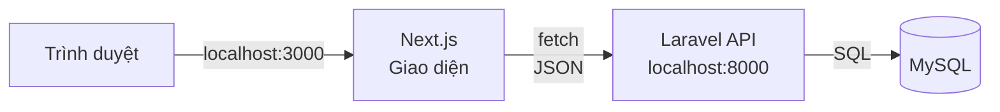
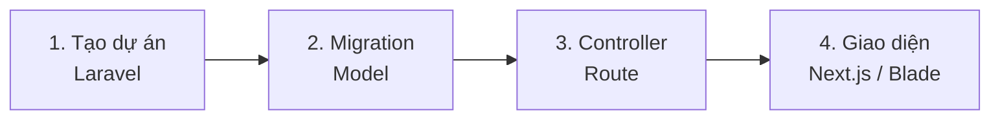

# Sản phẩm tự do B. Khóa local — Laravel v.v.

> 🇯🇵 Bản gốc (tiếng Nhật): [2026_10_09_資料3.md](<../../../2年生_システム開発実践/後期/2026_10_09/2026_10_09_資料3.md>) <!-- original-ja-link -->

Ở khóa này, bạn sẽ chạy ứng dụng trên máy tính của mình (`localhost`).

[Quay lại Sản phẩm tự do: Hãy phát triển thứ mình thích](./2026_10_09_資料1.md)

---

Chúng ta sẽ làm với cùng bộ công nghệ như **ứng dụng quản lý học sinh** ở học kỳ 1. Vì có ít kiến thức mới cần học, bạn có thể **tập trung phát triển chức năng**.

---

## 1. Chọn cách làm

Có 2 cách làm.

| Cách làm | Nội dung | Phù hợp với |
|-------|------|---------|
| **Laravel API + Next.js** | Giống học kỳ 1. Giao diện dùng Next.js, dữ liệu được xử lý bằng Laravel | Người muốn vừa làm vừa ôn lại học kỳ 1 |
| **Chỉ Laravel (Blade)** | Giao diện cũng làm bằng Blade của Laravel | Người muốn cấu trúc đơn giản |

---

## 2. Quy trình chuẩn bị

Hãy tham khảo tài liệu của học kỳ 1 và code phiên bản hoàn chỉnh.

- Toàn bộ quy trình → [Quy trình phát triển: Từ con số 0 đến khi làm xong API](../../前期/開発の流れ_まとめ.md)
- Nhìn lại học kỳ 1 → [Nhìn lại học kỳ 1 (ôn tập)](../2026_10_02/2026_10_02_資料1.md)
- Code phiên bản hoàn chỉnh → [portfolio](../../前期/portfolio/)

> **Chữ "v.v." trong "Laravel v.v."**
> Bạn nào muốn làm bằng công nghệ khác với những gì đã dùng ở học kỳ 1 (Python...) thì hãy trao đổi với giáo viên.

---

## 3. Từ đây trở đi, vừa làm vừa học

Khi đã chuẩn bị xong, bạn sẽ **vừa làm thứ mình muốn làm, vừa học**.
Trong quá trình lặp lại "muốn làm chức năng này → tra cứu → thử → chạy được rồi!", những công nghệ bạn dùng được sẽ ngày càng nhiều thêm.

Khi phân vân, hãy quay về với **điểm tâm huyết của bản thân**. Chính mong muốn "riêng chỗ này mình muốn làm thế này" sẽ cho bạn biết tiếp theo cần học gì.

Khi hoàn thành, bạn có thể nộp **URL GitHub** như một portfolio. Hãy đưa **ảnh chụp màn hình hoặc video màn hình** vào README, để người xem thấy được ứng dụng đang hoạt động như thế nào.
→ [Nộp như một portfolio](./2026_10_09_資料1.md#5-nộp-như-một-portfolio)

Hãy đọc thêm cả phần ["Vừa làm vừa học" của Tài liệu 1](./2026_10_09_資料1.md#4-vừa-làm-vừa-học) nhé.
