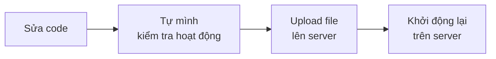
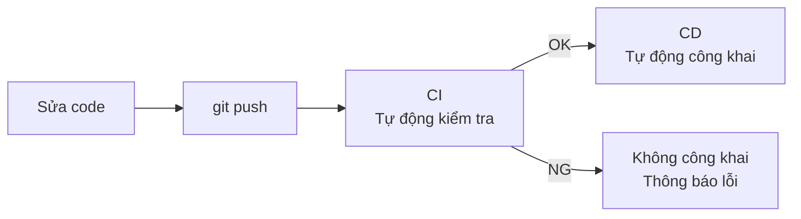
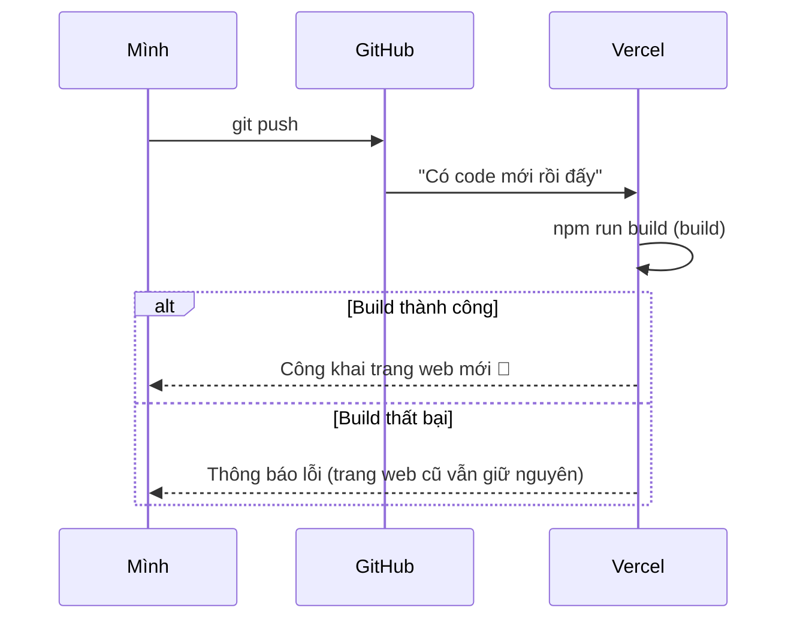
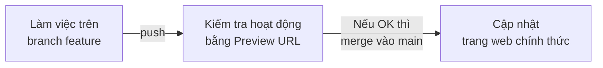
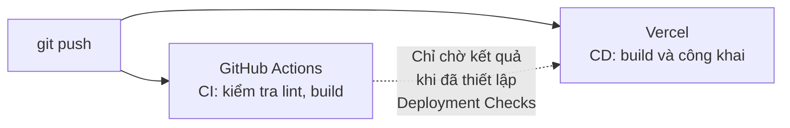

# Về CI/CD

> 🇯🇵 Bản gốc (tiếng Nhật): [CICDについて.md](<../../../2年生_システム開発実践/後期/2026_10_09/CICDについて.md>) <!-- original-ja-link -->

Ở khóa deploy, chỉ cần push lên GitHub là trang web trên Vercel đã được cập nhật.
Thực ra đó chính là cơ chế **CI/CD**.
Ở đây, chúng ta sẽ cùng tìm hiểu CI/CD là gì.

[Quay lại Sản phẩm tự do A. Khóa deploy](./2026_10_09_資料2.md)

---

## 1. CI/CD là gì

**CI/CD** là cơ chế "**tự động hóa** những công việc sau khi viết code".

| Tên | Tên đầy đủ | Ý nghĩa | Nói ngắn gọn |
|------|----------|------|-----------|
| **CI** | Continuous Integration (tích hợp liên tục) | Mỗi lần push, **tự động kiểm tra** | Tự động kiểm tra |
| **CD** | Continuous Delivery / Deployment (phân phối liên tục / triển khai liên tục) | Khi kiểm tra đạt, **tự động công khai** | Tự động công khai |

> 💡 **Ví dụ: "nộp báo cáo"**
> - **CI** = chức năng **tự động kiểm tra** lỗi chính tả hay số trang trước khi nộp
> - **CD** = chức năng **tự động nộp cho giáo viên** khi đã kiểm tra đạt
>
> Nếu làm bằng tay, sẽ xảy ra chuyện "quên kiểm tra" hay "quên nộp". Nếu tự động hóa, lần nào cũng làm được giống nhau.

> 📝 **Hai ý nghĩa của CD**
> CD có 2 ý nghĩa: **phân phối liên tục** (Continuous Delivery: luôn giữ ở trạng thái có thể công khai bất cứ lúc nào, còn nút công khai thì do người nhấn) và **triển khai liên tục** (Continuous Deployment: tự động toàn bộ cho đến khi công khai).
> Như Vercel trong tài liệu này, việc push xong là tự động công khai chính là **triển khai liên tục**.

---

## 2. Nếu không có CI/CD thì sao?

Nếu không có CI/CD, mỗi lần sửa code đều phải làm **bằng tay**.



- Quên kiểm tra và vô tình **triển khai code có lỗi**
- **Nhầm** file cần upload
- Lần nào cũng phải làm cùng một việc nên **tốn thời gian**

Nếu có CI/CD, mọi thứ sẽ như thế này.



**Việc bạn cần làm chỉ là `git push`**.

---

## 3. Vercel đang làm CD giúp chúng ta

Khi kết nối Vercel với GitHub, **mỗi lần push sẽ tự động deploy**. Đây chính là **CD**.



> 📝 **Dù build thất bại, trang web cũng không bị hỏng**
> Khi build thất bại, **trang web phiên bản trước vẫn được hiển thị như cũ**.
> Hãy kiểm tra lý do thất bại (thông báo lỗi) trên màn hình `Deployments` của Vercel.

### Mỗi branch sẽ có một "URL dùng thử"

Trên Vercel, cách công khai sẽ khác nhau tùy theo branch.

| Branch đã push | Điều gì xảy ra? | URL |
|------------------|-----------|-----|
| `main` | **Trang web chính thức (production)** được cập nhật | `https://〇〇.vercel.app` |
| Các branch khác (`feature/login`...) | Một **trang web dùng thử (Preview)** được tạo ra | `https://〇〇-git-feature-login-〇〇.vercel.app`... |



Với chức năng mới, nếu **tạo branch, kiểm tra bằng Preview URL rồi mới merge vào main**, bạn sẽ không làm hỏng trang web chính thức.
Đây cũng giống như quy trình **branch → Pull Request → merge** đã học trong phần phát triển nhóm ở học kỳ 1.

---

## 4. Thử làm CI (GitHub Actions)

Vercel chủ yếu đảm nhiệm phần CD.
**CI (tự động kiểm tra)** có thể được thêm vào bằng một chức năng của GitHub tên là **GitHub Actions** (miễn phí với repository công khai. Với repository riêng tư, cũng miễn phí trong một số giờ nhất định mỗi tháng).

### 4-1. Tạo file thiết lập

Tạo file `.github/workflows/ci.yml` trong dự án.

```yaml
# .github/workflows/ci.yml
name: CI

# Chạy khi nào: khi push và khi có Pull Request
on:
  push:
  pull_request:

jobs:
  check:
    runs-on: ubuntu-latest   # Chạy trên máy do GitHub chuẩn bị sẵn
    steps:
      - uses: actions/checkout@v6      # Lấy code về
      - uses: actions/setup-node@v6    # Cài Node.js
        with:
          node-version: 24
      - run: npm ci                    # Cài package
      - run: npm run lint              # Kiểm tra cách viết code
      - run: npm run build             # Kiểm tra xem có build được không
```

> ⚠️ **Khi `npm run lint` không chạy**
> Dự án nào khi tạo bằng `create-next-app` mà **chọn None cho Linter** thì sẽ không có script `lint`. Trong trường hợp đó, hãy xóa dòng `npm run lint` đi.
> Ngoài ra, từ Next.js 16, lệnh `next lint` đã bị bỏ. Nếu dự án cũ đang ghi `"lint": "next lint"`, hãy sửa thành `"lint": "eslint"`.
> Hãy xem phần `"scripts"` trong `package.json` để kiểm tra xem có `lint` không.

| Dòng | Ý nghĩa |
|----|------|
| `on:` | Chạy **khi nào** |
| `runs-on:` | Chạy **ở đâu** (mượn máy của GitHub) |
| `steps:` | Làm **gì** (chạy lần lượt từ trên xuống) |

### 4-2. Xem kết quả

Sau khi push file, bạn có thể xem kết quả ở tab **`Actions`** của repository trên GitHub.

| Hiển thị | Ý nghĩa |
|------|------|
| ✅ Dấu tích xanh | Tất cả các bước kiểm tra đều đạt |
| ❌ Dấu X đỏ | Có chỗ bị thất bại → nhấp vào để xem lỗi |

Kết quả cũng được hiển thị trên màn hình Pull Request, nên **bạn có thể phát hiện vấn đề trước khi merge**.

> ⚠️ **Dù GitHub Actions thất bại, Vercel vẫn deploy**
> GitHub Actions (CI) và Vercel (CD) đang chạy **độc lập với nhau**.
> Vì vậy, nếu không thiết lập gì, thì dù CI là ❌, chỉ cần Vercel build thành công là **trang web chính thức vẫn được cập nhật**.
> Khi muốn "chỉ đưa lên production khi CI là ✅", hãy dùng chức năng **Deployment Checks** của Vercel.
> Vào `Settings` của dự án, ở mục Deployment Checks trong `Build and Deployment`, nhấn `Add Checks` rồi chọn phần kiểm tra của GitHub Actions (chi tiết xem ở [tài liệu của Vercel](https://vercel.com/docs/deployment-checks)).

Nếu vẽ mối quan hệ giữa CI và CD thành sơ đồ, ta có như sau.



> 💡 **Gắn badge vào README sẽ giúp portfolio của bạn gây ấn tượng hơn**
> Mở workflow trong tab `Actions`, chọn `⋮` bên cạnh `Filter workflow runs` → `Create status badge` → `Copy status badge Markdown` để tạo code cho badge.
> Khi gắn badge vào README, người xem sẽ biết ngay bạn có dùng CI/CD trong quá trình phát triển.

---

## 5. Ưu điểm của CI/CD

- **Phát hiện lỗi sớm**: Push xong là được kiểm tra ngay
- **Công khai đơn giản**: Chỉ cần `git push` là thay đổi được cập nhật lên production
- **Lần nào cũng làm theo cùng một quy trình**: Không còn lỗi do làm tay
- **Hữu ích khi phát triển theo nhóm**: Code của mọi người đều được kiểm tra theo cùng một quy tắc

Ở môi trường phát triển thực tế, CI/CD **gần như luôn luôn** được sử dụng.
Nếu sử dụng CI/CD trong sản phẩm tự do, bạn sẽ có thêm kinh nghiệm để kể khi đi xin việc.

---

## 6. Tổng kết

- **CI** = push xong là **tự động kiểm tra**, **CD** = kiểm tra đạt là **tự động công khai**
- Thứ Vercel tự động kiểm tra chỉ là **build có thành công hay không**. Khi muốn dừng việc công khai dựa trên kết quả của GitHub Actions, hãy thiết lập **Deployment Checks**
- Vercel liên kết với GitHub, **mỗi lần push sẽ tự động deploy (CD)**
- Có thể kiểm tra các branch ngoài `main` bằng **Preview URL**
- Dùng **GitHub Actions** để thêm **tự động kiểm tra (CI)** cho lint và build
- Việc bạn cần làm **chỉ là `git push`**

[Quay lại Sản phẩm tự do A. Khóa deploy](./2026_10_09_資料2.md)
