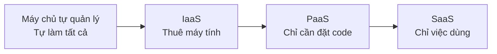
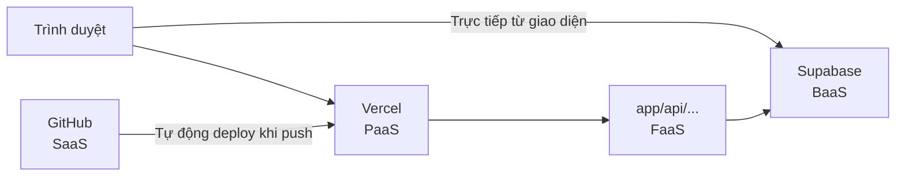

# Về IaaS, PaaS, SaaS, BaaS

> 🇯🇵 Bản gốc (tiếng Nhật): [IaaS_PaaS_SaaS_BaaSについて.md](<../../../2年生_システム開発実践/後期/2026_10_09/IaaS_PaaS_SaaS_BaaSについて.md>) <!-- original-ja-link -->

Khi tìm hiểu về các dịch vụ đám mây (cloud), bạn sẽ thường bắt gặp những từ như **IaaS**, **PaaS**, **SaaS**, **BaaS**.
Tất cả đều là viết tắt của "〇〇 as a Service (dùng 〇〇 như một dịch vụ)", thể hiện sự khác nhau ở chỗ **giao cho dịch vụ đảm nhận đến mức nào**.

[Quay lại Sản phẩm tự do A. Khóa deploy](./2026_10_09_資料2.md)

---

## 1. Nói ngắn gọn

| Tên | Tên đầy đủ | Thứ đi thuê | Nói ngắn gọn |
|------|----------|-----------|-----------|
| **IaaS** | Infrastructure as a Service | **Bản thân máy chủ (máy tính)** | Thuê một máy tính trống trơn |
| **PaaS** | Platform as a Service | **Nơi chạy ứng dụng** | Đặt code vào là chạy |
| **BaaS** | Backend as a Service | **Các chức năng backend** | Có sẵn cơ sở dữ liệu và chức năng đăng nhập ngay từ đầu |
| **FaaS** | Function as a Service | **Nơi chạy hàm** | Chỉ cần viết hàm là chạy |
| **SaaS** | Software as a Service | **Ứng dụng hoàn chỉnh** | Chỉ việc dùng luôn |

Càng xuống dưới, **những việc mình phải tự làm càng ít**.

---

## 2. Nếu so sánh với pizza

| | Việc mình phải tự làm | Nếu là pizza thì |
|---|---|---|
| **Máy chủ tự quản lý** | Tất cả | Tự làm đế pizza từ bột mì, tự mua cả lò nướng |
| **IaaS** | Chuẩn bị OS, phần mềm và ứng dụng | Thuê bếp và lò nướng, tự làm từ nguyên liệu |
| **PaaS** | Chỉ ứng dụng (code) | Đế bánh và lò nướng đã được chuẩn bị sẵn. Chỉ tự rắc topping lên |
| **SaaS** | Không làm gì cả (chỉ dùng) | Chỉ việc đặt pizza giao tận nơi rồi ăn |

→ Càng sang phải càng **đơn giản**. Càng sang trái càng **có thể tự do tùy chỉnh**.

---

## 3. Ai quản lý cái gì?

Để chạy một ứng dụng, cần có nhiều "tầng" khác nhau.
**🟦 = tự mình quản lý**, **⬜ = dịch vụ quản lý giúp**.

| Tầng | Máy chủ tự quản lý | IaaS | PaaS | SaaS |
|----|:---:|:---:|:---:|:---:|
| Ứng dụng (code của mình) | 🟦 | 🟦 | 🟦 | ⬜ |
| Dữ liệu | 🟦 | 🟦 | 🟦 | ⬜ |
| Môi trường chạy như PHP, Node.js | 🟦 | 🟦 | ⬜ | ⬜ |
| OS (Linux...) | 🟦 | 🟦 | ⬜ | ⬜ |
| Server (phần cứng máy tính) | 🟦 | ⬜ | ⬜ | ⬜ |
| Mạng, tòa nhà, điện | 🟦 | ⬜ | ⬜ | ⬜ |

---

## 4. Tìm hiểu chi tiết từng loại

### 4-1. IaaS — Thuê một máy tính trống trơn

Hãy hình dung việc **thuê một chiếc máy tính** nằm ở phía bên kia Internet.
Việc cài OS, cài PHP hay MySQL là **do chính mình** làm.

- **Ví dụ**: EC2 của AWS, Compute Engine của Google Cloud, Sakura Cloud
- **Ưu điểm**: Có thể tự do làm bất cứ điều gì
- **Điểm vất vả**: Phải tự làm tất cả từ thiết lập đến các biện pháp bảo mật

> Nếu công khai ứng dụng Laravel của học kỳ 1 bằng IaaS, bạn sẽ phải tự làm tất cả: "cài Linux → cài PHP, MySQL → đặt code → cho chạy 24 giờ".

### 4-2. PaaS — Đặt code vào là chạy

Đây là dịch vụ **đã có sẵn môi trường để chạy ứng dụng ngay từ đầu**.
Bạn **chỉ cần chuẩn bị code**, dịch vụ sẽ lo giúp đến tận khâu công khai.

- **Ví dụ**: **Vercel**, Render, Heroku, Google App Engine
  (Heroku đã thông báo sẽ dừng phát triển tính năng mới vào năm 2026. Tuy vậy, cái tên này vẫn thường được nhắc đến như một ví dụ tiêu biểu lâu đời của PaaS)
- **Ưu điểm**: Không cần thiết lập server. Chỉ cần `git push` là có thể công khai
- **Điểm vất vả**: Bị giới hạn bởi ngôn ngữ và cách dùng mà dịch vụ hỗ trợ

> 🎯 **Vercel dùng trong khóa deploy là PaaS.**
> Chỉ cần push code Next.js lên GitHub là đã có thể công khai lên Internet.

### 4-3. BaaS — Có sẵn backend ngay từ đầu

Đây là dịch vụ **cung cấp trọn gói các chức năng backend như cơ sở dữ liệu, chức năng đăng nhập, lưu trữ file...**.
Bạn có thể làm ứng dụng **mà không cần tự viết** code backend (tương đương Laravel API ở học kỳ 1).

- **Ví dụ**: **Supabase**, Firebase
- **Ưu điểm**: Có thể tập trung vào việc làm frontend (giao diện)
- **Điểm vất vả**: Với các xử lý phức tạp, cần tạo API riêng

| Việc muốn làm | Học kỳ 1 (tự làm) | Supabase (BaaS) |
|------------|-----------------|-----------------|
| Lưu dữ liệu | Laravel API + MySQL | Có sẵn từ đầu |
| Chức năng đăng nhập | Tự làm | Có sẵn từ đầu (Authentication) |
| Lưu hình ảnh | Tự làm | Có sẵn từ đầu (Storage) |

> 🎯 **Supabase dùng trong khóa deploy là BaaS.**

### 4-4. FaaS — Chỉ cần viết hàm là chạy

Đây là dịch vụ mà **chỉ cần viết một hàm, dịch vụ sẽ chỉ chạy nó khi được gọi**.
Đây là ý tưởng trung tâm của "serverless". → [Về serverless](./サーバレスについて.md)

- **Ví dụ**: **Vercel Functions** (`app/api/〇〇/route.ts` của Next.js), AWS Lambda, Cloudflare Workers
- **Ưu điểm**: Dùng bao nhiêu trả bấy nhiêu. Dù lượng truy cập tăng cũng tự động đáp ứng
- **Điểm vất vả**: Không phù hợp với các tác vụ chạy trong thời gian dài. Không thể giữ lại dữ liệu bên trong hàm

### 4-5. SaaS — Dùng ứng dụng hoàn chỉnh

Đây là dịch vụ **dùng luôn ứng dụng đã hoàn chỉnh thông qua Internet**.
Phần lớn những thứ các bạn dùng hằng ngày đều là SaaS.

- **Ví dụ**: Gmail, Google Docs, **GitHub**, Slack, Zoom, Notion
- **Ưu điểm**: Không cần cài đặt hay quản lý. Dùng được ngay
- **Điểm vất vả**: Không thể tự thay đổi bên trong ứng dụng

> Nếu bạn công khai ứng dụng làm trong sản phẩm tự do và cho mọi người dùng, thì đó cũng là **SaaS**.

---

## 5. Áp dụng vào cấu trúc của khóa deploy

| Thứ đang dùng | Loại |
|--------------|------|
| GitHub | SaaS (dịch vụ hoàn chỉnh để quản lý code) |
| Vercel | PaaS (nơi chạy Next.js) |
| API của Next.js (`app/api/`) | FaaS (hàm chạy trên Vercel, chỉ chạy khi được gọi) |
| Supabase | BaaS (backend gồm cơ sở dữ liệu, đăng nhập...) |

> 📝 **Có khi không thể phân chia rạch ròi**
> Có những trường hợp một dịch vụ mang nhiều vai trò, kiểu như "Vercel là PaaS, nhưng cũng cung cấp cả FaaS".
> Thay vì học thuộc tên gọi, hãy tập suy nghĩ theo hướng **"đang giao cho dịch vụ đảm nhận đến mức nào"**.

---

## 6. Tổng kết

- Các loại "〇〇 as a Service" khác nhau ở chỗ **giao cho dịch vụ đảm nhận đến mức nào**
- **IaaS**: Thuê máy tính (tự do nhưng vất vả)
- **PaaS**: Đặt code vào là chạy (Vercel)
- **BaaS**: Có sẵn các chức năng backend ngay từ đầu (Supabase)
- **FaaS**: Chỉ cần viết hàm là chạy (API của Next.js trên Vercel)
- **SaaS**: Chỉ việc dùng ứng dụng hoàn chỉnh (Gmail, GitHub)
- Càng giao cho dịch vụ thì càng **đơn giản**, càng tự làm thì càng **tự do**

[Quay lại Sản phẩm tự do A. Khóa deploy](./2026_10_09_資料2.md)
