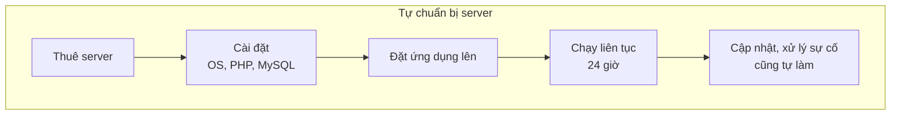
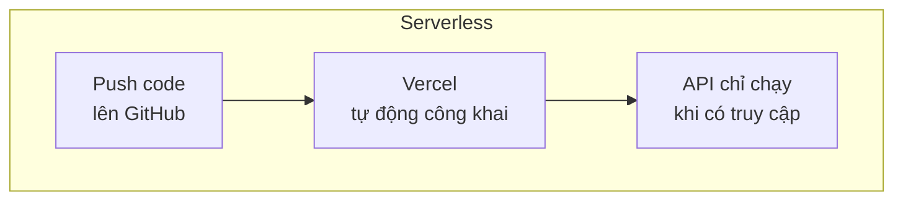
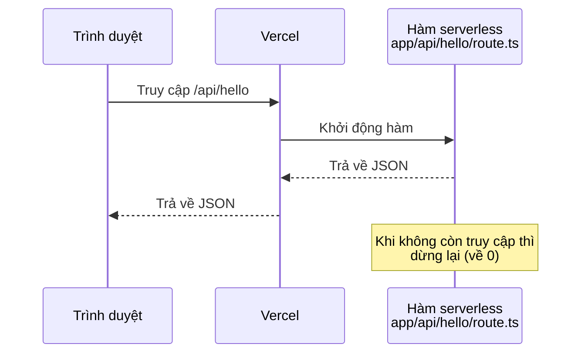
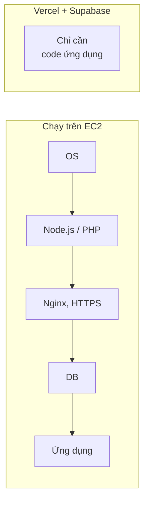

# Về Serverless

> 🇯🇵 Bản gốc (tiếng Nhật): [サーバレスについて.md](<../../../2年生_システム開発実践/後期/2026_10_09/サーバレスについて.md>) <!-- original-ja-link -->

Trên **Vercel**, nền tảng dùng trong khóa Deploy, API của Next.js chạy theo một cơ chế gọi là "**serverless**".
Ở đây, chúng ta sẽ tìm hiểu serverless là gì bằng cách so sánh với Laravel đã học ở học kỳ trước.

[Quay lại Dự án tự do A. Khóa Deploy](./2026_10_09_資料2.md)

---

## 1. Serverless là gì

**Serverless** không có nghĩa là "không có server".
Thực tế, **vẫn có server**. Nhưng đây là cơ chế mà **bạn không cần tự chuẩn bị hay quản lý server**.

> 💡 **Ví dụ như "đi taxi"**
> - **Tự chuẩn bị server** = mua xe hơi. Chỗ đậu xe, đăng kiểm, xăng, sửa khi hỏng — tất cả đều tự lo
> - **Serverless** = đi taxi. Chỉ cần nói điểm đến, còn việc quản lý xe thì tài xế (hãng taxi) lo cho bạn
>
> Cả hai đều dùng "xe". Điểm khác nhau là **ai quản lý**.

---

## 2. So sánh với cách làm ở học kỳ trước

Ở học kỳ trước, chúng ta chạy `php artisan serve` trên máy tính của mình để khởi động server Laravel.
Nếu muốn công khai nó lên Internet, bạn sẽ phải tự chuẩn bị **một server chạy liên tục**.





| | Tự chuẩn bị server | Serverless (Vercel, v.v.) |
|---|---|---|
| Chuẩn bị server | Tự làm (cài OS, phần mềm) | **Không cần** |
| Thời gian chạy | **Suốt 24 giờ** | **Chỉ khi có truy cập** |
| Khi lượt truy cập tăng đột ngột | Tự thêm server | **Tự động mở rộng** |
| Cập nhật, bảo mật | Tự làm | Dịch vụ làm giúp |
| Chi phí | Vẫn tốn tiền dù không dùng | **Dùng bao nhiêu trả bấy nhiêu** (dùng ít thì miễn phí) |

---

## 3. "Chỉ chạy khi có truy cập" nghĩa là gì

Đặc điểm lớn nhất của serverless là **chỉ chạy khi được gọi**.

API Next.js mà bạn đã làm ở Tài liệu 2 (`app/api/〇〇/route.ts`), khi deploy lên Vercel, sẽ chạy dưới dạng **hàm serverless (Vercel Functions)**.



```ts
// app/api/hello/route.ts
export async function GET() {
  return Response.json({ message: "こんにちは" });
}
```

Bạn chỉ cần tự viết **mỗi hàm này**.
Những việc như "khởi động server" hay "chọn số cổng" thì Vercel làm giúp bạn.

---

## 4. Supabase có phải là serverless không?

Supabase cũng giống ở điểm **không cần quản lý server**. Ở học kỳ trước, chúng ta chạy MySQL trên máy tính của mình (XAMPP hoặc Homebrew),
còn với Supabase thì **Supabase lo giúp việc chuẩn bị cơ sở dữ liệu và tạo API**.

| Việc cần làm | Học kỳ trước (Laravel + MySQL) | Supabase |
|---------|------------------------|----------|
| Chạy cơ sở dữ liệu | Tự khởi động bằng XAMPP, v.v. | Supabase chạy giúp |
| Tạo bảng | Viết migration | Tạo được bằng Table Editor |
| API để đọc/ghi dữ liệu | Tự viết controller, route | **Được chuẩn bị tự động** |

Tuy nhiên, cơ sở dữ liệu của Supabase **không phải chỉ chạy khi được gọi**.
Mỗi project được cấp một server riêng cho cơ sở dữ liệu và **chạy liên tục** (đó là lý do cơ sở dữ liệu trong gói miễn phí sẽ tạm dừng nếu không được sử dụng trong khoảng 1 tuần).

| | API của Vercel (hàm serverless) | Cơ sở dữ liệu của Supabase |
|---|---|---|
| Quản lý server | Không cần | Không cần |
| Thời gian chạy | **Chỉ khi được gọi** | **Chạy liên tục** |
| Loại | Serverless (FaaS) | **BaaS** (dịch vụ lo phần backend giúp bạn) |

> ⚠️ **Gói miễn phí không có sao lưu tự động**
> Chỉ gói trả phí thì Supabase mới tự động sao lưu mỗi ngày.
> Với gói miễn phí, hãy tự xuất (export) những dữ liệu mà mất đi sẽ gây rắc rối.

> 📝 **Cách dùng từ "serverless"**
> Theo nghĩa rộng là "không cần quản lý server", những dịch vụ như Supabase đôi khi cũng được gọi là "serverless".
> Nhưng nó hơi khác với serverless "chỉ chạy khi được gọi" mà tài liệu này nói đến, nên hãy nhớ Supabase là **BaaS**.
> → [Về IaaS, PaaS, SaaS, BaaS](./IaaS_PaaS_SaaS_BaaSについて.md)

---

## 5. Ưu điểm và những điều cần lưu ý

### Ưu điểm 👍

- **Công khai được ngay**: chỉ cần push lên GitHub là deploy được
- **Ít tốn tiền**: dùng bao nhiêu trả bấy nhiêu. Ứng dụng cá nhân của sinh viên thì gói miễn phí là đủ
- **Lượt truy cập tăng cũng không sao**: khả năng xử lý tự động tăng lên
- **Tập trung được vào việc làm ứng dụng**: không cần bận tâm chuyện quản lý server

### Những điều cần lưu ý ⚠️

| Điều cần lưu ý | Nghĩa là sao? |
|---------------|--------------|
| **Lần truy cập đầu tiên đôi khi hơi chậm** | Nếu một thời gian không được dùng, hàm sẽ dừng lại nên cần thời gian để khởi động (gọi là **cold start**). Vercel hiện nay đã có nhiều cải tiến để thời gian này rất ngắn |
| **Không phù hợp với các tác vụ chạy lâu** | Mỗi lần xử lý có giới hạn thời gian (gói miễn phí của Vercel là **tối đa 5 phút**). Không phù hợp với xử lý nặng |
| **Không lưu được dữ liệu bên trong hàm** | Vì không biết lúc nào hàm sẽ dừng, nên dù có lưu vào biến hay file thì **lần sau chưa chắc vẫn còn** → **hãy lưu dữ liệu vào Supabase** |
| **Gói miễn phí có giới hạn** | Dùng quá nhiều có thể bị dừng. Đừng chọn gói trả phí |

> 📝 **Điều rất quan trọng: "Dữ liệu không được giữ lại trong hàm"**
> Giống như khi dùng Laravel, nguyên tắc cơ bản là **lưu dữ liệu vào cơ sở dữ liệu**.
> Hãy nghĩ rằng biến bên trong hàm serverless **có thể đã mất** vào lần truy cập tiếp theo.
> Ngược lại, trên Vercel, một hàm đôi khi xử lý nhiều lượt truy cập cùng lúc, nên **biến có thể bị dùng chung giữa các lượt truy cập của những người dùng khác nhau**. Đừng đặt dữ liệu riêng của từng người dùng vào biến nằm bên ngoài hàm.

---

## 6. Nếu không dùng serverless thì sao? (Trường hợp chạy trên EC2)

Lợi ích của serverless sẽ thấy rõ khi so sánh với **trường hợp tự chuẩn bị server**.
Ở đây, chúng ta sẽ xem trường hợp chạy trên **EC2** của AWS (dịch vụ cho thuê một máy tính nằm ở đâu đó trên Internet).

EC2 chỉ là thuê **một máy tính trống (Linux)**. Không có sẵn Node.js hay PHP.
→ Xem chi tiết ở phần IaaS trong [Về IaaS, PaaS, SaaS, BaaS](./IaaS_PaaS_SaaS_BaaSについて.md).

### 6-1. Nếu chạy Next.js trên EC2

| Việc cần làm | Nội dung | Với Vercel thì |
|---|---|---|
| 1. Tạo EC2 | Chọn OS (Ubuntu, v.v.) rồi khởi động | Không cần |
| 2. Cài Node.js | Cài Node.js bằng `nvm`, v.v. | Không cần |
| 3. Lấy code về | Chạy `git clone` | Chỉ cần kết nối GitHub |
| 4. Đặt biến môi trường | Tự tạo `.env.local`, v.v. | Đăng ký trên giao diện |
| 5. Build và khởi động | `npm ci` → `npm run build` → `npm run start` | Tự động |
| 6. Chạy liên tục | Dùng công cụ như **PM2** để không bị dừng khi đóng terminal | Tự động |
| 7. Mở cổng | Mở cổng 80 và 443 trong **Security Group** của EC2 | Không cần |
| 8. Đặt Nginx | Next.js chạy ở cổng 3000, nên dùng **Nginx** để chuyển tiếp từ cổng 80 và 443 | Không cần |
| 9. Chuyển sang HTTPS | Lấy chứng chỉ bằng **Let's Encrypt**, v.v. và gia hạn liên tục | Tự động |
| 10. Khi cập nhật | Mỗi lần đều đăng nhập rồi `git pull` → build → khởi động lại | Chỉ cần `git push` |
| 11. Tiếp tục quản lý | Cập nhật OS, bảo mật, xử lý khi server bị sập | Không cần |

### 6-2. Nếu chạy Laravel trên EC2

Với Laravel, số thứ phải cài còn nhiều hơn.

| Việc cần làm | Nội dung | Ở học kỳ trước (máy tính của mình) thì |
|---|---|---|
| 1. Tạo EC2 | Chọn OS (Ubuntu, v.v.) rồi khởi động | Máy tính của mình |
| 2. Cài PHP | Bản thân PHP và các extension Laravel dùng (`mbstring`, `xml`, `curl`, `pdo_mysql` để kết nối MySQL, v.v.) | XAMPP hoặc Homebrew |
| 3. Cài Composer | Công cụ quản lý package của PHP | Đã cài |
| 4. Cài web server | Cài **Nginx + PHP-FPM** (cơ chế chạy PHP) và cấu hình để công khai thư mục `public/` | `php artisan serve` |
| 5. Chuẩn bị MySQL | Tự cài trên EC2, hoặc dùng **RDS** của AWS (dịch vụ cơ sở dữ liệu) | XAMPP hoặc Homebrew |
| 6. Lấy code về | `git clone` → `composer install --no-dev` | Giống nhau |
| 7. Tạo `.env` | Ghi `APP_ENV=production`, `APP_DEBUG=false`, thông tin kết nối DB, v.v., rồi chạy `php artisan key:generate` | Giống nhau (dùng giá trị cho môi trường production) |
| 8. Tạo bảng | `php artisan migrate --force` | `php artisan migrate` |
| 9. Cấu hình quyền | Cho phép web server ghi vào `storage/` và `bootstrap/cache/` | Không cần để ý |
| 10. Mở cổng, HTTPS | Mở cổng 80 và 443, lấy chứng chỉ bằng Let's Encrypt | Không cần |
| 11. Khi cập nhật | `git pull` → `composer install` → `migrate` → tạo lại cache (`php artisan optimize`) | — |
| 12. Tiếp tục quản lý | Cập nhật OS và PHP, bảo mật, xử lý sự cố | — |

> ⚠️ **Những điều cần lưu ý trên production**
> - **Không dùng `php artisan serve` trên production.** Đây là server đơn giản dành cho lúc phát triển, không được thiết kế để xử lý nhiều lượt truy cập. Thay vào đó, hãy dùng Nginx + PHP-FPM (vì vậy thường không cần PM2 như với Next.js).
> - **Không được công khai khi vẫn để `APP_DEBUG=true`.** Màn hình lỗi có thể hiển thị cả những thông tin quan trọng như mật khẩu.

### 6-3. So sánh



Nếu muốn công khai ứng dụng quản lý sinh viên của học kỳ trước (Next.js + Laravel API + MySQL) trên EC2, bạn sẽ cần **cả 6-1 lẫn 6-2**.
Khóa Deploy dùng **Vercel + Supabase** là để giao lại những việc chuẩn bị và quản lý này, giúp bạn **tập trung vào việc làm ứng dụng**.

> 💡 **Chạy trên EC2 cũng có ý nghĩa riêng**
> Tự làm tất cả thì vất vả, nhưng bù lại bạn sẽ **hiểu rõ cách server hoạt động** và có thể tự do cấu hình mọi thứ.
> Ở các công ty thực tế, những server như EC2 cũng được dùng rất phổ biến. Ai có hứng thú thì hãy thử sức sau khi xong dự án tự do nhé.

---

## 7. Tóm tắt

- Serverless không phải là "không có server", mà là cơ chế **không cần quản lý server**
- Chỉ chạy **khi có truy cập**, và **dùng bao nhiêu trả bấy nhiêu**
- API Next.js deploy lên Vercel chạy dưới dạng **hàm serverless**
- Supabase cũng có thể giao việc quản lý, nhưng cơ sở dữ liệu **chạy liên tục**. Gọi là **BaaS** thì đúng hơn là serverless
- Dữ liệu phải **lưu vào cơ sở dữ liệu**, không phải bên trong hàm
- Nếu chạy trên server như EC2, bạn phải **tự chuẩn bị và quản lý tất cả** Node.js, PHP, Nginx, HTTPS, cơ sở dữ liệu, v.v.

[Quay lại Dự án tự do A. Khóa Deploy](./2026_10_09_資料2.md)
