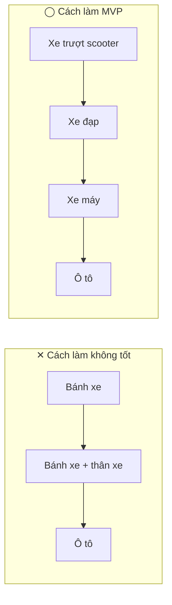
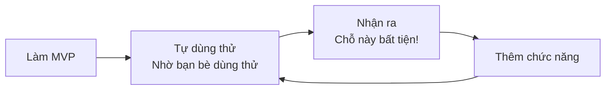
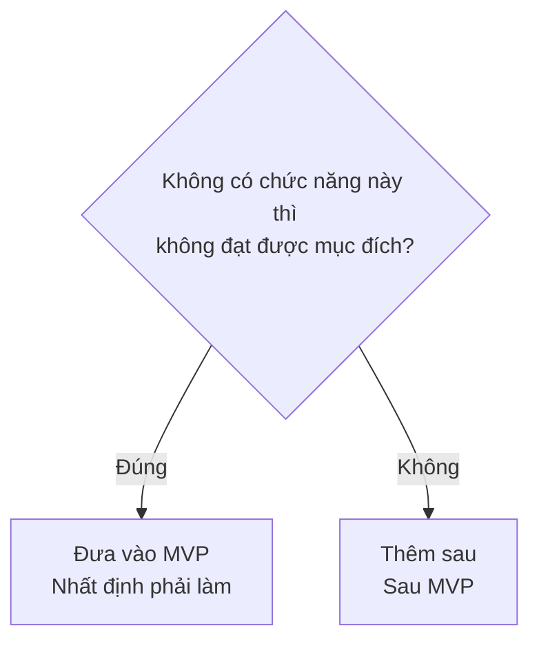
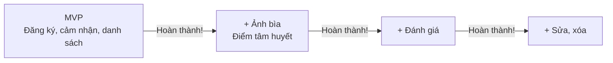
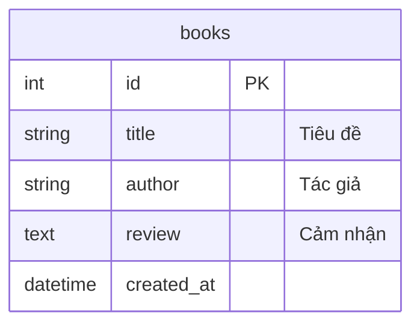

# MVP: Trước tiên hãy hoàn thành "thứ tối thiểu dùng được"

> 🇯🇵 Bản gốc (tiếng Nhật): [2026_10_16_資料1.md](<../../../2年生_システム開発実践/後期/2026_10_16/2026_10_16_資料1.md>) <!-- original-ja-link -->

## 1. MVP là gì

Buổi trước, chúng ta đã nói về chuyện [bắt đầu nhỏ](../2026_10_09/2026_10_09_資料1.md#trước-tiên-hãy-làm-nhỏ).
Sản phẩm được làm nhỏ như vậy có một cái tên. Đó là **MVP**.

| Từ đầy đủ | Ý nghĩa |
|-------|------|
| **M**inimum | Tối thiểu |
| **V**iable | Có thể sử dụng, có tính khả thi |
| **P**roduct | Sản phẩm, ứng dụng |

Nói cách khác, MVP là **ứng dụng chỉ có những chức năng tối thiểu cần thiết để sử dụng được**.
Ở các công ty thực tế, khi làm một dịch vụ mới, người ta cũng làm MVP trước rồi công khai, sau đó vừa xem phản hồi của người dùng vừa phát triển dần lên.

> 💡 **Ví dụ như "cơm cà ri"**
> MVP của cà ri là "cơm + nước sốt cà ri". Chỉ cần vậy là **đã ăn được như một món cà ri đúng nghĩa**.
> Thịt heo chiên, phô mai, dưa muối là những thứ có thể thêm vào sau như topping.
> Ngược lại, nếu có thật nhiều topping mà **không có nước sốt cà ri** thì không thể gọi là ăn cà ri được.

---

## 2. Những hiểu lầm thường gặp về MVP

MVP không phải là "đồ làm dở". Điều quan trọng là **dù nhỏ nhưng vẫn dùng được thật sự**.



| | ✕ Cách làm không tốt | ◯ Cách làm MVP |
|---|---|---|
| Lần 1 | Chỉ có bánh xe → **không di chuyển được** | Xe trượt scooter → **di chuyển được!** |
| Lần 2 | Bánh xe + thân xe → **vẫn chưa di chuyển được** | Xe đạp → **di chuyển nhanh hơn** |
| Nếu hết thời gian giữa chừng | **Không dùng được gì cả** | **Vẫn còn lại thứ dùng được** |

- Với cách ✕, nếu không làm xong đến cuối thì **không thể sử dụng được dù chỉ một lần**
- Với cách ◯, dù dừng ở giai đoạn nào thì **vẫn đạt được mục đích "di chuyển"**

Ứng dụng cũng vậy. "Chỉ màn hình đăng nhập là hoàn hảo", "chỉ thiết kế là hoàn hảo" nhưng **chức năng chính lại không chạy** — đó là kiểu ✕.

---

## 3. Tại sao phải làm từ MVP?

### ① Tránh được tình trạng kết thúc mà chưa hoàn thành

Thất bại thường gặp nhất trong dự án tự do là **nhồi nhét quá nhiều chức năng rồi kết thúc mà chưa hoàn thành**.
Nếu làm MVP trước, thì **dù hết thời gian ở giai đoạn nào, bạn vẫn có trong tay một "ứng dụng chạy được"**.

### ② Dùng thử sớm sẽ biết được thứ thật sự cần

Những thứ "có thì hay" mà bạn nghĩ ra trước khi làm, khi dùng thật thì thường lại **không cần**.
Ngược lại, cũng có những chức năng mà phải dùng thử rồi bạn mới nhận ra "thiếu cái này thì bất tiện quá!".



### ③ Sớm có sản phẩm để đưa vào portfolio và cho người khác xem

Khi nộp lúc đi xin việc, **ứng dụng chưa hoàn thành** thì khó đem ra cho người khác xem.
Nếu đã hoàn thành MVP, bạn có thể nộp ứng dụng bất cứ lúc nào như một **"sản phẩm chạy được"**.
Còn những phần tâm huyết thì chỉ cần **xây dần từng chút một** lên trên đó là được.

---

## 4. Cách quyết định MVP

### Bước 1: Viết mục đích của ứng dụng bằng 1 câu

Trước tiên, hãy viết bằng 1 câu **ứng dụng dành cho "ai" và "để làm gì"**.

```
Ứng dụng để người 〇〇 có thể △△
```

| Ứng dụng | Mục đích (1 câu) |
|-------|-----------|
| Ghi chép đọc sách | Ứng dụng để người thích sách **ghi lại sách đã đọc và cảm nhận để xem lại** |
| Ghi chép tập gym | Ứng dụng để người tập gym **ghi lại bài tập và số lần mỗi ngày** |
| Bảng điểm danh câu lạc bộ | Ứng dụng để người quản lý câu lạc bộ **tổng hợp điểm danh các buổi tập** |

> **Phần in đậm** trong câu này chính là "nước sốt cà ri" của ứng dụng. Nếu không làm được phần này, ứng dụng sẽ không thể thực hiện được mục đích của mình.

### Bước 2: Liệt kê tất cả chức năng muốn làm

Hãy thoải mái liệt kê **tất cả** chức năng bạn nghĩ ra. Ở bước này chưa cần nghĩ xem có làm được hay không.

**Ví dụ: ứng dụng ghi chép đọc sách**

- Đăng ký sách (tiêu đề, tác giả)
- Viết cảm nhận
- Đánh giá (1–5 sao)
- Xem danh sách sách đã đăng ký
- Sửa, xóa sách
- Hiển thị ảnh bìa
- Tìm kiếm sách
- Phân loại theo thể loại
- Chức năng đăng nhập
- Chia sẻ sách với bạn bè
- Vẽ biểu đồ số sách đã đọc

### Bước 3: Phân loại theo câu hỏi "Không có thì không đạt được mục đích?"

Xem từng chức năng đã liệt kê, rồi tự hỏi **"Nếu không có chức năng này, có phải mình sẽ không đạt được mục đích (câu viết ở bước 1) không?"**.



**Ví dụ: ứng dụng ghi chép đọc sách** (mục đích: ghi lại sách đã đọc và cảm nhận để xem lại)

| Chức năng | Không có thì không đạt được mục đích? | Phân loại |
|------|-------------------|------|
| Đăng ký sách (tiêu đề, tác giả) | Đúng (không ghi lại được) | **MVP** |
| Viết cảm nhận | Đúng (không ghi lại được cảm nhận) | **MVP** |
| Xem danh sách sách đã đăng ký | Đúng (không xem lại được) | **MVP** |
| Đánh giá (1–5 sao) | Không (có cảm nhận là ghi lại được) | Để sau |
| Sửa, xóa sách | Không (không có vẫn ghi lại và xem lại được) | Để sau |
| Hiển thị ảnh bìa | Không | Để sau |
| Tìm kiếm sách | Không (khi số sách còn ít thì danh sách là đủ) | Để sau |
| Phân loại theo thể loại | Không | Để sau |
| Chức năng đăng nhập | Không (nếu chỉ mình mình dùng thì không cần) | Để sau |
| Chia sẻ sách với bạn bè | Không | Để sau |
| Vẽ biểu đồ số sách đã đọc | Không | Để sau |

> 💡 **MVP nên có khoảng 3 chức năng**. Nếu có từ 5 chức năng trở lên, hãy tự hỏi lại một lần nữa: "Thật sự không có thì không đạt được mục đích sao?".

> ⚠️ **Chức năng đăng nhập thường không đưa vào MVP**
> Đăng nhập vừa khó vừa tốn thời gian, nhưng hầu hết trường hợp **không phải là mục đích chính của ứng dụng**.
> Trước tiên hãy làm thứ chạy được mà không cần đăng nhập, khi nào cần thì thêm vào sau.

### Bước 4: Sắp xếp thứ tự cho các chức năng "thêm sau"

Đặt **thứ tự muốn làm** cho các chức năng "thêm sau".
Điều quan trọng ở đây là **sự tâm huyết của riêng bạn** mà buổi trước chúng ta đã nói đến.

| Thứ tự | Chức năng | Lý do |
|-----|------|------|
| 1 | Hiển thị ảnh bìa | **Muốn ứng dụng trông giống một kệ sách** (điểm tâm đắc nhất) |
| 2 | Đánh giá (1–5 sao) | Nhìn là biết ngay sách nào đáng đọc |
| 3 | Sửa, xóa sách | Muốn sửa khi nhập nhầm |
| 4 | Phân loại theo thể loại | Cần khi số sách tăng lên |
| … | … | … |



Nên làm chức năng mà bạn tâm đắc **ngay sau MVP**.
Nếu chỉ có MVP, ứng dụng dễ trở nên giống của người khác, nhưng khi thêm điểm tâm huyết vào, nó sẽ thành **"ứng dụng của riêng bạn"**.

---

## 5. Thiết kế bảng cho MVP

Bảng cũng vậy, hãy bắt đầu chỉ với **các cột cần cho MVP**. Cột có thể thêm sau bằng migration (với Supabase thì bằng màn hình quản lý).



Đánh giá (`rating`) hay ảnh bìa (`image_url`) thì đến khi làm chức năng đó rồi thêm vào là được.

