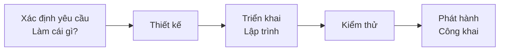
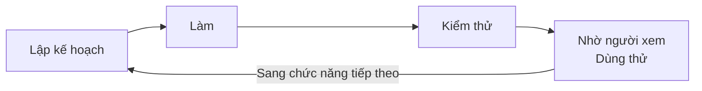
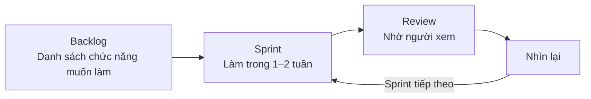

# Về phát triển Agile

> 🇯🇵 Bản gốc (tiếng Nhật): [アジャイル開発について.md](<../../../2年生_システム開発実践/後期/2026_10_23/アジャイル開発について.md>) <!-- original-ja-link -->

Buổi trước, chúng ta đã học về **MVP**: trước tiên hoàn thành một phiên bản nhỏ của sản phẩm.
Cách làm "tạo một phiên bản nhỏ, dùng thử rồi phát triển dần" này có một tên gọi. Đó là **phát triển Agile**.
Ở đây, chúng ta sẽ tìm hiểu Agile bằng cách so sánh với **phát triển Waterfall**, một phương pháp đã có từ lâu.

[Quay lại Dự án tự do](../2026_10_09/2026_10_09_資料1.md)

---

## 1. Nói ngắn gọn

| Tên | Cách đọc | Cách tiến hành | Nói ngắn gọn |
|------|-------|-------|-----------|
| **Phát triển Waterfall** | Waterfall (thác nước) | Quyết định hết mọi thứ rồi làm lần lượt, một lần là xong | Làm đúng theo kế hoạch |
| **Phát triển Agile** | Agile (nhanh nhẹn) | Làm nhỏ, rồi cải tiến lặp đi lặp lại | Vừa làm vừa phát triển dần |

---

## 2. Phát triển Waterfall

**Giống như nước thác chảy từ trên xuống dưới**, các công đoạn được thực hiện lần lượt, từng công đoạn một.
Khi công đoạn trước chưa xong thì không chuyển sang công đoạn tiếp theo. Về cơ bản, nó dựa trên tiền đề là **không quay lại**.

| Ưu điểm 👍 | Điều cần lưu ý ⚠️ |
|------------|-----------------|
| Vì quyết định hết từ đầu nên **dễ nắm được lịch trình và chi phí** | Giữa chừng **khó đề xuất** "Tôi đổi ý, muốn làm theo cách này" |
| Dễ phân chia người phụ trách cho từng công đoạn | Người dùng chỉ được xem sản phẩm hoạt động được vào **cuối quá trình** |
| Phù hợp với hệ thống **không được phép sai sót** như ngân hàng, cơ quan nhà nước | Nếu đến cuối mới thấy "khác với những gì mình nghĩ" thì **làm lại rất vất vả** |

---

## 3. Phát triển Agile

**Lặp lại "lập kế hoạch → làm → kiểm tra" cho từng chức năng nhỏ**, từ đó phát triển ứng dụng từng bước.
Mỗi vòng lặp là một khoảng thời gian ngắn, **khoảng 1–4 tuần**.

| Ưu điểm 👍 | Điều cần lưu ý ⚠️ |
|------------|-----------------|
| Có thể xem **sản phẩm hoạt động được từ sớm** | **Khó biết ngay từ đầu** cuối cùng có thể hoàn thành đến đâu |
| Có thể **áp dụng ngay ý kiến của người dùng vào vòng tiếp theo** | Nếu chỉ nghĩ "cứ làm trước đã" thì **thiết kế dễ trở nên lộn xộn** |
| Dễ thay đổi phương hướng giữa chừng | Cả nhóm cần **trao đổi thường xuyên** |

> 💡 **MVP là "vòng đầu tiên" của phát triển Agile**
> Làm MVP, dùng thử, rồi thêm từng chức năng mà mình chú trọng——
> cách tiến hành dự án tự do chính là phát triển Agile.

---

## 4. Thử so sánh

Hãy lấy việc **"nấu ăn"** làm ví dụ.

| | Waterfall | Agile |
|---|---|---|
| Cách tiến hành | **Quyết định toàn bộ** thực đơn của một bữa ăn nhiều món, nấu lần lượt từ món khai vị đến món tráng miệng, rồi **đến cuối mới dọn ra tất cả cùng lúc** | Nấu 1 món trước, **mời người khác nếm thử**, nghe ý kiến rồi quyết định món tiếp theo |
| Thay đổi giữa chừng | Sẽ rất vất vả nếu được yêu cầu "Tôi đổi ý, muốn ăn thịt thay vì cá" | Chỉ cần thay đổi ở món tiếp theo |
| Phù hợp với | Tiệc cưới (thực đơn đã quyết định từ đầu) | Bữa cơm gia đình (thay đổi theo tâm trạng hôm đó) |

Không có cách nào là đúng tuyệt đối. **Tùy vào thứ cần làm mà chọn cách phù hợp.**

---

## 5. Scrum — một cách tiến hành phát triển Agile

Trong các phương pháp phát triển Agile, nổi tiếng nhất là **Scrum**. Tên gọi này bắt nguồn từ "scrum" trong môn bóng bầu dục (rugby), khi các thành viên trong đội khoác vai nhau.

| Thuật ngữ | Ý nghĩa | Trong dự án tự do thì |
|-----|------|---------------|
| **Sprint** | Khoảng thời gian của 1 vòng lặp (1–4 tuần) | Khoảng 1–2 buổi học |
| **Product Backlog** | Danh sách các chức năng muốn làm, xếp theo **thứ tự quan trọng** | "Các chức năng thêm sau (theo thứ tự làm)" đã lập trong tài liệu MVP |
| **Daily Scrum** | Buổi họp ngắn khoảng 15 phút mỗi ngày | Đầu giờ học, quyết định "việc hôm nay sẽ làm" |
| **Sprint Review** | Giới thiệu sản phẩm đã làm được và nhận ý kiến phản hồi | Nhờ bạn bè hoặc giáo viên dùng thử |
| **Nhìn lại (Retrospective)** | Nhìn lại cách làm để rút kinh nghiệm cho lần sau | Cuối giờ học, suy nghĩ về "những việc đã làm tốt và những khó khăn đã gặp" |

> 💡 **Có thể tạo backlog trên GitHub**
> Nếu tạo một issue trong **Issues** của GitHub cho mỗi "chức năng muốn làm", rồi sắp xếp chúng vào các cột "Cần làm / Đang làm / Hoàn thành" trong **Projects**, bạn có thể quản lý backlog giống như ngoài thực tế.

---

## 6. Ngoài thực tế thì cách nào phổ biến hơn?

Gần đây, **phát triển Agile** được sử dụng phổ biến trong việc phát triển dịch vụ web và ứng dụng điện thoại.
Lý do là người ta cập nhật gần như hàng tuần, hàng ngày, vừa làm vừa xem phản ứng của người dùng.

Mặt khác, với hệ thống ngân hàng hay hệ thống điều khiển máy móc trong nhà máy, hiện nay vẫn dùng **phát triển Waterfall**.
Ngoài ra, cũng có kiểu **kết hợp**: quyết định hướng đi lớn bằng Waterfall, còn các phần chi tiết thì tiến hành bằng Agile.

> 💡 **Có thể nói khi phỏng vấn**
> Nếu bạn nói được rằng "Trong dự án tự do, em đã áp dụng **cách làm Agile**: tạo MVP trước, dùng thử rồi bổ sung chức năng", người phỏng vấn sẽ thấy bạn hiểu cách tiến hành phát triển phần mềm.

---

## 7. Tóm tắt

- **Phát triển Waterfall** = quyết định mọi thứ trước, sau đó thực hiện lần lượt các công đoạn trong một lượt (không quay lại)
- **Phát triển Agile** = làm nhỏ, dùng thử, rồi cải tiến lặp đi lặp lại
- **Scrum** là một cách tiến hành phát triển Agile. Lặp lại các **sprint** (khoảng thời gian ngắn)
- Cách tiến hành dự án tự do **MVP → thêm dần chức năng** chính là phát triển Agile
- Không có cách nào đúng tuyệt đối; **tùy vào thứ cần làm mà chọn cách phù hợp**

[Quay lại Dự án tự do](../2026_10_09/2026_10_09_資料1.md)
