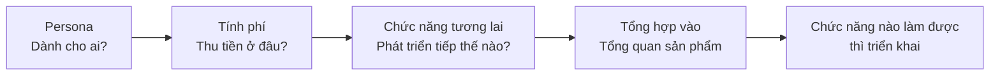
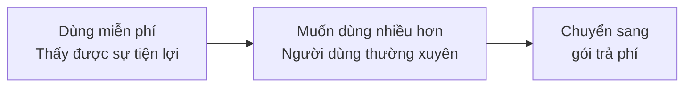
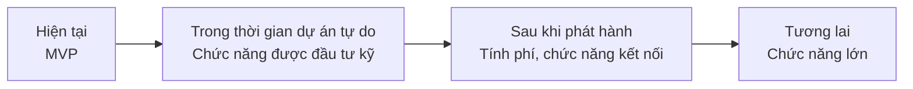
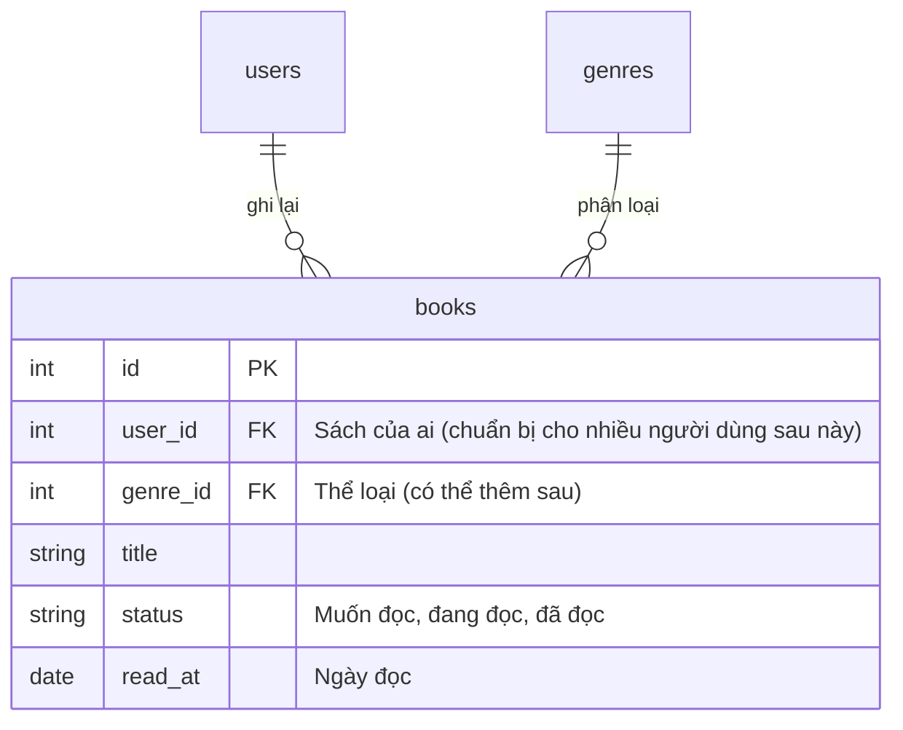
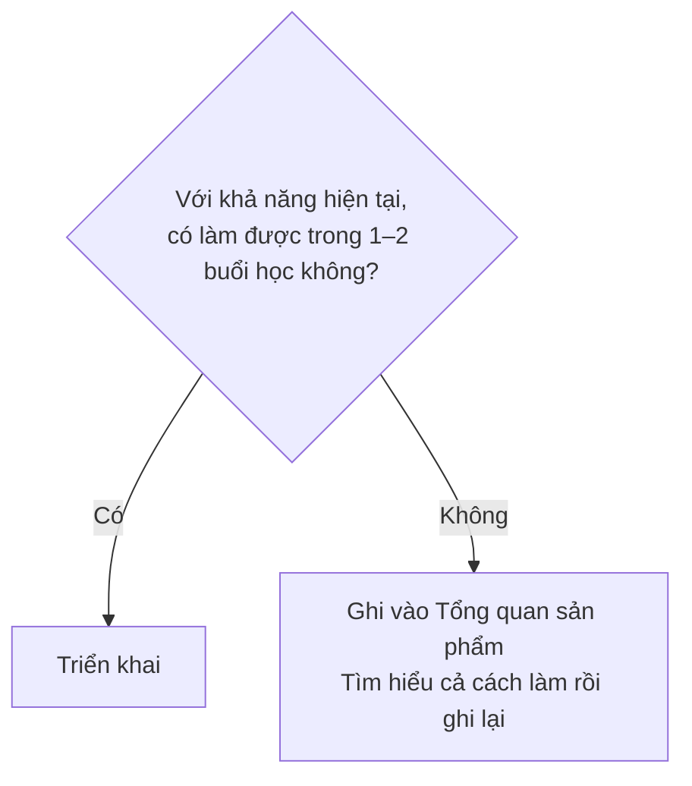

# Làm dự án tự do với tầm nhìn về tương lai

> 🇯🇵 Bản gốc (tiếng Nhật): [自由制作の将来像も考えて作る.md](<../../../2年生_システム開発実践/後期/2026_10_23/自由制作の将来像も考えて作る.md>) <!-- original-ja-link -->

Hãy thử nghĩ về ứng dụng dự án tự do của bạn không phải như "bài tập trên lớp", mà như **một dịch vụ sẽ thật sự phát hành**.
Hãy suy nghĩ **ai sẽ dùng (persona)**, **thu tiền ở đâu (tính phí)**, **từ giờ trở đi sẽ thêm những chức năng nào**, rồi tổng hợp lại thành tài liệu **Tổng quan sản phẩm**.

[Quay lại Dự án tự do](../2026_10_09/2026_10_09_資料1.md)

---

## 1. Tại sao phải nghĩ về tương lai?



- **Không còn phân vân nên làm chức năng nào**: có thể phán đoán bằng câu hỏi "Người này (persona) có cần không?"
- **Có thể nói khi phỏng vấn**: nếu nói được đến mức "đây là ứng dụng giải quyết khó khăn gì cho ai, và là dịch vụ sẽ duy trì bằng cách nào", người phỏng vấn sẽ thấy bạn là **người có suy nghĩ khi làm**
- **Giống như ở công ty thực tế**: khi làm ứng dụng ở công ty, trước khi làm nhất định phải suy nghĩ về **kế hoạch sản phẩm**

> 💡 Không cần triển khai tất cả các chức năng. Chỉ cần **ghi lại những gì đã suy nghĩ vào Tổng quan sản phẩm** thôi cũng đã có giá trị như một portfolio.

---

## 2. Thiết lập persona

### Persona là gì

**Persona** là việc xác định chi tiết người dùng ứng dụng như **một nhân vật cụ thể**.
Không phân loại chung chung kiểu "người ở độ tuổi 20", mà hãy hình dung **một người có vẻ có thật**.

| ✕ Chung chung | ◯ Persona |
|----------|----------|
| Người thích sách | Chị Tanaka Sakura (21 tuổi, sinh viên đại học năm 3). Mỗi tháng đọc 3–4 cuốn trên tàu điện khi đi học. Băn khoăn vì hay quên ngay nội dung sách đã đọc, nên khi bạn bè hỏi có sách nào hay không thì không trả lời được |

> 💡 **Tại sao phải thu hẹp lại còn 1 người?**
> Nếu làm "cho tất cả mọi người", ứng dụng dễ trở thành thứ **hơi khó dùng** với bất kỳ ai.
> Khi thu hẹp lại còn 1 người, bạn có thể **suy nghĩ cụ thể**, chẳng hạn "Sakura chắc sẽ muốn ghi chép **bằng một tay** trên tàu điện".

### Những gì cần quyết định cho persona

| Mục | Ví dụ (ứng dụng ghi chép đọc sách) |
|-----|-----------------|
| Tên, tuổi, nghề nghiệp | Tanaka Sakura, 21 tuổi, sinh viên đại học năm 3 |
| Sinh hoạt hằng ngày | Mỗi ngày đọc sách 30 phút trên tàu điện khi đi học. Lúc nào cũng mang theo điện thoại |
| Mức độ quen với IT | Dùng mạng xã hội nhiều. Không giỏi những cài đặt phức tạp |
| Khó khăn | Hay quên ngay nội dung sách đã đọc. Được hỏi có sách nào hay thì không trả lời được |
| Mục tiêu (muốn đạt được điều gì?) | Muốn sau này có thể nhanh chóng xem lại những cuốn sách đã đọc và cảm nhận về chúng |
| Tình huống dùng ứng dụng | Ghi lại **bằng điện thoại** ngay sau khi đọc xong trên tàu điện |

> ⚠️ **Đừng tạo ra một người chỉ có lợi cho mình**
> "Người mở ứng dụng mỗi ngày và dùng hết tất cả chức năng" thì gần như không có.
> Hãy nghĩ về một người thực tế, kiểu **bận rộn, lười, nhanh chán**.

---

## 3. Suy nghĩ xem sẽ tính phí ở đâu

### Cách thu tiền (mô hình doanh thu)

| Mô hình | Cơ chế | Ví dụ |
|-------|------|-----|
| **Quảng cáo** | Ứng dụng miễn phí. Đặt quảng cáo trên màn hình và nhận tiền từ nhà quảng cáo | YouTube (gói miễn phí), ứng dụng tin tức |
| **Mua đứt** | Trả tiền một lần duy nhất lúc đầu | Game điện thoại trả phí, phần mềm |
| **Subscription** (thuê bao) | Trả tiền hằng tháng, hằng năm | Netflix, Spotify |
| **Freemium** | Cơ bản là **miễn phí**. Chỉ người muốn dùng chức năng tiện hơn mới **trả phí** | Spotify, Notion, sticker LINE |

Nếu là ứng dụng web do cá nhân làm, **freemium** là mô hình dễ nghĩ nhất.

### Vạch ranh giới giữa "miễn phí" và "trả phí"

Điều quan trọng nhất với freemium là **miễn phí đến đâu, và trả phí từ đâu**.



| Cách nghĩ | Giải thích |
|-------|------|
| **"Mục đích" của ứng dụng thì để miễn phí** | Nếu chức năng của MVP (chức năng quan trọng nhất) phải trả phí thì sẽ không ai bắt đầu dùng |
| **Người dùng nhiều sẽ trả phí** | Vạch ranh giới theo **số lượng**, chẳng hạn "miễn phí đến 〇 mục" |
| Cho **những thứ có thì tiện nhưng không có cũng không sao** vào trả phí | Biểu đồ dễ nhìn, xuất dữ liệu, thay đổi giao diện, v.v. |
| Suy nghĩ về **lý do persona chịu trả tiền** | "Sakura sẽ chịu trả 300 yên mỗi tháng cho cái gì?" |

**Ví dụ: ứng dụng ghi chép đọc sách**

| | Gói miễn phí | Gói trả phí (300 yên/tháng) |
|---|---|---|
| Đăng ký sách | **Tối đa 50 cuốn** | Không giới hạn |
| Viết cảm nhận | ◯ | ◯ |
| Xem lại danh sách | ◯ | ◯ |
| Biểu đồ số sách đã đọc | ✕ | ◯ |
| Đổi giao diện kệ sách | 1 kiểu | 10 kiểu |
| Quảng cáo | Có | **Không** |

> 💡 **Thử nghĩ theo "Sakura"**
> Vì là sinh viên nên không thể trả nhiều tiền. Nhưng sau 1 năm dùng liên tục, khoảng lúc **vượt quá 50 cuốn**, các ghi chép đã tích lũy nhiều đến mức không thể bỏ được nữa.
> Nếu đúng lúc đó đưa ra gói "không giới hạn + biểu đồ" với giá 300 yên/tháng, có thể chị ấy sẽ chịu trả.

---

## 4. Suy nghĩ về chức năng trong tương lai

### Chia chức năng theo thời điểm

Ở bài [MVP](../2026_10_16/2026_10_16_資料1.md), chúng ta đã liệt kê "các chức năng thêm sau". Bây giờ hãy chia và sắp xếp chúng theo **thời điểm**.
Kế hoạch "khi nào, làm gì" này được gọi là **roadmap**.



| Thời điểm | Ví dụ chức năng (ứng dụng ghi chép đọc sách) |
|-----|-----------------------|
| **Hiện tại (MVP)** | Đăng ký sách, cảm nhận, danh sách |
| **Trong thời gian dự án tự do** | Ảnh bìa, đánh giá (sao), tìm kiếm |
| **Sau khi phát hành** | Đăng nhập, gói trả phí, biểu đồ số sách đã đọc |
| **Tương lai** | Chia sẻ kệ sách với bạn bè, quét mã vạch để đăng ký sách, AI gợi ý sách nên đọc |

### Cách nghĩ ra ý tưởng

- Hình dung **một ngày của persona**, tìm những tình huống mà "nếu dùng được cả ở đây thì tiện"
- Dùng thử 3 **ứng dụng tương tự**, rồi liệt kê "điểm tốt" và "điểm bất tiện"
- Nghĩ xem **khi dữ liệu tích lũy nhiều** thì có thể làm gì (biểu đồ, bảng xếp hạng, gợi ý)
- Nghĩ xem **khi kết nối với người khác** thì có thể làm gì (chia sẻ, bình luận, bảng xếp hạng)

---

## 5. Thiết kế tốt là thiết kế có nghĩ đến tương lai

### "Đoán trước" những chức năng chưa được yêu cầu

Khi làm ứng dụng trong công việc, khách hàng sẽ nhờ "hãy làm cho tôi một ứng dụng như thế này".
Nhưng khách hàng **không phải lúc nào cũng nói ra hết những gì cần thiết**. Thường thì sau khi bắt đầu dùng, họ mới nói "à, tôi cũng muốn có cái này nữa".

**Thiết kế tốt** không phải là chỉ làm những gì được yêu cầu,
mà là **đoán trước "dù chưa được nói ra, nhưng chắc họ sẽ nhờ thêm chức năng kiểu này" rồi thiết kế theo đó**.

> 💡 **Ví dụ như "xây nhà"**
> Khi xây nhà cho một cặp vợ chồng, bạn nghĩ "sau này có con, chắc họ sẽ muốn có thêm phòng",
> nên làm sẵn một căn phòng rộng **có thể thêm vách ngăn sau để chia thành 2 phòng** —— đó là thiết kế có nghĩ đến tương lai.
> Không phải làm phòng cho con ngay bây giờ, mà là làm sao để **sau này dễ thêm vào**.

### Ví dụ đoán trước (ứng dụng ghi chép đọc sách)

| Điều đang được yêu cầu bây giờ | Điều có thể sẽ được nói (đoán trước) | Thiết kế nên làm sẵn từ bây giờ |
|------------------|--------------------|-------------------|
| Muốn ghi lại sách mình đã đọc | "Gia đình và bạn bè cũng muốn dùng" | Để bảng `books` ở dạng có thể thêm `user_id` cho biết sách đó là của ai |
| Muốn ghi lại "đã đọc" | "Muốn phân biệt cả **sách muốn đọc** và **sách đang đọc**" | Không dùng 2 lựa chọn "đã đọc / chưa đọc" (`true` / `false`), mà làm thành cột **trạng thái (`status`)** |
| Muốn gắn thể loại | "Muốn tự thêm thể loại, đổi tên thể loại" | Không ghi thẳng tên thể loại bằng chữ, mà **tách ra thành bảng `genres`** rồi liên kết |
| Muốn viết cảm nhận | "Sau này muốn **viết lại** cảm nhận", "Muốn biết đã đọc khi nào" | Giữ lại `created_at` và `updated_at`, và tính trước cột **ngày đọc (`read_at`)** |



> ⚠️ **Không phải là "làm tất cả" các chức năng đã đoán**
> Thứ cần nghĩ đến tương lai là **thiết kế (hình dạng bảng và cách chia code)**. Còn bản thân chức năng thì vẫn như trong [MVP](../2026_10_16/2026_10_16_資料1.md): làm nhỏ rồi thêm dần từng chút.
> Nếu bắt đầu làm hết những "điều có thể sẽ được nói" thì mãi mãi không hoàn thành.
> **Bây giờ chưa làm. Nhưng để sẵn ở dạng mà khi thêm vào sau không phải làm lại** —— đó là điểm mấu chốt.

### Gợi ý khi đoán trước

- **1 người → nhiều người**: với thứ hiện chỉ 1 người dùng, liệu sau này có người nói "muốn người khác cũng dùng được" không?
- **2 lựa chọn → từ 3 trở lên**: với thứ được làm theo kiểu "có / không", liệu sau này có người muốn thêm một lựa chọn nữa không?
- **Giá trị cố định → muốn tự thay đổi**: với các lựa chọn được viết cứng trong chương trình, liệu sau này người dùng có muốn tự thêm hoặc thay đổi chúng không?
- **Chỉ hiện tại → muốn lưu lại lịch sử**: liệu sau này có người muốn biết "thay đổi khi nào" hoặc "trước đây thế nào" không?
- Nghĩ theo **persona**: "Nếu Sakura dùng nửa năm, tiếp theo chị ấy sẽ muốn gì?"

> 💡 **Có thể nói khi phỏng vấn**
> Nếu nói được rằng "Hiện tại chưa có chức năng đăng nhập, nhưng em đã thiết kế bảng để có thể thêm `user_id`, để sau này người khác cũng dùng được",
> người phỏng vấn sẽ thấy bạn là **người biết nhìn trước để thiết kế**. Những điều đã đoán trước, hãy ghi cả vào roadmap trong Tổng quan sản phẩm.

---

## 6. Triển khai hay ghi vào Tổng quan sản phẩm

Không cần làm hết tất cả những chức năng nghĩ ra.
Hãy chia ra: **nếu không khó thì triển khai**, **nếu có vẻ khó thì ghi vào Tổng quan sản phẩm**.



| Tiêu chí phán đoán | Ví dụ |
|-----------|-----|
| **Triển khai** (làm được bằng cách vận dụng kiến thức hiện có) | Thêm 1 cột (đánh giá, thể loại), tìm kiếm, sắp xếp, kiểm tra giới hạn "tối đa 〇 mục", **chỉ màn hình** của gói trả phí (trang bảng giá) |
| **Ghi vào Tổng quan sản phẩm** (liên quan đến công nghệ mới, tiền bạc hoặc thông tin cá nhân) | Thanh toán thật (thẻ tín dụng), quét mã vạch, AI gợi ý, chuyển thành ứng dụng điện thoại, cơ chế cho nhiều người dùng cùng lúc |

> 💡 **"Ghi vào Tổng quan sản phẩm" cũng là một thành quả đáng giá**
> Nếu **tìm hiểu cách làm rồi ghi lại**, kiểu "chức năng thanh toán có vẻ làm được nếu dùng dịch vụ tên là **Stripe**",
> thì khi phỏng vấn bạn có thể nói "hiện tại em chưa làm được, nhưng em biết cách làm".

> ⚠️ **Không triển khai thanh toán thật**
> Với thanh toán bằng thẻ tín dụng, nếu làm sai thì **tiền sẽ bị chuyển thật**. Trong dự án tự do, chỉ dừng ở mức **ghi vào Tổng quan sản phẩm** thôi.
> Nếu muốn thử cơ chế tính phí, hãy chỉ làm đến mức **chuyển đổi "người dùng gói trả phí" bằng một cột trong cơ sở dữ liệu (`is_premium`, v.v.)**.

---

## 7. Tạo Tổng quan sản phẩm

Hãy tổng hợp những gì đã suy nghĩ vào tài liệu **Tổng quan sản phẩm**.
Tổng quan sản phẩm là tài liệu tóm tắt "**đây là sản phẩm gì, dành cho ai, và từ giờ sẽ phát triển thế nào**" sao cho cả người lần đầu xem cũng hiểu được.
Nếu tạo file `docs/プロダクト概要.md` trong repository và viết vào đó, bạn có thể cho người khác xem ngay trên GitHub. Hãy đặt link đến nó từ README.

### Mẫu Tổng quan sản phẩm

```markdown
# Tổng quan sản phẩm 〇〇 (tên ứng dụng)

## 1. Nói ngắn gọn
Ứng dụng để người 〇〇 có thể △△

## 2. Persona
- Tên, tuổi, nghề nghiệp:
- Sinh hoạt hằng ngày:
- Mức độ quen với IT:
- Khó khăn:
- Mục tiêu (muốn đạt được điều gì?):
- Tình huống dùng ứng dụng:

## 3. Điểm khác biệt so với các ứng dụng tương tự
| Ứng dụng | Điểm tốt | Điểm bất tiện |
|-------|----------|-----------|
|       |          |           |

Điểm được đầu tư riêng của ứng dụng này:

## 4. Mô hình doanh thu (tính phí ở đâu)
- Mô hình: (Freemium / Quảng cáo / Subscription / Mua đứt)
- Giá gói trả phí:

| | Gói miễn phí | Gói trả phí |
|---|---|---|
|   |   |   |

Lý do persona chịu trả tiền:

## 5. Roadmap (chức năng tương lai)
| Thời điểm | Chức năng | Trạng thái |
|-----|------|-----|
| Hiện tại (MVP) |  | ✅ Đã triển khai |
| Trong thời gian dự án tự do |  | 🚧 Đang làm |
| Sau khi phát hành |  | 📝 Chưa làm |
| Tương lai |  | 📝 Chưa làm |

## 6. Ghi chú cách làm các chức năng chưa làm
- Chức năng 〇〇: có vẻ làm được nếu dùng dịch vụ/công nghệ △△
```

### Những điểm cần chú ý khi viết

- Làm sao để **persona → tính phí → roadmap** đều **liên kết với nhau** (chức năng persona muốn có nằm trong gói trả phí hoặc roadmap)
- Dùng cột trạng thái (✅ 🚧 📝) để nhìn là biết ngay **đã triển khai đến đâu**
- Không phải viết một lần là xong, mà vừa làm vừa **viết lại thường xuyên** (cùng cách nghĩ với [phát triển Agile](./アジャイル開発について.md))

---

## 8. Tóm tắt

- Hãy nghĩ về ứng dụng dự án tự do như **một dịch vụ sẽ thật sự phát hành**
- **Persona** = xác định người dùng như **một nhân vật cụ thể**
- Về tính phí, **freemium** là mô hình dễ hình dung nhất. **Chức năng cốt lõi thì miễn phí**, còn **người dùng nhiều và các chức năng có thì tiện thì trả phí**
- Chức năng tương lai thì **chia theo thời điểm** để làm thành roadmap
- **Thiết kế tốt** là **đoán trước** cả những chức năng khách hàng chưa nói ra, và để sẵn ở **dạng dễ thêm vào sau** (còn việc làm thì từng chút một)
- **Nếu không khó thì triển khai**, **nếu khó thì ghi vào Tổng quan sản phẩm** (tìm hiểu cả cách làm rồi ghi lại)
- Không triển khai thanh toán thật. Tính phí chỉ dừng ở mức **chuyển đổi bằng một cột trong cơ sở dữ liệu**
- Viết Tổng quan sản phẩm vào `docs/プロダクト概要.md` và đặt link từ README

[Quay lại Dự án tự do](../2026_10_09/2026_10_09_資料1.md)
