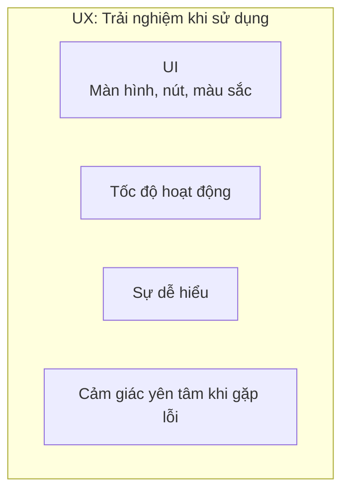
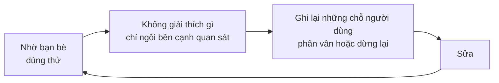

# Về UI và UX

> 🇯🇵 Bản gốc (tiếng Nhật): [UI_UXについて.md](<../../../2年生_システム開発実践/後期/2026_10_30/UI_UXについて.md>) <!-- original-ja-link -->

Khi nói chuyện về ứng dụng, các từ **UI** và **UX** thường xuyên xuất hiện.
Cả hai đều liên quan đến "người dùng", nhưng ý nghĩa thì hơi khác nhau.

[Quay lại Dự án tự do](../2026_10_09/2026_10_09_資料1.md)

---

## 1. Nói ngắn gọn

| Tên | Tên đầy đủ | Ý nghĩa | Nói ngắn gọn |
|------|----------|------|-----------|
| **UI** | User Interface (giao diện người dùng) | Phần người dùng **nhìn thấy và chạm vào** (màn hình, nút, chữ, màu sắc) | Vẻ ngoài và thao tác |
| **UX** | User Experience (trải nghiệm người dùng) | Những gì người dùng **cảm nhận khi sử dụng** (tiện lợi, vui, dễ hiểu) | Trải nghiệm khi sử dụng |

> 💡 **Ví dụ như "nhà hàng"**
> - **UI** = thực đơn, bát đĩa, bàn ghế, nội thất của quán
> - **UX** = **toàn bộ trải nghiệm** khiến bạn cảm thấy "có chỗ ngồi ngay", "gọi món dễ", "món ăn ngon", "muốn quay lại lần nữa"
>
> Dù thực đơn có đẹp (UI tốt), nhưng nếu phải đợi 1 tiếng mới có đồ ăn thì trải nghiệm (UX) vẫn không tốt.

---

## 2. Mối quan hệ giữa UI và UX

UI là **một phần** của UX.
Để tạo ra UX tốt thì cần UI tốt, nhưng **chỉ UI tốt thôi thì chưa đủ để có UX tốt**.

| Ví dụ | UI | UX |
|----|----|----|
| Nút trông rất đẹp nhưng bấm vào không có phản ứng gì | ◯ | ✕ |
| Vẻ ngoài đơn giản nhưng tìm được ngay thông tin mình cần | △ | ◯ |
| Dữ liệu đã nhập bị mất sạch vì lỗi | — | ✕✕ |

---

## 3. Những điểm quan trọng của UI tốt

### ① Làm cho đồng nhất (tính nhất quán)

Những thành phần có cùng ý nghĩa nên có **cùng hình thức và ở cùng vị trí**.

| ✕ Không tốt | ◯ Tốt |
|----------|-------|
| Màu và vị trí nút "Lưu" khác nhau tùy trang | Nút Lưu ở trang nào cũng **cùng màu, cùng vị trí** |
| Các từ cùng nghĩa như "Đăng ký", "Thêm", "Tạo" dùng lẫn lộn | **Thống nhất dùng 1 từ** |

### ② Thứ bấm được thì phải cho thấy là bấm được

Nút và link cần được thiết kế sao cho **nhìn vào là biết ngay có thể bấm được**.
Nếu đổi màu khi di chuột lên (`hover`) thì còn dễ hiểu hơn nữa.

### ③ Làm nổi bật thứ quan trọng

Nút bạn muốn người dùng bấm nhất (như "Lưu") thì dùng **màu đậm**, còn những nút khác (như "Hủy") thì dùng **màu nhạt**.
Nếu cái gì cũng nổi bật thì **chẳng có cái nào nổi bật cả**.

### ④ Làm cho dễ đọc

- Tạo sự khác biệt rõ ràng giữa màu chữ và màu nền (**độ tương phản**) (chữ màu xám nhạt rất khó đọc)
- Đừng để chữ quá nhỏ
- Chừa khoảng trắng (khoảng cách giữa các thành phần), đừng nhồi nhét quá nhiều

---

## 4. Những điểm quan trọng của UX tốt

### ① Phản hồi lại (feedback)

Khi bấm nút, hãy **cho biết điều gì đã xảy ra**. Nếu không có phản ứng, người dùng sẽ lo lắng "không biết đã bấm được chưa?" và bấm đi bấm lại nhiều lần.

| Tình huống | Ví dụ feedback |
|-----|----------------|
| Đang lưu | Hiển thị "Đang lưu…", làm cho nút không bấm được |
| Đã lưu xong | Hiển thị "Đã lưu" |
| Lỗi | Hiển thị **sai ở đâu và nên làm gì** |

### ② Hiển thị lỗi một cách thân thiện

| ✕ Không tốt | ◯ Tốt |
|----------|-------|
| `Error 422` | "Vui lòng nhập tiêu đề" |
| Khi bị lỗi thì nội dung đã nhập mất sạch | **Giữ nguyên** nội dung đã nhập, tô đỏ chỗ bị lỗi |

### ③ Thao tác không hoàn tác được thì phải xác nhận

Với những thao tác không thể hoàn tác như **xóa**, hãy xác nhận bằng câu hỏi "Bạn có thật sự muốn xóa không?".

### ④ Hoàn thành với ít bước

Chức năng càng hay dùng thì càng phải làm được với **ít lần nhấp chuột**.
Một ứng dụng mà "mỗi lần ghi chép phải chuyển qua 3 trang" sẽ dần dần không còn ai dùng.

---

## 5. Cách kiểm tra ứng dụng của mình

Cách tốt nhất là **nhờ người khác dùng thử**.

- Người làm ra ứng dụng đã biết cách dùng, nên **không nhận ra được những chỗ khó hiểu**
- Những **chỗ người dùng dừng lại, phân vân** chính là chỗ cần sửa
- Nếu bạn muốn giải thích bằng lời, đó là dấu hiệu **giao diện chưa truyền đạt đủ rõ**

---

## 6. Tóm tắt

- **UI** = **phần nhìn thấy và chạm vào** như màn hình, nút, màu sắc
- **UX** = **những gì cảm nhận được, toàn bộ trải nghiệm** khi sử dụng
- UI là một phần của UX. **Chỉ đẹp bên ngoài thôi thì không thành trải nghiệm tốt**
- UI tốt: **đồng nhất, cho thấy bấm được, làm nổi bật thứ quan trọng, dễ đọc**
- UX tốt: **phản hồi lại, hiển thị lỗi thân thiện, xác nhận thao tác không hoàn tác được, ít bước**
- Cách kiểm tra tốt nhất là **nhờ người khác dùng thử**

[Quay lại Dự án tự do](../2026_10_09/2026_10_09_資料1.md)
