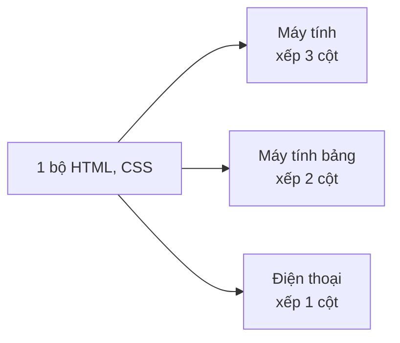
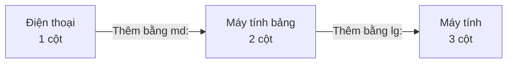
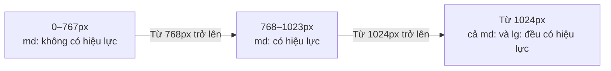
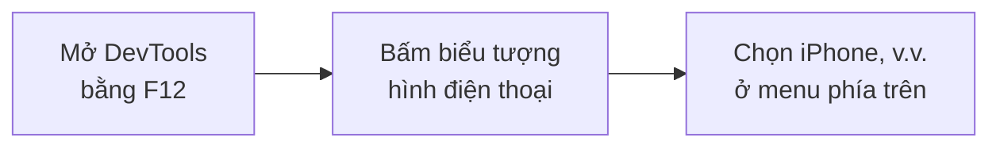

# Về Responsive Design

> 🇯🇵 Bản gốc (tiếng Nhật): [レスポンシブデザインについて.md](<../../../2年生_システム開発実践/後期/2026_11_06/レスポンシブデザインについて.md>) <!-- original-ja-link -->

Website được xem trên **nhiều kích thước màn hình khác nhau** như máy tính, máy tính bảng, điện thoại.
Cách làm để một trang **hiển thị dễ nhìn trên mọi màn hình** được gọi là **responsive design**.

[Quay lại Dự án tự do](../2026_10_09/2026_10_09_資料1.md)

---

## 1. Responsive design là gì

**Responsive** có nghĩa là "phản ứng lại".
Bố cục sẽ tự động thay đổi theo **chiều rộng** của màn hình.



> 💡 **Ngày xưa người ta làm riêng "trang cho điện thoại"**
> Trước đây, có khi người ta làm trang cho máy tính và trang cho điện thoại (như `m.〇〇.com`) **riêng biệt**.
> Như vậy thì mỗi lần sửa đều phải **sửa cả hai**. Với responsive design, **chỉ cần sửa một chỗ** là xong.

---

## 2. Tại sao lại quan trọng?

- Hiện nay, **số người xem website bằng điện thoại rất nhiều**
- Người ở công ty cũng có thể **mở URL portfolio trên điện thoại**
- Nếu chữ quá nhỏ hoặc nội dung bị tràn ngang khi xem trên điện thoại, **chỉ riêng điều đó cũng đủ tạo ấn tượng không tốt**

---

## 3. Cơ chế ①: viewport

Nếu không chỉ định gì, trình duyệt điện thoại sẽ hiển thị bằng cách **thu nhỏ trang dành cho máy tính** (chữ sẽ rất nhỏ).
Để tránh điều đó, hãy thiết lập **viewport** trong phần `<head>` của HTML.

```html
<meta name="viewport" content="width=device-width, initial-scale=1">
```

| Phần | Ý nghĩa |
|-----|------|
| `width=device-width` | Đặt chiều rộng trang khớp với **chiều rộng màn hình của thiết bị đó** |
| `initial-scale=1` | Lúc đầu hiển thị **không phóng to, không thu nhỏ** (tỉ lệ 1:1) |

> 📝 **Next.js tự động thêm vào cho bạn**
> Trong Next.js (App Router), cài đặt viewport này đã được thêm **tự động ngay từ đầu**.
> Khi làm bằng Blade của Laravel, hãy tự viết vào file layout (trang được tạo bằng `laravel new` thì đã có sẵn từ đầu).

---

## 4. Cơ chế ②: media query

**Media query** là cách viết để chỉ định "chỉ dùng CSS này khi chiều rộng màn hình từ 〇〇px trở lên".

```css
/* Mặc định (điện thoại) là 1 cột */
.cards {
  display: grid;
  grid-template-columns: 1fr;
}

/* Nếu chiều rộng màn hình từ 768px trở lên thì 2 cột */
@media (min-width: 768px) {
  .cards {
    grid-template-columns: 1fr 1fr;
  }
}

/* Từ 1024px trở lên thì 3 cột */
@media (min-width: 1024px) {
  .cards {
    grid-template-columns: 1fr 1fr 1fr;
  }
}
```

**Mốc chiều rộng** để chuyển đổi bố cục như thế này được gọi là **breakpoint**.

---

## 5. Viết bằng Tailwind CSS

Trong Tailwind CSS, chỉ cần thêm `md:` hay `lg:` vào trước tên class là làm được điều tương tự như media query.

```html
<div class="grid grid-cols-1 md:grid-cols-2 lg:grid-cols-3 gap-4">
  <div>カード1</div>
  <div>カード2</div>
  <div>カード3</div>
</div>
```

| Cách viết | Được áp dụng khi nào? |
|-------|------------|
| `grid-cols-1` | **Luôn được áp dụng** (điện thoại) |
| `sm:` | Khi chiều rộng **từ 640px trở lên** |
| `md:grid-cols-2` | Khi chiều rộng **từ 768px trở lên** (cỡ màn hình máy tính bảng) |
| `lg:grid-cols-3` | Khi chiều rộng **từ 1024px trở lên** (cỡ màn hình máy tính) |

---

## 6. Mobile first

Cả hai ví dụ ở trên đều **viết giao diện điện thoại trước**, rồi **thêm sau** những thay đổi khi màn hình lớn hơn.
Cách nghĩ này được gọi là **mobile first**.



- Màn hình nhỏ hiển thị được ít nội dung, nên bạn sẽ phải cân nhắc **chỉ giữ lại những gì thật sự cần thiết**
- Mở rộng giao diện đã gọn gàng trên màn hình nhỏ sang màn hình lớn thì **dễ hơn**

> ⚠️ **`md:` của Tailwind có nghĩa là "từ md trở lên"**
> `md:hidden` không phải là "**chỉ** ẩn trên máy tính bảng", mà là "ẩn nếu **từ** 768px **trở lên**".
> Giao diện cho điện thoại thì viết bằng **class bình thường** không gắn `md:` hay các tiền tố tương tự.

Mối quan hệ giữa chiều rộng màn hình và các class có hiệu lực như sau.



---

## 7. Kiểm tra giao diện trên điện thoại

Dù không có điện thoại, bạn vẫn có thể kiểm tra bằng **công cụ dành cho nhà phát triển (DevTools) của trình duyệt**.



| Vấn đề thường gặp | Cách sửa |
|-----------|------|
| Có thể cuộn ngang (bị tràn ra) | Tìm xem có phần tử nào cố định chiều rộng bằng `px` không. Với ảnh thì dùng `max-width: 100%` |
| Nút nhỏ, khó bấm | Làm nút có kích thước dễ bấm bằng ngón tay (**khoảng 44px**) |
| Bảng (table) bị tràn ra ngang | Đặt bảng vào một khung có thể cuộn ngang, hoặc trên điện thoại thì đổi sang dạng thẻ (card) |
| Chữ quá nhỏ | Nên đặt cỡ chữ của phần nội dung chính **khoảng 16px** |

> 💡 Bạn nào học khóa Deploy thì hãy thử **mở URL Vercel bằng điện thoại của mình** để kiểm tra nhé.

---

## 8. Tóm tắt

- **Responsive design** = cách làm để một trang thay đổi cho dễ nhìn **theo chiều rộng màn hình**
- Với cài đặt **viewport**, trang sẽ hiển thị **tỉ lệ 1:1** cả trên điện thoại (Next.js tự động làm)
- Dùng **media query** để chỉ định "nếu từ 〇〇px trở lên thì dùng CSS này". Mốc chia gọi là **breakpoint**
- Trong Tailwind CSS chỉ cần thêm `md:` `lg:`
- **Mobile first**: làm giao diện điện thoại trước, rồi thêm thay đổi cho màn hình lớn
- Kiểm tra bằng **DevTools** và **điện thoại của mình**

[Quay lại Dự án tự do](../2026_10_09/2026_10_09_資料1.md)
