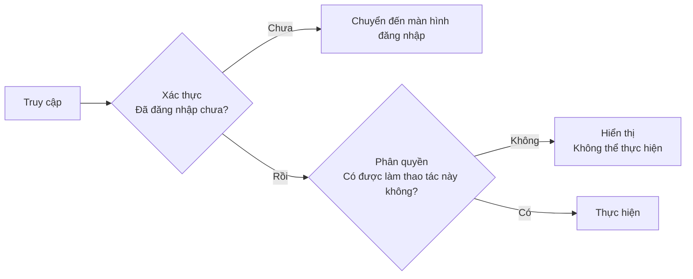
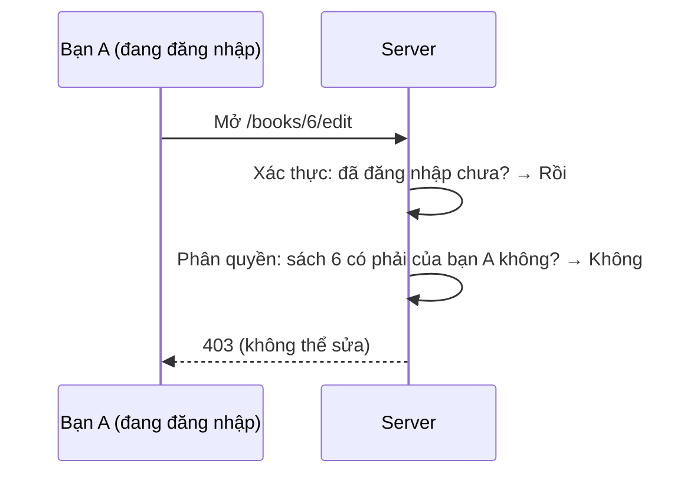
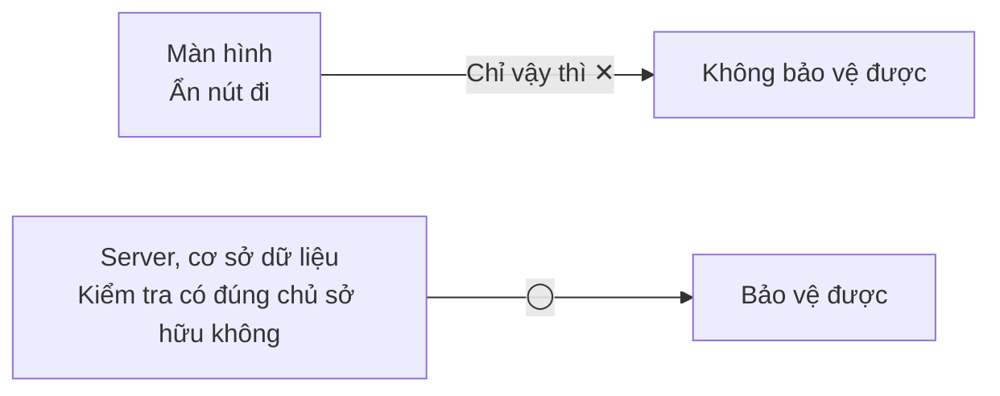

# Về xác thực và phân quyền

> 🇯🇵 Bản gốc (tiếng Nhật): [認証と認可について.md](<../../../2年生_システム開発実践/後期/2026_11_13/認証と認可について.md>) <!-- original-ja-link -->

Khi làm chức năng đăng nhập, bạn sẽ gặp hai từ **xác thực (認証)** và **phân quyền (認可)**.
Trong tiếng Nhật, hai từ này chỉ khác nhau đúng 1 chữ Hán, nhưng việc chúng làm thì hoàn toàn khác nhau.

[Quay lại Dự án tự do](../2026_10_09/2026_10_09_資料1.md)

---

## 1. Nói ngắn gọn

| Tên | Tiếng Anh | Điều cần kiểm tra | Nói ngắn gọn |
|------|-----|-----------|-----------|
| **Xác thực** | Authentication, viết tắt là **AuthN** | **Bạn là ai?** | Xác nhận danh tính |
| **Phân quyền** | Authorization, viết tắt là **AuthZ** | **Bạn được phép làm gì?** | Kiểm tra quyền hạn |

> 💡 **Ví dụ như "buổi hòa nhạc"**
> - **Xác thực** = ở cổng vào, bạn đưa **vé và giấy tờ tùy thân** để được xác nhận đúng là bạn
> - **Phân quyền** = tùy theo loại vé mà **khu vực được phép vào sẽ khác nhau** (người có vé ghế thường thì không được vào khu vực dành cho người có liên quan)
>
> Dù đã xác nhận đúng là bạn (xác thực OK), không có nghĩa là bạn vào được bất cứ đâu (phân quyền là chuyện khác).

---

## 2. Thứ tự là "xác thực → phân quyền"

**Nếu không biết đó là ai thì cũng không thể quyết định người đó được làm gì.** Vì vậy, xác thực luôn đi trước.



---

## 3. Thử áp dụng vào ứng dụng của mình

Hãy cùng xem ví dụ về **ứng dụng ghi chép đọc sách**.

| Tình huống | Xác thực hay phân quyền? | Điều cần kiểm tra |
|-----|-----------|-----------|
| Đăng nhập bằng địa chỉ email và mật khẩu | **Xác thực** | Có đúng là người này không? |
| Người chưa đăng nhập mở trang "Đăng ký sách" | **Xác thực** | Đã đăng nhập chưa? → nếu chưa thì chuyển đến màn hình đăng nhập |
| Bạn A định sửa cảm nhận **của bạn B** | **Phân quyền** | Cuốn sách này có phải do mình đăng ký không? → nếu không thì không được |
| Chỉ quản trị viên mới xóa được bài đăng của người khác | **Phân quyền** | Người này có phải quản trị viên không? |

> ⚠️ **Lỗi thường gặp: chỉ làm xác thực mà quên phân quyền**
> Nếu chỉ giới hạn trang sửa cho người đã đăng nhập, thì **bất kỳ ai** đã đăng nhập cũng có thể sửa **dữ liệu của người khác** chỉ bằng cách đổi con số trên URL.
>
> ```
> /books/5/edit   ← Sách của mình
> /books/6/edit   ← Đổi con số thì… sách của người khác?
> ```
>
> Khi sửa hoặc xóa, hãy luôn kiểm tra **"Dữ liệu này có phải của chính người đang đăng nhập không?"**.

Nếu có kiểm tra phân quyền, thì dù là người đã đăng nhập, việc thao tác với dữ liệu của người khác cũng sẽ bị chặn như sau.



---

## 4. Mã trạng thái HTTP

Mã trạng thái trả về khi có lỗi cũng được chia riêng cho xác thực và phân quyền.

| Mã | Tên | Ý nghĩa |
|-------|-----|------|
| **401** | Unauthorized | Chưa được **xác thực** (chưa đăng nhập, không biết là ai) |
| **403** | Forbidden | Đã được xác thực, nhưng **không có quyền** thực hiện thao tác đó (thao tác đó bị cấm) |

> 📝 Tên của 401 là "Unauthorized (không được phép)", nhưng ý nghĩa lại là **chưa được xác thực**. Vì cái tên dễ gây nhầm lẫn, hãy nhớ theo ý nghĩa.

---

## 5. Với từng công nghệ thì làm thế nào?

### Với Laravel

| | Thành phần sử dụng | Ví dụ |
|---|---|---|
| Xác thực | `Auth`, middleware `auth` | Chuyển người chưa đăng nhập đến màn hình đăng nhập |
| Phân quyền | **Policy**, `Gate` | Viết quy tắc "chỉ người đã đăng ký cuốn sách mới được sửa nó" |

```php
// routes/web.php: chỉ người đã đăng nhập (xác thực)
Route::middleware('auth')->group(function () {
    Route::get('/books/{book}/edit', [BookController::class, 'edit']);
});
```

```php
// BookController: có phải sách của mình không (phân quyền)
public function edit(Book $book)
{
    if ($book->user_id !== Auth::id()) {
        abort(403); // Nếu không phải sách của mình thì 403
    }

    return view('books.edit', compact('book'));
}
```

### Với Supabase

| | Thành phần sử dụng | Ví dụ |
|---|---|---|
| Xác thực | **Supabase Auth** | Đăng nhập bằng email và mật khẩu, hoặc bằng tài khoản Google |
| Phân quyền | **RLS (Row Level Security / bảo mật cấp hàng)** | Viết quy tắc "chỉ được xem và thay đổi những hàng có `user_id` của mình" vào cơ sở dữ liệu |

> ⚠️ **Với Supabase, RLS cực kỳ quan trọng**
> Supabase cho phép trình duyệt **truy cập trực tiếp vào cơ sở dữ liệu**.
> Nếu không cài đặt RLS, có thể sẽ rơi vào tình trạng **ai cũng xem hoặc xóa được toàn bộ dữ liệu**.
> Hãy kiểm tra trên màn hình quản lý của Supabase xem RLS đã được **bật (Enabled)** cho từng bảng chưa.

---

## 6. Chỉ ẩn trên màn hình thì không phải là phân quyền

"Không hiển thị nút sửa với sách của người khác" —— đây là **cách xử lý giao diện**, **không phải là phân quyền**.
Vì dù không có nút, nếu gõ thẳng URL hoặc gọi thẳng API thì vẫn thao tác được.



**Việc kiểm tra phân quyền nhất định phải làm ở phía server (controller của Laravel, RLS của Supabase, v.v.).**

---

## 7. Tóm tắt

- **Xác thực** = **Bạn là ai?** (xác nhận danh tính, đăng nhập)
- **Phân quyền** = **Bạn được phép làm gì?** (kiểm tra quyền hạn)
- Thứ tự là **xác thực → phân quyền**
- Chưa đăng nhập → **401**, đã đăng nhập nhưng bị cấm → **403**
- Laravel dùng **middleware auth + Policy**, Supabase dùng **Supabase Auth + RLS**
- Chỉ ẩn nút thì không bảo vệ được. **Nhất định phải kiểm tra ở phía server**

[Quay lại Dự án tự do](../2026_10_09/2026_10_09_資料1.md)
