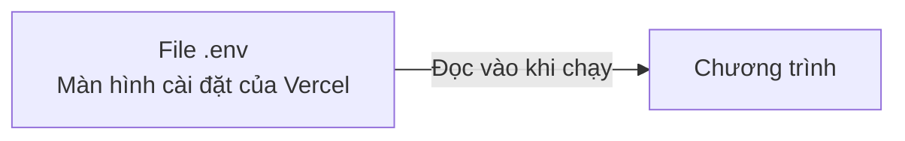
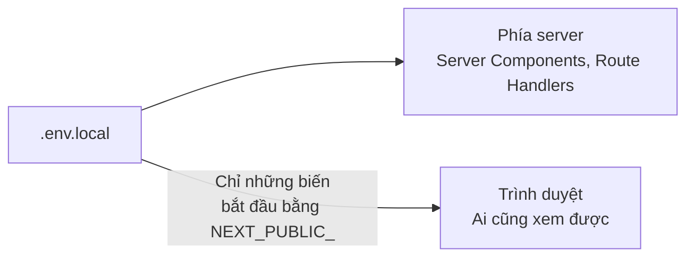
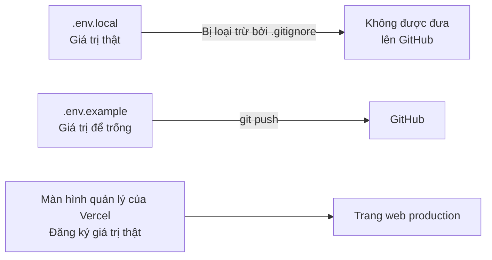
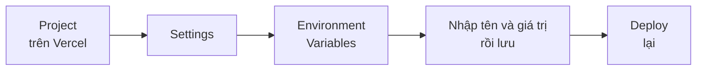

# Về biến môi trường

> 🇯🇵 Bản gốc (tiếng Nhật): [環境変数について.md](<../../../2年生_システム開発実践/後期/2026_11_27/環境変数について.md>) <!-- original-ja-link -->

Trong các tài liệu dự án tự do, chúng ta đã nhiều lần ghi "**không đưa API key hay mật khẩu lên GitHub**" và "hãy viết vào `.env`".
Những thứ được viết trong `.env` này chính là **biến môi trường**.
Ở đây, chúng ta sẽ cùng tìm hiểu biến môi trường là gì và tại sao lại dùng chúng.

[Quay lại Dự án tự do](../2026_10_09/2026_10_09_資料1.md)

---

## 1. Biến môi trường là gì

**Biến môi trường** là các giá trị cấu hình được đặt **bên ngoài** chương trình.
Khi chạy, chương trình sẽ **đọc** các giá trị đó để sử dụng.



| Những thứ đặt vào biến môi trường | Ví dụ |
|------------------|-----|
| **Giá trị bí mật** | API key, mật khẩu cơ sở dữ liệu |
| **Giá trị thay đổi tùy nơi chạy** | Vị trí cơ sở dữ liệu (máy tính của mình hay server production), URL của API |

> 💡 **Ví dụ như "chìa khóa nhà"**
> **Bản thiết kế** ngôi nhà (chương trình) thì cho người khác xem cũng không sao.
> Nhưng **chìa khóa** (mật khẩu) thì bạn không dán lên bản thiết kế, mà **giữ riêng**, đúng không?
> Biến môi trường giống như **chìa khóa** được giữ riêng, tách khỏi chương trình.

---

## 2. Tại sao lại dùng biến môi trường?

### ① Để không đưa giá trị bí mật lên GitHub

Nếu **viết thẳng** API key vào chương trình rồi công khai lên GitHub, thì **bất kỳ ai trên thế giới cũng xem được**.

```js
// ✕ Nguy hiểm: viết thẳng vào code
const apiKey = "sk-abc123xyz...";
```

```js
// ◯ An toàn: đọc từ biến môi trường
const apiKey = process.env.WEATHER_API_KEY;
```

> ⚠️ **Key đã đưa lên GitHub sẽ bị lợi dụng ngay lập tức**
> Có những chương trình tự động đi tìm key bị lộ trong các repository công khai.
> Nếu lỡ push lên, thì **chỉ xóa commit thôi là không đủ** (nó vẫn còn trong lịch sử).
> Hãy lập tức vào màn hình quản lý của dịch vụ để **vô hiệu hóa key và tạo key mới**.

### ② Để chuyển đổi giá trị tùy nơi chạy

Cùng một chương trình, nhưng **máy tính của mình** và **production (Vercel, v.v.)** sẽ kết nối đến những nơi khác nhau.

| | Máy tính của mình (môi trường phát triển) | Môi trường production |
|---|---|---|
| Cơ sở dữ liệu | MySQL trên máy tính của mình | Cơ sở dữ liệu trên Internet |
| URL của API | `http://localhost:8000` | `https://〇〇.com` |

Chương trình **giữ nguyên**, chỉ cần thay đổi biến môi trường là có thể chuyển nơi kết nối.
Vì đây là "**biến** thay đổi tùy theo **môi trường**", nên mới có tên là **biến môi trường**.

---

## 3. File `.env`

Trong lúc phát triển, bạn viết biến môi trường vào file có tên `.env`.

### Với Laravel (`.env`)

```
APP_NAME=BookApp
DB_HOST=127.0.0.1
DB_DATABASE=laravel
DB_USERNAME=laravel
DB_PASSWORD=password
```

```php
// Khi đọc vào (bên trong file config)
'database' => env('DB_DATABASE'),
```

### Với Next.js (`.env.local`)

```
WEATHER_API_KEY=abc123xyz
NEXT_PUBLIC_SUPABASE_URL=https://〇〇.supabase.co
```

```js
// Khi đọc vào
const apiKey = process.env.WEATHER_API_KEY;
```

> ⚠️ **Chú ý `NEXT_PUBLIC_` của Next.js**
> Biến môi trường có tên bắt đầu bằng `NEXT_PUBLIC_` sẽ **được gửi đến trình duyệt, và ai cũng xem được**.
> **Đừng gắn `NEXT_PUBLIC_` cho giá trị bí mật (API key, v.v.)**.
> Biến môi trường không có `NEXT_PUBLIC_` thì chỉ dùng được ở phía server (Server Components hoặc Route Handlers).

Sơ đồ sau cho thấy các giá trị được truyền đến những đâu.



> 📝 **URL và key công khai (publishable key / anon key)** của Supabase vốn được thiết kế để dùng trên trình duyệt, nên gắn `NEXT_PUBLIC_` cũng không sao.
> Bù lại, để bảo vệ dữ liệu, bạn nhất định phải cấu hình **RLS** (→ [Về xác thực và phân quyền](../2026_11_13/認証と認可について.md)).
> Ngược lại, **secret key / service_role key** là key làm được mọi thứ, nên tuyệt đối không được gắn `NEXT_PUBLIC_`.

---

## 4. Cơ chế giúp `.env` không bị đưa lên GitHub

`.env` không bị đưa lên GitHub là vì nó được ghi trong **`.gitignore`**.

```
# .gitignore
.env
.env*.local
```

Các file được ghi trong `.gitignore` sẽ **bị Git bỏ qua**, nên không được commit.
Với project tạo bằng Laravel hoặc `create-next-app`, các dòng này **đã được ghi sẵn từ đầu**.

### Chuẩn bị `.env.example`

Vì `.env` không được đưa lên GitHub, nên người khác xem cũng không biết **cần những biến môi trường nào**.
Vì vậy, hãy tạo file `.env.example` làm **mẫu với giá trị để trống** rồi đưa lên GitHub.

```
# .env.example (đưa lên GitHub)
WEATHER_API_KEY=
NEXT_PUBLIC_SUPABASE_URL=
```

> 💡 Laravel đã có sẵn `.env.example` từ đầu. Khi giới thiệu dự án trong portfolio, việc có `.env.example` cũng tạo ấn tượng **chỉn chu**.

---

## 5. Trên production (Vercel) thì thiết lập ở màn hình quản lý

Vì `.env.local` không được đưa lên GitHub, nên **nó không đến được Vercel**.
Biến môi trường cho production được cài đặt trên màn hình quản lý của Vercel.

Sắp xếp lại xem mỗi nơi — máy tính của mình, GitHub, Vercel — chứa những gì, ta có sơ đồ như sau.



Các bước cài đặt như sau.



> ⚠️ **Sau khi thêm hoặc thay đổi biến môi trường, hãy deploy lại**
> Biến môi trường được đọc vào **lúc deploy**. Chỉ cài đặt thôi thì chưa được áp dụng cho trang web đang chạy.

---

## 6. Tóm tắt

- **Biến môi trường** = các giá trị cấu hình được đặt **bên ngoài** chương trình
- Lý do sử dụng là để **bảo vệ giá trị bí mật** và để **chuyển đổi giá trị tùy theo môi trường**
- Trong lúc phát triển thì viết vào **`.env`** (Next.js là `.env.local`). Nhờ **`.gitignore`** mà nó không bị đưa lên GitHub
- Đưa **`.env.example`** lên GitHub làm mẫu cho các biến môi trường cần thiết
- Giá trị của biến có tiền tố **`NEXT_PUBLIC_`** trong Next.js bị lộ hoàn toàn trên trình duyệt. Không dùng tiền tố này cho giá trị bí mật
- Production (Vercel) thì **cài đặt ở màn hình quản lý**, rồi **deploy lại**
- Nếu lỡ push key lên, hãy **lập tức vô hiệu hóa và tạo lại**

[Quay lại Dự án tự do](../2026_10_09/2026_10_09_資料1.md)
