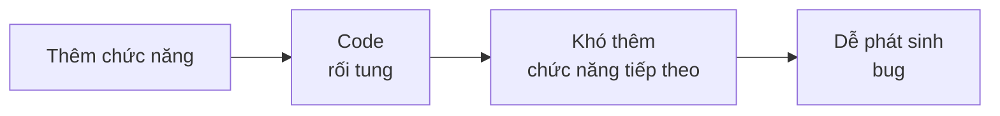
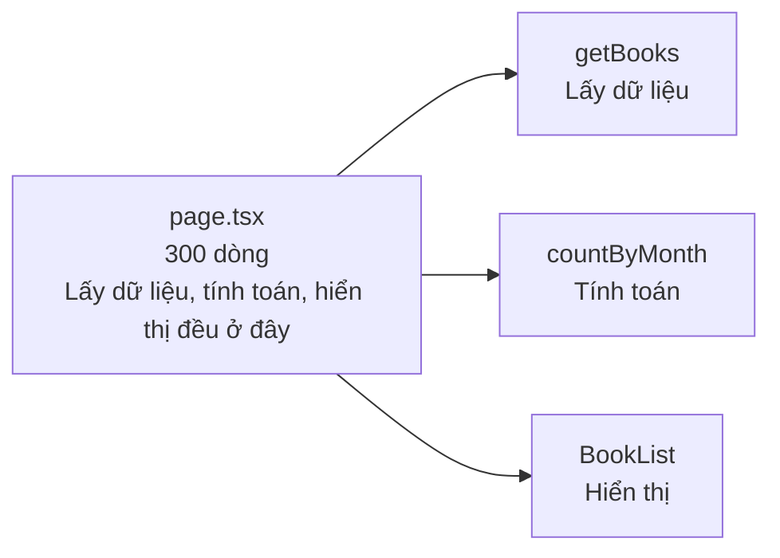
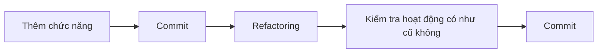

# Về refactoring

> 🇯🇵 Bản gốc (tiếng Nhật): [リファクタリングについて.md](<../../../2年生_システム開発実践/後期/2026_12_04/リファクタリングについて.md>) <!-- original-ja-link -->

Khi cứ thêm chức năng liên tục, code sẽ dài ra và bạn dần **không còn biết phần nào được viết ở đâu**.
Lúc đó, việc cần làm chính là **refactoring**.

[Quay lại Dự án tự do](../2026_10_09/2026_10_09_資料1.md)

---

## 1. Refactoring là gì

**Refactoring** là việc **sắp xếp lại bên trong code cho dễ đọc, dễ sửa**, **mà không thay đổi cách ứng dụng hoạt động**.

| | Cách hoạt động (những gì người dùng nhìn thấy) | Bên trong code |
|---|---|---|
| Thêm chức năng | **Thay đổi** | Thay đổi |
| Sửa bug | **Thay đổi** (trở nên đúng) | Thay đổi |
| **Refactoring** | **Không thay đổi** | Thay đổi (trở nên gọn gàng) |

> 💡 **Ví dụ như "dọn dẹp phòng"**
> Dọn dẹp phòng thì đồ đạc bạn có (những việc làm được) không thay đổi.
> Nhưng vì biết cái gì nằm ở đâu, nên **lần sau khi tìm đồ hay đặt đồ mới vào sẽ dễ dàng hơn**.

---

## 2. Tại sao phải refactoring?



- Code rối tung thì **thêm chức năng tiếp theo sẽ tốn thời gian**
- Nếu cùng một đoạn code nằm rải rác nhiều nơi, bạn có thể **quên sửa một chỗ** và gây ra bug
- Nửa năm sau, chính bạn sẽ **gần như không còn nhớ** code mình viết bây giờ
- Với portfolio, người của công ty **cũng xem cả code**. Code dễ đọc sẽ được đánh giá cao

---

## 3. Những dấu hiệu cho thấy code cần refactoring

Code rối thường có một số đặc điểm chung. Đây được gọi là dấu hiệu **code có "mùi" (code smell)**.

| Dấu hiệu | Ví dụ |
|-------|-----|
| **Cùng một đoạn code nằm rải rác nhiều nơi** | Sao chép cùng một header vào tất cả các trang |
| **Một hàm hay một file quá dài** | `page.tsx` dài 300 dòng |
| **Tên khó hiểu** | `data`, `tmp`, `a`, `flg` |
| **Con số không biết dùng để làm gì** | `if (status === 2)` (2 là gì?) |
| **Code không được sử dụng** | Code cũ bị comment lại và vẫn để nguyên trong file |

---

## 4. Những kiểu refactoring thường gặp

### ① Đặt tên dễ hiểu hơn

```js
// ✕ Không biết bên trong chứa gì
const d = await getData();
const l = d.filter((x) => x.r >= 4);
```

```js
// ◯ Nhìn tên là hiểu
const books = await getBooks();
const favoriteBooks = books.filter((book) => book.rating >= 4);
```

Đây là kiểu refactoring đơn giản nhất mà cũng hiệu quả nhất.

### ② Gộp các đoạn code giống nhau lại thành một

Việc tách thành **thành phần (component, `@include`)** như đã học ở học kỳ trước hoặc năm nhất cũng là refactoring.

```jsx
// ✕ Viết các thẻ (card) có cùng giao diện ở nhiều trang khác nhau
<div className="rounded border p-4">
  <h2 className="font-bold">{book.title}</h2>
  <p>{book.author}</p>
</div>
```

```jsx
// ◯ Tách thành thành phần BookCard để dùng ở mọi nơi
<BookCard book={book} />
```

Làm như vậy thì khi muốn thay đổi giao diện của thẻ, **chỉ cần sửa một chỗ** là xong.
Cách nghĩ không lặp lại cùng một thứ được gọi là **DRY** (Don't Repeat Yourself).

### ③ Đặt tên cho những con số không rõ ý nghĩa

```js
// ✕ Không biết số 2 biểu thị cái gì
if (book.status === 2) { ... }
```

```js
// ◯ Đặt tên cho nó
const STATUS_FINISHED = 2; // Đã đọc xong
if (book.status === STATUS_FINISHED) { ... }
```

### ④ Chia nhỏ hàm hay file quá dài

Khi một hàm **làm quá nhiều việc**, hãy chia nó ra theo từng việc.



---

## 5. Quy tắc khi refactoring

### Quy tắc ①: Commit trước

Trước khi refactoring, hãy **commit trạng thái đang chạy được**.
Lỡ có làm hỏng thì cũng **khôi phục lại được ngay**.

### Quy tắc ②: Không làm cùng lúc với việc thêm chức năng

Nếu "vừa thêm chức năng vừa sắp xếp lại code", thì khi ứng dụng không chạy nữa bạn sẽ **không biết nguyên nhân là ở bên nào**.



### Quy tắc ③: Làm từng chút một

Đừng cố sửa hết một lần, mà hãy lặp lại việc **sửa một chỗ rồi kiểm tra**.

### Quy tắc ④: Làm xong thì kiểm tra xem cách hoạt động có bị thay đổi không

Quy tắc của refactoring là **không thay đổi cách hoạt động**.
Sau khi sửa, nhất định phải kiểm tra xem **có chạy giống như trước không**.
Việc kiểm tra này có thể được thực hiện tự động bằng **test**, nội dung mà chúng ta sẽ học ở buổi sau.

---

## 6. Nhờ AI hỗ trợ refactoring

Nếu nhờ AI "hãy refactor đoạn code này cho dễ đọc", AI sẽ đưa ra code đã được sắp xếp lại.
Tuy nhiên, hãy chú ý những điều sau.

- Tự mình kiểm tra **xem cách hoạt động có bị thay đổi không** (AI cũng có lúc sai)
- Hãy hiểu **tại sao lại sửa như vậy** rồi mới dùng. Code mà bạn không giải thích được sẽ khiến bạn lúng túng khi bị hỏi lúc phỏng vấn
- Đừng nhờ nhiều thứ một lúc, hãy nhờ **từng file một, từng hàm một**

---

## 7. Tóm tắt

- **Refactoring** = sắp xếp lại code cho dễ đọc, dễ sửa **mà không thay đổi cách hoạt động**
- Các dấu hiệu là **cùng một đoạn code ở nhiều nơi, quá dài, tên khó hiểu, con số không rõ ý nghĩa**
- Những kiểu thường gặp là **đổi tên, gộp thành thành phần (DRY), đặt tên cho con số, chia nhỏ**
- **Commit trước**, **không làm cùng lúc với thêm chức năng**, **làm từng chút một**, **kiểm tra hoạt động có như cũ không**
- Khi dùng AI cũng vậy, hãy **hiểu rồi mới dùng**

[Quay lại Dự án tự do](../2026_10_09/2026_10_09_資料1.md)
