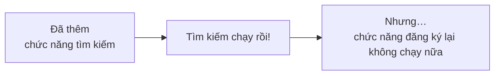
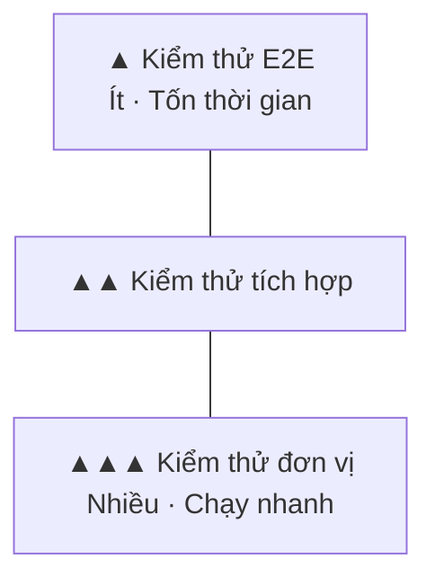

# Về kiểm thử (test)

> 🇯🇵 Bản gốc (tiếng Nhật): [テストについて.md](<../../../2年生_システム開発実践/後期/2026_12_11/テストについて.md>) <!-- original-ja-link -->

Sau khi làm xong ứng dụng, chúng ta cần kiểm tra xem nó **có chạy đúng không**. Việc này gọi là **kiểm thử (test)**.
Trong bài này, chúng ta sẽ tìm hiểu các loại kiểm thử và cơ chế chạy kiểm thử **tự động**.

[Quay lại phần Dự án tự do](../2026_10_09/2026_10_09_資料1.md)

---

## 1. Kiểm thử là gì?

**Kiểm thử (test)** là việc xác nhận xem chương trình **có chạy đúng như mình mong muốn không**.

Chắc các bạn cũng thường làm thế này sau khi viết code: **mở trang web trên trình duyệt, bấm thử các nút** để kiểm tra, đúng không?
Đó cũng là một kiểu kiểm thử thực thụ. Vì làm bằng tay nên nó được gọi là **kiểm thử thủ công**.

| | Kiểm thử thủ công | Kiểm thử tự động |
|---|---|---|
| Cách làm | Người thao tác trên màn hình để kiểm tra | **Chương trình kiểm thử** kiểm tra |
| Thời gian | Càng nhiều thứ cần kiểm tra thì **càng tốn thời gian** | Hàng trăm bài kiểm thử cũng chỉ mất **vài giây đến vài phút** |
| Quên kiểm tra | Có thể xảy ra | **Không** (lần nào cũng làm đúng những việc như nhau) |

---

## 2. Tại sao kiểm thử tự động lại quan trọng?

Khi thêm chức năng hoặc [refactor](../2026_12_04/リファクタリングについて.md) code, **những chỗ trước đây vẫn chạy tốt có thể bị hỏng**.
Hiện tượng này gọi là **regression** (lỗi hồi quy).



Mỗi lần thêm chức năng mà phải **kiểm tra lại toàn bộ chức năng bằng tay** thì rất vất vả.
Nếu có kiểm thử tự động, chỉ cần một lệnh là **kiểm tra lại được tất cả cùng lúc**.

> 💡 **Giống như "chấm bài kiểm tra"**
> Nếu đã xác định trước **đáp án (kết quả mong đợi)**, chẳng hạn "Đáp án của câu này là 〇〇",
> thì sau đó máy chỉ cần kiểm tra xem **kết quả có khớp với đáp án không** là xong.

---

## 3. Các loại kiểm thử

Kiểm thử được chia theo **phạm vi cần kiểm tra lớn hay nhỏ**.

| Loại | Kiểm tra gì | Ví dụ |
|-----|-----------|-----|
| **Kiểm thử đơn vị** (unit test) | **Một hàm, một thành phần** có chạy đúng không | Khi đưa `[4, 5, 3]` vào "hàm tính điểm đánh giá trung bình" thì có ra `4` không |
| **Kiểm thử tích hợp** (integration test) | **Khi kết hợp nhiều thành phần với nhau** thì có chạy đúng không | Khi gọi "API đăng ký sách" thì dữ liệu có được lưu vào cơ sở dữ liệu không |
| **Kiểm thử E2E** (End to End) | Có chạy đúng từ đầu đến cuối **giống như khi người dùng thực sự sử dụng** không | Cho trình duyệt chạy tự động, rồi kiểm tra: đăng nhập → đăng ký sách → sách có hiện trong danh sách không |



Kiểm thử càng nhỏ (kiểm thử đơn vị) thì **càng nhanh và dễ viết**, nên ta viết nhiều.
Kiểm thử lớn (kiểm thử E2E) thì **tốn thời gian**, nên chỉ tập trung vào những luồng quan trọng.
Vì có hình dạng như vậy nên mô hình này được gọi là **kim tự tháp kiểm thử** (test pyramid).

---

## 4. Cùng xem cách viết kiểm thử

### Kiểm thử đơn vị (ví dụ với JavaScript và Vitest)

```js
// average.js: hàm tính điểm đánh giá trung bình
export function average(ratings) {
  if (ratings.length === 0) return 0;
  const total = ratings.reduce((sum, r) => sum + r, 0);
  return total / ratings.length;
}
```

```js
// average.test.js: kiểm thử
import { expect, test } from "vitest";
import { average } from "./average";

test("平均を計算できる", () => {
  expect(average([4, 5, 3])).toBe(4);
});

test("1つもないときは 0", () => {
  expect(average([])).toBe(0);
});
```

| Phần | Ý nghĩa |
|-----|------|
| `test("〇〇", ...)` | Tên của bài kiểm thử và nội dung cần kiểm tra |
| `expect(A).toBe(B)` | **A phải bằng B** (kết quả mong đợi) |

### Kiểm thử tích hợp (ví dụ với Laravel)

Laravel có sẵn cơ chế kiểm thử ngay từ đầu.

```php
// tests/Feature/BookTest.php
public function test_本を登録できる(): void
{
    $response = $this->post('/books', [
        'title' => 'こころ',
        'author' => '夏目漱石',
    ]);

    $response->assertRedirect('/books');                      // quay về trang danh sách
    $this->assertDatabaseHas('books', ['title' => 'こころ']); // đã được lưu vào DB
}
```

```powershell
php artisan test
```

> 📝 Trong Laravel có 2 cách viết kiểm thử là **PHPUnit** và **Pest**. Ví dụ ở trên là cách viết của PHPUnit. Cách viết sẽ khác nhau tùy vào lựa chọn của bạn khi tạo dự án, nên hãy xem thử các ví dụ trong thư mục `tests`.

---

## 5. Kết quả kiểm thử

Khi chạy kiểm thử, kết quả sẽ được hiển thị.

| Hiển thị | Ý nghĩa |
|-----|------|
| ✅ PASS (xanh lá) | Đúng như mong đợi |
| ❌ FAIL (đỏ) | Khác với mong đợi → hiển thị bài kiểm thử nào thất bại và kết quả nào khác với mong đợi |

> 💡 **Chạy kiểm thử tự động bằng CI**
> Nếu đưa lệnh chạy kiểm thử vào **GitHub Actions** mà các bạn đã học ở bài [Về CI/CD](../2026_10_09/CICDについて.md),
> thì **mỗi lần push, kiểm thử sẽ tự động chạy**. Nhờ vậy, bạn có thể phát hiện ngay code bị hỏng.

---

## 6. Nên kiểm thử những gì?

Không cần phải kiểm thử tất cả. Trước tiên, hãy bắt đầu từ những chỗ như sau.

- **Chức năng quan trọng nhất** (các chức năng của MVP)
- **Những chỗ có tính toán** (tính tổng, trung bình, tính ngày tháng, v.v.)
- **Những chỗ dễ sai** (khi không có dữ liệu nào, khi để trống đầu vào, khi đầu vào rất dài)
- **Những chỗ đã từng có bug** (để không lặp lại bug cũ)

> 💡 **Có thể ghi điểm trong portfolio**
> Không có nhiều sinh viên viết cả kiểm thử trong các dự án đưa vào portfolio.
> Chỉ cần có vài bài kiểm thử cho các chức năng quan trọng thôi là đã cho người xem thấy bạn là "**người biết chú ý đến chất lượng khi làm sản phẩm**".

---

## 7. Tóm tắt

- **Kiểm thử** = xác nhận xem chương trình **có chạy đúng như mong muốn không**
- **Kiểm thử thủ công** là do người kiểm tra, **kiểm thử tự động** là do chương trình kiểm tra
- Có kiểm thử tự động thì khi thêm chức năng hay refactor, có thể kiểm tra ngay xem **có chỗ nào bị hỏng không (regression)**
- Các loại kiểm thử: **kiểm thử đơn vị, kiểm thử tích hợp, kiểm thử E2E**. Nên viết nhiều kiểm thử nhỏ (**kim tự tháp kiểm thử**)
- So sánh với **kết quả mong đợi**, ví dụ như `expect(A).toBe(B)`
- Kết hợp với **GitHub Actions** thì mỗi lần push, kiểm thử sẽ tự động chạy

[Quay lại phần Dự án tự do](../2026_10_09/2026_10_09_資料1.md)
