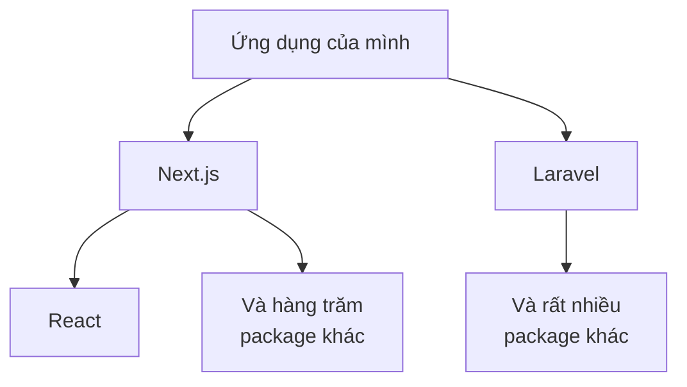
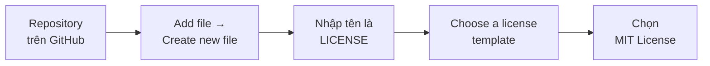

# Về OSS và giấy phép (license)

> 🇯🇵 Bản gốc (tiếng Nhật): [OSSとライセンスについて.md](<../../../2年生_システム開発実践/後期/2026_12_18/OSSとライセンスについて.md>) <!-- original-ja-link -->

Laravel, Next.js, React, Tailwind CSS mà chúng ta đang dùng trong dự án tự do đều có thể sử dụng **miễn phí**.
Đó là vì chúng đều là **OSS (phần mềm mã nguồn mở)**.
Trong bài này, chúng ta sẽ tìm hiểu về OSS và **giấy phép (license)** cần tuân thủ khi sử dụng.

[Quay lại phần Dự án tự do](../2026_10_09/2026_10_09_資料1.md)

---

## 1. OSS là gì?

**OSS (Open Source Software / phần mềm mã nguồn mở)** là phần mềm có **mã nguồn (phần bên trong của chương trình) được công khai**,
và chỉ cần tuân thủ các quy tắc đã định thì **ai cũng có thể tự do sử dụng, chỉnh sửa và phân phối**.

| | OSS | Phần mềm không phải OSS |
|---|---|---|
| Mã nguồn | **Được công khai** | Không công khai (chỉ trong nội bộ công ty) |
| Chỉnh sửa | Được, nếu tuân thủ quy tắc | Không được |
| Ví dụ | Laravel, Next.js, React, MySQL, Linux, mã nguồn nền tảng của VS Code | Windows, Microsoft Office, Photoshop |

> 💡 **Giống như "công khai công thức nấu ăn"**
> Đăng công thức nấu ăn lên mạng và nói: "Cứ tự do nấu nhé. Biến tấu cũng OK. Nhưng **hãy ghi tên tác giả của công thức gốc**" —
> đó chính là tinh thần của OSS. Phần "nhưng 〇〇" này chính là **giấy phép (license)**.

---

## 2. OSS ở quanh ta

Ứng dụng trong dự án tự do của các bạn thực ra cũng được **tạo thành từ nhiều phần mềm OSS**.

Những thứ được cài bằng `npm install` hay `composer install` (nội dung bên trong `node_modules` và `vendor`) hầu hết đều là OSS.
Nhờ có OSS do mọi người trên khắp thế giới tạo ra, chúng ta có thể làm ứng dụng **mà không cần tự làm mọi thứ từ đầu**.

---

## 3. Giấy phép (license) là gì?

**Giấy phép (license)** là **quy tắc** quy định "**được phép sử dụng** phần mềm này như thế nào".
OSS có thể dùng tự do, nhưng **không có nghĩa là muốn làm gì cũng được**. Bạn cần tuân thủ các quy tắc được ghi trong giấy phép.

### Các giấy phép thường gặp

| Giấy phép | Mức độ hạn chế | Quy tắc (nói đơn giản) | Ví dụ sử dụng |
|----------|------|-----------------|-----------|
| **MIT** | Rất ít hạn chế | **Chỉ cần giữ lại thông báo bản quyền và nội dung giấy phép** là dùng vào việc gì cũng được (kể cả ứng dụng thu phí) | Laravel, Next.js, React, Tailwind CSS |
| **Apache 2.0** | Ít hạn chế | Gần giống MIT. Có thêm một vài quy tắc như **phải ghi rõ những chỗ đã thay đổi** | TypeScript, Kubernetes |
| **GPL** | Hạn chế hơn | Nếu **phân phối** phần mềm có dùng code GPL thì **phải công khai cả code của mình theo GPL** | Linux, WordPress |

> 📝 **Những giấy phép như GPL được gọi là "copyleft"**
> Đây là cách nghĩ: "Bạn được tự do sử dụng, nhưng những sản phẩm tạo ra từ đó cũng phải được **cho phép sử dụng tự do như vậy** nhé".
> Khi làm ứng dụng ở công ty, người ta **luôn kiểm tra** giấy phép của các OSS đang dùng.

---

## 4. Gắn giấy phép cho ứng dụng của mình

Bạn cũng có thể gắn giấy phép cho repository của mình đã công khai trên GitHub.

> ⚠️ **Nếu không gắn giấy phép, người khác không thể tự do sử dụng**
> Dù là repository công khai, nếu không có giấy phép thì có nghĩa là **người khác chưa được cho phép sử dụng hay chỉnh sửa code**.
> Hãy nghĩ thế này: nếu "muốn mọi người tự do sử dụng" thì chọn MIT, còn nếu "chỉ muốn cho xem thôi (không muốn người khác dùng)" thì không gắn giấy phép.

---

## 5. Không chỉ code mới có "quyền"

**Hình ảnh, hình minh họa, icon, font chữ, âm nhạc** đưa vào ứng dụng cũng có **bản quyền** của người tạo ra chúng.

| ✕ Không được làm | ◯ Hãy làm thế này |
|----------------|----------|
| Dùng luôn hình ảnh tìm thấy trên mạng | Dùng **tài nguyên miễn phí** (hãy kiểm tra điều khoản sử dụng), hoặc hình ảnh do mình tự tạo hay tự chụp |
| Đưa hình nhân vật anime hay game vào ứng dụng rồi công khai | Không dùng trong ứng dụng công khai. Nếu muốn dùng thì hãy kiểm tra **hướng dẫn chính thức** |
| Dùng tài nguyên miễn phí mà không đọc điều khoản sử dụng | Tuân thủ các quy tắc như "phải ghi credit (tên tác giả)" |

> 💡 **Icon và font chữ thì dùng loại OSS sẽ tiện**
> Có nhiều thứ được công khai miễn phí, ví dụ icon thì có **Heroicons, Lucide**, font chữ thì có **Google Fonts**.
> Hãy kiểm tra giấy phép rồi hãy dùng.

> ⚠️ **Đặc biệt chú ý với portfolio**
> Portfolio là thứ **để cho người của công ty xem**. Chỉ cần có hình ảnh vi phạm bản quyền là **ấn tượng sẽ rất xấu**.

---

## 6. "Đóng góp lại" cho OSS

OSS được mọi người trên khắp thế giới tạo ra **một cách tình nguyện hoặc như một phần công việc của họ**. Ngoài việc sử dụng, chúng ta cũng có thể đóng góp lại.

| Cách đóng góp lại | Nội dung |
|-----------|------|
| ⭐ **Star** | Gắn star cho repository của OSS mà mình đang dùng trên GitHub (dễ nhất) |
| 🐛 **Issue** | Khi tìm thấy bug thì báo cáo bằng Issue |
| 📝 **Sửa tài liệu** | Sửa chỗ giải thích sai hoặc lỗi chính tả bằng pull request |
| 🔧 **Sửa code** | Gửi pull request để sửa bug |

Kinh nghiệm gửi pull request cho OSS và được chấp nhận (merge) sẽ là **điểm cộng lớn** khi đi xin việc.

---

## 7. Tóm tắt

- **OSS** = phần mềm có mã nguồn được công khai, chỉ cần tuân thủ quy tắc thì **ai cũng có thể sử dụng và chỉnh sửa**
- Laravel, Next.js, React cũng là OSS. Ứng dụng của mình **được tạo thành từ nhiều phần mềm OSS**
- **Giấy phép (license)** = quy tắc về việc được phép sử dụng như thế nào. Có **MIT** (rất ít hạn chế), **GPL** (có trường hợp phải công khai cả code của mình), v.v.
- Bạn cũng có thể gắn giấy phép cho repository của mình bằng file **LICENSE**
- Hình ảnh, icon, font chữ, âm nhạc cũng có **bản quyền**. Đặc biệt chú ý với portfolio
- Không chỉ dùng thôi, mà còn có thể đóng góp lại bằng **star, Issue, pull request**

[Quay lại phần Dự án tự do](../2026_10_09/2026_10_09_資料1.md)
