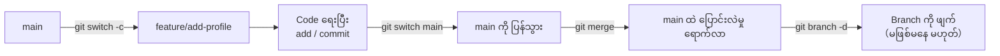
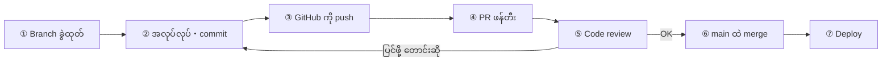
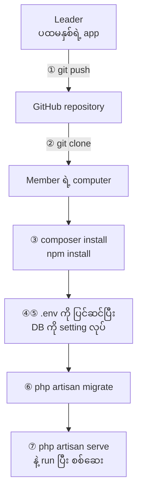

# Git ဖြင့် Team Development အတွက် ပြင်ဆင်ခြင်း

> 🇯🇵 မူရင်း (ဂျပန်ဘာသာဖြင့်): [2026_04_30.md](<../../../2年生_システム開発実践/前期/2026_04_30/2026_04_30.md>) <!-- original-ja-link -->

---

## Git ပြန်လည်လေ့ကျင့်ခြင်း + branch / merge

### ဒီနေ့ရဲ့ ရည်မှန်းချက်
- ပထမနှစ်မှာ သင်ခဲ့တဲ့ commit/push ကို ပြန်လေ့ကျင့်မယ်
- Branch ရဲ့ သဘောတရားကို နားလည်ပြီး သုံးနိုင်ရမယ်
- Merge လုပ်နည်းကို သိရမယ်

---

### Branch ဆိုတာ

**Branch = အလုပ်ရဲ့「ခွဲထွက်လမ်း」။ Main code ကို မပျက်စေဘဲ လုပ်ဆောင်ချက်（feature）အသစ်ကို develop လုပ်နိုင်တယ်**

```
main（production branch）
  │
  ├── feature/login    ← Login လုပ်ဆောင်ချက်ကို develop လုပ်နေဆဲ
  ├── feature/search   ← ရှာဖွေမှု လုပ်ဆောင်ချက်ကို develop လုပ်နေဆဲ
  └── bugfix/404-error ← bug ပြင်နေဆဲ
```

```bash
# လက်ရှိ branch ကို စစ်ကြည့်တယ်
git branch
# → * main（* ပါတာက လက်ရှိ branch）

# Branch အသစ် ဖန်တီးပြီး အဲဒီကို ပြောင်းတယ်
git checkout -b feature/add-profile
# ဒါမှမဟုတ်（Git 2.23 နှင့်အထက်）
git switch -c feature/add-profile

# Branch စာရင်းကို ပြတယ်
git branch -a   # -a နဲ့ remote branch တွေကိုပါ ပြတယ်

# main ကို ပြန်သွားတယ်
git switch main

# Branch ကို ဖျက်တယ်
git branch -d feature/add-profile
```

---

### merge — branch တွေကို ပေါင်းစပ်ခြင်း

အလုပ်လုပ်တဲ့ branch မှာ လုပ်ခဲ့တဲ့ ပြောင်းလဲမှုတွေကို နောက်ဆုံးမှာ main ထဲ ထည့်ပေါင်းတာကို merge လို့ ခေါ်ပါတယ်။



```bash
# ① feature/add-profile branch မှာ အလုပ်လုပ်ပြီး commit လုပ်တယ်
git switch feature/add-profile
# ... code ရေးတယ် ...
git add .
git commit -m "プロフィール画面を追加"

# ② main branch ကို ပြန်သွားတယ်
git switch main

# ③ feature/add-profile ရဲ့ ပြောင်းလဲမှုတွေကို main ထဲ ပေါင်းထည့်တယ်
git merge feature/add-profile

# ④ Merge ပြီးရင် branch ကို ဖျက်တယ်（မဖြစ်မနေ မဟုတ်）
git branch -d feature/add-profile
```

---

### Conflict（ထိပ်တိုက်တွေ့မှု）ကို ဖြေရှင်းခြင်း

```bash
# လူ 2 ယောက်က စာကြောင်းတစ်ကြောင်းတည်းကို ပြောင်းထားရင် merge လုပ်တဲ့အခါ conflict ဖြစ်တယ်
# Conflict ဖြစ်တဲ့ ဖိုင်ကို ဖွင့်ကြည့်ရင်...

<<<<<<< HEAD
  echo "Aさんが書いたコード";
=======
  echo "Bさんが書いたコード";
>>>>>>> feature/b-work

# ↑ ဒါကို မှန်ကန်တဲ့ code ဖြစ်အောင် ကိုယ်တိုင် ပြင်ရမယ်
# ပြင်ပြီးရင်：
git add .
git commit -m "コンフリクトを解消"
```

---

## အတန်းချိန် 02：GitHub Flow — PR・Code Review

### GitHub Flow ဆိုတာ

Team နဲ့ develop လုပ်ဖို့အတွက် သတ်မှတ်ထားတဲ့ စည်းမျဉ်း（rule）ပါ။

```
① main ကနေ အလုပ်လုပ်မယ့် branch ကို ခွဲထုတ်တယ်
      git switch -c feature/xxxx

② Branch မှာ အလုပ်လုပ်ပြီး commit လုပ်တယ်
      git add .
      git commit -m "မက်ဆေ့ချ်"

③ GitHub ကို push လုပ်တယ်
      git push origin feature/xxxx

④ Pull Request（PR）ကို ဖန်တီးတယ်
      → GitHub ပေါ်မှာ「ဒီ code ကို main ထဲ ထည့်ချင်ပါတယ်」လို့ တောင်းဆိုတယ်

⑤ Team member တွေက code review လုပ်တယ်
      → comment ရေးတာ၊ ပြင်ဖို့ တောင်းဆိုတာ စတာတွေ လုပ်တယ်

⑥ ပြဿနာမရှိရင် main ထဲ merge လုပ်တယ်
⑦ Deploy（production မှာ အသုံးပြုနိုင်အောင် ထည့်သွင်းခြင်း）
```

ပုံနဲ့ ပြရရင် အောက်ပါအတိုင်း စီးဆင်းပါတယ်။ Review မှာ ပြင်ဖို့ တောင်းဆိုခံရရင် ② ကို ပြန်သွားပြီး ပြင်ပြီးမှ ထပ် push လုပ်ပါ။



### Pull Request ရေးနည်း

```markdown
## ပြောင်းလဲမှုများ
- Profile screen ကို ထည့်ခဲ့တယ်
- User ရဲ့ နာမည်・icon ကို ပြနိုင်အောင် လုပ်ခဲ့တယ်

## စစ်ဆေးပေးစေချင်တဲ့ အချက်များ
- `/profile` ကို ဝင်ကြည့်တဲ့အခါ မှန်မှန်ကန်ကန် ပြသလား
- Login မဝင်ထားတဲ့အခါ `/login` ကို redirect ဖြစ်လား

## Screenshot
（ပုံကို ပူးတွဲပါ）
```

### Code review ရဲ့ အဓိကအချက်များ

- Bug ဒါမှမဟုတ် logic error မရှိဘူးလား
- Security ပြဿနာ မရှိဘူးလား（XSS、SQL Injection စသည်）
- Code က ဖတ်ရလွယ်လား
- Test ရေးထားလား（ဒုတိယနှစ်မှာတော့ မဖြစ်မနေ မဟုတ်）

---

## အတန်းချိန် 03：ပထမနှစ် app ကို team နဲ့ run ကြည့်ခြင်း

### အဆင့်များ

Leader က GitHub ကို တင်ထားတဲ့ app ကို member အားလုံး ကိုယ့် computer မှာ run နိုင်တဲ့အထိ လုပ်ရမယ့် အဆင့်တွေပါ။



```bash
# ① Team leader က ပထမနှစ်ရဲ့ app ကို GitHub ကို push လုပ်တယ်
git init
git remote add origin https://github.com/အဖွဲ့အမည်/app.git
git add .
git commit -m "initial commit"
git push -u origin main

# ② Team member တွေက clone လုပ်တယ်
git clone https://github.com/အဖွဲ့အမည်/app.git
cd app

# ③ Dependency တွေကို install လုပ်တယ်
composer install
npm install

# ④ Environment setting
cp .env.example .env
php artisan key:generate

# ⑤ DB setting（.env ကို ပြင်တယ်）
# DB_DATABASE=app_db
# DB_USERNAME=root
# DB_PASSWORD=

# ⑥ Migration
php artisan migrate

# ⑦ Run ပြီး စစ်ဆေးတယ်
php artisan serve
```

---

## အနှစ်ချုပ်

| Command | အဓိပ္ပာယ် |
|---------|------|
| `git switch -c branchအမည်` | Branch ဖန်တီးပြီး အဲဒီကို ပြောင်းတယ် |
| `git switch main` | main ကို ပြန်သွားတယ် |
| `git merge branchအမည်` | Branch ကို လက်ရှိ branch ထဲ ပေါင်းတယ် |
| `git push origin branchအမည်` | Branch ကို remote ကို push လုပ်တယ် |
| Pull Request（PR） | GitHub မှာ code ကို merge လုပ်ဖို့ တောင်းဆိုတယ် |
| Code review | PR အပေါ် comment・ထောက်ပြချက် ပေးတယ် |
