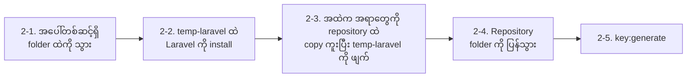
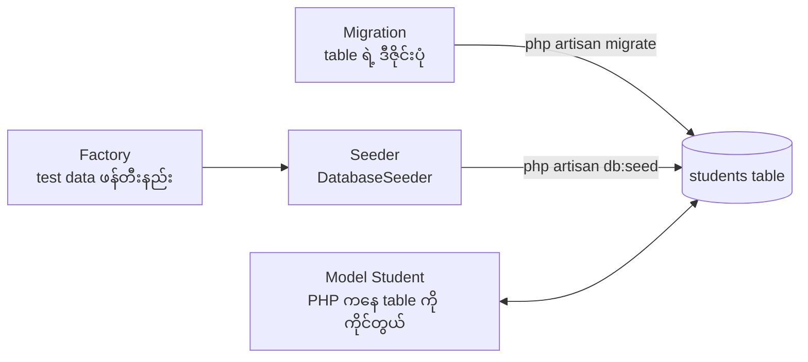

> 🇯🇵 မူရင်း (ဂျပန်ဘာသာဖြင့်): [20260506.md](<../../../2年生_システム開発実践/前期/2026_05_06/20260506.md>) <!-- original-ja-link -->

## Laravel Project ကို အစကနေ တည်ဆောက်ခြင်း

> **ရည်ရွယ်ချက်：** ဒီသင်ခန်းစာမှာ သုံးမယ့် Laravel project ကို သုညကနေ ဖန်တီးပြီး API development ကို စတင်နိုင်တဲ့ အခြေအနေ ဖြစ်အောင် လုပ်မယ်။

---

### အစပိုင်း：လိုအပ်တဲ့ software တွေ ရှိမရှိ စစ်ဆေးမယ်

အလုပ်မစခင် လိုအပ်တဲ့ software တွေ install လုပ်ထားပြီးပြီလား စစ်ဆေးပါမယ်။  
Terminal ကို ဖွင့်ပြီး အောက်ပါ command တွေကို **တစ်ကြောင်းချင်း** run ပါ။

---

#### PHP ကို စစ်ဆေးခြင်း

```bash
php --version
```

**OK ဖြစ်ရင်：**
```
PHP 8.2.x (cli) ...  ← version ပေါ်လာရင် OK
```

**NG ဖြစ်ရင်（`command not found` ဒါမှမဟုတ် `'php' は認識されていません`（'php' ကို မသိပါ）လို့ ပေါ်လာရင်）：**

PHP မရှိသေးပါဘူး။ XAMPP ကို install လုပ်ရင် PHP နဲ့ MySQL ကို တစ်ပြိုင်နက် သုံးနိုင်ပါပြီ။

**Windows ဆိုရင်：**
1. `https://www.apachefriends.org/` ကို ဝင်ပါ
2. 「XAMPP for Windows」ကို download လုပ်ပြီး install လုပ်ပါ
3. Install ပြီးရင် `C:\xampp\php` ကို **environment variable PATH** ထဲ ထည့်ပါ  
   （Start menu မှာ「環境変数」(environment variable) လို့ ရှာ → 「システム環境変数の編集」(system environment variable ကို ပြင်ဆင်ရန်) →「環境変数」(environment variable) →「Path」ကို ရွေးပြီး「編集」(ပြင်ဆင်ရန်) →「新規」(အသစ်) နဲ့ `C:\xampp\php` ကို ထည့်ပါ）
4. Terminal ကို **ပိတ်ပြီး ပြန်ဖွင့်** ကာ `php --version` ကို နောက်တစ်ကြိမ် run ပါ

**Mac ဆိုရင်：**
1. Terminal မှာ အောက်ပါအတိုင်း run ပါ（Homebrew ရှိရင်）
   ```bash
   brew install php
   ```
2. Homebrew မရှိသေးရင် အရင်ဆုံး အောက်ပါအတိုင်း run ပါ
   ```bash
   /bin/bash -c "$(curl -fsSL https://raw.githubusercontent.com/Homebrew/install/HEAD/install.sh)"
   ```

---

#### Composer ကို စစ်ဆေးခြင်း

```bash
composer --version
```

**OK ဖြစ်ရင်：**
```
Composer version 2.x.x ...  ← version ပေါ်လာရင် OK
```

**NG ဖြစ်ရင်（`command not found` ဒါမှမဟုတ် `'composer' は認識されていません`（'composer' ကို မသိပါ）လို့ ပေါ်လာရင်）：**

Composer မရှိသေးပါဘူး။ အောက်ပါ အဆင့်တွေအတိုင်း install လုပ်ပါမယ်။

**Windows ဆိုရင်：**
1. `https://getcomposer.org/download/` ကို ဝင်ပါ
2. 「Composer-Setup.exe」ကို download လုပ်ပြီး run ပါ
3. Install လုပ်နေစဉ် PHP ရဲ့ တည်နေရာကို မေးရင် `C:\xampp\php\php.exe` ကို ရွေးပါ
4. Install ပြီးရင် terminal ကို **ပိတ်ပြီး ပြန်ဖွင့်** ကာ `composer --version` ကို run ပါ

**Mac ဆိုရင်：**
```bash
brew install composer
```

---

#### MySQL ကို စစ်ဆေးခြင်း

```bash
mysql --version
```

**OK ဖြစ်ရင်：**
```
mysql  Ver 8.0.x ...  ← version ပေါ်လာရင် OK
```

Version ပေါ်လာရင် နောက်တစ်ဆင့်အနေနဲ့ MySQL **server** run နေလား စစ်ဆေးပါမယ်။

> **သတိပြုရန်（Mac）：** `mysql --version` ပေါ်လာပေမယ့် server မရှိသေးတာမျိုး ဖြစ်နိုင်ပါတယ်။  
> `mysql-client`（ချိတ်ဆက်တဲ့ tool သက်သက်）နဲ့ `mysql`（server ကိုယ်တိုင်）က မတူပါဘူး။  
> Server run နေလားဆိုတာကို အောက်ပါ အဆင့်တွေနဲ့ မဖြစ်မနေ စစ်ဆေးပါ။

**Mac ဆိုရင်：**
```bash
brew services list | grep mysql
```

| ပေါ်လာတဲ့စာ | အဓိပ္ပာယ် |
|------|------|
| `mysql  started` | Server run နေတယ်။ နောက်အဆင့်ကို ဆက်သွားလို့ OK |
| `mysql  stopped` | Server ရပ်နေတယ်။ အောက်က「စတင်ခြင်း」အဆင့်ကို သွားပါ |
| mysql စာကြောင်း မပေါ်ဘူး | Server ကိုယ်တိုင်ကို install မလုပ်ရသေးဘူး။ အောက်က「Install လုပ်ခြင်း」အဆင့်ကို သွားပါ |

**Windows（XAMPP）ဆိုရင်：**  
XAMPP Control Panel ကို ဖွင့်ပြီး MySQL ဘေးက「Start」ခလုတ်ကို နှိပ်ပါ။  
「Running」လို့ ပေါ်လာရင် စတင်ပြီးသားပါ။

**MySQL server က stopped ဖြစ်နေရင်（စတင်ခြင်း）：**

```bash
# Mac ဆိုရင်
brew services start mysql
```

XAMPP ဆိုရင် Control Panel ရဲ့「Start」ခလုတ်ကို နှိပ်ပါ။

**MySQL server ကိုယ်တိုင်ကို install မလုပ်ရသေးရင်（Mac）：**

```bash
brew install mysql
brew services start mysql
```

> **ချိတ်ဆက်တဲ့အခါ password အကြောင်း**  
> `mysql -u root -p` ကို run ရင် password ကို မေးပါလိမ့်မယ်။  
> Homebrew နဲ့ အသစ် install လုပ်ထားရင် **password မရှိ** တဲ့အတွက် ဒီအတိုင်း Enter ကို နှိပ်ပါ။  
> XAMPP မှာလည်း မူလ setting အရ **password မရှိ** ပါဘူး။  
> ကိုယ်တိုင် password သတ်မှတ်ခဲ့ဖူးတယ်ဆိုရင် အဲဒီ password ကို ရိုက်ထည့်ပါ။

---

**NG ဖြစ်ရင်（`command not found` ဒါမှမဟုတ် `'mysql' は認識されていません`（'mysql' ကို မသိပါ）လို့ ပေါ်လာရင်）：**

MySQL မရှိသေးပါဘူး။

**Windows（XAMPP သုံးမယ်ဆိုရင်）：**
1. XAMPP ကို install လုပ်ပြီးသားဆိုရင် `C:\xampp\mysql\bin` ကို environment variable PATH ထဲ ထည့်ပါ  
   （PHP ထည့်တုန်းကနဲ့ အဆင့်တူတူပဲ၊ ဒီတစ်ခါတော့ `C:\xampp\mysql\bin` ကို ထည့်ပါ）
2. Terminal ကို **ပိတ်ပြီး ပြန်ဖွင့်** ကာ `mysql --version` ကို run ပါ

**Mac ဆိုရင်：**
```bash
brew install mysql
brew services start mysql
```

---

> **ဒါတောင် မဖြေရှင်းနိုင်သေးရင် ဆရာ/ဆရာမကို ပြောပါ။**  
> Version အရမ်းဟောင်းနေရင်（PHP 7 series စသည်）လည်း ဆရာ/ဆရာမကို မေးကြည့်ပါ။  
> **PHP 8.1 နဲ့ အထက်・Composer 2 series・MySQL 8 series** က အကြံပြုထားတဲ့ version တွေပါ။

---

### Step 1｜Clone လုပ်ထားတဲ့ repository ထဲကို ရွှေ့မယ်

GitHub ကနေ clone လုပ်ထားတဲ့ repository တစ်ခု ရှိပြီးသား ဖြစ်ပါလိမ့်မယ်။  
Terminal ကို ဖွင့်ပြီး အဲဒီ folder ထဲကို ရွှေ့ပါ။

**Windows ဆိုရင်（PowerShell ဒါမှမဟုတ် Command Prompt）：**
```bash
cd C:\Users\（ကိုယ့် username）\Documents\（repository အမည်）
```

**Mac ဆိုရင်：**
```bash
cd ~/Documents/（repository အမည်）
```

ရွှေ့ပြီးပြီလား စစ်ဆေးပါမယ်：
```bash
pwd
```
```
/Users/（ကိုယ့် username）/Documents/（repository အမည်）  ← repository ထဲမှာ ရှိနေရင် OK
```

Git repository အဖြစ် အသိအမှတ်ပြုထားခြင်း ရှိမရှိကိုလည်း စစ်ကြည့်ရအောင်：
```bash
git status
```
```
On branch main
nothing to commit, working tree clean  ← ဒီလို ပေါ်လာရင် OK
```

> **`git status` မှာ error တက်ရင်**（`not a git repository` စသည်）  
> Repository folder ထဲကို မရောက်သေးပါဘူး။ Folder အမည်ကို စစ်ပြီး `cd` နဲ့ ထပ်ဝင်ကြည့်ပါ။

---

### Step 2｜Laravel ကို install လုပ်မယ်

Clone လုပ်ထားတဲ့ folder ထဲမှာ `git clone` က အလိုအလျောက် ဖန်တီးပေးတဲ့ `.git` folder ရှိနေပါတယ်။  
`composer create-project laravel/laravel .` က folder လုံးဝ ဗလာ မဖြစ်ရင် run လို့ မရတဲ့အတွက် error တက်ပါတယ်။

```
Project directory "..." is not empty.  ← ဒီ error ပေါ်လာတယ်
```

> **`.git` က hidden folder ဖြစ်လို့ Finder ဒါမှမဟုတ် Explorer မှာ မမြင်ရပါဘူး။**  
> Terminal မှာ `ls -a` ကို run ရင် မြင်နိုင်ပါတယ်။

ဒါကြောင့် **ခဏ တခြား folder မှာ ဖန်တီးပြီးမှ အထဲက အရာတွေကို ရွှေ့တဲ့** နည်းနဲ့ လုပ်ပါမယ်။



#### 2-1. အပေါ်တစ်ဆင့်ရှိ folder ထဲကို သွားမယ်

```bash
cd ..
```

စစ်ဆေးပါမယ်：
```bash
pwd
```
```
/Users/（ကိုယ့် username）/Documents  ← repository ရဲ့ အပေါ် 1 ဆင့်မှာ ရှိနေရင် OK
```

#### 2-2. ယာယီ folder ထဲမှာ Laravel ကို install လုပ်မယ်

```bash
composer create-project laravel/laravel temp-laravel
```

> Run ဖို့ **2〜5 မိနစ်** ကြာပါတယ်။ Screen ပေါ်မှာ စာတွေ အများကြီး ဆက်တိုက်ပေါ်လာပါလိမ့်မယ်။ ပြီးသည်အထိ စောင့်ပါ။  
> နောက်ဆုံးမှာ `Application ready!` လို့ ပေါ်လာရင် အောင်မြင်ပါပြီ။

#### 2-3. ယာယီ folder ထဲက အရာတွေကို repository folder ထဲ ရွှေ့မယ်

**Mac ဆိုရင်：**
```bash
cp -r temp-laravel/. （repository အမည်）/
rm -rf temp-laravel
```

**Windows ဆိုရင်（PowerShell）：**
```powershell
Copy-Item -Path temp-laravel\* -Destination （repository အမည်）\ -Recurse -Force
Copy-Item -Path temp-laravel\.* -Destination （repository အမည်）\ -Recurse -Force -ErrorAction SilentlyContinue
Remove-Item -Recurse -Force temp-laravel
```

> **（repository အမည်）** နေရာမှာ ကိုယ့် repository ရဲ့ folder အမည်ကို အစားထိုးပါ။

#### 2-4. Repository folder ကို ပြန်သွားမယ်

```bash
cd （repository အမည်）
```

မှန်မှန်ကန်ကန် ရွှေ့ပြီးပြီလား စစ်ဆေးပါမယ်：
```bash
pwd
```
```
/Users/（ကိုယ့် username）/Documents/（repository အမည်）  ← repository ထဲမှာ ရှိနေရင် OK
```

`app/` နဲ့ `routes/` စတဲ့ folder တွေ ဖန်တီးထားတာ တွေ့ရရင် အောင်မြင်ပါပြီ：
```bash
ls
```
```
README.md  app  artisan  bootstrap  composer.json  config  database  ...
```

#### 2-5. Application key ကို ထုတ်မယ်

Laravel က session နဲ့ encryption အတွက် **application key**（secret key）ကို လိုအပ်ပါတယ်။  
မဖြစ်မနေ run ပါ။

```bash
php artisan key:generate
```

```
   INFO  Application key set successfully.
```

> ဒီ command ကို run ရင် `.env` ဖိုင်ရဲ့ `APP_KEY=` မှာ တန်ဖိုးကို အလိုအလျောက် ထည့်ပေးပါတယ်။  
> မေ့သွားရင် `MissingAppKeyException` ဆိုတဲ့ error screen ပေါ်လာပါလိမ့်မယ်။

**Error တက်ရင်：`No APP_KEY variable was found in the .env file`**

`.env` ဖိုင်ထဲမှာ `APP_KEY=` စာကြောင်း မရှိပါဘူး။  
VSCode မှာ `.env` ကို ဖွင့်ပြီး ဖိုင်ရဲ့ အဆုံးမှာ အောက်ပါ စာကြောင်း 1 ကြောင်းကို ထပ်ထည့်ပါ။

```dotenv
APP_KEY=
```

Save ပြီးရင် နောက်တစ်ကြိမ် run ပါ：

```bash
php artisan key:generate
```

`APP_KEY=` ရဲ့ နောက်မှာ စာတန်းရှည်ကြီး အလိုအလျောက် ဝင်လာရင် အောင်မြင်ပါပြီ။

**ဒီအချိန်အထိ folder ဖွဲ့စည်းပုံ（အဓိကကျတာတွေပဲ）：**

```
（repository အမည်）/          ← clone လုပ်ထားတဲ့ folder（= Git repository）
├── app/
│   ├── Http/
│   │   └── Controllers/   ← controller ထားတဲ့နေရာ
│   └── Models/            ← model ထားတဲ့နေရာ
├── database/
│   ├── migrations/        ← table သတ်မှတ်ချက် ထားတဲ့နေရာ
│   ├── factories/         ← test data ထုတ်တဲ့ setting
│   └── seeders/           ← test data ထည့်တဲ့ setting
├── routes/
│   ├── api.php            ← API ရဲ့ routing（ဒီတစ်ခါ အဓိက သုံးမယ်）
│   └── web.php            ← Blade ရဲ့ routing（ပထမနှစ်မှာ သုံးခဲ့တာ）
└── .env                   ← DB ချိတ်ဆက်မှု အချက်အလက် စတာတွေရဲ့ setting ဖိုင်
```

---

### Step 3｜Database ကို ပြင်ဆင်မယ်

#### phpMyAdmin ဆိုတာ ဘာလဲ？

**phpMyAdmin** က MySQL database ကို browser ပေါ်ကနေ ကိုင်တွယ်နိုင်တဲ့ စီမံခန့်ခွဲရေး tool ပါ။  
Command မရိုက်ဘဲ screen ကို နှိပ်ရုံနဲ့ database ကို ဖန်တီး・စစ်ဆေး・ဖျက် လုပ်နိုင်ပါတယ်။

| Environment             | phpMyAdmin ဖွင့်နည်း                                                        |
| -------------- | ---------------------------------------------------------------------- |
| Windows（XAMPP） | XAMPP Control Panel ရဲ့「Admin」ခလုတ်ကို နှိပ် → browser မှာ `http://localhost/phpmyadmin` ပွင့်လာမယ် |
| Mac（XAMPP）     | XAMPP Control Panel ရဲ့「Admin」ခလုတ်ကို နှိပ် → browser မှာ `http://localhost/phpmyadmin` ပွင့်လာမယ် |
| Mac（Homebrew）  | phpMyAdmin ကို သီးသန့် install လုပ်ဖို့ လိုတယ်（နောက်မှာ ပြမယ့် terminal နည်းကို သုံးတာက ပိုလွယ်တယ်）                             |

---

#### 3-1. Database ကို ဖန်တီးမယ်

**Windows ဆိုရင်（XAMPP + phpMyAdmin）：**

1. XAMPP Control Panel မှာ MySQL ကို「Start」လုပ်ပါ
2. Browser မှာ `http://localhost/phpmyadmin` ကို ဖွင့်ပါ
3. ဘယ်ဘက် menu ရဲ့「**新規作成**」(အသစ်ဖန်တီးရန်) ကို click လုပ်ပါ
4. အောက်ပါအတိုင်း ဖြည့်ပြီး「**作成**」(ဖန်တီးရန်) ခလုတ်ကို နှိပ်ပါ

   - **Database အမည်：** `school_api`
   - **Collation：** `utf8mb4_unicode_ci`

**Mac ဆိုရင်（Homebrew）：**

phpMyAdmin ကို setup လုပ်စရာမလိုတဲ့ terminal ကနေ ဖန်တီးတဲ့ နည်းနဲ့ လုပ်ပါမယ်။  
MySQL run နေတာကို စစ်ပြီးမှ run ပါ။

```bash
mysql -u root
```
```sql
CREATE DATABASE school_api CHARACTER SET utf8mb4 COLLATE utf8mb4_unicode_ci;
EXIT;
```

> Password သတ်မှတ်ထားရင် `mysql -u root -p` လို့ ရိုက်ပြီး password ကို ထည့်ပါ။

#### 3-2. `.env` ဖိုင်ကို setting လုပ်မယ်

VSCode မှာ project ကို ဖွင့်ပြီး root အောက်တိုက်ရိုက်မှာ ရှိတဲ့ `.env` ဖိုင်ကို ဖွင့်ပါ။

```
（repository အမည်）/
└── .env   ← ဒါကို ဖွင့်ပါ
```

> **⚠️ သတိပြုရန်：ဖိုင်ထဲက အကြောင်းအရာ အားလုံးကို ဖျက်ပြီး ပြန်မရေးပါနဲ့။**  
> `.env` ထဲမှာ `APP_KEY` အပါအဝင် setting အများကြီး ရေးထားပြီးသားပါ။  
> **DB နဲ့ ဆိုင်တဲ့ စာကြောင်း 5 ကြောင်းကိုပဲ ရှာပြီး တန်ဖိုးကို ပြောင်းပါ။ တခြား စာကြောင်းတွေကို မထိပါနဲ့။**

ဖိုင်ထဲမှာ အောက်ကို scroll ဆွဲကြည့်ရင် အောက်ပါလို စာကြောင်းတွေ ရှိပါတယ်။  
ဒီစာကြောင်း 5 ကြောင်းရဲ့ `=` ညာဘက်ကိုပဲ ပြောင်းပါ：

```dotenv
DB_CONNECTION=mysql
DB_HOST=127.0.0.1
DB_PORT=3306
DB_DATABASE=school_api    ← ခုနက ဖန်တီးခဲ့တဲ့ DB အမည်ကို ပြောင်းထည့်ပါ
DB_USERNAME=root           ← MySQL ရဲ့ username（ပုံမှန်အားဖြင့် root）
DB_PASSWORD=               ← password မသတ်မှတ်ထားရင် ဗလာအတိုင်း ထားပါ
```

ပြောင်းပြီးရင် **Ctrl+S**（Mac မှာ **Cmd+S**）နဲ့ save ပါ။

> **`.env` က password ရေးထားတဲ့ setting ဖိုင်ပါ။**  
> Git ထဲ အလိုအလျောက် မပါဝင်အောင် လုပ်ထားပြီးသားမို့ တခြားသူကို မပြမိအောင် သတိထားပါ။

---

### Step 4｜Model・Migration・Factory ကို ဖန်တီးမယ်

ဒီသင်ခန်းစာမှာ **ကျောင်းသား（Student）** ကို စီမံခန့်ခွဲတဲ့ API ကို ဖန်တီးပါမယ်။  
အောက်ပါ command 1 ခုတည်းနဲ့ လိုအပ်တဲ့ ဖိုင်တွေကို တစ်ပြိုင်နက် ဖန်တီးနိုင်ပါတယ်။

```bash
php artisan make:model Student -mf
```

| Option | အဓိပ္ပာယ်                  | ဖန်တီးမယ့် ဖိုင်                                             |
| ----- | ------------------- | ---------------------------------------------------- |
| （မပါ）  | Model ကို ဖန်တီးတယ်              | `app/Models/Student.php`                             |
| `-m`  | Migration（table သတ်မှတ်ချက်）ကိုပါ ဖန်တီးတယ် | `database/migrations/xxxx_create_students_table.php` |
| `-f`  | Factory（test data ထုတ်ခြင်း）ကိုပါ ဖန်တီးတယ်  | `database/factories/StudentFactory.php`              |

ဖန်တီးမယ့် ဖိုင် 3 ခုနဲ့ နောက်မှ သုံးမယ့် seeder တို့က အောက်ပါအတိုင်း ချိတ်ဆက်နေပါတယ်။



Run ပြီးတဲ့အခါ အောက်ပါအတိုင်း ပေါ်လာရင် အောင်မြင်ပါပြီ：

```
   INFO  Model [app/Models/Student.php] created successfully.
   INFO  Factory [database/factories/StudentFactory.php] created successfully.
   INFO  Migration [database/migrations/2024_xx_xx_create_students_table.php] created successfully.
```

---

### Step 5｜Model ကို ပြင်မယ်（`$fillable` setting）

ဖန်တီးထားတဲ့ `app/Models/Student.php` ကို VSCode မှာ ဖွင့်ပါ။

```
school-api/
└── app/
    └── Models/
        └── Student.php   ← ဒါကို ဖွင့်ပါ
```

ဖိုင်ကို ဖွင့်ရင် အောက်ပါလို အကြောင်းအရာ ဖြစ်နေပါမယ်။ `$fillable` ကို ထည့်ပါ：

```php
<?php
namespace App\Models;

use Illuminate\Database\Eloquent\Factories\HasFactory;
use Illuminate\Database\Eloquent\Model;

class Student extends Model
{
    use HasFactory;

    // ↓ ဒီစာကြောင်း 1 ကြောင်းကို ထည့်ပါ
    protected $fillable = ['name', 'email', 'score'];
}
```

> **`$fillable` ဆိုတာ ဘာလဲ？**  
> Laravel ရဲ့ security လုပ်ဆောင်ချက်ပါ။ ရေးထားတဲ့ column အမည်တွေကိုပဲ `create()` နဲ့ `update()` မှာ ပြောင်းလဲနိုင်ပါတယ်။  
> ဒါကို setting မလုပ်ထားရင် နောက်ပိုင်း API ကနေ data သိမ်းတဲ့အခါ error တက်ပါလိမ့်မယ်။

---

### Step 6｜Migration ဖိုင်ကို ပြင်မယ်

`database/migrations/` folder ကို VSCode မှာ ဖွင့်ရင် ရက်စွဲနဲ့ စတဲ့ ဖိုင်တွေ စီထားတာကို တွေ့ရပါမယ်။

```
school-api/
└── database/
    └── migrations/
        ├── 0001_01_01_000000_create_users_table.php    ← Laravel က အစကတည်းက ပြင်ဆင်ထားတာ
        ├── 0001_01_01_000001_create_cache_table.php    ← Laravel က အစကတည်းက ပြင်ဆင်ထားတာ
        ├── 0001_01_01_000002_create_jobs_table.php     ← Laravel က အစကတည်းက ပြင်ဆင်ထားတာ
        └── 2024_xx_xx_xxxxxx_create_students_table.php ← ← Step4 မှာ ဖန်တီးခဲ့တာ（ဒါကို ပြင်ပါ）
```

**အောက်ဆုံးက `create_students_table.php` ကို ဖွင့်ပြီး** `up()` method ထဲက အကြောင်းအရာကို ပြောင်းရေးပါ：

```php
public function up(): void
{
    Schema::create('students', function (Blueprint $table) {
        $table->id();                              // ID（အလိုအလျောက် နံပါတ်စဉ်）
        $table->string('name', 100);              // အမည်
        $table->string('email')->unique();         // Email လိပ်စာ（ထပ်လို့ မရ）
        $table->integer('score')->default(0);     // အမှတ်（မူလတန်ဖိုး 0）
        $table->timestamps();                      // ဖန်တီးချိန်・ပြင်ဆင်ချိန်（အလိုအလျောက်）
    });
}
```

---

### Step 7｜Migration ကို run ပြီး table ကို ဖန်တီးမယ်

```bash
php artisan migrate
```

အောင်မြင်ရင် အောက်ပါအတိုင်း ပေါ်လာပါမယ်：

```
   INFO  Running migrations.

  0001_01_01_000000_create_users_table ................... 21ms DONE
  0001_01_01_000001_create_cache_table ................... 10ms DONE
  0001_01_01_000002_create_jobs_table .................... 10ms DONE
  2024_xx_xx_xxxxxx_create_students_table ............... 15ms DONE
```

Table ဖန်တီးပြီးပြီလား စစ်ဆေးပါမယ်။

**Windows ဆိုရင်（phpMyAdmin）：**  
Browser မှာ `http://localhost/phpmyadmin` ကို ဖွင့်ပြီး ဘယ်ဘက်က `school_api` ကို click လုပ်ရင် `students` table ကို မြင်ရပါမယ်။

**Mac ဆိုရင်（terminal）：**
```bash
mysql -u root -e "SHOW TABLES IN school_api;"
```
```
+----------------------+
| Tables_in_school_api |
+----------------------+
| cache                |
| jobs                 |
| migrations           |
| students             |  ← ဒါ ပေါ်လာရင် OK
| users                |
+----------------------+
```

#### တွေ့ရလေ့ရှိတဲ့ error နဲ့ ဖြေရှင်းနည်း

**Error 1：DB နဲ့ ချိတ်ဆက်လို့ မရဘူး**
```
SQLSTATE[HY000] [2002] Connection refused
```
→ MySQL run မနေပါဘူး။  
→ **Windows：** XAMPP Control Panel မှာ MySQL ကို「Start」လုပ်ပါ။  
→ **Mac：** `brew services start mysql` ကို run ပါ။

**Error 2：Database ကို ရှာမတွေ့ဘူး**
```
SQLSTATE[HY000] [1049] Unknown database 'school_api'
```
→ Step3 မှာ database ကို မဖန်တီးရသေးတာ ဒါမှမဟုတ် `.env` ထဲက database အမည် မှားနေတာ ဖြစ်ပါတယ်။  
→ **Windows：** phpMyAdmin မှာ database အမည်ကို စစ်ပါ။  
→ **Mac：** `mysql -u root -e "SHOW DATABASES;"` နဲ့ database စာရင်းကို စစ်ပါ။

**Error 3：Password မှားနေတယ်**
```
SQLSTATE[HY000] [1045] Access denied for user 'root'@'localhost'
```
→ `.env` ထဲက `DB_PASSWORD` မှားနေပါတယ်။ MySQL ရဲ့ password ကို စစ်ပြီး ပြန်ရေးပါ။

---

### Step 8｜Test data ကို ထည့်မယ်

API အလုပ်လုပ်ပုံကို စစ်ဆေးဖို့ သုံးမယ့် test data ကို ပြင်ဆင်ပါမယ်။

#### 8-1. Factory ကို ပြင်မယ်

`database/factories/StudentFactory.php` ကို ဖွင့်ပါ။

```
school-api/
└── database/
    └── factories/
        └── StudentFactory.php   ← ဒါကို ဖွင့်ပါ
```

`definition()` method ထဲက အကြောင်းအရာကို ပြောင်းရေးပါ：

```php
public function definition(): array
{
    return [
        'name'  => $this->faker->name(),                      // ကျပန်း အမည်
        'email' => $this->faker->unique()->safeEmail(),        // ကျပန်း email
        'score' => $this->faker->numberBetween(0, 100),        // 0〜100 ကြား ကျပန်း အမှတ်
    ];
}
```

#### 8-2. Seeder ကို ပြင်မယ်

`database/seeders/DatabaseSeeder.php` ကို ဖွင့်ပြီး `run()` method ထဲ စာကြောင်း 1 ကြောင်း ထည့်ပါ：

```php
public function run(): void
{
    \App\Models\Student::factory(10)->create(); // ကျောင်းသား data 10 ခု ဖန်တီးတယ်
}
```

#### 8-3. Test data ကို ထည့်မယ်

```bash
php artisan db:seed
```

```
   INFO  Seeding database.
```

Data ဝင်သွားပြီလား စစ်ဆေးပါမယ်။

**Windows ဆိုရင်（phpMyAdmin）：**  
`http://localhost/phpmyadmin` ကို ဖွင့်ပြီး `school_api` → `students` ကို click လုပ်ရင် data 10 ခု ပေါ်လာပါမယ်။

**Mac ဆိုရင်（terminal）：**
```bash
mysql -u root -e "SELECT COUNT(*) FROM school_api.students;"
```
```
+----------+
| COUNT(*) |
+----------+
|       10 |  ← 10 လို့ ပေါ်လာရင် OK
+----------+
```

---

### Step 9｜Development server ကို စတင်မယ်

```bash
php artisan serve
```

```
   INFO  Server running on [http://127.0.0.1:8000].

  Press Ctrl+C to stop the server
```

Browser မှာ `http://localhost:8000` ကို ဝင်ပြီး「Laravel」logo ပေါ်လာရင် စတင်ခြင်း အောင်မြင်ပါပြီ။

> **ဒီ top screen က server run နေတာကို စစ်ဆေးဖို့ သက်သက်ပဲ ဖြစ်ပါတယ်။**  
> Seeder နဲ့ ထည့်ထားတဲ့ data တွေက database ထဲမှာ ရှိပြီး ဒီ screen မှာ မပေါ်ပါဘူး။  
> နောက်အတန်းချိန်ကစပြီး API endpoint တွေကို ဖန်တီးကာ data တွေကို ရယူပြီး ပြသနိုင်ပါမယ်။

> **Server ကို ရပ်ချင်ရင် `Ctrl + C` ကို နှိပ်ပါ။**  
> Server run နေတုန်း terminal ကို မပိတ်ပါနဲ့။

#### Seeder data မှန်မှန်ကန်ကန် ဝင်နေလား စစ်ချင်ရင်

**Mac ဆိုရင်（terminal မှာ စစ်ဆေး）：**

```bash
mysql -u root -e "SELECT id, name, score FROM school_api.students LIMIT 5;"
```

```
+----+------------------+-------+
| id | name             | score |
+----+------------------+-------+
|  1 | Tanaka Taro      |    72 |
|  2 | Yamada Hanako    |    88 |
...
+----+------------------+-------+
```

ဒီလို ကျပန်း data တွေ ပေါ်လာရင် seeder အောင်မြင်ပါပြီ။

**Windows ဆိုရင်（phpMyAdmin မှာ စစ်ဆေး）：**

`http://localhost/phpmyadmin` ကို ဖွင့်ပြီး `school_api` → `students` ကို click လုပ်ရင် data 10 ခုကို စာရင်းအဖြစ် မြင်ရပါမယ်။

---

### ဒီအထိ စစ်ဆေးရမယ့် checklist

| စစ်ဆေးရမယ့်အချက် | Check |
|---------|---------|
| `php --version` / `composer --version` နဲ့ version ပေါ်လာတယ် | □ |
| `composer create-project` နဲ့ project ကို ဖန်တီးနိုင်ခဲ့တယ် | □ |
| `php artisan key:generate` နဲ့ application key ကို ထုတ်ခဲ့တယ် | □ |
| `school_api` database ကို ဖန်တီးခဲ့တယ် | □ |
| `.env` ထဲက DB ချိတ်ဆက်မှု အချက်အလက်ကို setting လုပ်ခဲ့တယ် | □ |
| `app/Models/Student.php` မှာ `$fillable` ကို ထည့်ခဲ့တယ် | □ |
| Migration ဖိုင်မှာ column တွေ ထည့်ခဲ့တယ် | □ |
| `php artisan migrate` နဲ့ `students` table ကို ဖန်တီးနိုင်ခဲ့တယ် | □ |
| `php artisan db:seed` နဲ့ test data 10 ခု ဝင်သွားတယ် | □ |
| `php artisan serve` နဲ့ server စတင်ပြီး browser မှာ စစ်ဆေးနိုင်ခဲ့တယ် | □ |
