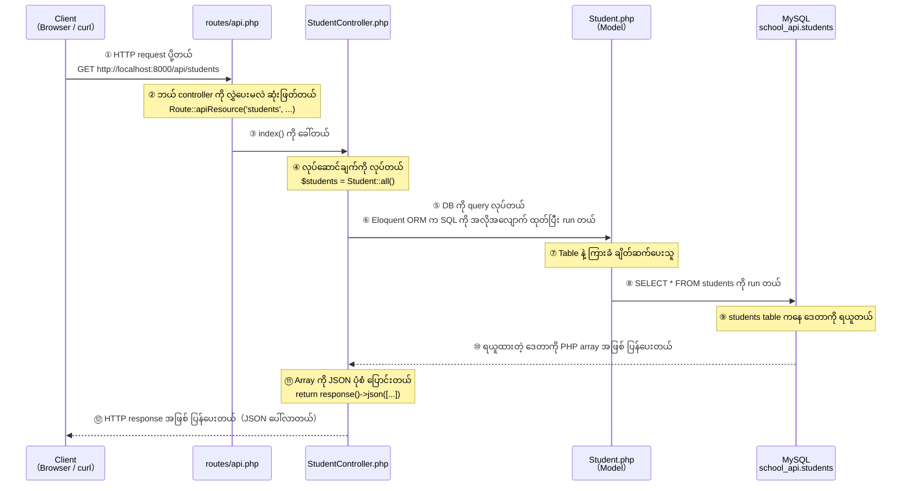
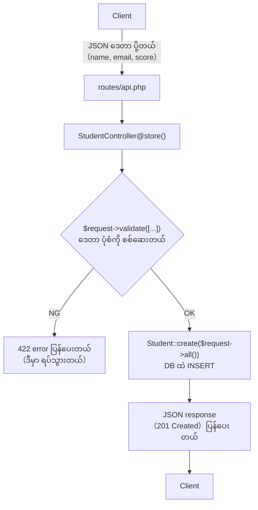

> 🇯🇵 မူရင်း (ဂျပန်ဘာသာဖြင့်): [20260514.md](<../../../2年生_システム開発実践/前期/2026_05_14/20260514.md>) <!-- original-ja-link -->


## Blade App ကို API အဖြစ် ပြောင်းခြင်း

### ဒီနေ့ရဲ့ ပန်းတိုင်
- REST API ဆိုတာ ဘာလဲဆိုတာ ရှင်းပြနိုင်မယ်
- JSON response ပြန်ပေးတဲ့ controller ကို ရေးနိုင်မယ်
- `api.php` ရဲ့ routing ကို နားလည်မယ်

---

### REST API ဆိုတာ

#### "API ဆိုတာ ဘာလဲ?" ကို တစ်ခွန်းတည်းနဲ့ ပြောရရင်

**API = 「ဒေတာကိုပဲ ပြန်ပေးတဲ့ ကောင်တာ」**

ပထမနှစ်မှာ browser ကနေ URL ကို ဝင်ကြည့်တဲ့အခါ HTML (ပုံစံ ဒီဇိုင်းပါ ပါတဲ့ စာမျက်နှာ) ပြန်ရခဲ့ပါတယ်။  
API ကလည်း အဲဒီ နည်းလမ်းအတိုင်းပဲ အလုပ်လုပ်ပေမယ့် HTML အစား **ဒေတာ (JSON) ကိုပဲ** ပြန်ပေးပါတယ်။

```
【Blade App（ပထမနှစ်မှာ ရေးခဲ့တာ）】
Browser → GET /students → Server → HTML စာမျက်နှာ ကို ပြန်ပေးတယ်
                                      ↑ ဇယား・ခလုတ်・ဒီဇိုင်း အကုန်ပါတယ်

【REST API（ဒီနေ့ကစပြီး ရေးမယ့်ဟာ）】
Browser သို့မဟုတ် တခြား App → GET /api/students → Server → JSON ဒေတာ ကိုပဲ ပြန်ပေးတယ်
                                                      ↑ ပုံစံ ဒီဇိုင်းမပါ・ဒေတာသာ
```

> **ဘာလို့ JSON ကိုပဲ ပြန်ပေးတာလဲ?**  
> React တို့ Vue တို့လို frontend တွေက 「ဒီဇိုင်းကို ကိုယ်တိုင် ဖန်တီးတာ」 ဖြစ်လို့  
> server ဆီကနေ 「ဒေတာကိုပဲ」 ပို့ပေးစေချင်တာပါ။  
> API ကို ရေးထားရင် 「React နဲ့ အလုပ်လုပ်တဲ့ App」「ဖုန်း App」 စတဲ့ မျက်နှာပြင် အမျိုးမျိုးကနေ ဒေတာတစ်ခုတည်းကို ပြန်သုံးလို့ရပါတယ်။

---

#### JSON က ဘယ်လိုပုံစံလဲ?

**JSON (ဂျေဆန်)** ဆိုတာ ဒေတာကို ဖော်ပြတဲ့ text format တစ်မျိုးပါ။  
Browser နဲ့ တခြား App တွေ ဖတ်ရလွယ်အောင် သတ်မှတ်ထားတဲ့ ရေးနည်း ရှိပါတယ်။

```json
{
    "status": "ok",
    "data": [
        {
            "id": 1,
            "name": "田中太郎",
            "email": "tanaka@example.com",
            "score": 85
        },
        {
            "id": 2,
            "name": "山田花子",
            "email": "yamada@example.com",
            "score": 72
        }
    ]
}
```

> **ဖတ်ပုံ အချက်များ:**  
> - `{ }` ထဲမှာ 「key」: 「value」 ပုံစံနဲ့ ရေးတယ်  
> - `[ ]` က list (ဒေတာ အများကြီးကို စုထားတာ)  
> - စာသား (string) ကို `"` နဲ့ ခြံရံတယ်။ ဂဏန်းကိုတော့ မခြံရံဘူး  
> - နောက်ဆုံး item ရဲ့ နောက်မှာ comma `,` မထည့်ရဘူး

---

#### REST ရဲ့ အတွေးအခေါ်: URL နဲ့ HTTP method ကို တွဲသုံးခြင်း

REST API က 「**URL (ဘယ်နေရာကို)** × **HTTP method (ဘာလုပ်မလဲ)**」 နဲ့ လုပ်ရမယ့်အလုပ်ကို ဆုံးဖြတ်ပါတယ်။  
HTTP method ဆိုတာ request အမျိုးအစားကို ဖော်ပြတဲ့ စကားလုံးပါ။

| HTTP method | အဓိပ္ပာယ် | နေ့စဉ်လုပ်ဆောင်ချက်နဲ့ နှိုင်းယှဉ်ရင် |
|-------------|------|-------------------|
| `GET`       | ရယူတယ် | စာမျက်နှာကြည့်တာ・ရှာဖွေတာ |
| `POST`      | အသစ် ဖန်တီးတယ် | Form ကို ပို့တာ |
| `PUT/PATCH` | ပြင်ဆင်တယ် | အကြောင်းအရာကို ပြင်ရေးတာ |
| `DELETE`    | ဖျက်တယ် | ဖျက်မယ့် ခလုတ်ကို နှိပ်တာ |

ဒီသင်ခန်းစာမှာ ရေးမယ့် ကျောင်းသား API စာရင်း:

| URL                  | Method      | အဓိပ္ပာယ်   | ဘာလုပ်လဲ           |
| -------------------- | --------- | ---- | --------------- |
| `/api/students`      | GET       | စာရင်း ရယူခြင်း | ကျောင်းသားအားလုံးရဲ့ ဒေတာကို ပြန်ပေးတယ်      |
| `/api/students`      | POST      | အသစ် ဖန်တီးခြင်း | ကျောင်းသားအသစ်ကို မှတ်ပုံတင်တယ်      |
| `/api/students/{id}` | GET       | အသေးစိတ် ရယူခြင်း | သတ်မှတ်ထားတဲ့ ကျောင်းသား ၁ ယောက်ကို ပြန်ပေးတယ်    |
| `/api/students/{id}` | PUT/PATCH | ပြင်ဆင်ခြင်း   | သတ်မှတ်ထားတဲ့ ကျောင်းသားရဲ့ အချက်အလက်ကို ပြင်ရေးတယ် |
| `/api/students/{id}` | DELETE    | ဖျက်ခြင်း   | သတ်မှတ်ထားတဲ့ ကျောင်းသားကို ဖျက်တယ်     |

> `{id}` နေရာမှာ ဂဏန်း ဝင်ပါတယ်။ ဥပမာ `GET /api/students/3` ဆိုရင် 「id က 3 ဖြစ်တဲ့ ကျောင်းသားကို ရယူမယ်」 လို့ အဓိပ္ပာယ်ရပါတယ်။

---

### HTTP status code အကြောင်း

API response မှာ **status code** (ဂဏန်း) အမြဲ ပါပါတယ်။  
Browser နဲ့ React က ဒီဂဏန်းကို ကြည့်ပြီး 「အောင်မြင်လား မအောင်မြင်ဘူးလား」 ဆုံးဖြတ်ပါတယ်။

| Code | အဓိပ္ပာယ် | ဘယ်အချိန် သုံးလဲ |
|-------|------|---------|
| `200 OK` | အောင်မြင်တယ် | ရယူခြင်း・ပြင်ဆင်ခြင်း・ဖျက်ခြင်း အောင်မြင်တဲ့အခါ |
| `201 Created` | ဖန်တီးမှု အောင်မြင်တယ် | POST နဲ့ အသစ် ဖန်တီးတဲ့အခါ |
| `404 Not Found` | ရှာမတွေ့ဘူး | သတ်မှတ်ထားတဲ့ id မရှိတဲ့အခါ |
| `422 Unprocessable Entity` | Validation error | ထည့်လိုက်တဲ့ တန်ဖိုး မမှန်တဲ့အခါ |
| `500 Internal Server Error` | Server error | Program မှာ bug ရှိတဲ့အခါ |

> ဥပမာ `GET /api/students/999` မှာ id=999 ကျောင်းသား မရှိရင်  
> 「404」 ကို ပြန်ပေးခြင်းအားဖြင့် 「ရှာမတွေ့ပါ」 ဆိုတာကို အသိပေးပါတယ်။

---

### Step 10｜API controller ကို ဖန်တီးခြင်း

#### 10-1. Controller file ကို ဖန်တီးမယ်

Terminal မှာ အောက်ပါ command ကို run ပါ (`php artisan serve` run နေတဲ့ terminal မဟုတ်ဘဲ **tab အသစ်တစ်ခု** ဖွင့်ပါ)။

```bash
php artisan make:controller Api/StudentController --api
```

**Command ရဲ့ အဓိပ္ပာယ်:**
- `make:controller` → controller file ကို ဖန်တီးတယ်
- `Api/StudentController` → `Api` folder ထဲမှာ `StudentController.php` ကို ဖန်တီးတယ်
- `--api` → API အတွက် method ၅ ခုကို ကြိုရေးပေးထားတယ် (`index` `store` `show` `update` `destroy`)

Run ပြီးတဲ့အခါ အောက်ပါအတိုင်း ပေါ်လာရင် အောင်မြင်ပါပြီ:

```
   INFO  Controller [app/Http/Controllers/Api/StudentController.php] created successfully.
```

ဖန်တီးလိုက်တဲ့ file ရဲ့ တည်နေရာကို စစ်ကြည့်မယ်:

```
（Repository အမည်）/
└── app/
    └── Http/
        └── Controllers/
            └── Api/                     ← အသစ် ဖန်တီးလိုက်တဲ့ folder
                └── StudentController.php  ← ဒီ file ကို ဖန်တီးထားတာပါ
```

---

#### 10-2. Controller file ကို ဖွင့်မယ်

VSCode မှာ `app/Http/Controllers/Api/StudentController.php` ကို ဖွင့်ပါ။  
`--api` option နဲ့ ဖန်တီးထားတဲ့ file မှာ အစကတည်းက ဒီလို အကြောင်းအရာတွေ ပါနေပါတယ်:

```php
<?php

namespace App\Http\Controllers\Api;

use Illuminate\Http\Request;
use App\Http\Controllers\Controller;

class StudentController extends Controller
{
    public function index()
    {
        //
    }

    public function store(Request $request)
    {
        //
    }

    public function show(string $id)
    {
        //
    }

    public function update(Request $request, string $id)
    {
        //
    }

    public function destroy(string $id)
    {
        //
    }
}
```

> **`namespace` နဲ့ `use` ဆိုတာ ဘာလဲ?**  
> - `namespace` ဆိုတာ ဒီ file ရဲ့ 「လိပ်စာ」 လိုမျိုးပါ။ `Api` folder ထဲမှာ ရှိနေတယ်ဆိုတာကို ဖော်ပြပါတယ်။  
> - `use` ဆိုတာ တခြား file ကို 「ခေါ်သုံးမယ်လို့ ကြေညာခြင်း」 ပါ။ `Student` model ကို သုံးဖို့ နောက်မှ ထည့်ပါမယ်။

---

#### 10-3. Controller မှာ လုပ်ဆောင်ချက်တွေကို ရေးမယ်

File ထဲက အကြောင်းအရာ **အားလုံးကို** အောက်ပါ code နဲ့ အစားထိုး ရေးပါ။  
(Ctrl+A နဲ့ အားလုံးရွေး → paste လုပ်ပါ၊ ဒါမှမဟုတ် ရှိပြီးသား အကြောင်းအရာကို ဖျက်ပြီး ပြန်ရေးပါ)

```php
<?php

namespace App\Http\Controllers\Api;

use App\Http\Controllers\Controller;
use App\Models\Student;           // ← Student model ကို သုံးလို့ရအောင် လုပ်တယ်
use Illuminate\Http\Request;

class StudentController extends Controller
{
    // -------------------------------------------------------
    // GET /api/students  → ကျောင်းသားအားလုံးရဲ့ စာရင်းကို ပြန်ပေးတယ်
    // -------------------------------------------------------
    public function index()
    {
        $students = Student::all();  // Database ကနေ အားလုံးကို ရယူတယ်

        return response()->json([
            'status' => 'ok',
            'data'   => $students,   // ရယူထားတဲ့ ဒေတာကို JSON ထဲထည့်ပြီး ပြန်ပေးတယ်
        ]);
    }

    // -------------------------------------------------------
    // POST /api/students  → ကျောင်းသားအသစ်ကို မှတ်ပုံတင်တယ်
    // -------------------------------------------------------
    public function store(Request $request)
    {
        // Validation: ပို့လာတဲ့ ဒေတာရဲ့ ပုံစံကို စစ်ဆေးတယ်
        $request->validate([
            'name'  => 'required|max:100',          // မဖြစ်မနေ လိုအပ်・စာလုံး ၁၀၀ အထိ
            'email' => 'required|email|unique:students', // မဖြစ်မနေ လိုအပ်・email ပုံစံ・ထပ်လို့မရ
            'score' => 'required|integer|min:0|max:100', // မဖြစ်မနေ လိုအပ်・ကိန်းပြည့်・0〜100
        ]);

        $student = Student::create($request->all()); // DB မှာ သိမ်းတယ်

        // 201 Created (ဖန်တီးမှု အောင်မြင်) status code နဲ့ ပြန်ပေးတယ်
        return response()->json([
            'status' => 'ok',
            'data'   => $student,
        ], 201);
    }

    // -------------------------------------------------------
    // GET /api/students/{id}  → id နဲ့ သတ်မှတ်ထားတဲ့ ၁ ယောက်ကို ပြန်ပေးတယ်
    // -------------------------------------------------------
    public function show($id)
    {
        $student = Student::find($id); // id နဲ့ ၁ ခု ရှာတယ်

        if (!$student) {
            // ရှာမတွေ့ရင် → 404 Not Found ကို ပြန်ပေးတယ်
            return response()->json([
                'status'  => 'error',
                'message' => 'Student not found',
            ], 404);
        }

        return response()->json([
            'status' => 'ok',
            'data'   => $student,
        ]);
    }

    // -------------------------------------------------------
    // PUT /api/students/{id}  → id နဲ့ သတ်မှတ်ထားတဲ့ ကျောင်းသားကို ပြင်ဆင်တယ်
    // -------------------------------------------------------
    public function update(Request $request, $id)
    {
        $student = Student::findOrFail($id); // ရှာမတွေ့ရင် 404 ကို အလိုအလျောက် ပြန်ပေးတယ်

        $request->validate([
            'name'  => 'sometimes|max:100',          // sometimes = ပို့လာတဲ့အခါမှသာ စစ်ဆေးတယ်
            'score' => 'sometimes|integer|min:0|max:100',
        ]);

        $student->update($request->all()); // DB ကို ပြင်ဆင်တယ်

        return response()->json([
            'status' => 'ok',
            'data'   => $student,
        ]);
    }

    // -------------------------------------------------------
    // DELETE /api/students/{id}  → id နဲ့ သတ်မှတ်ထားတဲ့ ကျောင်းသားကို ဖျက်တယ်
    // -------------------------------------------------------
    public function destroy($id)
    {
        Student::findOrFail($id)->delete(); // ရှာပြီး ဖျက်တယ်

        return response()->json([
            'status'  => 'ok',
            'message' => 'Deleted',
        ]);
    }
}
```

**ပြင်ရေးပြီးရင် Ctrl+S (Mac ဆိုရင် Cmd+S) နဲ့ save လုပ်ပါ။**

---

#### Method တစ်ခုချင်းစီရဲ့ တာဝန် အနှစ်ချုပ်

| Method အမည် | သက်ဆိုင်တဲ့ URL | လုပ်ဆောင်ချက် |
|-----------|------------|---------|
| `index()` | GET /api/students | အားလုံးကို ရယူပြီး JSON နဲ့ ပြန်ပေးတယ် |
| `store()` | POST /api/students | Validation → DB မှာ သိမ်း → 201 နဲ့ ပြန်ပေး |
| `show($id)` | GET /api/students/{id} | ၁ ခု ရှာ → မရှိရင် 404 → JSON နဲ့ ပြန်ပေး |
| `update($request, $id)` | PUT /api/students/{id} | ၁ ခု ရှာ → Validation → DB ပြင်ဆင် |
| `destroy($id)` | DELETE /api/students/{id} | ၁ ခု ရှာ → ဖျက် |

---

### Step 11｜API routing ကို အသုံးပြုလို့ရအောင် လုပ်ခြင်း

Controller ကို ဖန်တီးရုံနဲ့ URL နဲ့ controller က ချိတ်ဆက်မထားသေးပါဘူး။  
「ဒီ URL ကို ဝင်လာရင် ဒီ method ကို ခေါ်မယ်」 ဆိုတဲ့ **routing** ကို သတ်မှတ်ပါမယ်။

#### 11-1. `routes/api.php` ကို ဖန်တီးမယ်

> **⚠️ Laravel 11 နောက်ပိုင်းမှာ `routes/api.php` က အစကတည်းက မရှိပါဘူး။**  
> အောက်ပါ command ကို run မှသာ ပထမဆုံး ဖန်တီးပေးပါတယ်။

```bash
php artisan install:api
```

Run လိုက်တဲ့အခါ ကြားထဲမှာ အတည်ပြုချက် ၂ ကြိမ် တောင်းပါလိမ့်မယ်။ နှစ်ခုလုံးကို `yes` (ဒါမှမဟုတ် Enter key) နဲ့ ဆက်သွားပါ။

---

**【အတည်ပြုချက် 1】Migration ကို run မလား?**

```
   INFO  Published API routes file.

 One new database migration has been published. Would you like to run all pending database migrations? (yes/no) [yes]:
 > yes
```

> `routes/api.php` ဖန်တီးပြီးတဲ့နောက် migration ကို အခုချက်ချင်း run မလားလို့ မေးပါတယ်။  
> `yes` ဒါမှမဟုတ် Enter နဲ့ ဆက်သွားပါ။

---

**【အတည်ပြုချက် 2】Production environment မှာ run မှာကို အတည်ပြုခြင်း**

```
                                                                    
                         APPLICATION IN PRODUCTION.                 
                                                                    

 ┌ Are you sure you want to run this command? ──────────────────┐
 │ Yes                                                          │
 └──────────────────────────────────────────────────────────────┘
```

> **「APPLICATION IN PRODUCTION (production environment ဖြစ်ပါတယ်)」 လို့ ပေါ်လာလို့ လန့်သွားနိုင်ပေမယ့် စိတ်ပူစရာ မလိုပါဘူး။**  
> ဒါက 「တကယ် run မှာ သေချာလား?」 ဆိုတဲ့ Laravel ရဲ့ လုံခြုံရေး အတည်ပြုချက်ပါ။  
> 「Yes」 ကို ရွေးပြီး ဆက်သွားပါ။

---

**Migration ကို run ပါတယ်**

```
   INFO  Running migrations.

  2026_xx_xx_xxxxxx_create_personal_access_tokens_table .......... DONE
```

> `personal_access_tokens` (personal access token) table ကို ဖန်တီးပေးပါတယ်။  
> ဒါက **Sanctum က authentication အတွက် token တွေကို သိမ်းဖို့ table** ပါ။  
> အတန်းချိန် 07 မှာ authentication လုပ်ဆောင်ချက်ကို ရေးတဲ့အခါ သုံးပါမယ်။ အခုတော့ 「အလိုအလျောက် ဖန်တီးပေးသွားတယ်」 လို့ပဲ မှတ်ထားရင် ရပါပြီ။

---

**နောက်ဆုံးမှာ ဒီ message ပေါ်လာရင် အောင်မြင်ပါပြီ:**

```
   INFO  API scaffolding installed. Please add the [Laravel\Sanctum\HasApiTokens] trait to your User model.
```

> အဆုံးမှာပါတဲ့ `Please add the [Laravel\Sanctum\HasApiTokens] trait...` က  
> 「User model မှာ setting ထပ်ထည့်ပေးပါ」 ဆိုတဲ့ လမ်းညွှန်ချက်ပါ။ ဒါပေမယ့် **အတန်းချိန် 07 မှာ လုပ်ပါမယ်။ အခုတော့ လျစ်လျူရှုထားလို့ ရပါတယ်။**

---

ဒီ command က လုပ်ပေးသွားတာတွေ:
- `routes/api.php` file ကို ဖန်တီးခြင်း
- `bootstrap/app.php` မှာ API routing ကို မှတ်ပုံတင်ခြင်း
- Laravel Sanctum (အတန်းချိန် 07 မှာ သုံးမယ့် authentication package) ကို install လုပ်ခြင်း
- `personal_access_tokens` table ရဲ့ migration ကို run ခြင်း

Run ပြီးနောက် folder ဖွဲ့စည်းပုံ:

```
（Repository အမည်）/
└── routes/
    ├── api.php   ← ဒီ file ကို ဖန်တီးထားတာပါ（API routing အတွက်）
    └── web.php   ← ဒါက Blade အတွက်（ဒီတစ်ခါ မထိဘူး）
```

> **`api.php` နဲ့ `web.php` ရဲ့ ကွာခြားချက်**  
> - `web.php` … HTML ပြန်ပေးတဲ့ route တွေကို ရေးတယ်  
> - `api.php` … JSON ပြန်ပေးတဲ့ API အတွက်။ URL ရဲ့ ရှေ့မှာ `/api/` ကို အလိုအလျောက် ထည့်ပေးတယ်

#### 11-2. Route ကို ထည့်မယ်

VSCode မှာ `routes/api.php` ကို ဖွင့်ပါ။ အစမှာ ဘာမှ သိပ်မပါပါဘူး။ အောက်ပါအတိုင်း ပြင်ရေးပါ:

```php
<?php

use Illuminate\Support\Facades\Route;
use App\Http\Controllers\Api\StudentController;  // ← ဒီလိုင်းကို ထည့်ပါ

Route::apiResource('students', StudentController::class);
// ↑ ဒီ ၁ လိုင်းတည်းနဲ့ route ၅ ခုကို အလိုအလျောက် မှတ်ပုံတင်ပေးတယ်
```

**ပြင်ရေးပြီးရင် Ctrl+S (Mac ဆိုရင် Cmd+S) နဲ့ save လုပ်ပါ။**

---

#### `Route::apiResource` က မှတ်ပုံတင်ပေးတဲ့ route တွေကို စစ်ကြည့်မယ်

`Route::apiResource('students', StudentController::class)` က အောက်ပါ route ၅ ခုကို **၁ လိုင်းတည်းနဲ့** စုပြီး မှတ်ပုံတင်ပေးပါတယ်။

စစ်ဆေးတဲ့ command:

```bash
php artisan route:list --path=api/students
```

```
  GET|HEAD   api/students ............. students.index  › Api\StudentController@index
  POST       api/students ............. students.store  › Api\StudentController@store
  GET|HEAD   api/students/{student} ... students.show   › Api\StudentController@show
  PUT|PATCH  api/students/{student} ... students.update › Api\StudentController@update
  DELETE     api/students/{student} ... students.destroy› Api\StudentController@destroy
```

> ဒါတွေကို တစ်လိုင်းချင်း လက်နဲ့ရေးရင် ၅ လိုင်း ဖြစ်ပေမယ့် `apiResource` ကို သုံးရင် ၁ လိုင်းနဲ့ ပြီးပါတယ်။

---

### Step 12｜Browser မှာ API အလုပ်လုပ်ပုံကို စစ်ဆေးခြင်း

Development server မ run ရသေးရင် စတင်ပါ:

```bash
php artisan serve
```

#### 12-1. စာရင်း ရယူခြင်း (GET /api/students) ကို browser မှာ စစ်ကြည့်မယ်

Browser မှာ အောက်ပါ URL ကို ဝင်ကြည့်ပါ:

```
http://localhost:8000/api/students
```

အောက်ပါလို JSON ပေါ်လာရင် အောင်မြင်ပါပြီ:

```json
{
    "status": "ok",
    "data": [
        {
            "id": 1,
            "name": "Tanaka Taro",
            "email": "tanaka@example.com",
            "score": 72,
            "created_at": "2024-xx-xx ...",
            "updated_at": "2024-xx-xx ..."
        },
        ...
    ]
}
```

> **JSON မပေါ်ဘဲ error ပေါ်လာရင် အောက်ပါအချက်တွေကို စစ်ဆေးပါ။**

**တွေ့ရများတဲ့ error တွေနဲ့ ဖြေရှင်းနည်း:**

| Error အကြောင်းအရာ | အကြောင်းရင်း | ဖြေရှင်းနည်း |
|-----------|------|-------|
| `Class "App\Http\Controllers\Api\StudentController" not found` | use ရေးပုံ မှားနေတယ် | `api.php` ထဲက `use` လိုင်းကို စစ်ပါ |
| `SQLSTATE[HY000] [2002] Connection refused` | MySQL မ run ထားဘူး | MySQL ကို စတင်ပါ (XAMPP or `brew services start mysql`) |
| စာမျက်နှာ အလွတ်・500 error | PHP syntax error | `.storage/logs/laravel.log` ကို ဖွင့်ပြီး error ကို စစ်ပါ |
| `{"message":""}` ပဲ ပေါ်တယ် | Route ကို တွေ့ပေမယ့် လုပ်ဆောင်နေစဉ် error ဖြစ်တယ် | Controller ရဲ့ အကြောင်းအရာကို စစ်ပါ |

---

#### 12-2. ၁ ခု ရယူခြင်း (GET /api/students/{id}) ကို browser မှာ စစ်ကြည့်မယ်

Browser မှာ အောက်ပါ URL ကို ဝင်ကြည့်ပါ (id ဂဏန်းကို တကယ် ရှိနေတဲ့ ဒေတာနဲ့ ကိုက်အောင် ပြောင်းပါ):

```
http://localhost:8000/api/students/1
```

```json
{
    "status": "ok",
    "data": {
        "id": 1,
        "name": "Tanaka Taro",
        "email": "tanaka@example.com",
        "score": 72,
        "created_at": "2024-xx-xx ...",
        "updated_at": "2024-xx-xx ..."
    }
}
```

မရှိတဲ့ id နဲ့ ဝင်ကြည့်ရင်:

```
http://localhost:8000/api/students/999
```

```json
{
    "status": "error",
    "message": "Student not found"
}
```

ဒီလို ပေါ်လာရင် မှန်မှန်ကန်ကန် အလုပ်လုပ်နေပါပြီ။

---

#### 12-3. POST・PUT・DELETE ကို curl command နဲ့ စစ်ဆေးမယ်

Browser ရဲ့ address bar ကနေ GET request ကိုပဲ ပို့လို့ရပါတယ်။  
POST (အသစ် ဖန်တီးခြင်း)・PUT (ပြင်ဆင်ခြင်း)・DELETE (ဖျက်ခြင်း) ကိုတော့ **curl (ကားလ်)** ဆိုတဲ့ command ကို သုံးပြီး စစ်ဆေးပါမယ်။

> **curl ဆိုတာ?**  
> Terminal ကနေ HTTP request ပို့တဲ့ command ပါ။ Mac・Windows နှစ်ခုလုံးမှာ မူလကတည်းက ပါပြီးသားပါ။  
> `php artisan serve` run နေတဲ့ terminal မဟုတ်ဘဲ **tab အသစ်** မှာ run ပါ။

---

**curl command ရဲ့ option တွေကို ဖတ်နည်း:**

| Option | အဓိပ္ပာယ် |
|-----------|------|
| `-X POST` | HTTP method ကို သတ်မှတ်တယ် (POST / PUT / DELETE စသည်) |
| `-H "Content-Type: application/json"` | 「JSON ကို ပို့မယ်」 ဆိုတဲ့ ကြေညာချက် |
| `-d '{...}'` | ပို့မယ့် ဒေတာ (JSON ပုံစံ) |

---

**① အသစ် ဖန်တီးခြင်း (POST /api/students)**

**Mac ဆိုရင်:**
```bash
curl -X POST http://localhost:8000/api/students \
  -H "Content-Type: application/json" \
  -d '{"name": "新しい生徒", "email": "new@example.com", "score": 90}'
```

**Windows (Command Prompt) ဆိုရင်:**
```cmd
curl -X POST http://localhost:8000/api/students -H "Content-Type: application/json" -d "{\"name\": \"新しい生徒\", \"email\": \"new@example.com\", \"score\": 90}"
```

> Windows မှာ `"` ကို `\"` အဖြစ် escape လုပ်ဖို့ လိုပါတယ်။

အောင်မြင်တဲ့အခါ response (status code `201 Created`):

```json
{"status":"ok","data":{"id":11,"name":"新しい生徒","email":"new@example.com","score":90,...}}
```

---

**② ပြင်ဆင်ခြင်း (PUT /api/students/{id})**

id `1` ကျောင်းသားရဲ့ score ကို `95` ပြောင်းတဲ့ ဥပမာ:

**Mac ဆိုရင်:**
```bash
curl -X PUT http://localhost:8000/api/students/1 \
  -H "Content-Type: application/json" \
  -d '{"score": 95}'
```

**Windows (Command Prompt) ဆိုရင်:**
```cmd
curl -X PUT http://localhost:8000/api/students/1 -H "Content-Type: application/json" -d "{\"score\": 95}"
```

အောင်မြင်တဲ့အခါ response (status code `200 OK`):

```json
{"status":"ok","data":{"id":1,"name":"Tanaka Taro","email":"tanaka@example.com","score":95,...}}
```

---

**③ ဖျက်ခြင်း (DELETE /api/students/{id})**

id `1` ကျောင်းသားကို ဖျက်တဲ့ ဥပမာ:

**Mac ဆိုရင်:**
```bash
curl -X DELETE http://localhost:8000/api/students/1
```

**Windows (Command Prompt) ဆိုရင်:**
```cmd
curl -X DELETE http://localhost:8000/api/students/1
```

အောင်မြင်တဲ့အခါ response (status code `200 OK`):

```json
{"status":"ok","message":"Deleted"}
```

---

**ဖျက်ပြီးနောက် စာရင်းကို စစ်ကြည့်ပြီး အရေအတွက် လျော့သွားရင် အောင်မြင်ပါပြီ:**

```bash
curl http://localhost:8000/api/students
```

---

### Request က ဘယ် file တွေကို ဖြတ်သွားလဲ

`GET /api/students` ကို browser ဒါမှမဟုတ် curl နဲ့ ပို့လိုက်တဲ့အခါ အတွင်းပိုင်းမှာ ဘယ် file တွေက အစဉ်လိုက် အလုပ်လုပ်နေလဲဆိုတာ ကြည့်ကြပါမယ်။

---

#### တစ်ခုလုံးရဲ့ စီးဆင်းပုံ diagram

အချိန်က အပေါ်ကနေ အောက်ကို စီးဆင်းပါတယ်။ မျဉ်းအဆက်မပြတ် မြှားက 「အသွား (request)」၊ မျဉ်းပြတ်မြှားက 「အပြန် (response)」 ပါ။



---

#### File တစ်ခုချင်းစီရဲ့ တာဝန် အနှစ်ချုပ်

| File | တာဝန် | တာဝန်ယူတဲ့ အဆင့် |
|---------|------|---------------|
| `routes/api.php` | 「ဘယ် URL → ဘယ် controller」 ဆိုတာကို ချိတ်ဆက်ပေးတယ် | ② |
| `app/Http/Controllers/Api/StudentController.php` | Request ကို လက်ခံ၊ လုပ်ဆောင်ပြီး response ကို ပြန်ပေးတယ် | ④⑥⑪ |
| `app/Models/Student.php` | DB table နဲ့ PHP code ကြား ချိတ်ဆက်ပေးတယ် | ⑦ |
| `Database（MySQL）` | ဒေတာကို တကယ် သိမ်းဆည်း・ရှာဖွေတယ် | ⑨ |

---

#### Eloquent ORM ဆိုတာ (⑥⑦ အတွက် ဖြည့်စွက်ချက်)

`Student::all()` လို့ ရေးလိုက်ရုံနဲ့ Laravel က `SELECT * FROM students;` ဆိုတဲ့ SQL ကို အလိုအလျောက် ထုတ်ပြီး run ပေးပါတယ်။  
ဒီနည်းလမ်းကို **Eloquent ORM (အီလိုကွန့်)** လို့ ခေါ်ပါတယ်။

```php
// PHP မှာ ရေးတာ        →  တကယ် run တဲ့ SQL
Student::all()           →  SELECT * FROM students;
Student::find(1)         →  SELECT * FROM students WHERE id = 1 LIMIT 1;
Student::create([...])   →  INSERT INTO students (...) VALUES (...);
$student->update([...])  →  UPDATE students SET ... WHERE id = ?;
$student->delete()       →  DELETE FROM students WHERE id = ?;
```

> **SQL ကို တိုက်ရိုက် ရေးစရာမလိုတာ** က ORM ရဲ့ အားသာချက်ပါ။  
> Model ရဲ့ class အမည် (`Student`) က table အမည် (`students`) နဲ့ အလိုအလျောက် ကိုက်ညီပါတယ်။

---

#### POST ရဲ့ စီးဆင်းပုံနဲ့ ကွာခြားချက်

`POST /api/students` (အသစ် ဖန်တီးခြင်း) မှာလည်း အခြေခံ စီးဆင်းပုံက အတူတူပါပဲ။ ဒါပေမယ့် ကြားထဲမှာ **validation** ပါလာပါတယ်။



---

### ဒီအထိ စစ်ဆေးရမယ့် checklist

| စစ်ဆေးရမယ့် အချက် | Check |
|---------|---------|
| REST API ဆိုတာ 「ဒေတာကိုပဲ ပြန်ပေးတဲ့ နည်းလမ်း」 လို့ ရှင်းပြနိုင်တယ် | □ |
| JSON ရဲ့ အခြေခံ ရေးနည်း (`{}` `[]` `"key": "value"`) ကို နားလည်တယ် | □ |
| `php artisan make:controller Api/StudentController --api` ကို run ခဲ့တယ် | □ |
| `StudentController.php` မှာ method ၅ ခုရဲ့ code ကို ရေးခဲ့တယ် | □ |
| `php artisan install:api` ကို run ပြီး `routes/api.php` ကို ဖန်တီးခဲ့တယ် | □ |
| `routes/api.php` မှာ `Route::apiResource` ကို ထည့်ခဲ့တယ် | □ |
| `php artisan route:list` မှာ route ၅ ခု ပေါ်လာတယ် | □ |
| Browser မှာ `http://localhost:8000/api/students` ကို ဝင်ကြည့်ပြီး JSON ပြန်ရတယ် | □ |
| `http://localhost:8000/api/students/1` မှာ ၁ ခုစာ JSON ပြန်ရတယ် | □ |
| `http://localhost:8000/api/students/999` မှာ 404 error ရဲ့ JSON ပြန်ရတယ် | □ |
