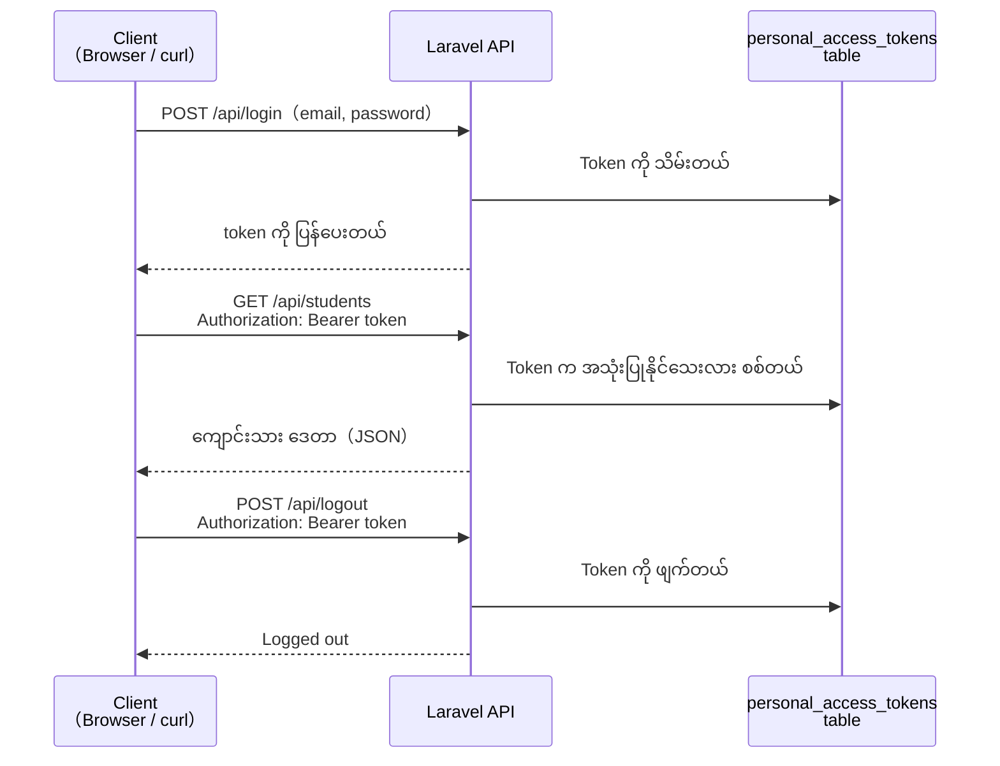
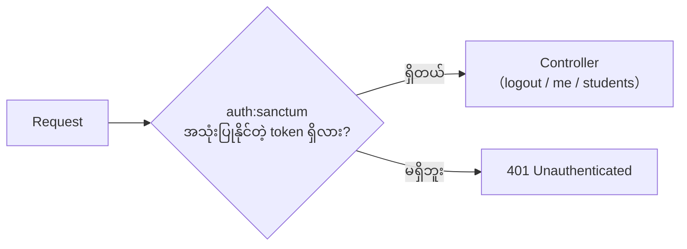

# Laravel ကို REST API အဖြစ် ပြောင်းခြင်း

> 🇯🇵 မူရင်း (ဂျပန်ဘာသာဖြင့်): [20260521.md](<../../../2年生_システム開発実践/前期/2026_05_21/20260521.md>) <!-- original-ja-link -->

---

## အတန်းချိန် 05：Resource controller နဲ့ CRUD API ကို စနစ်တကျ စီစဉ်ခြင်း

### API Resource — Response ပုံစံကို သပ်ရပ်အောင် လုပ်ခြင်း

```bash
php artisan make:resource StudentResource
```

```php
// app/Http/Resources/StudentResource.php
class StudentResource extends JsonResource
{
    public function toArray(Request $request): array
    {
        return [
            'id'         => $this->id,
            'name'       => $this->name,
            'email'      => $this->email,
            'score'      => $this->score,
            'evaluation' => $this->score >= 80 ? 'A' : 'B',  // တွက်ချက်ထားတဲ့ တန်ဖိုးကိုလည်း ထည့်လို့ရတယ်
            'created_at' => $this->created_at->format('Y/m/d'),
            // မလိုအပ်တဲ့ field (password စသည်) တွေကို မထည့်ဘူး
        ];
    }
}
```

**Controller မှာ သုံးမယ်:**

```php
use App\Http\Resources\StudentResource;
use App\Http\Resources\StudentCollection;

public function index()
{
    $students = Student::all();
    return StudentResource::collection($students);
    // → အားလုံးကို Resource နဲ့ ထုပ်ပိုးပြီး ပြန်ပေးတယ်
}

public function show($id)
{
    return new StudentResource(Student::findOrFail($id));
}
```

---

## အတန်းချိန် 06：API response ပုံစံကို တစ်ပြေးညီ ဖြစ်အောင် လုပ်ခြင်း

### API response ပုံစံရဲ့ best practice

```json
// အောင်မြင်တဲ့အခါ
{
    "status": "ok",
    "data": { ... }
}

// Error ဖြစ်တဲ့အခါ
{
    "status": "error",
    "message": "Not found",
    "errors": {
        "email": ["このメールアドレスは既に使われています"]
    }
}
```

---

## အတန်းချိန် 07：Sanctum နဲ့ token authentication

### Sanctum ဆိုတာ

Laravel ရဲ့ **API authentication package** ပါ။  
Token (စကားဝှက် တစ်မျိုး) ကို သုံးပြီး login အခြေအနေကို စီမံပါတယ်။

Login ဝင်ချိန်မှ logout လုပ်ချိန်အထိ ဆက်သွယ်ဆောင်ရွက်ပုံမှာ အောက်ပါအတိုင်း ဖြစ်ပါတယ်။



```bash
composer require laravel/sanctum
php artisan vendor:publish --provider="Laravel\Sanctum\SanctumServiceProvider"
php artisan migrate
```

**Authentication API ကို ရေးခြင်း:**

```php
// app/Http/Controllers/Api/AuthController.php
class AuthController extends Controller
{
    // POST /api/login
    public function login(Request $request)
    {
        $request->validate([
            'email'    => 'required|email',
            'password' => 'required',
        ]);
        
        // Email・password ကို စစ်ဆေးတယ်
        if (!Auth::attempt($request->only('email', 'password'))) {
            return response()->json([
                'status'  => 'error',
                'message' => 'メールアドレスまたはパスワードが違います',
            ], 401);
        }
        
        $user = Auth::user();
        
        // Token ကို ထုတ်ပေးတယ်
        $token = $user->createToken('api-token')->plainTextToken;
        
        return response()->json([
            'status' => 'ok',
            'token'  => $token,
            'user'   => $user,
        ]);
    }
    
    // POST /api/logout
    public function logout(Request $request)
    {
        // လက်ရှိ token ကို ဖျက်တယ်
        $request->user()->currentAccessToken()->delete();
        
        return response()->json(['status' => 'ok', 'message' => 'Logged out']);
    }
    
    // GET /api/me
    public function me(Request $request)
    {
        return response()->json(['status' => 'ok', 'user' => $request->user()]);
    }
}
```

---

## အတန်းချိန် 08：Authentication middleware・ခွင့်ပြုချက် စီမံခြင်း

`auth:sanctum` middleware က controller ရဲ့ ရှေ့မှာ 「token ရှိလား」 ဆိုတာကို စစ်ဆေးပေးတဲ့ ဂိတ်စောင့်ပါ။



```php
// routes/api.php

// Authentication မလိုတဲ့ route တွေ
Route::post('/login', [AuthController::class, 'login']);
Route::post('/register', [AuthController::class, 'register']);

// Authentication လိုအပ်တဲ့ route တွေ（auth:sanctum）
Route::middleware('auth:sanctum')->group(function () {
    Route::post('/logout', [AuthController::class, 'logout']);
    Route::get('/me', [AuthController::class, 'me']);
    Route::apiResource('students', StudentController::class);
});
```

**API ကို test လုပ်နည်း (curl command):**

```bash
# Login
curl -X POST http://localhost:8000/api/login \
  -H "Content-Type: application/json" \
  -d '{"email":"test@example.com","password":"password"}'
# → {"token": "1|abc123..."}

# Authentication လိုအပ်တဲ့ API ကို ခေါ်ကြည့်တယ်
curl http://localhost:8000/api/students \
  -H "Authorization: Bearer 1|abc123..."
```

---

## အနှစ်ချုပ်

| သဘောတရား | Blade（ပထမနှစ်） | API（ဒုတိယနှစ်） |
|------|-------------|------------|
| Response | HTML（view） | JSON（response()->json()） |
| Routing | routes/web.php | routes/api.php |
| Authentication | Session | Sanctum token |
| မျက်နှာပြင် | Blade က ပြန်ပေးတယ် | Frontend က ဖန်တီးတယ် |
