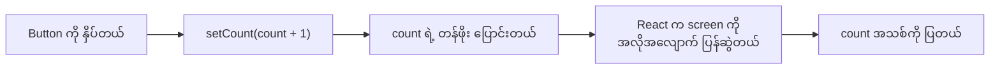
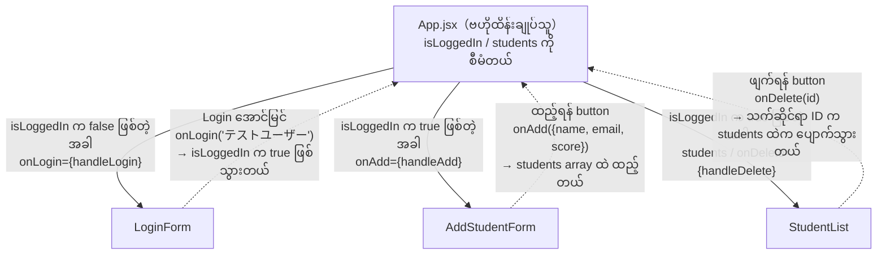

# အတန်းချိန် ၁၆｜React အခြေခံ — Component・JSX・props・useState

> 🇯🇵 မူရင်း (ဂျပန်ဘာသာဖြင့်): [2026_06_11.md](<../../../2年生_システム開発実践/前期/2026_06_11/2026_06_11.md>) <!-- original-ja-link -->

## ယနေ့ ပန်းတိုင်
- JSX ရေးနည်းကို နားလည်မယ်
- Component တွေ ဖန်တီးပြီး အသုံးပြုနိုင်မယ်
- `props` နဲ့ ဒေတာ ပေးပို့နိုင်မယ်
- `useState` နဲ့ state ကို စီမံနိုင်မယ်

> **ဒီသင်ခန်းစာရဲ့ နေရာ：** နောက်တစ်ကြိမ် သင်မယ့် Next.js ရဲ့ "အုတ်မြစ်" အဖြစ် လေ့လာပါမယ်။  
> "JSX ဆိုတာ ဘာလဲ・ဘာကြောင့် component တွေ ခွဲရေးတာလဲ" ကို နားလည်ဖို့ ရည်ရွယ်ပါတယ်။

---

## 0. React ပတ်ဝန်းကျင် တည်ဆောက်ခြင်း (ပထမဆုံးအကြိမ်သာ!)

### 0-1. Node.js ထည့်သွင်းထားခြင်း ရှိ/မရှိ စစ်ဆေးခြင်း

ပထမဆုံး **Node.js** ထည့်သွင်းထားလား စစ်ဆေးပါမယ်။  
Terminal (VSCode ရဲ့ terminal) မှာ အောက်က command ကို run ပါ။

```bash
node -v
```

Version နံပါတ် ပေါ်လာရင် OK ပါ (ဥပမာ: `v20.11.0`)။  
`command not found` ပေါ်လာရင် Node.js ကို အရင် ထည့်သွင်းပါ။

> **Node.js ထည့်သွင်းနည်း：** https://nodejs.org/ ကနေ **LTS version** (အကြံပြုထားသော version) ကို download လုပ်ပါ

---

### 0-2. React project ဖန်တီးခြင်း (Vite ကို သုံးမယ်)

Terminal မှာ **project ဖန်တီးချင်တဲ့ folder** ထဲကို အရင်ရွှေ့ပြီးမှ အောက်က command ကို run ပါ။

```bash
npm create vite@latest my-app -- --template react
```

> `my-app` နေရာက project အမည်ပါ။ ကြိုက်တဲ့ အမည်ကို ပြောင်းလို့ရပါတယ် (ဥပမာ: `react-practice`)

Run လိုက်ရင် အောက်ပါ message တွေ ပေါ်လာမှာဖြစ်လို့ Enter နှိပ်ပြီး ဆက်သွားပါ။

```
✔ Select a framework: › React
✔ Select a variant: › JavaScript
```

---

### 0-3. လိုအပ်တဲ့ package တွေ ထည့်သွင်းပြီး စတင် run ခြင်း

Project ဖန်တီးပြီးရင် အောက်ပါ အစီအစဉ်အတိုင်း command တွေကို run ပါ။

```bash
# ① ဖန်တီးထားတဲ့ folder ထဲကို ရွှေ့မယ်
cd my-app

# ② လိုအပ်တဲ့ package တွေကို တစ်ခါတည်း ထည့်သွင်းမယ်
npm install

# ③ Development server ကို စတင်မယ်
npm run dev
```

Terminal မှာ အောက်ပါလိုမျိုး ပေါ်လာရင် အောင်မြင်ပါပြီ!

```
  VITE v5.x.x  ready in xxx ms

  ➜  Local:   http://localhost:5173/
```

Browser မှာ `http://localhost:5173/` ကို ဖွင့်လိုက်ရင် React ရဲ့ နမူနာ စာမျက်နှာ ပေါ်လာပါမယ်။

> **Server ကို ရပ်ချင်ရင်：** Terminal မှာ `Ctrl + C` ကို နှိပ်ပါ

---

### 0-4. Folder ဖွဲ့စည်းပုံကို ကြည့်ကြရအောင်

```
my-app/
├── public/          # ပုံတွေလို static file တွေ ထားတဲ့နေရာ
├── src/             # ← အဓိက ဒီနေရာကို ပြင်ရေးမယ်!
│   ├── App.jsx      # အဓိက component (ပထမဆုံး ပြင်ရမယ့် file)
│   ├── App.css      # App.jsx ရဲ့ style
│   ├── main.jsx     # App စတင်တဲ့နေရာ (အခြေခံအားဖြင့် မပြင်ပါနဲ့)
│   └── index.css    # တစ်ခုလုံးအတွက် style
├── index.html       # App ရဲ့ HTML template
└── package.json     # Project setting・အသုံးပြုတဲ့ package စာရင်း
```

**ပထမဆုံး ပြင်ရမှာက `src/App.jsx` တစ်ခုတည်းပဲ ဖြစ်ပါတယ်!**

---

### 0-5. App.jsx ကို ပြင်ရေးကြည့်ကြရအောင်

`src/App.jsx` ကို ဖွင့်ပြီး ပါဝင်တာတွေ အားလုံးကို ဖျက်ကာ အောက်က code နဲ့ အစားထိုးရေးကြည့်ပါ။

```jsx
function App() {
  return (
    <div>
      <h1>はじめての React！</h1>
      <p>環境構築できました！</p>
    </div>
  );
}

export default App;
```

Save လုပ်လိုက်တာနဲ့ browser က အလိုအလျောက် update ဖြစ်သွားပါမယ် (hot reload)။  
"はじめての React！" (ပထမဆုံး React!) လို့ ပေါ်လာရင် အဆင်သင့် ဖြစ်ပါပြီ!

---

## 1. React ဆိုတာ ဘာလဲ

**React = UI ကို "component (အစိတ်အပိုင်း)" တွေနဲ့ တည်ဆောက်တဲ့ JavaScript library**

```
ယခင် HTML + JavaScript：
  <div id="app"></div>
  document.getElementById("app").innerHTML = "...";
  → စာမျက်နှာ များလာရင် စီမံရတာ ခက်လာတယ်

React：
  <Button label="送信" />  ← ပြန်သုံးလို့ရတဲ့ အစိတ်အပိုင်း
  <Card title="タイトル" body="内容" />
  → အစိတ်အပိုင်းတွေကို ပေါင်းစပ်ပြီး စာမျက်နှာ တည်ဆောက်တယ်
```

---

## 2. JSX — JavaScript ထဲမှာ HTML ရေးခြင်း

> **ဘယ်အချိန်မှာ သုံးလဲ？** HTML တစ်ခုတည်းနဲ့ဆိုရင် variable ရဲ့ တန်ဖိုးကို တိုက်ရိုက် ရေးလို့မရပါဘူး။ JSX ကို သုံးရင် `{variable အမည်}` နဲ့ တန်ဖိုးကို အချိန်နှင့်တစ်ပြေးညီ ထည့်ပြနိုင်ပါတယ်။ အသုံးပြုသူအမည်・ရက်စွဲ・တွက်ချက်မှုရလဒ် စတဲ့ "ပြောင်းလဲနိုင်တဲ့ တန်ဖိုး" တွေကို ပြချင်တဲ့အခါ သုံးပါတယ်။  
> **စစ်ဆေးရမယ့်အချက်：** `namae` ကို ကိုယ့်နာမည်နဲ့ ပြောင်းပြီး save လုပ်ပါ → screen အလိုအလျောက် update ဖြစ်လား စစ်ပါ။ `{1 + 1}` က `2` လို့ ပေါ်နေလား စစ်ပါ။

```jsx
// ▼ src/App.jsx မှာ ရေးကြည့်ပါ (file ထဲက ပါဝင်တာတွေ အားလုံးဖျက်ပြီး အောက်ပါအတိုင်း အစားထိုးပါ)

// JSX = JavaScript + XML (HTML နဲ့ ဆင်တူတဲ့ ရေးနည်း)

// ပုံမှန် function (component)
function Hello() {
  // JSX ကို return ပြန်ပေးမယ်
  return (
    <div>
      <h1>こんにちは！</h1>
      <p>React を始めよう</p>
    </div>
  );
}

// JavaScript expression တွေကို {} နဲ့ ထည့်မယ်
function Greeting() {
  const namae = "田中太郎";
  const today = new Date().toLocaleDateString("ja-JP");
  
  return (
    <div>
      <h1>こんにちは、{namae}さん！</h1>
      <p>今日は {today} です</p>
      <p>1 + 1 = {1 + 1}</p>
    </div>
  );
}

export default Greeting;
```

**JSX မှာ သတိထားရမယ့်အချက်များ：**

> **ဘယ်အချိန်မှာ သုံးလဲ？** JSX ရေးနေရင်း error တက်တဲ့အခါ ဒီစည်းမျဉ်း ၃ ခုက အကြောင်းရင်း ဖြစ်တတ်ပါတယ်။ အနီရောင် error ပေါ်လာရင် ဒီနေရာကို ပြန်လာပြီး တိုက်စစ်ကြည့်ပါ။

```jsx
// ▼ ရေးနည်း ကိုးကားမှတ်စု (ဒါတစ်ခုတည်းနဲ့ run လို့မရပါ・ဖတ်ပြီး မှတ်ထားပါ)

// ① class အစား className ကို သုံးပါ (class က JS ရဲ့ reserved word ဖြစ်လို့)
<div className="container">

// ② Element အားလုံးကို ပိတ်ရပါမယ်
<input type="text" />  // Self-closing tag

// ③ Element အများကို parent တစ်ခုတည်းနဲ့ ဝိုင်းထားရပါမယ်
return (
  <div>
    <h1>タイトル</h1>
    <p>内容</p>
  </div>
);
// ဒါမှမဟုတ် Fragment（<></>) ကို သုံးပါ
return (
  <>
    <h1>タイトル</h1>
    <p>内容</p>
  </>
);
```

---

## 3. props — Component ကို ဒေတာ ပေးပို့ခြင်း

> **ဘယ်အချိန်မှာ သုံးလဲ？** ဒီဇိုင်းတူပြီး "ဒေတာပဲ မတူတဲ့" card တွေ ဒါမှမဟုတ် row တွေကို အများအပြား ပြချင်တဲ့အခါ။ Component တစ်ခု ရေးထားရုံနဲ့ ပေးပို့တဲ့ ဒေတာကို ပြောင်းရုံဖြင့် အကြိမ်ကြိမ် ပြန်သုံးနိုင်ပါတယ်။  
> **စစ်ဆေးရမယ့်အချက်：** `passed={false}` ပါတဲ့ StudentCard ရဲ့ နောက်ခံအရောင်က လိမ္မော်ရောင်ဘက် ဖြစ်လား စစ်ပါ။ ၄ ယောက်မြောက် `<StudentCard>` ကို ကိုယ်တိုင် ထည့်ကြည့်ပါ။

```jsx
// ▼ src/App.jsx မှာ ရေးကြည့်ပါ (file ထဲက ပါဝင်တာတွေ အားလုံးဖျက်ပြီး အောက်ပါအတိုင်း အစားထိုးပါ)

// props = component ကို ပေးတဲ့ "argument"

// Component သတ်မှတ်ခြင်း (props ကို လက်ခံတယ်)
function StudentCard({ name, score, passed }) {
  return (
    <div style={{
      border: "1px solid #ddd",
      padding: "16px",
      margin: "8px",
      backgroundColor: passed ? "#e3f2fd" : "#fbe9e7"
    }}>
      <h3>{name}</h3>
      <p>点数: {score}点</p>
      <span>{passed ? "✅ 合格" : "❌ 不合格"}</span>
    </div>
  );
}

// အသုံးပြုပုံ (parent component)
function App() {
  return (
    <div>
      <StudentCard name="田中太郎" score={85} passed={true} />
      <StudentCard name="鈴木花子" score={45} passed={false} />
      <StudentCard name="山田次郎" score={91} passed={true} />
    </div>
  );
}

export default App;
```

---

## 4. useState — State စီမံခြင်း

> **ဘယ်အချိန်မှာ သုံးလဲ？** Button နှိပ်ခြင်း・စာရိုက်ခြင်း・ရွေးချယ်ခြင်း စတဲ့ "အသုံးပြုသူရဲ့ လုပ်ဆောင်ချက်ကြောင့် ပြောင်းလဲတဲ့ တန်ဖိုး" ကို screen ပေါ်မှာ ချက်ချင်း ပြချင်တဲ့အခါ။ `count` လို "ပြောင်းလဲတဲ့ တန်ဖိုး" ကို `useState` နဲ့ အမြဲ စီမံရပါမယ်။ ပုံမှန် variable (`let count = 0`) နဲ့ဆိုရင် screen က update မဖြစ်ပါဘူး။  
> **စစ်ဆေးရမယ့်အချက်：** `+1` ကို ၅ ကြိမ် နှိပ်ပြီး ဂဏန်း တိုးလာလား စစ်ပါ။ `リセット` (Reset) နဲ့ 0 ပြန်ဖြစ်လား စစ်ပါ။ စာမျက်နှာ reload မဖြစ်တာကိုလည်း စစ်ပါ။

```jsx
// ▼ src/App.jsx မှာ ရေးကြည့်ပါ (file ထဲက ပါဝင်တာတွေ အားလုံးဖျက်ပြီး အောက်ပါအတိုင်း အစားထိုးပါ)
import { useState } from "react";

function Counter() {
  // useState(ကနဦးတန်ဖိုး) → [လက်ရှိတန်ဖိုး, တန်ဖိုးပြောင်းတဲ့ function]
  const [count, setCount] = useState(0);
  
  return (
    <div>
      <p>カウント: {count}</p>
      
      {/* Button နှိပ်တိုင်း count တိုးလာမယ် */}
      <button onClick={() => setCount(count + 1)}>+1</button>
      <button onClick={() => setCount(count - 1)}>-1</button>
      <button onClick={() => setCount(0)}>リセット</button>
    </div>
  );
}

export default Counter;
```

`setCount` ကို ခေါ်လိုက်တာနဲ့ React က screen ကို ပြန်ဆွဲပေးတဲ့ လုပ်ငန်းစဉ်ကို ပုံနဲ့ ပြရရင် အောက်ပါအတိုင်း ဖြစ်ပါတယ်။



---

## 5. List ကို render လုပ်ခြင်း

> **ဘယ်အချိန်မှာ သုံးလဲ？** ကုန်ပစ္စည်းစာရင်း・ကျောင်းသားစာရင်း・comment ကဏ္ဍ စတဲ့ "array ဒေတာကို ထပ်ခါထပ်ခါ ပြချင်တဲ့" အခါ အမြဲသုံးတဲ့ ပုံစံပါ။ ဒေတာ များလာရင် ပြတာလည်း အလိုအလျောက် များလာပါတယ်။  
> **စစ်ဆေးရမယ့်အချက်：** `students` array ထဲကို ၄ ယောက်မြောက် ထည့်ကြည့်ပါ → `<li>` အလိုအလျောက် တိုးလာလား စစ်ပါ။ `key={student.id}` ကို ဖျက်ပြီး browser ရဲ့ console (F12) မှာ warning ပေါ်လာတာကိုလည်း စစ်ကြည့်ပါ။

```jsx
// ▼ src/App.jsx မှာ ရေးကြည့်ပါ (file ထဲက ပါဝင်တာတွေ အားလုံးဖျက်ပြီး အောက်ပါအတိုင်း အစားထိုးပါ)
function StudentList() {
  const students = [
    { id: 1, name: "田中太郎", score: 85 },
    { id: 2, name: "鈴木花子", score: 72 },
    { id: 3, name: "山田次郎", score: 91 },
  ];
  
  return (
    <ul>
      {/* Array ရဲ့ map နဲ့ element တွေကို ဖန်တီးမယ် */}
      {/* key က React က ကွာခြားချက်ကို သိဖို့ လိုအပ်တယ် (loop ထဲမှာ အမြဲထည့်ပါ) */}
      {students.map((student) => (
        <li key={student.id}>
          {student.name} - {student.score}点
        </li>
      ))}
    </ul>
  );
}

export default StudentList;
```

---

## 6. Form နဲ့ Event

> **ဘယ်အချိန်မှာ သုံးလဲ？** ရှာဖွေခြင်း・login・ဒေတာထည့်ခြင်း စတဲ့ "အသုံးပြုသူ ထည့်လိုက်တဲ့ တန်ဖိုးကို ယူပြီး လုပ်ဆောင်ချင်တဲ့" အခါ။ `onChange` နဲ့ ထည့်သွင်းထားတဲ့ တန်ဖိုး ပြောင်းတိုင်း state ကို update လုပ်ပြီး၊ `onSubmit` နဲ့ button နှိပ်တဲ့အခါ သက်ဆိုင်ရာ လုပ်ဆောင်ချက်ကို လုပ်ပါတယ်။  
> **စစ်ဆေးရမယ့်အချက်：** တစ်ခုခု ရိုက်ထည့်ပြီး "検索" (ရှာဖွေရန်) ကို နှိပ်ရင် ရလဒ်စာသား ပေါ်လာလား စစ်ပါ။ `e.preventDefault()` ကို comment out လုပ်ပြီး (`//` ထည့်ပြီး) submit လုပ်တဲ့အခါ စာမျက်နှာ reload ဖြစ်သွားတာကိုလည်း စစ်ကြည့်ပါ။

```jsx
// ▼ src/App.jsx မှာ ရေးကြည့်ပါ (file ထဲက ပါဝင်တာတွေ အားလုံးဖျက်ပြီး အောက်ပါအတိုင်း အစားထိုးပါ)
import { useState } from "react";

function SearchForm() {
  const [query, setQuery] = useState("");
  const [result, setResult] = useState(null);
  
  function handleSubmit(e) {
    e.preventDefault();  // စာမျက်နှာ reload ဖြစ်တာကို တားမယ်
    setResult(`"${query}" を検索しました`);
  }
  
  return (
    <form onSubmit={handleSubmit}>
      <input
        type="text"
        value={query}
        onChange={(e) => setQuery(e.target.value)}
        // onChange = input ပြောင်းတိုင်း setQuery နဲ့ state ကို update လုပ်မယ်
        placeholder="検索キーワード"
      />
      <button type="submit">検索</button>
      {result && <p>{result}</p>}
    </form>
  );
}

export default SearchForm;
```

---

## 7. လက်တွေ့လေ့ကျင့်ခန်း — Mock ဒေတာနဲ့ ကျောင်းသားစီမံခန့်ခွဲမှု App ဖန်တီးကြရအောင်

အခုထိ လေ့လာခဲ့တဲ့ JSX・component・props・useState အားလုံးကို သုံးပြီး  
**"ကျောင်းသားစီမံခန့်ခွဲမှု App"** ကို ဖန်တီးပါမယ်။

> **Mock ဆိုတာ ဘာလဲ？**  
> တကယ့် API အစား code ထဲမှာ ရေးထားတဲ့ ဒေတာကို သုံးတာ ဖြစ်ပါတယ်။  
> "API မပါဘဲ screen ဖန်တီးတဲ့ လေ့ကျင့်ခန်း" ပါ။  
> နောက်တစ်ကြိမ် (Next.js) မှာ ဒီ screen ကိုပဲ တကယ့် API နဲ့ ပြောင်းချိတ်ပါမယ်။

---

### 7-1. ပြီးစီးသွားမည့် ပုံစံ

```
【Login မဝင်ခင်】
┌──────────────────────────┐
│  ログイン                 │
│                          │
│  [メールアドレス        ] │
│  [パスワード            ] │
│  [    ログイン          ] │
│                          │
│  ※ test@example.com     │
│     / password           │
└──────────────────────────┘

【Login ဝင်ပြီးနောက်】
┌──────────────────────────────────────────────────┐
│ 生徒管理アプリ（React Mock版） ● ログイン中  [ログアウト] │
├──────────────────────────────────────────────────┤
│ 新規追加                                          │
│ [名前] [メールアドレス] [点数] [追加]               │
├──────────────────────────────────────────────────┤
│ 生徒一覧（3件）                                    │
│ ID │ 名前     │ メール              │ 点数 │      │
│  1 │ 田中太郎 │ tanaka@example.com │  85  │ 削除 │
│  2 │ 山田花子 │ yamada@example.com │  72  │ 削除 │
└──────────────────────────────────────────────────┘
```

---

### 7-2. File ဖွဲ့စည်းပုံ

`src/` ထဲမှာ `components/` folder ကို ဖန်တီးပြီး component တွေကို ခွဲထားပါမယ်။

```
src/
├── App.jsx                      ← အဓိက (state အားလုံးကို စုစည်းစီမံတယ်)
├── components/
│   ├── LoginForm.jsx            ← Login form
│   ├── StudentList.jsx          ← ကျောင်းသားစာရင်း table
│   └── AddStudentForm.jsx       ← ကျောင်းသားထည့်တဲ့ form
└── main.jsx                     ← မပြင်ပါနဲ့
```

VSCode မှာ `src/` folder ကို right-click နှိပ် → `New Folder` → `components` လို့ ရိုက်ပြီး Enter နှိပ်ပါ။

---

### 7-3. Step 1｜LoginForm.jsx ဖန်တီးခြင်း

`src/components/LoginForm.jsx` ကို အသစ်ဖန်တီးပြီး အောက်ပါ code ကို copy ကူးပြီး paste လုပ်ပါ။

```jsx
import { useState } from "react";

// Mock အတွက် ပုံသေ login အချက်အလက် (တကယ့် API အစား)
const MOCK_EMAIL = "test@example.com";
const MOCK_PASSWORD = "password";
const MOCK_NAME = "テストユーザー";

// onLogin = login အောင်မြင်တဲ့အခါ App.jsx က ပေးပို့ထားတဲ့ function
function LoginForm({ onLogin }) {
  const [email, setEmail] = useState("test@example.com");
  const [password, setPassword] = useState("password");
  const [error, setError] = useState("");

  function handleSubmit(e) {
    e.preventDefault(); // စာမျက်နှာ reload ဖြစ်တာကို တားမယ်

    // ထည့်လိုက်တဲ့ တန်ဖိုးက mock အချက်အလက်နဲ့ ကိုက်ညီရင် login အောင်မြင်တယ်
    if (email === MOCK_EMAIL && password === MOCK_PASSWORD) {
      onLogin(MOCK_NAME); // Parent component ကို အသုံးပြုသူအမည် ပေးပို့မယ်
    } else {
      setError("メールアドレスまたはパスワードが違います");
    }
  }

  return (
    <div style={{
      maxWidth: "400px", margin: "80px auto",
      background: "white", padding: "32px",
      borderRadius: "8px", boxShadow: "0 2px 8px rgba(0,0,0,0.1)"
    }}>
      <h2 style={{ marginBottom: "24px", textAlign: "center" }}>ログイン</h2>

      <form onSubmit={handleSubmit}>
        <div style={{ marginBottom: "16px" }}>
          <label style={{ display: "block", marginBottom: "6px", fontWeight: "bold" }}>
            メールアドレス
          </label>
          <input
            type="email"
            value={email}
            onChange={(e) => setEmail(e.target.value)}
            style={{ width: "100%", padding: "10px", border: "1px solid #ccc", borderRadius: "6px", fontSize: "1em", boxSizing: "border-box" }}
          />
        </div>

        <div style={{ marginBottom: "16px" }}>
          <label style={{ display: "block", marginBottom: "6px", fontWeight: "bold" }}>
            パスワード
          </label>
          <input
            type="password"
            value={password}
            onChange={(e) => setPassword(e.target.value)}
            style={{ width: "100%", padding: "10px", border: "1px solid #ccc", borderRadius: "6px", fontSize: "1em", boxSizing: "border-box" }}
          />
        </div>

        {/* error က အလွတ်မဟုတ်မှသာ error ကို ပြမယ် */}
        {error && (
          <p style={{ color: "#D32F2F", fontSize: "0.9em", marginBottom: "12px" }}>
            {error}
          </p>
        )}

        <button
          type="submit"
          style={{ width: "100%", padding: "12px", background: "#1976D2", color: "white", border: "none", borderRadius: "6px", fontSize: "1em", fontWeight: "bold", cursor: "pointer" }}
        >
          ログイン
        </button>
      </form>

      <p style={{ marginTop: "16px", fontSize: "0.85em", color: "#888", textAlign: "center" }}>
        ※ Mock用: test@example.com / password
      </p>
    </div>
  );
}

export default LoginForm;
```

---

### 7-4. Step 2｜StudentList.jsx ဖန်တီးခြင်း

`src/components/StudentList.jsx` ကို အသစ်ဖန်တီးပြီး အောက်ပါ code ကို copy ကူးပြီး paste လုပ်ပါ။

```jsx
// StudentList：ကျောင်းသားစာရင်း table တစ်ခုလုံး
// students = ကျောင်းသားဒေတာ array (parent ကနေ ပေးပို့လာတယ်)
// onDelete = ဖျက်ရန် button နှိပ်တဲ့အခါ ခေါ်မယ့် function (parent ကနေ ပေးပို့လာတယ်)
function StudentList({ students, onDelete }) {
  return (
    <div style={{ background: "white", borderRadius: "8px", padding: "24px", boxShadow: "0 2px 8px rgba(0,0,0,0.05)" }}>
      <h2 style={{ marginBottom: "16px", fontSize: "1.1em" }}>
        生徒一覧
        <span style={{ color: "#888", fontWeight: "normal", fontSize: "0.85em" }}>
          （{students.length}件）
        </span>
      </h2>

      {/* ကျောင်းသား 0 ယောက်ဆိုရင် "မှတ်ပုံတင်ထားခြင်းမရှိ" message ကို ပြမယ် */}
      {students.length === 0 ? (
        <p style={{ color: "#888", textAlign: "center", padding: "24px" }}>
          生徒が登録されていません
        </p>
      ) : (
        <table style={{ width: "100%", borderCollapse: "collapse" }}>
          <thead>
            <tr style={{ background: "#f5f5f5" }}>
              <th style={thStyle}>ID</th>
              <th style={thStyle}>名前</th>
              <th style={thStyle}>メール</th>
              <th style={thStyle}>点数</th>
              <th style={thStyle}></th>
            </tr>
          </thead>
          <tbody>
            {/* Array ထဲက ကျောင်းသားတစ်ယောက်ချင်းစီကို StudentRow component နဲ့ ပြမယ် */}
            {students.map((student) => (
              <StudentRow
                key={student.id}
                student={student}
                onDelete={onDelete}
              />
            ))}
          </tbody>
        </table>
      )}
    </div>
  );
}

// StudentRow：Table ရဲ့ row တစ်ကြောင်းစာ
function StudentRow({ student, onDelete }) {
  function handleDelete() {
    // အတည်ပြု dialog ကို ပြပြီးမှ ဖျက်မယ်
    if (window.confirm(`${student.name} を削除しますか？`)) {
      onDelete(student.id); // Parent ကို "ဒီ ID ကို ဖျက်ပေးပါ" လို့ ပြောမယ်
    }
  }

  return (
    <tr style={{ borderBottom: "1px solid #eee" }}>
      <td style={tdStyle}>{student.id}</td>
      <td style={tdStyle}>{student.name}</td>
      <td style={tdStyle}>{student.email}</td>
      <td style={tdStyle}>{student.score}</td>
      <td style={tdStyle}>
        <button
          onClick={handleDelete}
          style={{ background: "#D32F2F", color: "white", border: "none", borderRadius: "4px", padding: "4px 12px", cursor: "pointer", fontSize: "0.85em" }}
        >
          削除
        </button>
      </td>
    </tr>
  );
}

// Style constant (ထပ်ခါထပ်ခါ သုံးတဲ့ style တွေကို စုထားမယ်)
const thStyle = { padding: "10px 16px", textAlign: "left", fontWeight: "bold", fontSize: "0.9em" };
const tdStyle = { padding: "12px 16px", fontSize: "0.95em" };

export default StudentList;
```

---

### 7-5. Step 3｜AddStudentForm.jsx ဖန်တီးခြင်း

`src/components/AddStudentForm.jsx` ကို အသစ်ဖန်တီးပြီး အောက်ပါ code ကို copy ကူးပြီး paste လုပ်ပါ။

```jsx
import { useState } from "react";

// onAdd = ထည့်ရန် button နှိပ်တဲ့အခါ ခေါ်မယ့် function (parent ကနေ ပေးပို့လာတယ်)
function AddStudentForm({ onAdd }) {
  const [name, setName] = useState("");
  const [email, setEmail] = useState("");
  const [score, setScore] = useState("");
  const [error, setError] = useState("");

  function handleSubmit(e) {
    e.preventDefault();
    setError(""); // Error ကို reset လုပ်မယ်

    // Validation (ထည့်သွင်းချက် စစ်ဆေးခြင်း)
    if (!name || !email || !score) {
      setError("すべての項目を入力してください");
      return;
    }
    if (Number(score) < 0 || Number(score) > 100) {
      setError("点数は0〜100の数値を入力してください");
      return;
    }

    // Parent component ကို ကျောင်းသားဒေတာအသစ် ပေးပို့မယ်
    onAdd({ name, email, score: Number(score) });

    // Form ကို reset လုပ်မယ်
    setName("");
    setEmail("");
    setScore("");
  }

  return (
    <div style={{ background: "white", borderRadius: "8px", padding: "24px", boxShadow: "0 2px 8px rgba(0,0,0,0.05)", marginBottom: "24px" }}>
      <h2 style={{ marginBottom: "16px", fontSize: "1.1em" }}>新規追加</h2>

      <form onSubmit={handleSubmit} style={{ display: "flex", gap: "12px", alignItems: "flex-end", flexWrap: "wrap" }}>
        <div>
          <label style={labelStyle}>名前</label>
          <input
            type="text"
            value={name}
            onChange={(e) => setName(e.target.value)}
            placeholder="田中太郎"
            style={inputStyle}
          />
        </div>
        <div>
          <label style={labelStyle}>メールアドレス</label>
          <input
            type="email"
            value={email}
            onChange={(e) => setEmail(e.target.value)}
            placeholder="tanaka@example.com"
            style={inputStyle}
          />
        </div>
        <div>
          <label style={labelStyle}>点数</label>
          <input
            type="number"
            value={score}
            onChange={(e) => setScore(e.target.value)}
            placeholder="85"
            min="0"
            max="100"
            style={{ ...inputStyle, width: "80px" }}
          />
        </div>
        <button
          type="submit"
          style={{ padding: "10px 20px", background: "#1976D2", color: "white", border: "none", borderRadius: "6px", fontWeight: "bold", cursor: "pointer", fontSize: "0.95em" }}
        >
          追加
        </button>
      </form>

      {error && (
        <p style={{ color: "#D32F2F", marginTop: "10px", fontSize: "0.9em" }}>{error}</p>
      )}
    </div>
  );
}

const labelStyle = { display: "block", marginBottom: "4px", fontSize: "0.85em", fontWeight: "bold" };
const inputStyle = { padding: "9px 12px", border: "1px solid #ccc", borderRadius: "6px", fontSize: "0.95em", width: "180px" };

export default AddStudentForm;
```

---

### 7-6. Step 4｜App.jsx မှာ အားလုံးကို ချိတ်ဆက်ခြင်း

`src/App.jsx` ကို ဖွင့်ပြီး **ပါဝင်တာတွေ အားလုံးကို ဖျက်ကာ** အောက်ပါအတိုင်း အစားထိုးရေးပါ။

```jsx
import { useState } from "react";
import LoginForm from "./components/LoginForm";
import StudentList from "./components/StudentList";
import AddStudentForm from "./components/AddStudentForm";

// အစကတည်းက ပြထားမယ့် mock ဒေတာ
const INITIAL_STUDENTS = [
  { id: 1, name: "田中太郎", email: "tanaka@example.com", score: 85 },
  { id: 2, name: "山田花子", email: "yamada@example.com", score: 72 },
  { id: 3, name: "山田次郎", email: "jiro@example.com", score: 91 },
];

function App() {
  // Login အခြေအနေကို စီမံမယ်
  const [isLoggedIn, setIsLoggedIn] = useState(false);
  const [userName, setUserName] = useState("");

  // ကျောင်းသားစာရင်းကို စီမံမယ်
  const [students, setStudents] = useState(INITIAL_STUDENTS);
  const [nextId, setNextId] = useState(4); // နောက်ထပ်ထည့်မယ့် ကျောင်းသားရဲ့ ID

  // Login အောင်မြင်တဲ့အခါ：LoginForm က ခေါ်တယ်
  function handleLogin(name) {
    setIsLoggedIn(true);
    setUserName(name);
  }

  // Logout လုပ်တဲ့အခါ
  function handleLogout() {
    setIsLoggedIn(false);
    setUserName("");
  }

  // ကျောင်းသား ထည့်မယ်：AddStudentForm က ခေါ်တယ်
  function handleAdd(newStudent) {
    setStudents([...students, { ...newStudent, id: nextId }]);
    setNextId(nextId + 1);
  }

  // ကျောင်းသား ဖျက်မယ်：StudentList က ခေါ်တယ်
  function handleDelete(id) {
    setStudents(students.filter((s) => s.id !== id));
  }

  return (
    <div style={{ background: "#f4f6f8", minHeight: "100vh" }}>

      {/* Header */}
      <header style={{
        background: "#1565C0", color: "white",
        padding: "16px 32px",
        display: "flex", alignItems: "center"
      }}>
        <h1 style={{ fontSize: "1.2em" }}>生徒管理アプリ（React Mock版）</h1>

        {/* Login ဝင်ထားချိန်မှာသာ header ညာဘက်မှာ အသုံးပြုသူအမည်နဲ့ logout button ကို ပြမယ် */}
        {isLoggedIn && (
          <div style={{ marginLeft: "auto", display: "flex", alignItems: "center", gap: "12px" }}>
            <span style={{ fontSize: "0.9em" }}>● ログイン中：{userName}</span>
            <button
              onClick={handleLogout}
              style={{ background: "#D32F2F", color: "white", border: "none", borderRadius: "6px", padding: "6px 14px", cursor: "pointer" }}
            >
              ログアウト
            </button>
          </div>
        )}
      </header>

      {/* အဓိက content */}
      <main style={{ padding: "32px", maxWidth: "900px", margin: "0 auto" }}>
        {/* isLoggedIn က true ဆိုရင် ကျောင်းသားစီမံခန့်ခွဲမှု screen၊ false ဆိုရင် login screen */}
        {isLoggedIn ? (
          <>
            <AddStudentForm onAdd={handleAdd} />
            <StudentList students={students} onDelete={handleDelete} />
          </>
        ) : (
          <LoginForm onLogin={handleLogin} />
        )}
      </main>

    </div>
  );
}

export default App;
```

---

### 7-7. အလုပ်လုပ်ပုံ စစ်ဆေးခြင်း

Development server ကို စတင်ပြီး browser မှာ စစ်ဆေးပါမယ်။

```bash
npm run dev
```

`http://localhost:5173/` ကို ဖွင့်ပြီး အောက်ပါတို့ကို အစဉ်လိုက် စမ်းကြည့်ပါ။

| စစ်ဆေးရမယ့်အချက် | လုပ်ဆောင်ချက် | မျှော်မှန်းထားတဲ့ ရလဒ် |
|---------|------|------------|
| Login မဝင်ခင် screen | စာမျက်နှာကို ဖွင့်ပါ | Login form ပေါ်လာမယ် |
| Login အောင်မြင်ခြင်း | `test@example.com` / `password` နဲ့ login ဝင်ပါ | Header မှာ "ログイン中" (login ဝင်ထားသည်) ပေါ်ပြီး ကျောင်းသားစာရင်း ပေါ်လာမယ် |
| Login မအောင်မြင်ခြင်း | Password ကို ပြောင်းပြီး login ဝင်ပါ | Error message ပေါ်လာမယ် |
| ကျောင်းသား ထည့်ခြင်း | Form မှာ ဖြည့်ပြီး "追加" (ထည့်ရန်) ကို နှိပ်ပါ | Table မှာ row အသစ် ထပ်တိုးလာမယ် |
| ကျောင်းသား ဖျက်ခြင်း | "削除" (ဖျက်ရန်) button ကို နှိပ်ပါ | အတည်ပြု dialog → OK နှိပ်ရင် row ပျောက်သွားမယ် |
| 0 ယောက် ဖြစ်တဲ့အခါ | အားလုံးကို ဖျက်ပါ | "生徒が登録されていません" (ကျောင်းသား မှတ်ပုံတင်ထားခြင်း မရှိပါ) ပေါ်လာမယ် |
| Logout | "ログアウト" (logout) button ကို နှိပ်ပါ | Login form ကို ပြန်ရောက်မယ် |

---

### 7-8. Code ရဲ့ စီးဆင်းပုံကို စုစည်းကြည့်ခြင်း

အောက်ပုံမှာ မျဉ်းဖြောင့်က "parent → child ကို props ပေးပို့တဲ့" စီးဆင်းမှု၊ မျဉ်းစက်က "child က parent ရဲ့ function ကို ခေါ်ပြီး state ကို ပြောင်းတဲ့" စီးဆင်းမှု ဖြစ်ပါတယ်။



> **အဓိကအချက်：** ဒေတာ (state) ကို `App.jsx` က စုစည်းစီမံပြီး  
> child component တွေကို "ဒေတာ" နဲ့ "လုပ်ဆောင်တဲ့ function" ကို props နဲ့ ပေးပို့တာက React ရဲ့ အခြေခံပုံစံ ဖြစ်ပါတယ်။

---

### 7-9. Next.js နဲ့ ကွာခြားချက် (နောက်သင်ခန်းစာအတွက် ကြိုတင်လေ့လာခြင်း)

| | React (ဒီတစ်ကြိမ်) | Next.js (နောက်တစ်ကြိမ်) |
|--|--|--|
| ဒေတာ ရယူခြင်း | Code ထဲက Mock array | `fetch('/api/students')` နဲ့ Laravel API ကနေ ရယူမယ် |
| Login | ပုံသေတန်ဖိုးနဲ့ တိုက်စစ်မယ် | `POST /api/login` နဲ့ token ရယူမယ် |
| ဖျက်ခြင်း | Array ကို filter နဲ့ update လုပ်မယ် | `DELETE /api/students/{id}` ကို ခေါ်ပြီး ပြန်ရယူမယ် |
| Screen ရဲ့ အသွင်အပြင် | **လုံးဝ အတူတူပဲ** | **လုံးဝ အတူတူပဲ** |

နောက်တစ်ကြိမ်မှာ **ဒီတစ်ကြိမ် ဖန်တီးခဲ့တဲ့ screen ကို ဒီအတိုင်းသုံးပြီး** ဒေတာရယူတဲ့ အပိုင်းကိုပဲ API နဲ့ ပြောင်းချိတ်ပါမယ်။

---

## အနှစ်ချုပ်

| သဘောတရား | ရှင်းလင်းချက် |
|------|------|
| Component | UI ရဲ့ ပြန်သုံးလို့ရတဲ့ အစိတ်အပိုင်း။ Function နဲ့ သတ်မှတ်တယ် |
| JSX | JavaScript ထဲမှာ HTML နဲ့ ဆင်တူတဲ့ ရေးနည်းနဲ့ UI ကို ရေးတယ် |
| props | Parent ကနေ child component ကို ဒေတာ ပေးပို့တယ် |
| useState | Component အတွင်းက state ကို စီမံတယ် |
| key | List ပြတဲ့အခါ element တစ်ခုချင်းစီကို ခွဲခြားသိဖို့ attribute |

---

## နောက်တစ်ကြိမ် (အတန်းချိန် ၁၇) အကြို

Next.js နိဒါန်း ဖြစ်ပါတယ်။  
React အသိပညာကို အသုံးချရင်း App Router・စာမျက်နှာ ဖွဲ့စည်းပုံ・file-based routing ကို လေ့လာပါမယ်။
