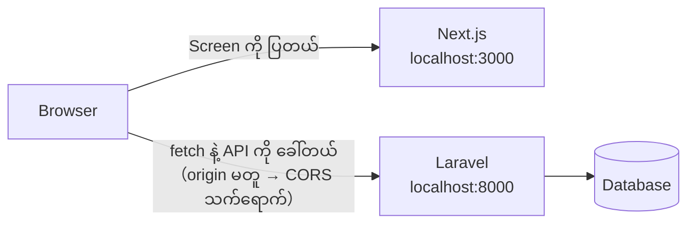
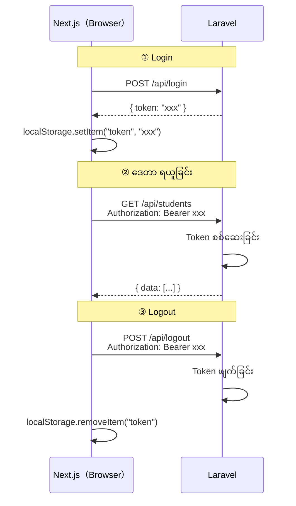

# အတန်းချိန် ၁၇〜၂၂｜Next.js နိဒါန်း → Laravel API နဲ့ ချိတ်ဆက်ခြင်း

> 🇯🇵 မူရင်း (ဂျပန်ဘာသာဖြင့်): [2026_07_02.md](<../../../2年生_システム開発実践/前期/2026_07_02/2026_07_02.md>) <!-- original-ja-link -->

---

## အတန်းချိန် ၁၇：Mock version ကို API နဲ့ ပြောင်းချိတ်ခြင်း

### ယနေ့ ပန်းတိုင်
- Next.js project ကို ဖန်တီးနိုင်မယ်
- App Router ရဲ့ အလုပ်လုပ်ပုံကို နားလည်မယ်
- အတန်းချိန် ၁၆ မှာ ဖန်တီးခဲ့တဲ့ Mock version screen ကို တကယ့် Laravel API နဲ့ ပြောင်းချိတ်နိုင်မယ်

> **ယနေ့ အဓိကအချက်：**  
> အတန်းချိန် ၁၆ မှာ ဖန်တီးခဲ့တဲ့ component တွေ (LoginForm・StudentList・AddStudentForm) ကို  
> **အများအားဖြင့် ဒီအတိုင်းပဲ သုံးလို့ရပါတယ်။** ပြောင်းလဲတာက ဒေတာ ရယူပုံ တစ်ခုတည်းပါ။

---

### 0. Mock version နဲ့ API version ရဲ့ ကွာခြားချက်ကို စစ်ကြည့်ခြင်း

| | အတန်းချိန် ၁၆ (Mock version・React) | အတန်းချိန် ၁၇ (API version・Next.js) |
|--|--|--|
| ဒေတာ ရယူခြင်း | Code ထဲက ပုံသေ array | `fetch()` နဲ့ Laravel API ကနေ ရယူမယ် |
| Login | ပုံသေတန်ဖိုးနဲ့ တိုက်စစ်မယ် | `POST /api/login` နဲ့ token ရယူမယ် |
| ကျောင်းသား ထည့်ခြင်း | Array ထဲ ထည့်မယ် | `POST /api/students` ကို ခေါ်မယ် |
| ကျောင်းသား ဖျက်ခြင်း | Array ထဲက ဖယ်ထုတ်မယ် | `DELETE /api/students/{id}` ကို ခေါ်မယ် |
| Screen ရဲ့ အသွင်အပြင် | **လုံးဝ အတူတူပဲ** | **လုံးဝ အတူတူပဲ** |

---

### 1. Next.js project ဖန်တီးခြင်း

#### 1-1. ထည့်သွင်းခြင်း

Terminal မှာ အောက်ပါ command ကို run ပါ (`my-app` နဲ့ **သီးခြား folder** မှာ ဖန်တီးပါမယ်)။

```bash
npx create-next-app@latest school-frontend
```

မေးခွန်းအချို့ ပေါ်လာနိုင်ပါတယ်။ မေးခွန်းပေါ်လာရင် အောက်ပါအတိုင်း ဖြေပါ။

```
Would you like to use TypeScript?             → Yes  ← TypeScript ကို သုံးမယ်
Would you like to use ESLint?                 → Yes
Would you like to use Tailwind CSS?           → Yes  ← ထည့်သွင်းထားမယ်
Would you like your code inside a src/ dir?   → No   ← Root အောက်မှာ တိုက်ရိုက် app/ folder ကို ထားမယ်
Would you like to use App Router?             → Yes
Would you like to use Turbopack?              → No
Would you like to customize the import alias? → No
```

> **TypeScript အကြောင်း**  
> File extension က `.tsx` (TypeScript) ဖြစ်သွားပါမယ်။ အခြေခံ code က JavaScript နဲ့ အများအားဖြင့် အတူတူပါပဲ။  
> Type ရေးဖို့ လိုတဲ့ နေရာတွေကို ကြုံတဲ့အခါတိုင်း ရှင်းပြပေးပါမယ်။
>
> **Tailwind CSS အကြောင်း**  
> ထည့်သွင်းတော့ ထည့်ပေမယ့် ဒီတစ်ကြိမ်မှာ inline style ကို သုံးပါမယ်။ Tailwind ကို နောက်ပိုင်း လေ့လာရာမှာ အသုံးချနိုင်ပါတယ်။

#### 1-2. ထည့်သွင်းပြီး စတင် run ခြင်း

```bash
# Project folder ထဲကို ရွှေ့မယ်
cd school-frontend

# Development server ကို စတင်မယ် (create-next-app က package တွေကို အလိုအလျောက် ထည့်သွင်းပြီးသား)
npm run dev
```

`http://localhost:3000` ကို ဖွင့်ပြီး Next.js ရဲ့ နမူနာ screen ပေါ်လာရင် အောင်မြင်ပါပြီ။

---

### 2. Folder ဖွဲ့စည်းပုံကို စစ်ကြည့်ခြင်း

```
school-frontend/
├── app/                         ← စာမျက်နှာ file တွေ ထားတဲ့နေရာ (routing)
│   ├── layout.tsx               ← စာမျက်နှာအားလုံး မျှသုံးတဲ့ HTML ဘောင်
│   ├── page.tsx                 ← / ကို ဝင်ကြည့်တဲ့အခါ ပြမယ့် စာမျက်နှာ
│   ├── login/
│   │   └── page.tsx             ← /login စာမျက်နှာ
│   └── students/
│       └── page.tsx             ← /students စာမျက်နှာ
├── components/                  ← အတန်းချိန် ၁၆ နဲ့ နေရာတူ
│   ├── LoginForm.tsx
│   ├── StudentList.tsx
│   └── AddStudentForm.tsx
└── package.json
```

**အတန်းချိန် ၁၆ နဲ့ ကွာခြားချက်：**

| အတန်းချိန် ၁၆ (React + Vite) | အတန်းချိန် ၁၇ (Next.js) |
|--|--|
| `src/App.jsx` က အဓိက | `app/page.tsx` က ပင်မစာမျက်နှာ |
| စာမျက်နှာ ၁ ခုတည်း (SPA) | Folder = URL ဖြစ်တယ် (`login/page.tsx` → `/login`) |
| `index.html` နဲ့ စတင်တယ် | `layout.tsx` က HTML ဘောင်ကို တာဝန်ယူတယ် |

---

### 3. အတန်းချိန် ၁၆ ရဲ့ component တွေကို copy ကူးခြင်း

ပထမဆုံး `src/components/` folder ကို ဖန်တီးပြီး အတန်းချိန် ၁၆ မှာ ဖန်တီးခဲ့တဲ့ file တွေကို copy ကူးပါ။

```
school-frontend/components/ ထဲကို အောက်ပါတို့ကို copy ကူးပါ：
  ├── LoginForm.tsx      ← အတန်းချိန် ၁၆ ရဲ့ LoginForm.jsx ကို copy ကူးပါ (extension ကို .tsx သို့ ပြောင်းပါ)
  ├── StudentList.tsx    ← အတန်းချိန် ၁၆ ရဲ့ StudentList.jsx ကို copy ကူးပါ (extension ကို .tsx သို့ ပြောင်းပါ)
  └── AddStudentForm.tsx ← အတန်းချိန် ၁၆ ရဲ့ AddStudentForm.jsx ကို copy ကူးပါ (extension ကို .tsx သို့ ပြောင်းပါ)
```

> **Extension အကြောင်း**  
> TypeScript ကို သုံးမှာဖြစ်လို့ file extension ကို `.tsx` (JSX ပါတဲ့ file) နဲ့ တစ်ပြေးညီ ထားပါမယ်။  
> Code အကြောင်းအရာကို အတန်းချိန် ၁၆ ရဲ့ `.jsx` ကနေ အများအားဖြင့် ဒီအတိုင်း copy ကူးလို့ရပါတယ်။

Copy ကူးထားတဲ့ file တစ်ခုချင်းစီရဲ့ **ပထမဆုံး line** မှာ `"use client";` ကို ထည့်ပါ။

```js
"use client";  // ← ဒီ line တစ်ကြောင်းကို ထည့်ပါ!
import { useState } from "react";
// ... ကျန်တာက အတန်းချိန် ၁၆ ရဲ့ code အတိုင်းပဲ
```

> **`"use client"` ဆိုတာ ဘာလဲ？**  
> Next.js က default အနေနဲ့ code ကို server ဘက်မှာ run ပါတယ်။  
> `useState` ဒါမှမဟုတ် `onClick` လို "browser ရဲ့ လုပ်ဆောင်ချက်" တွေကို သုံးတဲ့ component တွေမှာ  
> `"use client"` ကို ထိပ်ဆုံးမှာ ရေးပြီး "ဒါကို browser မှာ run မယ်" လို့ ပြောပေးရပါတယ်။

---

### 4. layout.js ကို ပြင်ရေးခြင်း

`app/layout.tsx` ကို ဖွင့်ပြီး ပါဝင်တာတွေ အားလုံးကို ဖျက်ကာ အောက်ပါအတိုင်း အစားထိုးရေးပါ။

```tsx
export const metadata = {
  title: "生徒管理アプリ",
};

export default function RootLayout({
  children,
}: {
  children: React.ReactNode;
}) {
  return (
    <html lang="ja">
      <body style={{ margin: 0, fontFamily: "sans-serif", background: "#f4f6f8" }}>
        {children}
      </body>
    </html>
  );
}
```

> **`{ children }: { children: React.ReactNode }` ဆိုတာ ဘာလဲ？**  
> TypeScript ရဲ့ type သတ်မှတ်ချက် ဖြစ်ပါတယ်။ "children ထဲမှာ React element တွေ ဝင်မယ်" လို့ ပြောထားတာပါ။  
> `React.ReactNode` က "JSX ဒါမှမဟုတ် string စတဲ့ React က ပြသပေးနိုင်တဲ့ အရာအားလုံး" လို့ အဓိပ္ပာယ်ရပါတယ်။

---

### 5. ပင်မစာမျက်နှာ (/) ကို login သို့ redirect လုပ်ခြင်း

`app/page.tsx` ကို ဖွင့်ပြီး ပါဝင်တာတွေ အားလုံးကို ဖျက်ကာ အောက်ပါအတိုင်း အစားထိုးရေးပါ။

```tsx
import { redirect } from "next/navigation";

// / ကို ဝင်လာရင် /login ကို အလိုအလျောက် ပို့မယ်
export default function Home() {
  redirect("/login");
}
```

---

### 6. Login စာမျက်နှာ ဖန်တီးခြင်း (/login)

`app/login/` folder ကို ဖန်တီးပြီး `page.tsx` ကို အသစ်ဖန်တီးပါ။

```
app/login/page.tsx  ← အသစ်ဖန်တီးမယ်
```

အောက်ပါ code ကို copy ကူးပြီး paste လုပ်ပါ။

```tsx
"use client";

import { useState } from "react";
import { useRouter } from "next/navigation";

export default function LoginPage() {
  const router = useRouter(); // စာမျက်နှာ ပြောင်းဖို့ သုံးတယ်
  const [email, setEmail] = useState("test@example.com");
  const [password, setPassword] = useState("password");
  const [error, setError] = useState("");
  const [loading, setLoading] = useState(false);

  async function handleSubmit(e) {
    e.preventDefault();
    setError("");
    setLoading(true);

    // ★ အတန်းချိန် ၁၆ နဲ့ ကွာခြားချက်：ပုံသေတန်ဖိုး စစ်ဆေးခြင်း → တကယ့် API ကို ခေါ်မယ်
    const res = await fetch("http://localhost:8000/api/login", {
      method: "POST",
      headers: {
        "Content-Type": "application/json",
        "Accept": "application/json",
      },
      body: JSON.stringify({ email, password }),
    });

    const data = await res.json();
    setLoading(false);

    if (res.ok) {
      // ★ Token ကို browser မှာ သိမ်းထားမယ်
      localStorage.setItem("token", data.token);
      localStorage.setItem("userName", data.user?.name || "ユーザー");
      // /students စာမျက်နှာကို သွားမယ်
      router.push("/students");
    } else {
      setError("メールアドレスまたはパスワードが違います");
    }
  }

  return (
    <div style={{
      maxWidth: "400px", margin: "80px auto",
      background: "white", padding: "32px",
      borderRadius: "8px", boxShadow: "0 2px 8px rgba(0,0,0,0.1)"
    }}>
      <h2 style={{ marginBottom: "24px", textAlign: "center" }}>ログイン</h2>

      <form onSubmit={handleSubmit}>
        <div style={{ marginBottom: "16px" }}>
          <label style={{ display: "block", marginBottom: "6px", fontWeight: "bold" }}>
            メールアドレス
          </label>
          <input
            type="email"
            value={email}
            onChange={(e) => setEmail(e.target.value)}
            style={{ width: "100%", padding: "10px", border: "1px solid #ccc", borderRadius: "6px", fontSize: "1em", boxSizing: "border-box" }}
          />
        </div>

        <div style={{ marginBottom: "16px" }}>
          <label style={{ display: "block", marginBottom: "6px", fontWeight: "bold" }}>
            パスワード
          </label>
          <input
            type="password"
            value={password}
            onChange={(e) => setPassword(e.target.value)}
            style={{ width: "100%", padding: "10px", border: "1px solid #ccc", borderRadius: "6px", fontSize: "1em", boxSizing: "border-box" }}
          />
        </div>

        {error && (
          <p style={{ color: "#D32F2F", fontSize: "0.9em", marginBottom: "12px" }}>
            {error}
          </p>
        )}

        <button
          type="submit"
          disabled={loading}
          style={{ width: "100%", padding: "12px", background: loading ? "#aaa" : "#1976D2", color: "white", border: "none", borderRadius: "6px", fontSize: "1em", fontWeight: "bold", cursor: loading ? "not-allowed" : "pointer" }}
        >
          {loading ? "ログイン中..." : "ログイン"}
        </button>
      </form>
    </div>
  );
}
```

**အတန်းချိန် ၁၆ ရဲ့ `LoginForm.tsx` နဲ့ ကွာခြားချက်：**

| | အတန်းချိန် ၁၆ (Mock) | အတန်းချိန် ၁၇ (API) |
|--|--|--|
| Authentication နည်းလမ်း | ပုံသေတန်ဖိုးနဲ့ တိုက်စစ်မယ် | `fetch("http://localhost:8000/api/login")` |
| Login ဝင်ပြီးနောက် | `setIsLoggedIn(true)` | `localStorage.setItem("token", ...)` + စာမျက်နှာ ပြောင်းမယ် |
| စာမျက်နှာ ပြောင်းခြင်း | Condition ခွဲပြီး screen ပြောင်းမယ် | `router.push("/students")` |

---

### 7. ကျောင်းသားစီမံခန့်ခွဲမှု စာမျက်နှာ ဖန်တီးခြင်း (/students)

`app/students/` folder ကို ဖန်တီးပြီး `page.tsx` ကို အသစ်ဖန်တီးပါ။

```
app/students/page.tsx  ← အသစ်ဖန်တီးမယ်
```

အောက်ပါ code ကို copy ကူးပြီး paste လုပ်ပါ။

```tsx
"use client";

import { useState, useEffect } from "react";
import { useRouter } from "next/navigation";
import StudentList from "@/components/StudentList";
import AddStudentForm from "@/components/AddStudentForm";

export default function StudentsPage() {
  const router = useRouter();
  const [students, setStudents] = useState([]);
  const [userName, setUserName] = useState("");
  const [loading, setLoading] = useState(true);
  const [addError, setAddError] = useState(""); // ← ထည့်ခြင်း error ပြဖို့

  // ★ useEffect：စာမျက်နှာ ပေါ်လာတဲ့အခါ ၁ ကြိမ်ပဲ run တယ်
  useEffect(() => {
    const token = localStorage.getItem("token");

    // Token မရှိရင် login စာမျက်နှာကို ပြန်ပို့မယ်
    if (!token) {
      router.push("/login");
      return;
    }

    setUserName(localStorage.getItem("userName") || "ユーザー");
    loadStudents(token);
  }, []); // [] = ပထမဆုံး ၁ ကြိမ်ပဲ run မယ်

  // ကျောင်းသားစာရင်းကို API ကနေ ရယူမယ်
  async function loadStudents(token) {
    setLoading(true);

    const res = await fetch("http://localhost:8000/api/students", {
      headers: {
        "Accept": "application/json",
        "Authorization": `Bearer ${token}`, // ★ Token ကို header မှာ ထည့်မယ်
      },
    });

    // 401 = token မမှန်ကန် → login စာမျက်နှာကို ပြန်ပို့မယ်
    if (res.status === 401) {
      router.push("/login");
      return;
    }

    const data = await res.json();
    setStudents(data.data); // Laravel API က { data: [...] } ပုံစံနဲ့ ပြန်ပေးတယ်
    setLoading(false);
  }

  // ကျောင်းသား ထည့်မယ်
  async function handleAdd(newStudent) {
    const token = localStorage.getItem("token");
    setAddError(""); // ← Error ကို reset လုပ်မယ်

    const res = await fetch("http://localhost:8000/api/students", {
      method: "POST",
      headers: {
        "Content-Type": "application/json",
        "Accept": "application/json",
        "Authorization": `Bearer ${token}`,
      },
      body: JSON.stringify(newStudent),
    });

    if (res.ok) {
      loadStudents(token); // ★ ထည့်ပြီးရင် စာရင်းကို ပြန်ရယူပြီး screen ကို update လုပ်မယ်
    } else {
      // ★ မအောင်မြင်ရင် API ရဲ့ error အကြောင်းအရာကို screen မှာ ပြမယ်
      const data = await res.json();
      if (data.errors) {
        const messages = Object.values(data.errors).flat().join(" / ");
        setAddError(messages);
      } else {
        setAddError(`エラーが発生しました（HTTP ${res.status}）`);
      }
    }
  }

  // ကျောင်းသား ဖျက်မယ်
  async function handleDelete(id) {
    const token = localStorage.getItem("token");

    const res = await fetch(`http://localhost:8000/api/students/${id}`, {
      method: "DELETE",
      headers: {
        "Accept": "application/json",
        "Authorization": `Bearer ${token}`,
      },
    });

    if (res.ok) {
      loadStudents(token); // ★ ဖျက်ပြီးရင် စာရင်းကို ပြန်ရယူပြီး screen ကို update လုပ်မယ်
    }
  }

  // Logout
  async function handleLogout() {
    const token = localStorage.getItem("token");

    await fetch("http://localhost:8000/api/logout", {
      method: "POST",
      headers: {
        "Accept": "application/json",
        "Authorization": `Bearer ${token}`,
      },
    });

    localStorage.removeItem("token");
    localStorage.removeItem("userName");
    router.push("/login");
  }

  if (loading) {
    return (
      <div style={{ textAlign: "center", padding: "80px", color: "#888" }}>
        読み込み中...
      </div>
    );
  }

  return (
    <div style={{ background: "#f4f6f8", minHeight: "100vh" }}>

      {/* Header (အတန်းချိန် ၁၆ နဲ့ အသွင်အပြင် တူတယ်) */}
      <header style={{
        background: "#1565C0", color: "white",
        padding: "16px 32px",
        display: "flex", alignItems: "center"
      }}>
        <h1 style={{ fontSize: "1.2em" }}>生徒管理アプリ（Next.js API版）</h1>
        <div style={{ marginLeft: "auto", display: "flex", alignItems: "center", gap: "12px" }}>
          <span style={{ fontSize: "0.9em" }}>● ログイン中：{userName}</span>
          <button
            onClick={handleLogout}
            style={{ background: "#D32F2F", color: "white", border: "none", borderRadius: "6px", padding: "6px 14px", cursor: "pointer" }}
          >
            ログアウト
          </button>
        </div>
      </header>

      {/* အဓိက content (အတန်းချိန် ၁၆ နဲ့ တူတဲ့ component တွေကို သုံးမယ်) */}
      <main style={{ padding: "32px", maxWidth: "900px", margin: "0 auto" }}>
        <AddStudentForm onAdd={handleAdd} />
        {/* ★ ထည့်ခြင်း မအောင်မြင်ရင် API ရဲ့ error message ကို ပြမယ် */}
        {addError && (
          <p style={{ color: "#D32F2F", marginBottom: "16px", fontWeight: "bold" }}>
            ⚠ {addError}
          </p>
        )}
        <StudentList students={students} onDelete={handleDelete} />
      </main>

    </div>
  );
}
```

**အတန်းချိန် ၁၆ ရဲ့ `App.tsx` နဲ့ ကွာခြားချက်：**

|                            | အတန်းချိန် ၁၆ (Mock)            | အတန်းချိန် ၁၇ (API)                         |
| -------------------------- | --------------------- | --------------------------------- |
| ကနဦးဒေတာ                      | `INITIAL_STUDENTS` array | `useEffect` → `fetch` နဲ့ ရယူမယ်         |
| ထည့်ခြင်း                         | Array ထဲ push လုပ်မယ်              | `POST /api/students` → ပြန်ရယူမယ်        |
| ဖျက်ခြင်း                         | Array ကို filter လုပ်မယ်            | `DELETE /api/students/{id}` → ပြန်ရယူမယ် |
| StudentList/AddStudentForm | **လုံးဝ အတူတူပဲ**              | **လုံးဝ အတူတူပဲ**                          |

---

### 8. CORS setting (Laravel ဘက်)

Next.js (`http://localhost:3000`) ကနေ Laravel (`http://localhost:8000`) ကို ခေါ်တဲ့အခါ  
**browser ရဲ့ လုံခြုံရေး လုပ်ဆောင်ချက် (CORS)** ကြောင့် ပုံမှန်အားဖြင့် ဆက်သွယ်မှုကို ပိတ်ဆို့ထားပါတယ်။

Screen က port 3000၊ API က port 8000 ဆိုပြီး port မတူတဲ့ server ၂ ခုကို ဝင်ရောက်နေတာကို သတိပြုကြည့်ပါ။



**Laravel 13 မှာ default အနေနဲ့ origin အားလုံး (`*`) ကို ခွင့်ပြုထားလို့ development လုပ်နေစဉ်မှာ setting ပြောင်းစရာ မလိုပါဘူး။**

> **CORS ဆိုတာ ဘာလဲ？**  
> Browser က "အခြား server (port မတူရုံနဲ့တောင် အခြား server အဖြစ် သတ်မှတ်တယ်) ကို ပို့တဲ့ request" ကို  
> လုံခြုံရေးအတွက် ပိတ်ဆို့တဲ့ စနစ် ဖြစ်ပါတယ်။  
> Laravel ဘက်မှာ "ဒီ origin ကနေ ဝင်ရောက်တာ OK" လို့ ရှင်းရှင်းလင်းလင်း သတ်မှတ်ပေးခြင်းဖြင့် ဖြေလျှော့နိုင်ပါတယ်။

---

#### (ကိုးကားရန်) Production ပတ်ဝန်းကျင်မှာ ချိတ်ဆက်ခွင့်ပြုမယ့် origin တွေကို ကန့်သတ်ခြင်း

Development ပြီးလို့ production မှာ ထုတ်ပြန်တဲ့အခါ ဝင်ရောက်ခွင့်ပြုမယ့် origin ကို ကန့်သတ်ပါမယ်။

ပထမဆုံး setting file ကို ထုတ်ပါ：

```bash
php artisan config:publish cors
```

ထုတ်လိုက်တဲ့ `config/cors.php` ကို ဖွင့်ပြီး ပြင်ပါ：

```php
// မပြင်ခင် (origin အားလုံး ခွင့်ပြု)
'allowed_origins' => ['*'],

// ပြင်ပြီးနောက် (production frontend ရဲ့ URL ကိုသာ ခွင့်ပြု)
'allowed_origins' => ['https://your-frontend.com'],
```

ပြင်ပြီးရင် cache ကို ရှင်းပါ：

```bash
php artisan config:clear
```

---

### 8-2. Route setting မှာ မကြာခဏ ဖြစ်တတ်တဲ့ အမှား (`routes/api.php`)

> **⚠ ပိတ်မိတတ်တဲ့ အချက်：`Route::apiResource` ကို နှစ်ခါ မှတ်ပုံတင်ခြင်း**  
>
> အောက်ပါအတိုင်း `students` route ကို ၂ ကြိမ် ရေးမိရင် **နောက်မှ ရေးတဲ့ဟာက ဦးစားပေး** ခံရပါတယ်။  
> Authentication မပါတဲ့ version နဲ့ authentication ပါတဲ့ version ရောနေရင် မရည်ရွယ်ထားတဲ့ အလုပ်လုပ်ပုံ ဖြစ်သွားပါမယ်။
>
> ```php
> // ❌ NG：Resource တစ်ခုတည်းကို ၂ ကြိမ် မှတ်ပုံတင်ထားတယ်
> Route::apiResource('students', StudentController::class); // ← ဖျက်ပါ
>
> Route::middleware('auth:sanctum')->group(function () {
>     Route::apiResource('students', StudentController::class); // ← ဒါကိုပဲ ချန်ထားပါ
> });
> ```
>
> ```php
> // ✅ OK：auth:sanctum ထဲမှာပဲ ရေးပါ
> Route::post('/login', [AuthController::class, 'login']);
>
> Route::middleware('auth:sanctum')->group(function () {
>     Route::post('/logout', [AuthController::class, 'logout']);
>     Route::get('/me',      [AuthController::class, 'me']);
>     Route::apiResource('students', StudentController::class);
> });
> ```
>
> သတ်မှတ်ပြီးရင် `php artisan route:list --path=api/students` နဲ့ route စာရင်းကို စစ်ကြည့်နိုင်ပါတယ်။

---

### 9. Server နှစ်ခုလုံးကို စတင်ပြီး အလုပ်လုပ်ပုံ စစ်ဆေးခြင်း

**Terminal ၂ ခု ဖွင့်ပြီး** တစ်ခုချင်းစီမှာ စတင် run ပါ။

```bash
# Terminal ① Laravel (backend)
cd （Laravel project ရဲ့ folder）
php artisan serve
# → http://localhost:8000 မှာ စတင်မယ်

# Terminal ② Next.js (frontend)
cd school-frontend
npm run dev
# → http://localhost:3000 မှာ စတင်မယ်
```

Browser မှာ `http://localhost:3000` ကို ဝင်လိုက်ရင် `/login` ကို redirect ဖြစ်သွားပါမယ်။

---

### 10. အလုပ်လုပ်ပုံ စစ်ဆေးရန် checklist

| စစ်ဆေးရမယ့်အချက် | လုပ်ဆောင်ချက် | မျှော်မှန်းထားတဲ့ ရလဒ် |
|---------|------|------------|
| Redirect | `http://localhost:3000` ကို ဖွင့်ပါ | `/login` ကို အလိုအလျောက် ရောက်သွားမယ် |
| Login မအောင်မြင်ခြင်း | Password ကို ပြောင်းပြီး login ဝင်ပါ | Error message ပေါ်လာမယ် |
| Login အောင်မြင်ခြင်း | မှန်ကန်တဲ့ အချက်အလက်နဲ့ login ဝင်ပါ | `/students` ကို ရောက်ပြီး ကျောင်းသားစာရင်း ပေါ်လာမယ် |
| API ရယူမှု စစ်ဆေးခြင်း | ကျောင်းသားစာရင်းကို ကြည့်ပါ | Laravel DB ထဲက တကယ့်ဒေတာ ပေါ်လာမယ် |
| ကျောင်းသား ထည့်ခြင်း | Form မှာ ဖြည့်ပြီး ထည့်ပါ | Table မှာ row အသစ် ထပ်တိုးလာမယ် |
| ကျောင်းသား ဖျက်ခြင်း | ဖျက်ရန် button ကို နှိပ်ပါ | အတည်ပြုပြီးနောက် row ပျောက်သွားမယ် |
| Logout | Logout button ကို နှိပ်ပါ | `/login` ကို ပြန်ရောက်မယ် |
| Authentication မရှိဘဲ ဝင်ရောက်ခြင်း | Logout ပြီးနောက် `/students` ကို တိုက်ရိုက် ဖွင့်ပါ | `/login` ကို redirect ဖြစ်သွားမယ် |

---

### 11. အတန်းချိန် ၁၆→အတန်းချိန် ၁၇ ပြောင်းလဲမှု အနှစ်ချုပ်

```
အတန်းချိန် ၁၆ (Mock version React)          အတန်းချိန် ၁၇ (API version Next.js)
─────────────────────────────────────────────────────────
src/
├── App.jsx                →  app/students/page.tsx
│   （useState နဲ့ စီမံတယ်）         （useEffect + fetch နဲ့ စီမံတယ်）
│
├── components/
│   ├── LoginForm.jsx      →  app/login/page.tsx
│   │   （ပုံသေတန်ဖိုး စစ်ဆေးခြင်း）       （fetch POST /api/login）
│   │
│   ├── StudentList.jsx    →  components/StudentList.tsx
│   │                           （"use client" ထည့်ရုံပဲ）
│   │
│   └── AddStudentForm.jsx →  components/AddStudentForm.tsx
│                               （"use client" ထည့်ရုံပဲ）
│
└── main.jsx               →  app/layout.tsx
```

> **အရေးကြီးတဲ့ အချက်：**  
> `StudentList` နဲ့ `AddStudentForm` ရဲ့ **အတွင်းပိုင်းကို လုံးဝ မပြောင်းထားပါဘူး။**  
> `"use client"` ကို တစ်ကြောင်း ထည့်ရုံပဲ ဖြစ်ပါတယ်။  
> Component က "ပြသခြင်း တာဝန်" ကိုပဲ အာရုံစိုက်ပြီး "ဒေတာ ရယူပုံ" ကိုတော့ Page က တာဝန်ယူတယ် —  
> ဒါက React / Next.js ရဲ့ component ဒီဇိုင်းရဲ့ အခြေခံ ဖြစ်ပါတယ်။

---

## အတန်းချိန် ၁၈：Component ဒီဇိုင်း

### ယနေ့ ပန်းတိုင်
- အများသုံး component တွေကို ခွဲထုတ်နိုင်မယ်
- props ရဲ့ type (ဘယ်လို ဒေတာ ဝင်လာမလဲ) ကို သတိပြုနိုင်မယ်

---

### ပြန်သုံးလို့ရတဲ့ component ဖန်တီးခြင်း

အတန်းချိန် ၁၇ မှာ ဖန်တီးခဲ့တဲ့ app ကို ပြန်ကြည့်ရင် "တခြား စာမျက်နှာတွေမှာလည်း သုံးလို့ရမယ့် အစိတ်အပိုင်း" အချို့ ရှိပါတယ်။

```
components/
├── ui/                      ← အထွေထွေသုံး UI အစိတ်အပိုင်း
│   ├── Button.tsx
│   ├── StatusBadge.tsx      ← "○○ လုပ်နေဆဲ" စတဲ့ badge ပြသမှု
│   └── LoadingSpinner.tsx
└── students/                ← ကျောင်းသားစီမံခန့်ခွဲမှုအတွက်သာ အစိတ်အပိုင်း
    ├── StudentList.tsx
    └── AddStudentForm.tsx
```

---

### Button component ဥပမာ

```tsx
"use client";

// variant = "primary" (အပြာ) ဒါမှမဟုတ် "danger" (အနီ)
function Button({ children, onClick, variant = "primary", disabled = false }: {
  children: React.ReactNode;
  onClick?: () => void;
  variant?: "primary" | "danger";
  disabled?: boolean;
}) {
  const bgColor = variant === "danger" ? "#D32F2F" : "#1976D2";

  return (
    <button
      onClick={onClick}
      disabled={disabled}
      style={{
        padding: "9px 18px",
        background: disabled ? "#aaa" : bgColor,
        color: "white",
        border: "none",
        borderRadius: "6px",
        fontWeight: "bold",
        cursor: disabled ? "not-allowed" : "pointer",
        fontSize: "0.95em",
      }}
    >
      {children}
    </button>
  );
}

export default Button;

// အသုံးပြုပုံ
// <Button onClick={handleSave}>保存</Button>
// <Button variant="danger" onClick={handleDelete}>削除</Button>
// <Button disabled={loading}>{loading ? "送信中..." : "送信"}</Button>
```

---

### LoadingSpinner component ဥပမာ

```tsx
function LoadingSpinner({ message = "読み込み中..." }: { message?: string }) {
  return (
    <div style={{ textAlign: "center", padding: "60px", color: "#888" }}>
      <p>{message}</p>
    </div>
  );
}

export default LoadingSpinner;
```

---

## အတန်းချိန် ၁၉：useEffect ကို အသေးစိတ် လေ့လာခြင်း

### ယနေ့ ပန်းတိုင်
- `useEffect` run တဲ့ အချိန်ကို ရှင်းပြနိုင်မယ်
- Dependency array (ဒုတိယ argument) ရဲ့ အဓိပ္ပာယ်ကို နားလည်မယ်

---

### useEffect ဆိုတာ ဘာလဲ

```js
useEffect(() => {
  // ဒီမှာ ရေးထားတဲ့ လုပ်ဆောင်ချက်က "သတ်မှတ်ထားတဲ့ အချိန်" မှာ run တယ်
}, [dependencyArray]);
```

| Dependency array | Run တဲ့ အချိန် |
|---------|-------------|
| `[]` | Component ပထမဆုံး ပေါ်လာတဲ့အခါ **၁ ကြိမ်ပဲ** |
| `[value]` | `value` ပြောင်းလဲတိုင်း run တယ် |
| ချန်လှပ်ထားခြင်း (မပါ) | Render လုပ်ပြီးတိုင်း run တယ် (သိပ်မသုံးပါ) |

---

### မကြာခဏ သုံးတဲ့ပုံစံ：ID ပြောင်းရင် ပြန်ရယူခြင်း

```tsx
"use client";

import { useState, useEffect } from "react";

export default function StudentDetailPage({ params }: { params: { id: string } }) {
  const [student, setStudent] = useState<any>(null);

  useEffect(() => {
    const token = localStorage.getItem("token");

    fetch(`http://localhost:8000/api/students/${params.id}`, {
      headers: {
        "Accept": "application/json",
        "Authorization": `Bearer ${token}`,
      },
    })
      .then((res) => res.json())
      .then((data) => setStudent(data.data));

  }, [params.id]); // ← params.id ပြောင်းတိုင်း ပြန်ရယူမယ်

  if (!student) return <p>読み込み中...</p>;

  return (
    <div>
      <h1>{student.name}</h1>
      <p>メール: {student.email}</p>
      <p>点数: {student.score}</p>
    </div>
  );
}
```

---

## အတန်းချိန် ၂၀：Authentication ရဲ့ အလုပ်လုပ်ပုံကို စုစည်းကြည့်ခြင်း

### ယနေ့ ပန်းတိုင်
- Token authentication ရဲ့ စီးဆင်းပုံကို ပုံနဲ့ ရှင်းပြနိုင်မယ်
- Login မဝင်ထားတဲ့အခါ redirect လုပ်တာကို implement လုပ်နိုင်မယ်

---

### Token authentication ရဲ့ စီးဆင်းပုံ

Login → ဒေတာ ရယူခြင်း → logout အထိ token ဘယ်လို အသွားအပြန် ဖြစ်လဲဆိုတာကို အစဉ်လိုက် ပုံနဲ့ ပြထားပါတယ်။



---

### Login မဝင်ထားတဲ့အခါ redirect လုပ်ခြင်း (custom hook)

Redirect လုပ်ဆောင်ချက် တစ်ခုတည်းကို စာမျက်နှာ အများမှာ သုံးမယ်ဆိုရင် **custom hook** အဖြစ် စုစည်းထားပါမယ်။

```ts
// hooks/useAuth.ts
import { useEffect, useState } from "react";
import { useRouter } from "next/navigation";

export function useAuth() {
  const router = useRouter();
  const [token, setToken] = useState(null);
  const [userName, setUserName] = useState("");

  useEffect(() => {
    const savedToken = localStorage.getItem("token");
    if (!savedToken) {
      router.push("/login");
      return;
    }
    setToken(savedToken);
    setUserName(localStorage.getItem("userName") || "ユーザー");
  }, []);

  return { token, userName };
}

// အသုံးပြုပုံ (စာမျက်နှာ တစ်ခုချင်းစီမှာ)
// const { token, userName } = useAuth();
// → Token မရှိရင် /login ကို အလိုအလျောက် ရောက်သွားမယ်
```

---

## အတန်းချိန် ၂၁：Form validation ကို စုစည်းကြည့်ခြင်း

### ယနေ့ ပန်းတိုင်
- Frontend ဘက်က validation (ထည့်သွင်းချက် စစ်ဆေးခြင်း) ကို implement လုပ်နိုင်မယ်
- Laravel ဘက်က validation error ကို လက်ခံပြီး ပြသနိုင်မယ်

---

### Validation error ကို Laravel ကနေ လက်ခံခြင်း

Laravel က 422 error ဖြစ်တဲ့အခါ response body ထဲမှာ မအောင်မြင်တဲ့ field နဲ့ အကြောင်းရင်းကို ပြန်ပေးပါတယ်။

```json
{
  "message": "The email has already been taken.",
  "errors": {
    "email": ["The email has already been taken."]
  }
}
```

ဒါကို screen မှာ ပြဖို့ `data.errors` ကို loop ပတ်ပြီး ထုတ်ယူပါမယ်။

```tsx
if (res.ok) {
  loadStudents(token);
} else {
  const data = await res.json();
  if (data.errors) {
    // errors ရဲ့ တန်ဖိုး (array) အားလုံးကို ပေါင်းပြီး string တစ်ခုတည်း ဖြစ်အောင် လုပ်မယ်
    const messages = Object.values(data.errors).flat().join(" / ");
    setAddError(messages);
  } else {
    setAddError(`エラーが発生しました（HTTP ${res.status}）`);
  }
}
```

> **⚠ မကြာခဏ ဖြစ်တတ်တဲ့ 422 ရဲ့ အကြောင်းရင်း：email address ထပ်နေခြင်း**  
> Laravel ရဲ့ `unique:students` rule ကြောင့် email address တစ်ခုတည်းကို ၁ ခုပဲ မှတ်ပုံတင်လို့ရပါတယ်။  
> "The email has already been taken." လို့ ပေါ်လာရင် တခြား email address ကို သုံးပါ။
>
> | Error message | အကြောင်းရင်း |
> |--|--|
> | The email has already been taken. | အဲဒီ email address က DB ထဲမှာ ရှိပြီးသား |
> | The score must be an integer. | အမှတ်မှာ ဒသမကိန်း (ဥပမာ：80.5) ထည့်ထားတယ် |
> | The name field is required. | အမည် ကွက်လပ် ဖြစ်နေတယ် |

---

## အတန်းချိန် ၂၂：အလယ်ပိုင်း assignment — Full-stack app ကို အပြီးသတ်ခြင်း

**ပထမ semester ရဲ့ API (Laravel) + Next.js screen** နဲ့ full-stack app ကို အပြီးသတ်ပါမယ်။

### Checklist

- [ ] Login screen (`/login`)
- [ ] ကျောင်းသားစာရင်း စာမျက်နှာ (`/students`) — API ကနေ ဒေတာ ရယူမယ်
- [ ] ကျောင်းသား ထည့်တဲ့ လုပ်ဆောင်ချက် (form + validation)
- [ ] ကျောင်းသား ဖျက်တဲ့ လုပ်ဆောင်ချက်
- [ ] Login မဝင်ထားတဲ့အခါ redirect
- [ ] Logout လုပ်ဆောင်ချက်
- [ ] CORS setting (Laravel ဘက်)
- [ ] Server နှစ်ခုလုံးကို တပြိုင်နက် စတင်ပြီး အလုပ်လုပ်ပုံ စစ်ဆေးခြင်း

---

## နောက်တစ်ကြိမ် (အတန်းချိန် ၂၃) အကြို

ဘွဲ့ယူစီမံကိန်း (graduation project) ကို စတင်ပါမယ်။  
Requirement သတ်မှတ်ခြင်း・screen ဒီဇိုင်းကနေ စတင်ပြီး team လိုက် တကယ့် Web app တစ်ခုကို တည်ဆောက်ပါမယ်။
