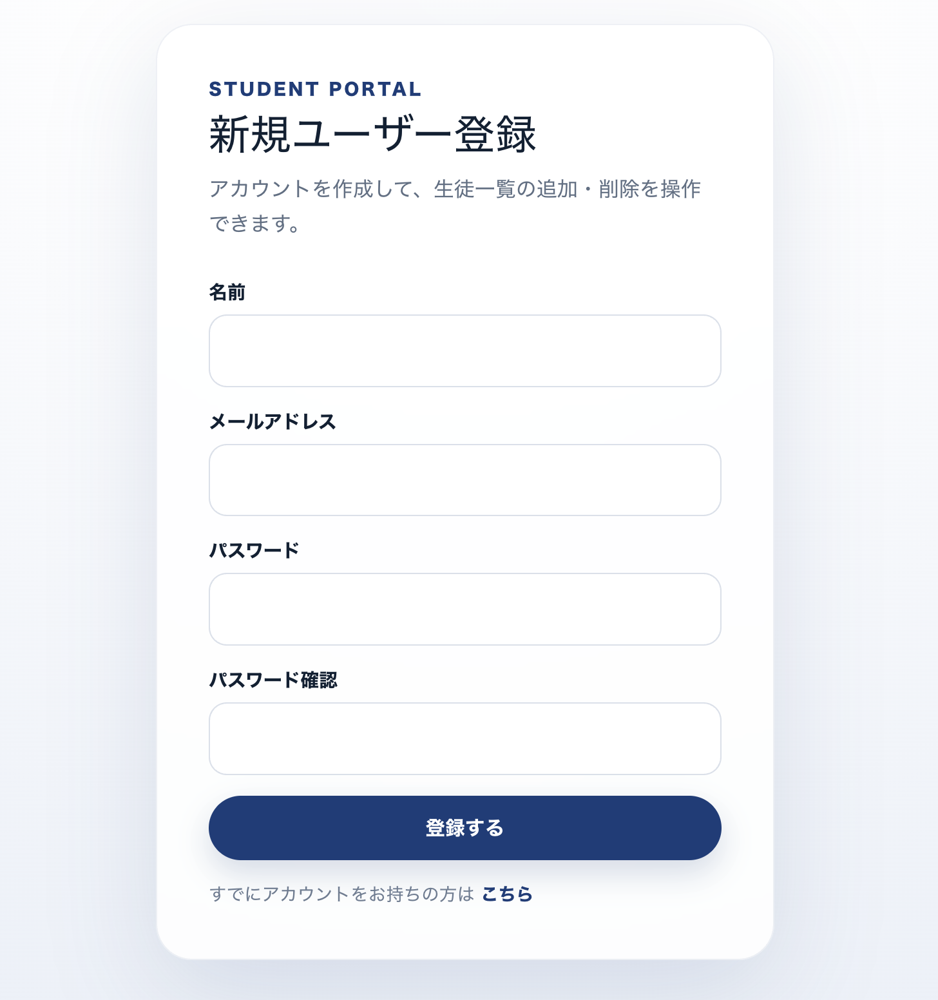
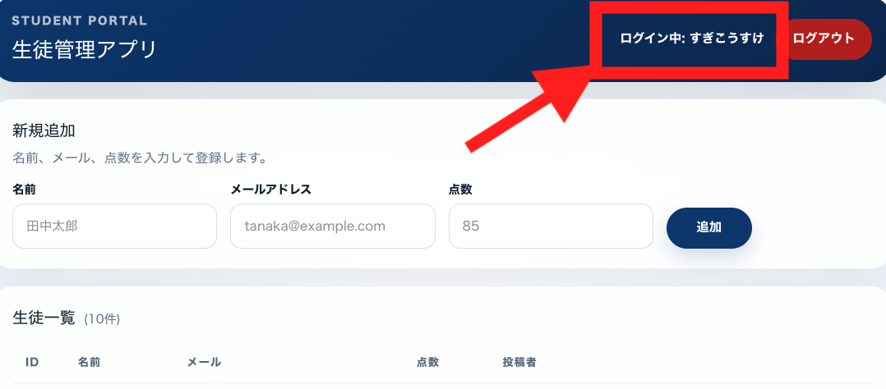
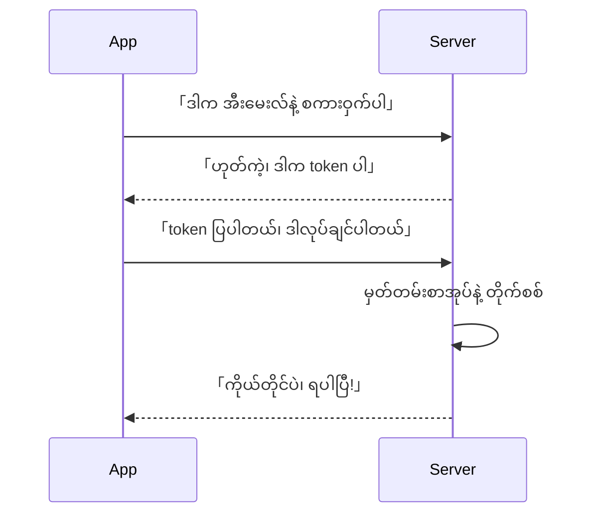
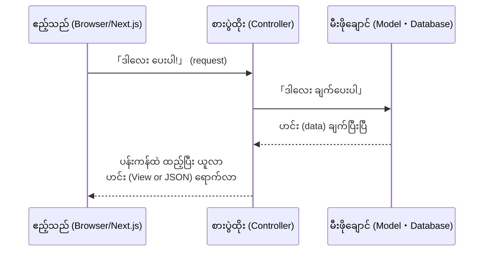

# အတန်းချိန် ၂၃｜အသုံးပြုသူအသစ် စာရင်းသွင်းခြင်း လုပ်ဆောင်ချက် ထည့်ခြင်းနှင့် ယခုအထိ သင်ခဲ့သည်များကို ပြန်လှန်လေ့လာခြင်း

> 🇯🇵 မူရင်း (ဂျပန်ဘာသာဖြင့်): [2026_07_09.md](<../../../2年生_システム開発実践/前期/2026_07_09/2026_07_09.md>) <!-- original-ja-link -->

---

# ဒီအထိ ပြီးသွားသူတွေက နောက်တစ်ဆင့်အနေနဲ့ အသုံးပြုသူအသစ် စာရင်းသွင်းတဲ့ မျက်နှာပြင်ကို ဖန်တီးကြရအောင်

အခုအခြေအနေမှာ login မျက်နှာပြင်ပဲ ရှိသေးတဲ့အတွက် ကျောင်းသားအသစ်ကို ထည့်ချင်တဲ့သူက app ထဲကို ဝင်လို့မရပါဘူး။

## ဘာကို ဖန်တီးမလဲ

အောက်က ပုံလိုမျိုး 「新規ユーザー登録」(အသုံးပြုသူအသစ် စာရင်းသွင်းခြင်း) မျက်နှာပြင်ကို ဖန်တီးပါမယ်။ အကောင့်အသစ် ဖွင့်လို့ရအောင် လုပ်ထားရင် ပထမဆုံးအကြိမ် သုံးတဲ့သူတောင် ကိုယ်တိုင် အကောင့်ဖွင့်ပြီး login ဝင်လို့ ရလာပါလိမ့်မယ်။



အသစ်စာရင်းသွင်းထားတဲ့ အသုံးပြုသူနဲ့ login ဝင်လို့ရရင် အောင်မြင်ပါပြီ!!!



## မျက်နှာပြင်မှာ လိုအပ်တဲ့ အစိတ်အပိုင်းများ

- **名前** (အမည်) ထည့်ရန် အကွက်
- **メールアドレス** (အီးမေးလ်လိပ်စာ) ထည့်ရန် အကွက်
- **パスワード** (စကားဝှက်) ထည့်ရန် အကွက်
- **パスワード確認** (စကားဝှက် အတည်ပြုရန်) အကွက် (စာလုံးမှားရိုက်မိတာကို ကာကွယ်ဖို့ စကားဝှက်တစ်ခုတည်းကို နောက်တစ်ကြိမ် ထပ်ရိုက်ခိုင်းခြင်း)
- **登録する** (စာရင်းသွင်းရန်) ခလုတ်
- 「すでにアカウントをお持ちの方はこちら」(အကောင့်ရှိပြီးသားသူများ ဤနေရာကို နှိပ်ပါ) ဆိုတဲ့ login မျက်နှာပြင်သို့ သွားမယ့် link

## ရေးသားရန် အရိပ်အမြွက်များ (ယခုအထိ သင်ခဲ့တာတွေနဲ့ ဆက်စပ်နေပါတယ်)

- ဒီမျက်နှာပြင်က လုပ်ချင်တာဟာ CRUD ထဲက **Create (အသုံးပြုသူအသစ် ဖန်တီးခြင်း)** ဖြစ်ပါတယ်။ Laravel ဘက်မှာဆိုရင် `store()` နဲ့ သက်ဆိုင်တဲ့ လုပ်ဆောင်ချက်ပါ
- Next.js ရဲ့ **form** မှာ အသုံးပြုသူ ထည့်လိုက်တဲ့ အမည်၊ အီးမေးလ်၊ စကားဝှက်တို့ကို Laravel API ဆီ ပို့ (POST) ပါမယ်
- Laravel ဘက်က **Controller** က လက်ခံရရှိတဲ့ အချက်အလက်ကို validation (စကားဝှက်နဲ့ စကားဝှက်အတည်ပြုချက် ကိုက်ညီရဲ့လား၊ အီးမေးလ် ထပ်နေသလား စသည်) စစ်ဆေးပြီးမှ **Model** ကနေတစ်ဆင့် database ထဲ သိမ်းပါမယ်
- စာရင်းသွင်းတာ အောင်မြင်သွားရင် login မျက်နှာပြင်ကို တန်းပို့လိုက်မလား (ဒါမှမဟုတ် ဆက်ပြီး login ဝင်ပေးကာ **token** ထုတ်ပေးမလား) ဆိုတဲ့ စီးဆင်းမှုမျိုး လုပ်ထားရင် သဘာဝကျပါတယ်

---

# ယခုအထိ သင်ခဲ့သည်များကို ပြန်လှန်လေ့လာခြင်း (သင်ပုန်းပေါ်မှာ ရေးပြီး ရှင်းပြပါမယ်!)

## 1. token ရဲ့ အလုပ်လုပ်ပုံ

app ရဲ့ server က လူအများကြီးဆီက request (တောင်းဆိုချက်) တွေကို လက်ခံရပါတယ်။ အဲဒီအခါ "ဒါ တကယ်ပဲ login ဝင်ထားတဲ့ ကိုယ်တိုင်ဆီက တောင်းဆိုချက် ဟုတ်ရဲ့လား?" ဆိုတာကို စစ်ဆေးရပါတယ်။ ဒီလို စစ်ဆေးဖို့ သုံးတဲ့ "စကားဝှက်ကတ်" လိုမျိုး အရာက **token** ပါ။

### အပန်းဖြေကစားကွင်းက လက်ပတ်နဲ့ ဥပမာပေးကြည့်ရအောင်

အပန်းဖြေကစားကွင်းထဲ ဝင်တဲ့အခါ လက်မှတ်ကို ပြလိုက်ရင် "လက်ပတ်" တစ်ခု ပေးလေ့ရှိတယ် မဟုတ်လား။ အဲဒီနောက်ပိုင်းမှာ ကစားစရာတစ်ခု စီးတိုင်း လက်မှတ်ကို ထပ်ပြစရာမလိုဘဲ **လက်ပတ်ကို ပြလိုက်ရုံနဲ့** "ဒီလူက ဝင်ခွင့်ရပြီးသား ဧည့်သည်ပဲ" ဆိုတာ သိကြပါတယ်။

token ကလည်း ဒီလိုပဲ အလုပ်လုပ်ပါတယ်။

```
   [လက်မှတ်ရောင်းကောင်တာမှာ လျှောက်ထားခြင်း]
          ↓
   ဝန်ထမ်း "ရပါပြီ၊ ဒီမှာ လက်ပတ်ပါ"
          ↓
   ★ လက်ပတ်ကို လက်မှာ ပတ်ထားခြင်း ★
          ↓
   ဒီနောက်ပိုင်း ကစားစရာ စီးတိုင်း
   လက်ပတ်ကို ပြရုံနဲ့ ရပါပြီ!
```

### app လောကမှာလည်း စီးဆင်းပုံ အတူတူပါပဲ

1. **Login**: အီးမေးလ်လိပ်စာနဲ့ စကားဝှက်ကို ပို့ပြီး "ကျွန်တော်/ကျွန်မ ပါ" လို့ ပြောတယ်
2. **token ရယူခြင်း**: server က "ကိုယ်တိုင်ပဲ" လို့ အတည်ပြုနိုင်ရင် စကားဝှက်ကတ် (token) ကို ထုတ်ပေးတယ်
3. **ကတ်ကို ကိုင်ထားခြင်း**: ရလာတဲ့ token ကို app ဘက်မှာ သိမ်းထားတယ်
4. **ကတ်ကို ပြခြင်း**: တစ်ခုခု လုပ်ဆောင်တိုင်း အဲဒီ token ကို တွဲပို့တယ်
5. **server က စစ်ဆေးခြင်း**: "ဒီ token က တကယ်ပဲ login ဝင်ထားတဲ့သူရဲ့ token ပဲ" လို့ တိုက်စစ်ပြီး ခွင့်ပြုတယ်

ဒီစီးဆင်းမှုကို ပုံနဲ့ပြရင် အောက်ပါအတိုင်း ဖြစ်ပါတယ်။



### မှတ်ထားသင့်တာတွေ

- token က စကားဝှက်နဲ့ အတူတူပါပဲ။ **တခြားသူကို ပြမိရင် ဒါမှမဟုတ် ခိုးယူခံရရင် အဲဒီလူက သင့်ကို အယောင်ဆောင်နိုင်သွားမှာ** ဖြစ်လို့ ဂရုတစိုက် ကိုင်တွယ်ပါ
- "Logout လုပ်တယ်" ဆိုတာ = server ဘက်က မှတ်တမ်းစာအုပ်ထဲမှာ "ဒီ token က အသုံးမဝင်တော့ဘူး" လို့ မှတ်တမ်းတင်တာပါ
- ဒီစစ်ဆေးတဲ့ အလုပ်ကို အကြိမ်တိုင်း လူကိုယ်တိုင် လုပ်ရရင် ပင်ပန်းလို့ Laravel မှာ `auth:sanctum` ဆိုတဲ့ စနစ်က အလိုအလျောက် စစ်ပေးပါတယ်

### token ကို developer tools မှာ ကြည့်လို့ရပါတယ်

တကယ်တော့ ကိုယ့် app က အခု ဘယ်လို token ကို ကိုင်ထားလဲဆိုတာ **browser ရဲ့ developer tools (DevTools) ကို ဖွင့်ရင် ကြည့်လို့ရပါတယ်**။

- **Application tab (Chrome ဆိုရင်)** → `Local Storage` ကို ကြည့်ရင် သိမ်းထားတဲ့ token စာသားကို တွေ့နိုင်တယ်
- **Network tab** → API ကို request ပို့တုန်းက ဆက်သွယ်မှုကို ကြည့်ရင် `Authorization: Bearer ○○○` ဆိုတဲ့ header ထဲမှာ တကယ့် token ပါနေတာကို တွေ့နိုင်တယ်

"token ကို တကယ် ရထားရဲ့လား"၊ "request မှာ မှန်မှန်ကန်ကန် တွဲထည့်ထားရဲ့လား" ဆိုတာ မသိတဲ့အခါ developer tools နဲ့ အရင်ဆုံး စစ်ကြည့်တဲ့ အကျင့်ကို လုပ်ထားရင် bug ရဲ့ အကြောင်းရင်းကို ရှာရ ပိုလွယ်လာပါလိမ့်မယ်။

### တကယ့် JavaScript code

အောက်က code တွေက **Laravel ဘက်မှာ မဟုတ်ဘဲ Next.js ဘက် (frontend) မှာ ရေးရမယ့် code** တွေပါ။ စားပွဲထိုး (Controller) ကို မှာယူတဲ့ဘက်၊ တစ်နည်းအားဖြင့် "ဧည့်သည်" ရဲ့ code လို့ မြင်ကြည့်ပါ။

#### 1. Login ဝင်ပြီး token ကို ရယူ၊ သိမ်းဆည်းခြင်း

```javascript
async function login(email, password) {
  const response = await fetch('http://localhost:8000/api/login', {
    method: 'POST',
    headers: {
      'Content-Type': 'application/json',
    },
    body: JSON.stringify({ email, password }),
  });

  const data = await response.json();

  // server ကနေ ရောက်လာတဲ့ token ကို browser ထဲမှာ သိမ်းထားမယ်
  localStorage.setItem('token', data.token);
}
```

#### 2. သိမ်းထားတဲ့ token ကို တွဲပြီး API ကို ခေါ်ခြင်း

```javascript
async function fetchMyProfile() {
  // ခုနက သိမ်းထားတဲ့ token ကို ပြန်ထုတ်မယ်
  const token = localStorage.getItem('token');

  const response = await fetch('http://localhost:8000/api/user', {
    method: 'GET',
    headers: {
      // ဒီနေရာမှာ "စကားဝှက်ကတ်" ကို ပြသလိုမျိုး token ကို တွဲထည့်မယ်
      Authorization: `Bearer ${token}`,
    },
  });

  const data = await response.json();
  console.log(data);
}
```

#### 3. Logout လုပ်ခြင်း (token ကို အသုံးမဝင်အောင် လုပ်ခြင်း)

```javascript
async function logout() {
  const token = localStorage.getItem('token');

  await fetch('http://localhost:8000/api/logout', {
    method: 'POST',
    headers: {
      Authorization: `Bearer ${token}`,
    },
  });

  // browser ဘက်မှာ ကျန်နေတဲ့ token ကိုလည်း ဖျက်ထားမယ်
  localStorage.removeItem('token');
}
```

`Authorization: Bearer ${token}` ဆိုတဲ့ အပိုင်းက "လက်ပတ်ကို ပြတဲ့" လုပ်ဆောင်ချက်နဲ့ အတိအကျ တူပါတယ်။ ဒီပုံစံနဲ့ header ကို မတွဲထည့်ရင် server ဘက်က "ဘယ်သူ့ဆီက request လဲ မသိဘူး" ဖြစ်တဲ့အတွက် 401 error (authentication error) ပြန်လာပါလိမ့်မယ်။

## 2. CRUD အကြောင်း

CRUD ဆိုတာ app က data အပေါ် လုပ်ဆောင်တဲ့ **အခြေခံ လုပ်ဆောင်ချက် ၄ မျိုး** ရဲ့ ရှေ့ဆုံးစာလုံးတွေကို ယူထားတာပါ။ မှတ်စုစာအုပ်ကို မြင်ယောင်ကြည့်ရင် နားလည်ရ လွယ်ပါတယ်။

| ရှေ့ဆုံးစာလုံး | လုပ်ဆောင်ချက် | မှတ်စုစာအုပ်နဲ့ ဥပမာပေးရင် |
|------|------|------------------|
| **C**reate (ဖန်တီးခြင်း) | data အသစ် ထည့်တယ် | မှတ်စုစာအုပ်မှာ စာမျက်နှာအသစ် ရေးတယ် |
| **R**ead (ဖတ်ခြင်း) | data ကို ကြည့်တယ် | ရေးထားတဲ့ စာမျက်နှာကို ပြန်ဖတ်တယ် |
| **U**pdate (ပြင်ဆင်ခြင်း) | data ကို ပြင်ရေးတယ် | ရေးထားတာကို ဖျက်ပြီး ပြန်ရေးတယ် |
| **D**elete (ဖျက်ခြင်း) | data ကို ဖျက်တယ် | စာမျက်နှာကို ဆုတ်ပြီး လွှင့်ပစ်တယ် |

```
      ┌─────────── မှတ်စုစာအုပ် (database) ───────────┐
      │                                             │
 Create│ စာမျက်နှာအသစ် ထည့်  →  [ စာမျက်နှာ 1 ]       │
      │                                             │
  Read │ ဖတ်တယ်            →  "အင်း အင်း၊ ဒါပဲ"      │
      │                                             │
Update │ ပြန်ရေးတယ်         →  [ စာမျက်နှာ 1 (ပြင်ပြီး) ] │
      │                                             │
Delete │ ဆုတ်ပြီး လွှင့်ပစ်  →  (စာမျက်နှာ ပျောက်သွား)   │
      └─────────────────────────────────────────────┘
```

### ဘာလို့ အရေးကြီးတာလဲ?

- အွန်လိုင်းဆွေးနွေးရေးဘုတ် (bulletin board)၊ online ဆိုင်၊ SNS၊ task စီမံခန့်ခွဲတဲ့ app… app အများစုဟာ "data ကို ဖန်တီး၊ ကြည့်၊ ပြင်၊ ဖျက်" ဆိုတာတွေကို ပေါင်းစပ်ပြီး တည်ဆောက်ထားတာပါ
- Laravel မှာ `Route::apiResource` ဆိုတဲ့ အသုံးဝင်တဲ့ လုပ်ဆောင်ချက် ရှိပြီး ဒီ ၄ မျိုး (တကယ်တော့ ၅ မျိုး) လုပ်ဆောင်ချက်ကို တစ်ခါတည်း စုစည်းပြီး ပြင်ဆင်ပေးပါတယ်

```php
Route::apiResource('users', UserController::class);
// ဒီတစ်ကြောင်းတည်းနဲ့ "ဖန်တီး၊ ကြည့်၊ ပြင်၊ ဖျက်" လမ်းကြောင်းအားလုံး ချိတ်ဆက်သွားတယ်
```

CRUD ကို သတိထားပြီး စဉ်းစားရင် "ဒီခလုတ်က ဘာလုပ်ဖို့လဲ" ဆိုတာ အဖွဲ့ထဲက ဘယ်သူ့ကိုမဆို ပြောပြရ ပိုလွယ်လာပါတယ်။

## 3. Laravel ရဲ့ MVC model အကြောင်း

Laravel app ကို **စားသောက်ဆိုင်** နဲ့ ဥပမာပေးရင် မြင်ယောင်ရ လွယ်ပါတယ်။ တာဝန်ခွဲဝေမှု ရှင်းလင်းတဲ့အတွက် လူအများကြီး အတူတူ အလုပ်လုပ်ရင်တောင် မရှုပ်ထွေးပါဘူး။

### ဆိုင်ထဲက တာဝန်တွေနဲ့ စဉ်းစားကြည့်ရအောင်

- **Controller (controller) ＝ စားပွဲထိုး**: ဧည့်သည် (request) ဆီက အော်ဒါကို လက်ခံ၊ မီးဖိုချောင်ကို ပြော၊ ချက်ပြီးတဲ့ ဟင်းကို ဧည့်သည်ဆီ ယူလာပေးတဲ့သူ
- **Model (model) ＝ မီးဖိုချောင်・ရေခဲသေတ္တာ**: ပါဝင်ပစ္စည်း (data) တွေကို သိမ်းထား၊ တကယ် ဟင်းချက် (data ရယူ・သိမ်းဆည်း) တဲ့ နေရာ
- **View (view) ＝ ပန်းကန်ထဲ အလှဆင်ပြီး ထည့်ထားတဲ့ ဟင်း**: ဧည့်သည်ရဲ့ ရှေ့ကို ရောက်လာတဲ့ နောက်ဆုံး မြင်ရတဲ့ပုံစံ

အော်ဒါမှာတာကနေ ဟင်းရောက်လာတဲ့အထိ စီးဆင်းမှုကို ပုံနဲ့ပြရင် အောက်ပါအတိုင်း ဖြစ်ပါတယ်။



### API အဖြစ် ပြောင်းလိုက်ရင် ဘာတွေ ပြောင်းသွားလဲ?

API အဖြစ် မပြောင်းခင်တုန်းက စားပွဲထိုး (Controller) က မီးဖိုချောင်ကနေ ရလာတဲ့ ဟင်းကို **ဆိုင်ထဲမှာပဲ** ပန်းကန်ထဲ အလှဆင်ပြီး ဧည့်သည်ရှေ့ ချပေးခဲ့ပါတယ် (Blade နဲ့ မျက်နှာပြင် ဖန်တီးခြင်း)။

API အဖြစ် ပြောင်းပြီးတဲ့နောက်မှာတော့ စားပွဲထိုး (Controller) က **ပန်းကန်ထဲ အလှဆင်တာအထိ မလုပ်တော့ဘဲ ပါဝင်ပစ္စည်းနဲ့ ချက်နည်း (JSON data) ကိုပဲ** ဧည့်သည်ကို ပေးလိုက်ပါတယ်။ ပြီးတော့ တကယ် မြင်ရတဲ့ပုံစံကို တည်ဆောက် (ပန်းကန်ထဲ အလှဆင်) တဲ့ အလုပ်ကို Next.js ဘက်က တာဝန်ယူလာပါတယ်။

တစ်နည်းအားဖြင့် "အော်ဒါကို လက်ခံပြီး မီးဖိုချောင်နဲ့ ဆက်သွယ်တယ်" ဆိုတဲ့ စားပွဲထိုးရဲ့ အခြေခံအလုပ်က မပြောင်းဘဲ **နောက်ဆုံး ပန်းကန်ထဲ အလှဆင်တဲ့အလုပ် (မျက်နှာပြင်ရဲ့ ပုံစံဖန်တီးခြင်း) တစ်ခုတည်းကပဲ Next.js ဘက်ကို ပြောင်းရွှေ့သွားတာ** လို့ မြင်ယောင်ကြည့်ရင် နားလည်ရ လွယ်ပါတယ်။

