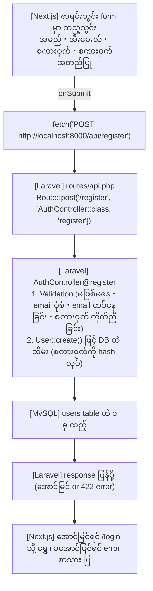

# အသုံးပြုသူအသစ် စာရင်းသွင်းမျက်နှာပြင် ဖန်တီးပုံ အဆင့်ဆင့်

> 🇯🇵 မူရင်း (ဂျပန်ဘာသာဖြင့်): [2026_07_09_2.md](<../../../2年生_システム開発実践/前期/2026_07_09/2026_07_09_2.md>) <!-- original-ja-link -->

ဒီစာတမ်းက အတန်းချိန် ၂၃ ရဲ့ လေ့ကျင့်ခန်း "အသုံးပြုသူအသစ် စာရင်းသွင်းမျက်နှာပြင် ဖန်တီးခြင်း" ကို ကိုယ်တိုင် လက်တွေ့လုပ်ရင်း ရှေ့ဆက်ဖို့ လမ်းညွှန်ချက်ပါ။  
`2026_07_09.md` မှာ ပေးထားတဲ့ ခေါင်းစဉ်ကို ယခုအထိ သင်ခန်းစာတွေ (အတန်းချိန် ၁၇〜၂၂) မှာ ဖန်တီးခဲ့တဲ့ `school-frontend` project ပေါ်မှာ ရေးသွားပါမယ်။

---

## 0. ခြုံငုံပုံ: ဘာနဲ့ဘာ ချိတ်ဆက်နေလဲ

စာရင်းသွင်းမျက်နှာပြင်က "record အသစ် ၁ ခု ဖန်တီးခြင်း" လုပ်ဆောင်ချက် ဖြစ်တဲ့အတွက် CRUD ထဲက **Create** နဲ့ သက်ဆိုင်ပါတယ်။  
စီးဆင်းပုံက login မျက်နှာပြင် (အတန်းချိန် ၁၇) နဲ့ အတော်လေး တူပြီး ပို့မယ့် URL နဲ့ validation အကြောင်းအရာပဲ ပြောင်းသွားပါတယ်။



`routes/api.php` ထဲမှာ တကယ်တော့ **အတန်းချိန် ၀၈ တုန်းကတည်းက စာရင်းသွင်းဖို့ route ကို ရေးထားပြီးသား ဖြစ်ပါတယ်။**

```php
// routes/api.php (ရေးထားပြီးသား ဖြစ်ရမယ်)
Route::post('/login', [AuthController::class, 'login']);
Route::post('/register', [AuthController::class, 'register']);
```

ဒါပေမဲ့ `AuthController` ထဲမှာ `login` / `logout` / `me` ကိုပဲ ရေးထားတဲ့အတွက်  
**`register()` method မရှိသေးတဲ့ အခြေအနေ** ဖြစ်ပါတယ်။ ဒီနေ့ ဒါကို ဖန်တီးတာကနေ စတင်ပါမယ်။

---

## 1. Laravel ဘက်: `register()` ကို ရေးခြင်း

`app/Http/Controllers/Api/AuthController.php` ကို ဖွင့်ပြီး `login()` method ရဲ့ အနားမှာ ထည့်ပါ။

```php
// app/Http/Controllers/Api/AuthController.php
use App\Models\User;
use Illuminate\Support\Facades\Hash;

// POST /api/register
public function register(Request $request)
{
    // ① ထည့်သွင်းချက် စစ်ဆေးခြင်း
    $validated = $request->validate([
        'name'     => 'required|string|max:255',
        'email'    => 'required|email|unique:users,email',
        'password' => 'required|min:8|confirmed',
    ]);

    // ② အသုံးပြုသူ ဖန်တီးခြင်း (စကားဝှက်ကို မဖြစ်မနေ hash လုပ်ပါ)
    $user = User::create([
        'name'     => $validated['name'],
        'email'    => $validated['email'],
        'password' => Hash::make($validated['password']),
    ]);

    // ③ တစ်ခါတည်း login ဝင်ထားစေချင်လို့ token ကိုပါ ထုတ်ပြီး ပြန်ပို့မယ်
    $token = $user->createToken('api-token')->plainTextToken;

    return response()->json([
        'status' => 'ok',
        'token'  => $token,
        'user'   => $user,
    ], 201); // 201 = အသစ်ဖန်တီးခြင်း အောင်မြင်
}
```

### Validation ရဲ့ အဓိကအချက်များ

| စည်းမျဉ်း | အဓိပ္ပာယ် |
|--------|------|
| `required` | မထည့်ထားရင် 422 error |
| `email` | အီးမေးလ် ပုံစံ ဟုတ်မဟုတ် စစ်ဆေး |
| `unique:users,email` | `users` table ထဲမှာ အီးမေးလ်တူ မရှိဘူးလား စစ်ဆေး (ထပ်ခါ စာရင်းသွင်းခြင်းကို ကာကွယ်) |
| `min:8` | စကားဝှက်က စာလုံး ၈ လုံးနှင့်အထက် |
| `confirmed` | **"နာမည်တူ + `_confirmation`" field နဲ့ တန်ဖိုး ကိုက်ညီရဲ့လား** ဆိုတာကို အလိုအလျောက် စစ်ပေးတဲ့ အထူးစည်းမျဉ်း |

`confirmed` စည်းမျဉ်းကို သုံးရင် frontend ကနေ ပို့တဲ့ key နာမည်တွေကို အောက်ပါအတိုင်း မဖြစ်မနေ ထားရပါမယ်။

```json
{
  "name": "田中太郎",
  "email": "tanaka@example.com",
  "password": "password123",
  "password_confirmation": "password123"
}
```

`password_confirmation` ဆိုတဲ့ နာမည်ကို စာလုံး ၁ လုံးတောင် မှားသွားရင် `confirmed` စည်းမျဉ်း အလုပ်မလုပ်တော့ဘဲ "ကိုက်ညီနေပါလျက် error တက်နေတယ်" ဆိုတဲ့ bug ရဲ့ အကြောင်းရင်း ဖြစ်လာတတ်လို့ သတိထားပါ။

---

## 2. Next.js ဘက်: `/register` စာမျက်နှာ ဖန်တီးခြင်း

`app/register/` folder ကို ဖန်တီးပြီး `page.tsx` ကို အသစ် ဖန်တီးပါ။

```
app/register/page.tsx  ← အသစ်ဖန်တီး
```

Login စာမျက်နှာ (အတန်းချိန် ၁၇) နဲ့ တည်ဆောက်ပုံ အတူတူ ဖန်တီးပါမယ်။ **ကွာခြားတာက ထည့်သွင်းရမယ့် အကွက်တွေနဲ့ ပို့မယ့်နေရာပဲ** ဖြစ်ပါတယ်။

```tsx
"use client";

import { useState } from "react";
import { useRouter } from "next/navigation";

export default function RegisterPage() {
  const router = useRouter();
  const [name, setName] = useState("");
  const [email, setEmail] = useState("");
  const [password, setPassword] = useState("");
  const [passwordConfirmation, setPasswordConfirmation] = useState("");
  const [error, setError] = useState("");
  const [loading, setLoading] = useState(false);

  async function handleSubmit(e) {
    e.preventDefault();
    setError("");
    setLoading(true);

    const res = await fetch("http://localhost:8000/api/register", {
      method: "POST",
      headers: {
        "Content-Type": "application/json",
        "Accept": "application/json",
      },
      // ★ key နာမည်တွေကို Laravel ဘက်က validation နဲ့ ကိုက်ညီအောင် ထားပါ
      body: JSON.stringify({
        name,
        email,
        password,
        password_confirmation: passwordConfirmation,
      }),
    });

    const data = await res.json();
    setLoading(false);

    if (res.ok) {
      // ★ တစ်ခါတည်း login ဝင်ထားတဲ့ အခြေအနေ ဖြစ်စေမယ် (token သိမ်းပြီး /students သို့)
      localStorage.setItem("token", data.token);
      localStorage.setItem("userName", data.user?.name || "ユーザー");
      router.push("/students");
    } else if (data.errors) {
      // အတန်းချိန် ၂၁ မှာ သင်ခဲ့တာနဲ့ အတူတူ၊ Laravel ရဲ့ validation error ပြသခြင်း
      const messages = Object.values(data.errors).flat().join(" / ");
      setError(messages);
    } else {
      setError(`エラーが発生しました（HTTP ${res.status}）`);
    }
  }

  return (
    <div style={{
      maxWidth: "400px", margin: "80px auto",
      background: "white", padding: "32px",
      borderRadius: "8px", boxShadow: "0 2px 8px rgba(0,0,0,0.1)"
    }}>
      <h2 style={{ marginBottom: "24px", textAlign: "center" }}>新規ユーザー登録</h2>

      <form onSubmit={handleSubmit}>
        <div style={{ marginBottom: "16px" }}>
          <label style={{ display: "block", marginBottom: "6px", fontWeight: "bold" }}>名前</label>
          <input
            type="text"
            value={name}
            onChange={(e) => setName(e.target.value)}
            style={{ width: "100%", padding: "10px", border: "1px solid #ccc", borderRadius: "6px", fontSize: "1em", boxSizing: "border-box" }}
          />
        </div>

        <div style={{ marginBottom: "16px" }}>
          <label style={{ display: "block", marginBottom: "6px", fontWeight: "bold" }}>メールアドレス</label>
          <input
            type="email"
            value={email}
            onChange={(e) => setEmail(e.target.value)}
            style={{ width: "100%", padding: "10px", border: "1px solid #ccc", borderRadius: "6px", fontSize: "1em", boxSizing: "border-box" }}
          />
        </div>

        <div style={{ marginBottom: "16px" }}>
          <label style={{ display: "block", marginBottom: "6px", fontWeight: "bold" }}>パスワード</label>
          <input
            type="password"
            value={password}
            onChange={(e) => setPassword(e.target.value)}
            style={{ width: "100%", padding: "10px", border: "1px solid #ccc", borderRadius: "6px", fontSize: "1em", boxSizing: "border-box" }}
          />
        </div>

        <div style={{ marginBottom: "16px" }}>
          <label style={{ display: "block", marginBottom: "6px", fontWeight: "bold" }}>パスワード確認</label>
          <input
            type="password"
            value={passwordConfirmation}
            onChange={(e) => setPasswordConfirmation(e.target.value)}
            style={{ width: "100%", padding: "10px", border: "1px solid #ccc", borderRadius: "6px", fontSize: "1em", boxSizing: "border-box" }}
          />
        </div>

        {error && (
          <p style={{ color: "#D32F2F", fontSize: "0.9em", marginBottom: "12px" }}>
            {error}
          </p>
        )}

        <button
          type="submit"
          disabled={loading}
          style={{ width: "100%", padding: "12px", background: loading ? "#aaa" : "#1976D2", color: "white", border: "none", borderRadius: "6px", fontSize: "1em", fontWeight: "bold", cursor: loading ? "not-allowed" : "pointer" }}
        >
          {loading ? "登録中..." : "登録する"}
        </button>

        <p style={{ textAlign: "center", marginTop: "16px", fontSize: "0.9em" }}>
          すでにアカウントをお持ちの方は{" "}
          <a href="/login" style={{ color: "#1976D2", fontWeight: "bold" }}>こちら</a>
        </p>
      </form>
    </div>
  );
}
```

### Login စာမျက်နှာ (အတန်းချိန် ၁၇) နဲ့ ကွာခြားချက်

| | `/login` (အတန်းချိန် ၁၇) | `/register` (ဒီတစ်ခါ) |
|--|--|--|
| ထည့်သွင်းရမယ့် အကွက်များ | အီးမေးလ်・စကားဝှက် | အမည်・အီးမေးလ်・စကားဝှက်・စကားဝှက်အတည်ပြု |
| ပို့မယ့်နေရာ | `POST /api/login` | `POST /api/register` |
| အောင်မြင်တဲ့အခါ response | `{ token, user }` | `{ token, user }` (ပုံစံ အတူတူ) |
| မအောင်မြင်တဲ့အခါ ပြသချက် | ပုံသေ စာသား (401) | Laravel ရဲ့ validation စာသား (422) |
| အောင်မြင်ပြီးနောက် ရွှေ့မယ့်နေရာ | `/students` | `/students` (စာရင်းသွင်းတာနဲ့ တစ်ပြိုင်နက် login ဝင်ပြီးသားအဖြစ် သတ်မှတ်) |

---

## 3. Login မျက်နှာပြင်နဲ့ စာရင်းသွင်းမျက်နှာပြင်ကို အပြန်အလှန် link ချိတ်ခြင်း

လေ့ကျင့်ခန်းရဲ့ သတ်မှတ်ချက် (`2026_07_09.md`) မှာ ပါတဲ့အတိုင်း စာရင်းသွင်းမျက်နှာပြင်မှာ 「すでにアカウントをお持ちの方はこちら」(အကောင့်ရှိပြီးသားသူများ ဤနေရာကို နှိပ်ပါ) ဆိုတဲ့ login မျက်နှာပြင်သို့ သွားမယ့် link လိုအပ်ပါတယ် (အပေါ်က code ရဲ့ အဆုံးမှာ ထည့်ပြီးသား ဖြစ်ပါတယ်)။

ဒါနဲ့အတူ login မျက်နှာပြင်ဘက်မှာလည်း စာရင်းသွင်းမျက်နှာပြင်သို့ သွားမယ့် link ကို ထည့်ထားရင် အသုံးပြုသူက မရှုပ်ထွေးဘဲ အပြန်အလှန် သွားလာနိုင်ပါတယ်။

```tsx
// app/login/page.tsx ရဲ့ <form> အောက်ဆုံးမှာ ထည့်ပါ
<p style={{ textAlign: "center", marginTop: "16px", fontSize: "0.9em" }}>
  アカウントをお持ちでない方は{" "}
  <a href="/register" style={{ color: "#1976D2", fontWeight: "bold" }}>こちら</a>
</p>
```

---

## 4. Server နှစ်ခုလုံးကို စတင်ပြီး အလုပ်လုပ်ပုံ စစ်ဆေးခြင်း

```bash
# Terminal ① Laravel
cd （Laravel project ရဲ့ folder）
php artisan serve

# Terminal ② Next.js
cd school-frontend
npm run dev
```

### အလုပ်လုပ်ပုံ စစ်ဆေးရန် checklist

| စစ်ဆေးရမယ့်အချက် | လုပ်ဆောင်ရမယ့်အရာ | မျှော်လင့်ထားတဲ့ ရလဒ် |
|---------|------|------------|
| မျက်နှာပြင် ပြသခြင်း | `http://localhost:3000/register` ကို ဖွင့် | အမည်・အီးမေးလ်・စကားဝှက်・စကားဝှက်အတည်ပြု ထည့်ရန် အကွက်များ ပေါ်လာ |
| ပုံမှန် စာရင်းသွင်းခြင်း | အားလုံးကို မှန်မှန်ကန်ကန် ထည့်ပြီး 「登録する」(စာရင်းသွင်းမည်) ကို နှိပ် | `/students` သို့ ရွှေ့သွားပြီး login ဝင်ပြီးသား အခြေအနေ ဖြစ်လာ |
| အီးမေးလ် ထပ်နေခြင်း | စာရင်းသွင်းပြီးသား အီးမေးလ်လိပ်စာနဲ့ စာရင်းသွင်း | 「The email has already been taken.」 (ဤအီးမေးလ်ကို အသုံးပြုပြီးသား ဖြစ်သည်) စသည့် error ပေါ်လာ |
| စကားဝှက် မကိုက်ညီခြင်း | စကားဝှက်နဲ့ စကားဝှက်အတည်ပြုကို မတူတဲ့ တန်ဖိုး ထည့် | 「The password confirmation does not match.」 (အတည်ပြုစကားဝှက် မကိုက်ညီပါ) ပေါ်လာ |
| မထည့်ထားခြင်း | ဘာမှ မထည့်ဘဲ ပို့ | အကွက်တစ်ခုချင်းစီရဲ့ 「required」 error ပေါ်လာ |
| မျက်နှာပြင် ကူးပြောင်းခြင်း (စာရင်းသွင်း→login) | 「すでにアカウントをお持ちの方はこちら」 ကို နှိပ် | `/login` သို့ ရွှေ့သွား |
| မျက်နှာပြင် ကူးပြောင်းခြင်း (login→စာရင်းသွင်း) | Login မျက်နှာပြင်ရဲ့ 「こちら」(ဤနေရာ) ကို နှိပ် | `/register` သို့ ရွှေ့သွား |
| Login စစ်ဆေးခြင်း | အသစ်စာရင်းသွင်းထားတဲ့ အီးမေးလ်・စကားဝှက်နဲ့ login ပြန်ဝင် | Login ဝင်ခြင်း အောင်မြင် |

---

## အနှစ်ချုပ်: ဒီတစ်ခါ လုပ်ခဲ့တာတွေက ယခင်သင်ခန်းစာတွေနဲ့ ဘယ်လို ဆက်စပ်သလဲ

| ယခုအထိ | ဒီတစ်ခါ ထပ်ထည့်ခဲ့တဲ့ အပိုင်း |
|--|--|
| `routes/api.php` မှာ `/register` လမ်းကြောင်းကို ပြင်ဆင်ထားပြီးသား (အတန်းချိန် ၀၈) | `AuthController` မှာ `register()` ရဲ့ အတွင်းပိုင်း (validation ＋ `User::create`) ကို ရေးခဲ့ |
| `/login` စာမျက်နှာ ရှိပြီးသား (အတန်းချိန် ၁၇) | တည်ဆောက်ပုံ အတူတူနဲ့ `/register` စာမျက်နှာကို အသစ် ဖန်တီးခဲ့ |
| 422 error ပြသပုံကို အတန်းချိန် ၂၁ မှာ သင်ခဲ့ပြီးသား | အဲဒီ စနစ်အတိုင်း သုံးပြီး စာရင်းသွင်း form ရဲ့ error ပြသမှုမှာ အသုံးချခဲ့ |

အယူအဆအသစ် သိပ်မပါဘဲ **CRUD ရဲ့ Create・Controller/Model・validation・token ထုတ်ပေးခြင်း** ဆိုတဲ့ ယခုအထိ သင်ခန်းစာတွေမှာ သင်ခဲ့တဲ့ အစိတ်အပိုင်းတွေကို ပေါင်းစပ်ရုံနဲ့ ဖန်တီးနိုင်တယ် ဆိုတာက ဒီလေ့ကျင့်ခန်းရဲ့ အဓိကအချက် ဖြစ်ပါတယ်။
