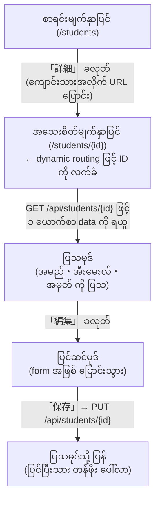
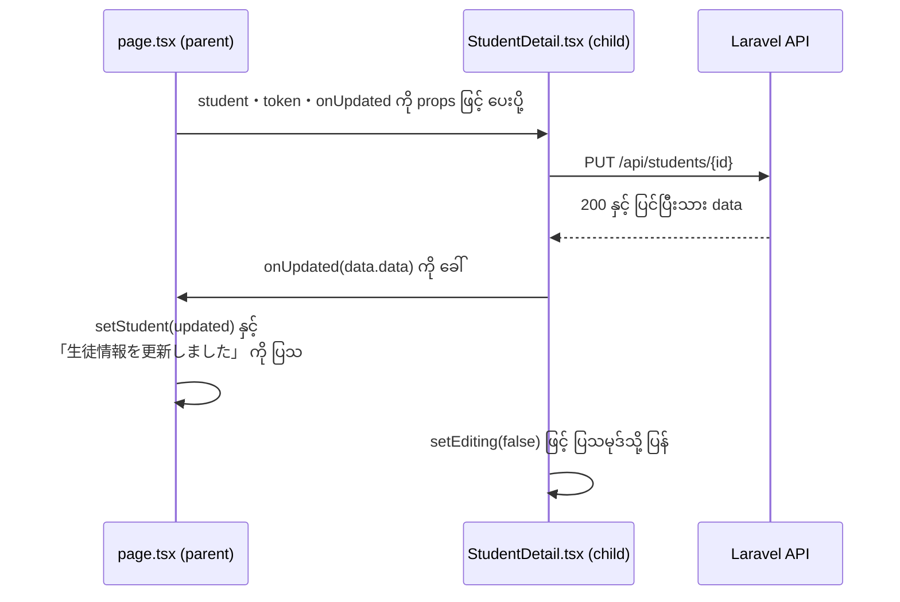

# အတန်းချိန် ၂၄｜အသေးစိတ်မျက်နှာပြင် ဖန်တီးခြင်း - ရေးသားပုံ အဆင့်ဆင့်

> 🇯🇵 မူရင်း (ဂျပန်ဘာသာဖြင့်): [2026_07_16_実装.md](<../../../2年生_システム開発実践/前期/2026_07_16/2026_07_16_実装.md>) <!-- original-ja-link -->

## ဒီနေ့ရဲ့ ပန်းတိုင်

- စာရင်းမျက်နှာပြင်ရဲ့ 「詳細」(အသေးစိတ်) ခလုတ်ကနေ အဲဒီကျောင်းသား ၁ ယောက်စာကိုပဲ ပြသတဲ့ မျက်နှာပြင်ကို ရွှေ့သွားနိုင်ရမယ်
- အသေးစိတ်မျက်နှာပြင်ရဲ့ 「編集」(ပြင်ဆင်ရန်) ခလုတ်နဲ့ အဲဒီနေရာမှာတင် form အဖြစ် ပြောင်းပြီး ပြင်ဆင်နိုင်ရမယ်
- Laravel ဘက်မှာ ပြင်ဆင်ရန် API endpoint (`PUT /api/students/{id}`) ကို ပြင်ဆင်ထားနိုင်ရမယ်

> **ဒီသင်ခန်းစာရဲ့ နေရာ：** စာရင်းမျက်နှာပြင် (`GET /api/students`) က "လူအားလုံးစာကို စုပြီး ကြည့်တဲ့" မျက်နှာပြင် ဖြစ်ခဲ့တာနဲ့ မတူဘဲ အသေးစိတ်မျက်နှာပြင်က "ID နဲ့ သတ်မှတ်ထားတဲ့ လူ ၁ ယောက်စာကိုပဲ ကြည့်・ပြင်တဲ့" မျက်နှာပြင် ဖြစ်ပါတယ်။ CRUD ထဲက **Read (၁ ခုတည်းကို ကြည့်ခြင်း)** နဲ့ **Update (ပြင်ဆင်ခြင်း)** က မျက်နှာပြင်တစ်ခုတည်းထဲမှာ အပြန်အလှန် ပြောင်းသွားတဲ့ တည်ဆောက်ပုံ ဖြစ်ပါတယ်။

---

## ခြုံငုံပုံ: ဘာကို ဖန်တီးမလဲ



### ဘာလို့ ဒီအစီအစဉ်အတိုင်း ဖန်တီးတာလဲ

> 💡 **ဥပမာပေးရရင်… ဆိုင်ရဲ့ "တစ်ဦးချင်း အော်ဒါကတ်"**
>
> စာရင်းမျက်နှာပြင်ကို "ဒီနေ့ ကြိုတင်ရက်ချိန်းယူထားသူများစာရင်း" လို့ ယူဆရင် အသေးစိတ်မျက်နှာပြင်က ဧည့်သည် ၁ ယောက်တည်းအတွက် "တစ်ဦးချင်း အော်ဒါကတ်" ဖြစ်ပါတယ်။ ကတ်ကို တိုက်ရိုက် ပြင်ရေး (ပြင်ဆင်) ဖို့အတွက် အရင်ဆုံး "ဒီကတ်ကို ထုတ်ပေးတဲ့" ကောင်တာ (`GET /api/students/{id}`) နဲ့ "ပြင်ရေးတာကို လက်ခံတဲ့" ကောင်တာ (`PUT /api/students/{id}`) က ဆိုင်ဘက် (Laravel) မှာ မရှိရင် စလို့ မရပါဘူး။

Backend ရဲ့ ပြင်ဆင်ရန် API မရှိရင် frontend ရဲ့ ပြင်ဆင်ရန် form ကို ဖန်တီးထားလည်း သိမ်းမယ့်နေရာ မရှိလို့ အလုပ်လုပ်ပုံ စစ်ဆေးလို့ မရပါဘူး။ ဒါကြောင့် **backend (API) → စာရင်းကနေ သွားမယ့်လမ်း → အသေးစိတ်မျက်နှာပြင် (ပြသခြင်း) → ပြင်ဆင်မုဒ်** ဆိုတဲ့ အစီအစဉ်အတိုင်း အသေးလေးတွေ ဖန်တီးပြီး တစ်ဆင့်ချင်း run ကြည့်ရင်း ရှေ့ဆက်ပါမယ်။

### File ဖွဲ့စည်းပုံ (ဒီတစ်ခါ ကိုင်တွယ်မယ့် file များ)

| သင်္ကေတ | အဓိပ္ပာယ် |
|---|---|
| 🆕 အသစ် | file အသစ် ဖန်တီး |
| ➕ ထပ်ထည့် | ရှိပြီးသား file ထဲမှာ code ထပ်ရေး |
| 👀 စစ်ဆေး | ပြောင်းစရာမလို။ ပြီးပြီလား စစ်ဆေးရုံသာ |

```
Laravel/
├── app/Http/Requests/UpdateStudentRequest.php      🆕 အသစ်
├── app/Http/Controllers/Api/StudentController.php  ➕ update() ကို ထပ်ထည့်
└── routes/api.php                                  👀 စစ်ဆေးရုံသာ

school-frontend/
├── components/students/StudentList.tsx             ➕ အသေးစိတ် link ကို ထပ်ထည့်
├── components/students/StudentDetail.tsx           🆕 အသစ် (ပြသ⇔ပြင်ဆင်)
└── app/students/[id]/page.tsx                       🆕 အသစ် → နောက်ပိုင်းမှာ ➕ ထပ်ရေး (dynamic routing)
```

---

## Step 1｜Backend: ပြင်ဆင်ရန် API ကို ထပ်ထည့်ခြင်း

စာရင်း・အသေးစိတ်ရယူ・ဖျက်ခြင်း API တွေက ရှိပြီးသား ဖြစ်ပေမဲ့ "၁ ခုကို ပြင်ရေးတဲ့" ကောင်တာက မရှိသေးပါဘူး။ ဒီအပိုင်းကို အရင်ဆုံး ဖန်တီးပါမယ်။


### 1-3. `routes/api.php` ကို စစ်ဆေးခြင်း

**👀 စစ်ဆေးရုံသာ (များသောအားဖြင့် ပြောင်းစရာမလို)** — `Route::apiResource('students', StudentController::class)` က မူလအခြေအနေမှာ `update` ကိုပါ ပါဝင်ပြီးသား ဖြစ်ပါတယ်။ `->only([...])` နဲ့ ကန့်သတ်ထားတဲ့ **အခါမှသာ** `update` ကို ထပ်ထည့်ပါ။

```php
Route::middleware('auth:sanctum')->group(function () {
    Route::post('/logout', [AuthController::class, 'logout']);
    Route::get('/me', [AuthController::class, 'me']);
    Route::apiResource('students', StudentController::class);
    
    // only ဖြစ်မနေဘူးလား ဆိုတာကိုပဲ စစ်ဆေးပါ
    // Route::apiResource('students', StudentController::class)->only(['index', 'show']);
});
```

### 1-4. အလုပ်လုပ်ပုံ စစ်ဆေးခြင်း

```bash
cd Laravel && php artisan serve
```

Login ဝင်ပြီး token ရယူထားပြီးနောက် `curl` နဲ့ ပြင်ဆင်ရန် API ကို တိုက်ရိုက် ခေါ်ကြည့်ပါမယ်။

⚠️ Windows (PowerShell) သုံးနေသူများ သတိပြုရန်
PowerShell မှာ curl ကို ဒီအတိုင်း သုံးရင် error တက်ပါလိမ့်မယ်။ ရှေ့ဆုံးကို curl.exe လို့ မဖြစ်မနေ ပြောင်းရေးပါ၊ ဒါမှမဟုတ် terminal မှာ cmd လို့ ရိုက်ပြီး "Command Prompt" ကို ပြောင်းပြီးမှ run ပါ။ ထို့အပြင် data ထဲက double quotation (\") တွေကို escape လုပ်ဖို့ လိုပါတယ်။
```bash
curl -X PUT http://localhost:8000/api/students/1 \
  -H "Authorization: Bearer <ရယူထားတဲ့ token>" \
  -H "Content-Type: application/json" \
  -H "Accept: application/json" \
  -d '{"name":"テスト太郎","email":"test-taro@example.com","score":80}'
```

| စစ်ဆေးရမယ့်အချက် | လုပ်ဆောင်ရမယ့်အရာ | မျှော်လင့်ထားတဲ့ ရလဒ် |
|---|---|---|
| ပြင်ဆင်ခြင်း အောင်မြင် | အပေါ်က curl ကို run | 200 ပြန်လာပြီး ပြင်ပြီးသား အမည်・အီးမေးလ်・အမှတ် က JSON ထဲမှာ ပါဝင် |
| Validation | `score` မှာ `200` ထည့်ပြီး run | 422 ပြန်လာ |
| Authentication လိုအပ် | `Authorization` header ကို ဖြုတ်ပြီး run | 401 ပြန်လာ |
| မရှိတဲ့ ID | `/api/students/9999` ကို run | 404 ပြန်လာ |

---

## Step 2｜Frontend: စာရင်းကနေ အသေးစိတ်သို့ သွားမယ့်လမ်း

`school-frontend/components/students/StudentList.tsx` ကို ပြင်ပါမယ်။

### ဘာလို့ လိုအပ်တာလဲ

စာရင်းရဲ့ အတန်းတိုင်းကနေ "ဒီကျောင်းသားတစ်ယောက်အတွက် သီးသန့် URL" ကို သွားလို့ မရရင် အသေးစိတ်မျက်နှာပြင်ကို ဖန်တီးထားလည်း ရောက်အောင် သွားစရာ နည်းလမ်း မရှိပါဘူး။ **ကျောင်းသားရဲ့ ID ကို URL ရဲ့ အစိတ်အပိုင်းအဖြစ် ဒီအတိုင်း ထည့်သွင်းတာ** က အဓိကအချက် ဖြစ်ပါတယ်။

**➕ ထပ်ထည့် (ရှိပြီးသား file ရဲ့ ထိပ်ဆုံး)** — `import` ကို ထပ်ထည့်ပါ။

```tsx
// ▼ StudentList.tsx ရဲ့ ထိပ်ဆုံးမှာ ထပ်ထည့်
"use client";

import Link from "next/link";
```

**➕ ထပ်ထည့် (ရှိပြီးသား file)** — `bodyCell` ရဲ့ အောက်လောက်မှာ အသေးစိတ် link ရဲ့ style ကို ထပ်ထည့်ပါ။

```tsx
// Style ကိန်းသေများ (ထပ်ခါထပ်ခါ သုံးမယ့် style တွေကို စုထားတာ)
const thStyle = { padding: "10px 16px", textAlign: "left", fontWeight: "bold", fontSize: "0.9em" };
const tdStyle = { padding: "12px 16px", fontSize: "0.95em" };

// ▼ အောက်လောက်မှာ ထပ်ထည့် (အသေးစိတ် link ရဲ့ style)
const detailLinkStyle = {
  display: "inline-flex",
  alignItems: "center",
  justifyContent: "center",
  minWidth: 104,
  padding: "0.85rem 1.25rem",
  borderRadius: 999,
  background: "#163D7A",
  color: "#fff",
  fontWeight: 700,
  fontSize: "0.95rem",
  letterSpacing: "0.01em",
  boxShadow: "0 10px 24px rgba(22, 61, 122, 0.18)",
};
```

**🔁 အစားထိုး (ရှိပြီးသား file)** — `StudentRow` ရဲ့ နောက်ဆုံး `<td>` (လုပ်ဆောင်ချက် ခလုတ်တွေရဲ့ cell) ကို အောက်ပါအတိုင်း အစားထိုးပါ။

```tsx
// StudentRow: table ရဲ့ အတန်း ၁ ကြောင်းစာ
function StudentRow({ student, onDelete }) {
  function handleDelete() {
    // အတည်ပြု dialog ကို ပြပြီးမှ ဖျက်မယ်
    if (window.confirm(`${student.name} を削除しますか？`)) {
      onDelete(student.id); // parent ကို "ဒီ ID ကို ဖျက်ပေးပါ" လို့ ပြောမယ်
    }
  }

  return (
    <tr style={{ borderBottom: "1px solid #eee" }}>
      <td style={tdStyle}>{student.id}</td>
      <td style={tdStyle}>{student.name}</td>
      <td style={tdStyle}>{student.email}</td>
      <td style={tdStyle}>{student.score}</td>
      <td style={tdStyle}>
      <div style={{ display: "flex", gap: "0.5rem", flexWrap: "wrap" }}>
        <Link href={`/students/${student.id}`} style={detailLinkStyle}>
          詳細
        </Link>
        <button
          onClick={handleDelete}
          style={{ background: "#D32F2F", color: "white", border: "none", borderRadius: "4px", padding: "4px 12px", cursor: "pointer", fontSize: "0.85em" }}
        >
          削除
        </button>
        </div >
      </td>
    </tr>
  );
}
```

### အလုပ်လုပ်ပုံ စစ်ဆေးခြင်း

```bash
cd school-frontend && npm run dev
```

| စစ်ဆေးရမယ့်အချက် | လုပ်ဆောင်ရမယ့်အရာ | မျှော်လင့်ထားတဲ့ ရလဒ် |
|---|---|---|
| သွားမယ့်လမ်း ပြသခြင်း | `/students` ကို ဖွင့် | အတန်းတိုင်းမှာ 「詳細」 ခလုတ် ပေါ်လာ |
| ရွှေ့ခြင်း | 「詳細」 ခလုတ်ကို click | `/students/{အဲဒီအတန်းရဲ့ ID}` သို့ ရွှေ့သွား (ဒီအဆင့်မှာ 404 ဖြစ်လည်း ရပါတယ်။ Step 3 မှာ ဖန်တီးမယ်) |

---

## Step 3｜Frontend: အသေးစိတ်မျက်နှာပြင် (ပြသမုဒ်)

**🆕 file အသစ်** — `school-frontend/app/students/[id]/page.tsx` ကို အသစ် ဖန်တီးပါ (`[id]` ဆိုတဲ့ နာမည်ရှိ folder ကိုလည်း အသစ် ဖန်တီးပါ)။

### ဘာလို့ `[id]` ဆိုတဲ့ folder နာမည် ပေးတာလဲ

Next.js မှာ folder နာမည်ကို `[id]` လိုမျိုး လေးထောင့်ကွင်းနဲ့ ပေးလိုက်ရင် URL ရဲ့ အဲဒီအပိုင်း (`/students/3` ထဲက `3`) ကို စာမျက်နှာထဲမှာ လက်ခံနိုင်တဲ့ **dynamic routing** ဖြစ်သွားပါတယ်။

```tsx
"use client";

import { useState, useEffect } from "react";
import { useRouter, useParams } from "next/navigation";
import Link from "next/link";


export default function StudentDetailPage() {
  const router = useRouter();
  const params = useParams(); // URL ရဲ့ {id} အပိုင်းကို လက်ခံမယ်
  const [student, setStudent] = useState(null);
  const [userName, setUserName] = useState("");
  const [loading, setLoading] = useState(true);
  const [notFound, setNotFound] = useState(false);
  const [token, setToken] = useState(null); // ★ error ရဲ့ အကြောင်းရင်း ဖြစ်ခဲ့တဲ့ "token" သိမ်းမယ့်သေတ္တာကို ဒီမှာ ထပ်ထည့်ထားပါတယ်!

  // ★ useEffect: စာမျက်နှာ ပေါ်လာတဲ့အခါ ၁ ကြိမ်တည်းသာ run မယ်
  useEffect(() => {
    const savedToken = localStorage.getItem("token");

    // token မရှိရင် login စာမျက်နှာကို ပြန်ပို့မယ်
    if (!savedToken) {
      router.push("/login");
      return;
    }

    setToken(savedToken); // ★ ရယူထားတဲ့ token ကို state ထဲမှာ သေချာ သိမ်းမယ်
    setUserName(localStorage.getItem("userName") || "ユーザー");
    loadStudent(savedToken);
  }, []); // [] = ပထမဆုံး ၁ ကြိမ်တည်းသာ run မယ်

  // သတ်မှတ်ထားတဲ့ ကျောင်းသား ၁ ယောက်စာ data ကို API ကနေ ရယူမယ်
  async function loadStudent(currentToken) {
    setLoading(true);
    setNotFound(false);
  
    try {
      // URL parameter ဖြစ်တဲ့ params.id ကို သုံးပြီး Laravel API ကို မေးမယ်
      const res = await fetch(`http://localhost:8000/api/students/${params.id}`, {
        headers: {
          "Accept": "application/json",
          "Authorization": `Bearer ${currentToken}`, // ★ token ကို header မှာ တွဲထည့်မယ်
        },
      });

      // 401 = token အသုံးမဝင် → login စာမျက်နှာကို ပြန်ပို့မယ်
      if (res.status === 401) {
        router.push("/login");
        return;
      }

      // 404 = ကျောင်းသားကို ရှာမတွေ့
      if (res.status === 404) {
        setStudent(null);
        setNotFound(true);
        return;
      }

      const data = await res.json();
      setStudent(data.data); // Laravel API က { data: {...} } ပုံစံနဲ့ ပြန်ပို့တယ်
    } catch (error) {
      console.error("データの取得に失敗しました", error);
    } finally {
      setLoading(false);
    }
  }

  // Logout
  async function handleLogout() {
    const currentToken = localStorage.getItem("token");

    await fetch("http://localhost:8000/api/logout", {
      method: "POST",
      headers: {
        "Accept": "application/json",
        "Authorization": `Bearer ${currentToken}`,
      },
    });

    localStorage.removeItem("token");
    localStorage.removeItem("userName");
    router.push("/login");
  }

  // ★ token အဆင်သင့် ဖြစ်တဲ့အထိ ဒါမှမဟုတ် load ပြီးတဲ့အထိ စောင့်မယ်
  if (!token || loading) {
    return (
      <div style={{ textAlign: "center", padding: "80px", color: "#888" }}>
        生徒データを読み込んでいます...
      </div>
    );
  }

  return (
    <div style={{ background: "#f4f6f8", minHeight: "100vh" }}>

      {/* Header (စာရင်းမျက်နှာပြင်နဲ့ တူညီတဲ့ ဘုံပုံစံ) */}
      <header style={{
        background: "#1565C0", color: "white",
        padding: "16px 32px",
        display: "flex", alignItems: "center"
      }}>
        <h1 style={{ fontSize: "1.2em" }}>生徒管理アプリ（Next.js API版）</h1>
        <div style={{ marginLeft: "auto", display: "flex", alignItems: "center", gap: "12px" }}>
          <span style={{ fontSize: "0.9em" }}>● ログイン中：{userName}</span>
          <button
            onClick={handleLogout}
            style={{ background: "#D32F2F", color: "white", border: "none", borderRadius: "6px", padding: "6px 14px", cursor: "pointer" }}
          >
            ログアウト
          </button>
        </div>
      </header>

      {/* အဓိက အကြောင်းအရာ */}
      <main style={{ padding: "32px", maxWidth: "640px", margin: "0 auto", display: "grid", gap: "20px" }}>
        
        <Link href="/students" style={{ color: "#1565C0", fontWeight: "bold", textDecoration: "none" }}>
          ← 一覧に戻る
        </Link>


        {/* ★ ကျောင်းသားကို ရှာမတွေ့တဲ့အခါ ဒါမှမဟုတ် data ဗလာဖြစ်နေတဲ့အခါ ပြသမယ့်အရာ */}
        {notFound || !student ? (
          <div style={{
            borderRadius: "8px",
            padding: "40px 24px",
            textAlign: "center",
            background: "white",
            border: "1px solid #ddd",
          }}>
            <p style={{ margin: 0, color: "#888" }}>生徒が見つかりません</p>
          </div>
        ) : (
          /* ★ token ကို child component ဆီ မှန်မှန်ကန်ကန် ပေးပို့နိုင်ပြီ ဖြစ်ပါတယ် */
          <section style={{
              background: "white", border: "1px solid #ddd", borderRadius: "8px",
              padding: "24px", boxShadow: "0 4px 12px rgba(0,0,0,0.05)"
            }}>
              <h2 style={{ margin: "0 0 20px 0", fontSize: "1.4em", borderBottom: "2px solid #1565C0", paddingBottom: "8px" }}>
                {student.name}
              </h2>
              
              <dl style={{ display: "grid", gap: "16px", margin: 0 }}>
                <div>
                  <dt style={{ fontSize: "0.9em", color: "#666", marginBottom: "4px" }}>メールアドレス</dt>
                  <dd style={{ margin: 0, fontWeight: "bold", fontSize: "1.1em" }}>{student.email}</dd>
                </div>
                <div>
                  <dt style={{ fontSize: "0.9em", color: "#666", marginBottom: "4px" }}>点数</dt>
                  <dd style={{ margin: 0, fontWeight: "bold", fontSize: "1.1em" }}>{student.score} 点</dd>
                </div>
              </dl>
            </section>
        )}

      </main>

    </div>
  );
}
```

### အလုပ်လုပ်ပုံ စစ်ဆေးခြင်း

| စစ်ဆေးရမယ့်အချက် | လုပ်ဆောင်ရမယ့်အရာ | မျှော်လင့်ထားတဲ့ ရလဒ် |
|---|---|---|
| ပြသခြင်း | Login ဝင်ပြီးနောက် စာရင်းရဲ့ 「詳細」 ကနေ ရွှေ့ | အဲဒီကျောင်းသားရဲ့ အမည်・အီးမေးလ်・အမှတ် ကိုပဲ ပြသ |
| မရှိတဲ့ ID | `/students/99999` ကို တိုက်ရိုက် ဖွင့် | 「生徒が見つかりません」(ကျောင်းသားကို ရှာမတွေ့ပါ) လို့ ပြသ |
| Authentication မလုပ်ရသေး | Logout ဖြစ်နေတဲ့ အခြေအနေမှာ `/students/1` ကို ဖွင့် | `/login` သို့ redirect လုပ်ခံရ |

---

## Step 4｜Frontend: ပြင်ဆင်မုဒ်ကို ထပ်ထည့်ခြင်း

ပြသဖို့သက်သက် ဖြစ်ခဲ့တဲ့ အသေးစိတ်မျက်နှာပြင်မှာ 「編集」 ခလုတ်နဲ့ ပြောင်းသွားမယ့် form ကို ထပ်ထည့်ပါမယ်။ အတန်းချိန် ၁၇〜၂၁ မှာ ဖန်တီးခဲ့တဲ့ "form နဲ့ ထည့်သွင်းချက်ကို လက်ခံပြီး ပို့တယ်" ဆိုတဲ့ အတွေးအခေါ်ကို ဒီအတိုင်း သုံးနိုင်ပါတယ်။

### 4-1. `school-frontend/components/students/StudentDetail.tsx` ကို အသစ် ဖန်တီးခြင်း

**🆕 file အသစ်** — `editing` ကို `useState` နဲ့ သိမ်းထားပြီး "အခု ပြသမုဒ်လား၊ ပြင်ဆင်မုဒ်လား" ဆိုတာကို ပြောင်းပါမယ်။

```tsx
"use client";

import { useState } from "react";

// ထည့်သွင်းရန် form ရဲ့ ဘုံ style
const inputStyle = {
  width: "100%",
  borderRadius: "6px",
  border: "1px solid #ddd",
  padding: "10px 12px",
  fontSize: "1rem",
  outline: "none",
  background: "#fff",
  boxSizing: "border-box", // ဘောင်မျဉ်း အပြင်ဘက်ကို မထွက်သွားအောင် ပုံသေထားမယ်
};

export default function StudentDetail({ student, token, onUpdated }) {
  const [editing, setEditing] = useState(false); // false = ပြသမုဒ်, true = ပြင်ဆင်မုဒ်
  const [name, setName] = useState(student.name);
  const [email, setEmail] = useState(student.email);
  const [score, setScore] = useState(String(student.score));
  const [error, setError] = useState("");
  const [saving, setSaving] = useState(false);

  function startEditing() {
    // လက်ရှိ တန်ဖိုးတွေနဲ့ form ကို ပြန်သတ်မှတ်ပြီးမှ ပြင်ဆင်မုဒ်သို့ ပြောင်းမယ်
    setName(student.name);
    setEmail(student.email);
    setScore(String(student.score));
    setError("");
    setEditing(true);
  }

  function cancelEditing() {
    setError("");
    setEditing(false); // ထည့်ထားတဲ့ အကြောင်းအရာကို စွန့်ပြီး ပြသမုဒ်သို့ ပြန်မယ်
  }

  async function handleSubmit(e) {
    e.preventDefault();
    setError("");

    if (!name || !email || !score) {
      setError("すべての項目を入力してください");
      return;
    }

    const scoreNumber = Number(score);
    if (Number.isNaN(scoreNumber) || scoreNumber < 0 || scoreNumber > 100) {
      setError("点数は0〜100の数値を入力してください");
      return;
    }

    setSaving(true);

    try {
      const res = await fetch(`http://localhost:8000/api/students/${student.id}`, {
        method: "PUT",
        headers: {
          "Content-Type": "application/json",
          "Accept": "application/json",
          "Authorization": `Bearer ${token}`,
        },
        body: JSON.stringify({ name, email, score: scoreNumber }),
      });

      if (res.status === 401) {
        window.location.href = "/login";
        return;
      }

      if (res.ok) {
        const data = await res.json();
        onUpdated(data.data); // parent (page.tsx) ကို နောက်ဆုံး data ပေးပြီး update လုပ်မယ်
        setEditing(false);
        return;
      }

      if (res.status === 422) {
        const data = await res.json();
        const details = Object.values(data.errors ?? {}).flat().join(" / ");
        setError(details || "入力内容をご確認ください");
        return;
      }

      setError("更新に失敗しました");
    } catch (err) {
      setError("更新に失敗しました");
    } finally {
      setSaving(false);
    }
  }

  // 【1】ပြသမုဒ် (ပြင်ဆင်ရန် ခလုတ်ကို မနှိပ်ရသေးတဲ့အခါ)
  if (!editing) {
    return (
      <section style={{
        background: "white", border: "1px solid #ddd", borderRadius: "8px",
        padding: "24px", boxShadow: "0 4px 12px rgba(0,0,0,0.05)"
      }}>
        <h2 style={{ margin: "0 0 20px 0", fontSize: "1.4em", borderBottom: "2px solid #1565C0", paddingBottom: "8px" }}>
          {student.name}
        </h2>
        
        <dl style={{ display: "grid", gap: "16px", margin: 0 }}>
          <div>
            <dt style={{ fontSize: "0.9em", color: "#666", marginBottom: "4px" }}>メールアドレス</dt>
            <dd style={{ margin: 0, fontWeight: "bold", fontSize: "1.1em" }}>{student.email}</dd>
          </div>
          <div>
            <dt style={{ fontSize: "0.9em", color: "#666", marginBottom: "4px" }}>点数</dt>
            <dd style={{ margin: 0, fontWeight: "bold", fontSize: "1.1em" }}>{student.score} 点</dd>
          </div>
        </dl>

        <div style={{ marginTop: "20px" }}>
          <button 
            onClick={startEditing}
            style={{
              background: "#1565C0", color: "white", border: "none", 
              borderRadius: "6px", padding: "8px 20px", cursor: "pointer", fontWeight: "bold"
            }}
          >
            編集する
          </button>
        </div>
      </section>
    );
  }

  // 【2】ပြင်ဆင်မုဒ် (ပြင်ဆင်ရန် ခလုတ်ကို နှိပ်လိုက်တဲ့အခါ)
  return (
    <section style={{
      background: "white", border: "1px solid #ddd", borderRadius: "8px",
      padding: "24px", boxShadow: "0 4px 12px rgba(0,0,0,0.05)"
    }}>
      <h2 style={{ margin: "0 0 20px 0", fontSize: "1.3rem", color: "#1565C0", fontWeight: "bold" }}>
        生徒情報を編集
      </h2>

      <form onSubmit={handleSubmit} style={{ display: "grid", gap: "16px" }}>
        <label style={{ display: "grid", gap: "6px" }}>
          <span style={{ fontSize: "0.9em", fontWeight: "bold", color: "#444" }}>名前</span>
          <input
            type="text"
            value={name}
            onChange={(event) => setName(event.target.value)}
            style={inputStyle}
          />
        </label>

        <label style={{ display: "grid", gap: "6px" }}>
          <span style={{ fontSize: "0.9em", fontWeight: "bold", color: "#444" }}>メールアドレス</span>
          <input
            type="email"
            value={email}
            onChange={(event) => setEmail(event.target.value)}
            style={inputStyle}
          />
        </label>

        <label style={{ display: "grid", gap: "6px" }}>
          <span style={{ fontSize: "0.9em", fontWeight: "bold", color: "#444" }}>点数</span>
          <input
            type="number"
            value={score}
            onChange={(event) => setScore(event.target.value)}
            min="0"
            max="100"
            style={inputStyle}
          />
        </label>

        <div style={{ display: "flex", gap: "12px", marginTop: "8px" }}>
          <button
            type="submit"
            disabled={saving}
            style={{
              background: saving ? "#aaa" : "#2E7D32", color: "white", border: "none",
              borderRadius: "6px", padding: "8px 20px", cursor: saving ? "default" : "pointer", fontWeight: "bold"
            }}
          >
            {saving ? "保存中..." : "保存"}
          </button>
          
          <button
            type="button"
            onClick={cancelEditing}
            disabled={saving}
            style={{
              background: "#757575", color: "white", border: "none",
              borderRadius: "6px", padding: "8px 20px", cursor: saving ? "default" : "pointer", fontWeight: "bold"
            }}
          >
            キャンセル
          </button>
        </div>
      </form>

      {/* Error message ပြသခြင်း */}
      {error && (
        <p style={{
          margin: "16px 0 0 0", color: "#D32F2F", fontWeight: "bold",
          background: "#FFEBEE", borderRadius: "6px", padding: "10px 12px", fontSize: "0.9em"
        }}>
          ⚠ {error}
        </p>
      )}
    </section>
  );
}
```

### 4-2. app/students/[id]/page.tsx ကို ပြင်ပြီး StudentDetail ကို ထည့်သွင်းခြင်း

Step 3 မှာ ဖန်တီးခဲ့တဲ့ ဒီ file ထဲမှာ အောက်ပါ နေရာ ၄ ခုကို ထပ်ထည့်・အစားထိုး ပါမယ်။

**➕ ထပ်ထည့် (import)**

```tsx
import StudentDetail from "@/components/students/StudentDetail";
```

**➕ ထပ်ထည့် (notFound state ရဲ့ အောက်မှာ ၁ ကြောင်း ထပ်ထည့်)** — ပြင်ဆင်ပြီးနောက် message ကို ပြသဖို့ state ဖြစ်ပါတယ်။

```tsx
  const [message, setMessage] = useState("");
```

**➕ ထပ်ထည့် (loadStudent ထဲမှာ setNotFound(false); ရဲ့ ချက်ချင်း နောက်မှာ ၁ ကြောင်း ထပ်ထည့်)**

```tsx
      setLoading(true);
      setNotFound(false);
      // ဒီတစ်ကြောင်းကိုပဲ ထပ်ထည့်ပါ↓↓
      setMessage("");
```

**➕ ထပ်ထည့် (`<Link href="/students" ...>` ရဲ့ ချက်ချင်း နောက်မှာ)** — message ပြသမယ့် block ကို ထပ်ထည့်ပါ။

```tsx
        {message ? (
          <div
            style={{
              borderRadius: 18,
              padding: "0.9rem 1rem",
              background: "rgba(255, 255, 255, 0.82)",
              border: "1px solid rgba(22, 61, 122, 0.08)",
              color: "#163D7A",
              fontWeight: 700,
            }}
          >
            {message}
          </div>
        ) : null}
```

**🔁 အစားထိုး** — Step 3 မှာ ဖန်တီးခဲ့တဲ့ ပြသဖို့သက်သက် `<section>...</section>` ကို `StudentDetail` ကို ခေါ်သုံးတာနဲ့ အစားထိုးပါ။

```tsx
        {/* ★ ကျောင်းသားကို ရှာမတွေ့တဲ့အခါ ဒါမှမဟုတ် data ဗလာဖြစ်နေတဲ့အခါ ပြသမယ့်အရာ */}
        {notFound || !student ? (
          <div style={{
            borderRadius: "8px",
            padding: "40px 24px",
            textAlign: "center",
            background: "white",
            border: "1px solid #ddd",
          }}>
            <p style={{ margin: 0, color: "#888" }}>生徒が見つかりません</p>
          </div>
        ) : (
          /* ★ token ကို child component ဆီ မှန်မှန်ကန်ကန် ပေးပို့နိုင်ပြီ ဖြစ်ပါတယ် */
          <StudentDetail
            student={student}
            token={token}
            onUpdated={(updated) => {
              setStudent(updated);
              setMessage("生徒情報を更新しました");
            }}
          />
        )}
```

「保存」(သိမ်းရန်) ကို နှိပ်လိုက်တဲ့အခါ child (`StudentDetail.tsx`)၊ parent (`page.tsx`) နဲ့ Laravel ကြားမှာ data ဘယ်လို စီးဆင်းလဲ ဆိုတာကို ပုံနဲ့ပြရင် အောက်ပါအတိုင်း ဖြစ်ပါတယ်။



### အလုပ်လုပ်ပုံ စစ်ဆေးခြင်း

```bash
cd school-frontend && npm run dev
```

| စစ်ဆေးရမယ့်အချက် | လုပ်ဆောင်ရမယ့်အရာ | မျှော်လင့်ထားတဲ့ ရလဒ် |
|---|---|---|
| ပြင်ဆင်မုဒ်သို့ ပြောင်းခြင်း | 「編集」 ခလုတ်ကို နှိပ် | လက်ရှိ တန်ဖိုးတွေ ထည့်ထားတဲ့ အခြေအနေနဲ့ form အဖြစ် ပြောင်းသွား |
| သိမ်းခြင်း | တန်ဖိုးကို ပြောင်းပြီး 「保存」 | ပြသမုဒ်သို့ ပြန်ပြီး ပြင်ပြီးသား တန်ဖိုးနဲ့ 「生徒情報を更新しました」(ကျောင်းသား အချက်အလက်ကို ပြင်ဆင်ပြီးပါပြီ) ပေါ်လာ |
| Cancel | တန်ဖိုးကို ပြောင်းပြီး 「キャンセル」(Cancel) | ပြောင်းထားတာတွေ ပယ်ဖျက်ခံရပြီး မူလတန်ဖိုးအတိုင်း ပြသမုဒ်သို့ ပြန် |
| အမှတ် validation | အမှတ်မှာ `200` ထည့်ပြီး သိမ်း | error message ပေါ်လာပြီး ပြင်ဆင်မုဒ်မှာပဲ ဆက်ရှိ |
| အီးမေးလ် ထပ်နေခြင်း | တခြားကျောင်းသား သုံးထားတဲ့ အီးမေးလ်ကို ထည့်ပြီး သိမ်း | backend ရဲ့ 422 error message ပေါ်လာ |

---

## အနှစ်ချုပ်

| အယူအဆ | ဒီတစ်ခါ သက်ဆိုင်တဲ့ နေရာ |
|---|---|
| Read (၁ ခုတည်းကို ကြည့်ခြင်း) | `GET /api/students/{id}`、`app/students/[id]/page.tsx` |
| Update (ပြင်ဆင်ခြင်း) | `PUT /api/students/{id}`、`StudentDetail.tsx` ရဲ့ သိမ်းဆည်းခြင်း လုပ်ဆောင်ချက် |
| Dynamic routing | `app/students/[id]/page.tsx`、`useParams()` |
| ပြသ⇔ပြင်ဆင် အပြန်အလှန် ပြောင်းခြင်း | `StudentDetail.tsx` ရဲ့ `editing` state |

## ပြီးဆုံးကြောင်း စစ်ဆေးရန် checklist (Definition of Done)

- [ ] `/students` ရဲ့ အတန်းတိုင်းမှာ 「詳細」 ခလုတ် ရှိပြီး click လိုက်ရင် `/students/{id}` သို့ ရွှေ့သွား
- [ ] `/students/{id}` မှာ အမည်・အီးမေးလ်・အမှတ် ပြသ
- [ ] 「編集」 ခလုတ်နဲ့ form အဖြစ် ပြောင်းသွားပြီး တန်ဖိုးကို ပြောင်းကာ သိမ်းလိုက်ရင် DB・မျက်နှာပြင် နှစ်ခုလုံးမှာ ပြောင်းလဲမှု ပေါ်လာ
- [ ] Validation error (မဖြစ်မနေ ထည့်ရမယ့် အကွက်・အမှတ် အပိုင်းအခြား・အီးမေးလ် ထပ်နေခြင်း) တွေ မျက်နှာပြင်မှာ ပြသ
- [ ] မရှိတဲ့ ID ကို ဝင်ကြည့်ရင် 「生徒が見つかりません」 လို့ ပြသ
- [ ] Authentication မလုပ်ရသေးတဲ့ ဝင်ရောက်မှုက `/login` သို့ redirect လုပ်ခံရ

## စတင်ရန် command များ

```bash
# Backend
cd Laravel && php artisan serve   # http://localhost:8000

# Frontend
cd school-frontend && npm run dev # http://localhost:3000
```

စမ်းသပ်ရန် အကောင့်: `test@example.com` / `password`
