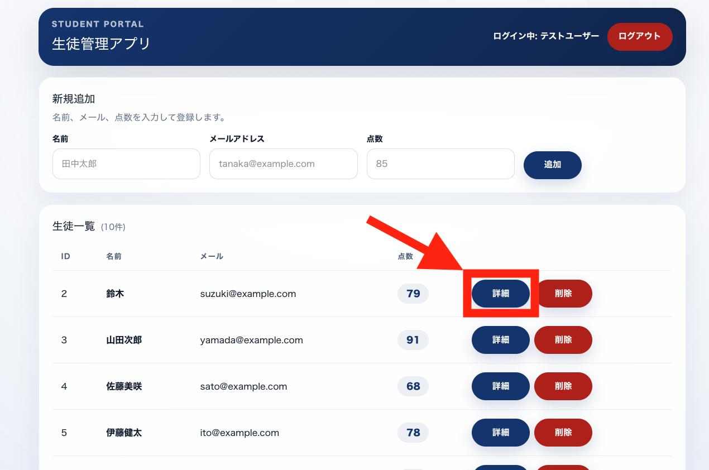
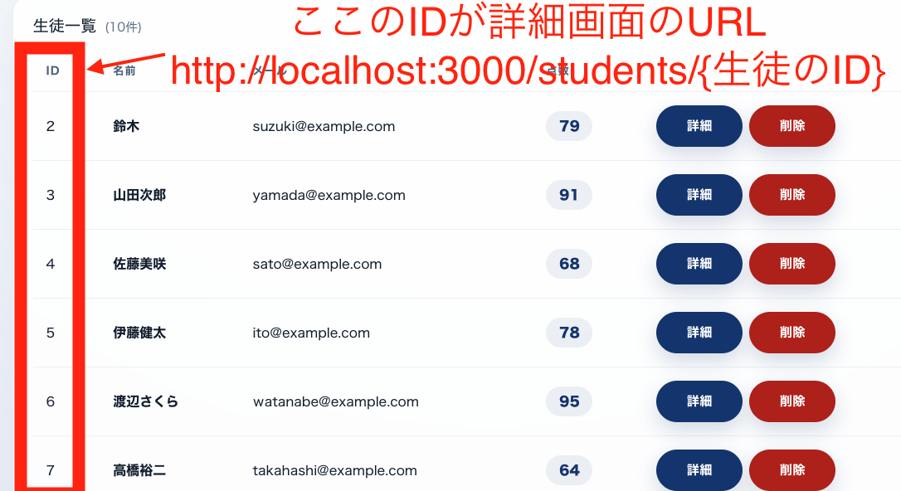
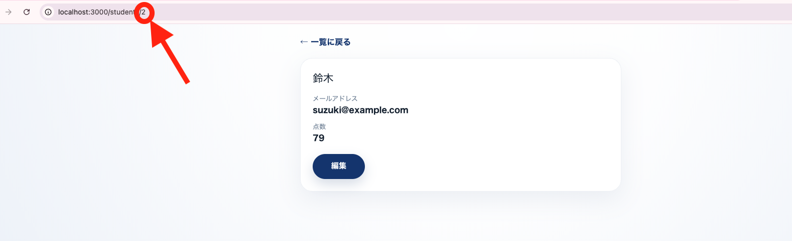
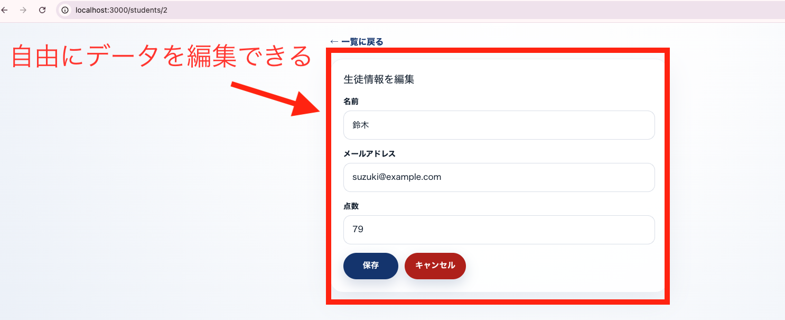
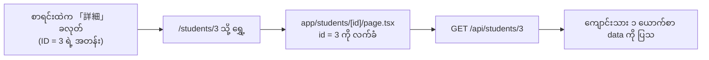

# အတန်းချိန် ၂၄｜အသေးစိတ်မျက်နှာပြင် ဖန်တီးခြင်း

> 🇯🇵 မူရင်း (ဂျပန်ဘာသာဖြင့်): [2026_07_16_課題.md](<../../../2年生_システム開発実践/前期/2026_07_16/2026_07_16_課題.md>) <!-- original-ja-link -->

---

# ဒီအထိ ပြီးသွားသူတွေက နောက်တစ်ဆင့်အနေနဲ့ အသေးစိတ်မျက်နှာပြင်ကို ဖန်တီးကြရအောင်

အခုအခြေအနေမှာ စာရင်းမျက်နှာပြင်မှာ အမည်・အီးမေးလ်・အမှတ်တွေကို တစ်ချက်ကြည့်ရုံနဲ့ မြင်ရပေမဲ့ ကျောင်းသား တစ်ယောက်ချင်းစီရဲ့ အချက်အလက်ကို အေးအေးဆေးဆေး စစ်ကြည့်ဖို့၊ အဲဒီကနေ ပြင်ဆင်ဖို့ မျက်နှာပြင် မရှိသေးပါဘူး။ စာရင်းထဲက 「詳細」(အသေးစိတ်) ခလုတ်ကို နှိပ်လိုက်တဲ့အခါ အဲဒီကျောင်းသား တစ်ယောက်တည်းရဲ့ အချက်အလက်ကို ပြသမယ့် မျက်နှာပြင်ကို ဖန်တီးပါမယ်။

## ဘာကို ဖန်တီးမလဲ

စာရင်းမျက်နှာပြင်ရဲ့ အတန်းတိုင်းမှာ ရှိတဲ့ 「詳細」 ခလုတ်ကို နှိပ်ရင် အဲဒီကျောင်းသားရဲ့ အချက်အလက်ကိုပဲ ပြသတဲ့ မျက်နှာပြင်ကို ရွှေ့သွားအောင် လုပ်ပါမယ်။

အဓိကအချက်က **စာရင်းထဲက ဘယ်အတန်းရဲ့ 「詳細」 ကို နှိပ်လိုက်သလဲ ဆိုတာပေါ် မူတည်ပြီး ရွှေ့သွားမယ့် URL ပြောင်းသွားတာ** ဖြစ်ပါတယ်။ ကျောင်းသားရဲ့ ID က URL ရဲ့ အစိတ်အပိုင်းတစ်ခု ဖြစ်လာပါတယ်။

ခလုတ်ကို နှိပ်လိုက်ရင် အောက်က ပုံလိုမျိုး အဲဒီကျောင်းသားရဲ့ အမည်・အီးမေးလ်လိပ်စာ・အမှတ်ကိုပဲ ပြသထားတဲ့ မျက်နှာပြင်ကို ရွှေ့သွားနိုင်ရင် အောင်မြင်ပါပြီ။

ထို့အပြင် အသေးစိတ်မျက်နှာပြင်ကနေ 「編集」(ပြင်ဆင်ရန်) ခလုတ်ကို နှိပ်ရင် အဲဒီနေရာမှာတင် form အဖြစ် ပြောင်းသွားပြီး အကြောင်းအရာကို ပြင်ရေးနိုင်အောင် လုပ်ပါမယ် (အတန်းချိန် ၂၁ မှာ ဖန်တီးခဲ့တဲ့ update လုပ်ဆောင်ချက်နဲ့ အတွေးအခေါ် အတူတူပါပဲ)။

## အသေးစိတ်မျက်နှာပြင် ဆိုတာ ဘာလဲ?

အသေးစိတ်မျက်နှာပြင်က CRUD ထဲက **Read (၁ ခုတည်းကို ကြည့်ခြင်း)** နဲ့ သက်ဆိုင်ပါတယ်။ စာရင်းမျက်နှာပြင်က "လူအားလုံးစာကို စုပြီး ကြည့်တဲ့" မျက်နှာပြင် ဖြစ်ခဲ့တာနဲ့ မတူဘဲ အသေးစိတ်မျက်နှာပြင်က "ID နဲ့ သတ်မှတ်ထားတဲ့ လူ ၁ ယောက်စာကိုပဲ ကြည့်တဲ့" မျက်နှာပြင် ဖြစ်ပါတယ်။

- စာရင်းမျက်နှာပြင်: `GET /api/students` → လူအားလုံးစာ data ပြန်လာတယ်
- အသေးစိတ်မျက်နှာပြင်: `GET /api/students/{id}` → သတ်မှတ်ထားတဲ့ ID နဲ့ ကိုက်ညီတဲ့ ကျောင်းသား ၁ ယောက်စာ data ကိုပဲ ပြန်ပေးတယ်

ဥပမာ ID 3 ဖြစ်တဲ့ ကျောင်းသားရဲ့ 「詳細」 ကို နှိပ်လိုက်တဲ့အခါ URL ထဲက ID ဘယ်လို လက်ဆင့်ကမ်းသွားလဲ ဆိုတာကို ပုံနဲ့ပြရင် အောက်ပါအတိုင်း ဖြစ်ပါတယ်။

ထို့အပြင် အသေးစိတ်မျက်နှာပြင်ကနေ ပြင်ဆင်ပြီး သိမ်းတဲ့ အပိုင်းက CRUD ထဲက **Update (ပြင်ဆင်ခြင်း)** နဲ့ သက်ဆိုင်ပါတယ်။ ပြသခြင်း (Read) နဲ့ ပြင်ဆင်ခြင်း (Update) က မျက်နှာပြင်တစ်ခုတည်းထဲမှာ အပြန်အလှန် ပြောင်းသွားတဲ့ တည်ဆောက်ပုံ ဖြစ်ပါတယ်။

## မျက်နှာပြင်မှာ လိုအပ်တဲ့ အစိတ်အပိုင်းများ

- ကျောင်းသားရဲ့ **အမည်** ပြသခြင်း
- ကျောင်းသားရဲ့ **အီးမေးလ်လိပ်စာ** ပြသခြင်း
- ကျောင်းသားရဲ့ **အမှတ်** ပြသခြင်း
- 「**編集**」(ပြင်ဆင်ရန်) ခလုတ် (နှိပ်ရင် form အဖြစ် ပြောင်းသွား)
- ပြင်ဆင်ရန် form မှာ အမည်・အီးမေးလ်လိပ်စာ・အမှတ် ထည့်ရန် အကွက်များနဲ့ 「**保存**」(သိမ်းရန်)・「**キャンセル**」(မလုပ်တော့ပါ) ခလုတ်များ
- 「**一覧に戻る**」(စာရင်းသို့ ပြန်သွားရန်) link

## ရေးသားရန် အရိပ်အမြွက်များ (ယခုအထိ သင်ခဲ့တာတွေနဲ့ ဆက်စပ်နေပါတယ်)

- စာရင်းမျက်နှာပြင်ရဲ့ 「詳細」 ခလုတ်ကို ကျောင်းသားတစ်ယောက်ချင်းစီအလိုက် `/students/{ကျောင်းသားရဲ့ ID}` ဆိုတဲ့ link ဖြစ်အောင် လုပ်ပါ (`` <Link href={`/students/${student.id}`}> `` လိုမျိုး ID ကို ထည့်သွင်းထားတဲ့ URL ကို ဖန်တီးပါ)
- Next.js မှာ URL ရဲ့ အစိတ်အပိုင်း (ID) ကို လက်ခံနိုင်တဲ့ **dynamic routing** ကို သုံးပါမယ်။ `app/students/[id]/page.tsx` လိုမျိုး folder・file ဖွဲ့စည်းပုံ လုပ်ထားရင် URL ရဲ့ `{id}` အပိုင်းက တန်ဖိုးကို စာမျက်နှာထဲမှာ လက်ခံနိုင်ပါတယ်
- စာမျက်နှာ ပေါ်လာတဲ့အခါ လက်ခံရရှိတဲ့ ID ကို သုံးပြီး `` fetch(`http://localhost:8000/api/students/${id}`) `` လိုမျိုး Laravel API ကို request ပို့ကာ အဲဒီကျောင်းသား ၁ ယောက်စာ data ကိုပဲ ရယူပါ
- Laravel ဘက်မှာ `routes/api.php` ရဲ့ `Route::apiResource('students', StudentController::class)` ကြောင့် တကယ်တော့ `show($id)` (၁ ခု ရယူခြင်း) နဲ့ `update($id)` (ပြင်ဆင်ခြင်း) route တွေကိုလည်း ပြင်ဆင်ထားပြီးသား ဖြစ်ပါတယ်။ `StudentController` မှာ ဒီ method ၂ ခု ရေးထားပြီးပြီလား စစ်ဆေးပါ
- 「編集」 ခလုတ်ကို နှိပ်ရင် ပြသပုံကို ပြောင်းချင်တဲ့အတွက် `useState` နဲ့ "အခု ပြသမုဒ်လား၊ ပြင်ဆင်မုဒ်လား" ဆိုတာကို သိမ်းထားရင် အတန်းချိန် ၁၇〜၂၁ မှာ ဖန်တီးခဲ့တဲ့ form ရဲ့ အတွေးအခေါ်ကို ဒီအတိုင်း သုံးနိုင်ပါတယ်
- 「保存」(သိမ်းရန်) ခလုတ်ကို နှိပ်တဲ့အခါ `fetch` မှာ `PUT` (ဒါမှမဟုတ် `PATCH`) ကို သုံးပြီး `http://localhost:8000/api/students/{id}` ကို ပို့ပါ။ token ကို `Authorization: Bearer ${token}` နဲ့ တွဲထည့်ဖို့ မမေ့ပါနဲ့
