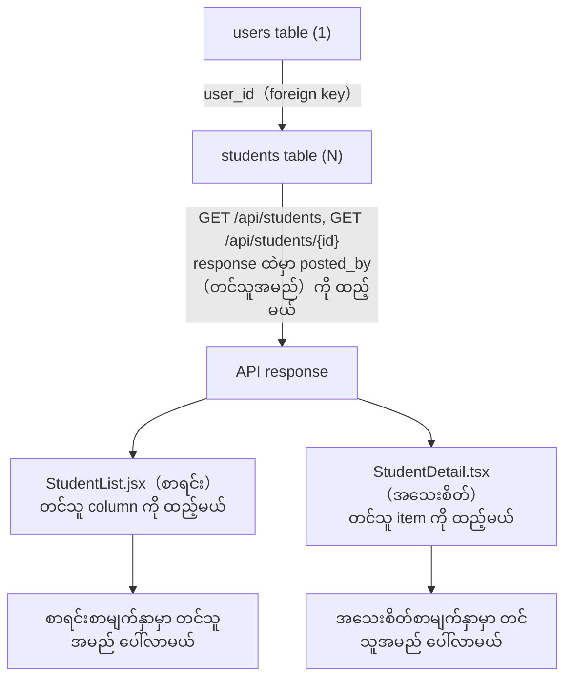
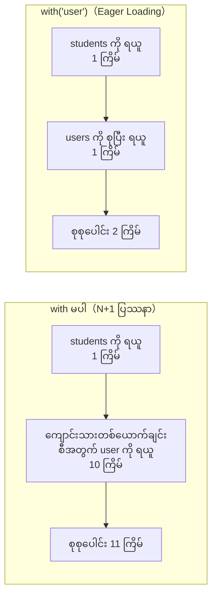

# အတန်းချိန် 25｜Users ⇔ Students ကို relation ချိတ်ပြီး တင်သူ (poster) ကို ပြသခြင်း - အကောင်အထည်ဖော်ပုံ အဆင့်များ

> 🇯🇵 မူရင်း (ဂျပန်ဘာသာဖြင့်): [2026_07_23_実装 .md](<../../../2年生_システム開発実践/前期/2026_07_23/2026_07_23_実装 .md>) <!-- original-ja-link -->

## ယနေ့ ရည်မှန်းချက်

- `students` table ထဲမှာ "ဘယ်သူ မှတ်ပုံတင်ခဲ့တဲ့ data လဲ" ဆိုတာကို ပြတဲ့ `user_id` ကို ထည့်ပေးမယ်
- `User` နဲ့ `Student` ကို Eloquent relation နဲ့ ချိတ်ဆက်မယ် (user တစ်ယောက်က ကျောင်းသား အများအပြားကို ပိုင်ဆိုင်နိုင်တယ်)
- ကျောင်းသားစာရင်း API နဲ့ အသေးစိတ် API ရဲ့ response ထဲမှာ "တင်သူအမည် (`posted_by`)" ကို ထည့်ပေးမယ်
- ကျောင်းသားအသစ် မှတ်ပုံတင်တဲ့အခါ login ဝင်ထားတဲ့ user နဲ့ အလိုအလျောက် ချိတ်ပြီး သိမ်းမယ်
- စာရင်းစာမျက်နှာ နဲ့ အသေးစိတ်စာမျက်နှာ နှစ်ခုလုံးမှာ "တင်သူ" ကို ပြမယ်

> **ဒီသင်ခန်းစာရဲ့ နေရာ：** အခုထိ `students` table မှာ "ဘယ်သူ မှတ်ပုံတင်ခဲ့လဲ" ဆိုတဲ့ အချက်အလက် မရှိခဲ့ပါဘူး။ `users` table နဲ့ foreign key relation ကို ထည့်ပြီး အဲဒီ အချက်အလက်ကို API ကနေတစ်ဆင့် frontend အထိ ပို့ကာ screen ပေါ်မှာ ပြပေးတဲ့ လုပ်ငန်းစဉ် တစ်ခုလုံးကို တည်ဆောက်ပါမယ်။

---

## အလုံးစုံ ပုံကြမ်း：ဘာကို တည်ဆောက်မလဲ



> 💡 **ဥပမာပေးရရင်… စာကြည့်တိုက်ရဲ့ စာအုပ်ငှားကတ်**
>
> `students` table ထဲက record တစ်ခုချင်းစီကို "စာအုပ်" လို့ ယူဆရင် `user_id` ဆိုတာ "ဘယ်သူ ငှားခဲ့တဲ့ (မှတ်ပုံတင်ခဲ့တဲ့) စာအုပ်လဲ" ဆိုတာကို ရေးထားတဲ့ ငှားကတ် ဖြစ်ပါတယ်။ ကတ်မရှိရင် စာအုပ်ကို ကြည့်ရုံနဲ့ "ဘယ်သူ တာဝန်ယူထားလဲ" ဆိုတာ မသိနိုင်ပါဘူး။ ပထမဆုံး စာအုပ် (`students`) ထဲမှာ ကတ်ညှပ်ထားမယ့်နေရာ (`user_id` column) ကို လုပ်မယ်၊ နောက်တစ်ဆင့်မှာ "အသုံးပြုသူ တစ်ယောက်က စာအုပ် အများကြီး ငှားနိုင်တယ်" ဆိုတဲ့ ဆက်ဆံရေးကို code (Eloquent) နဲ့ ဖော်ပြမယ်၊ နောက်ဆုံးမှာ အဲဒီ အချက်အလက်ကို screen ပေါ် ပြမယ်။

Eloquent မှာ ဒီဆက်နွယ်မှုတွေကို အောက်ပါအတိုင်း ဖော်ပြပါတယ်။

| Class | Method | အဓိပ္ပာယ် |
|---|---|---|
| `User` | `students()` | user တစ်ယောက်က ကျောင်းသား အများအပြားကို ပိုင်ဆိုင်တယ် (`hasMany`) |
| `Student` | `user()` | ကျောင်းသား record တစ်ခုက user တစ်ယောက်နဲ့ သက်ဆိုင်တယ် (`belongsTo`) |

### ဘာကြောင့် ဒီအစီအစဉ်အတိုင်း လုပ်တာလဲ

Backend မှာ `user_id` နဲ့ relation ကို ပြင်ဆင်ထားပြီး API က `posted_by` ကို ပြန်ပေးနိုင်အောင် မလုပ်ရသေးရင် frontend မှာ ပြစရာ data ကိုယ်တိုင်က မရှိနိုင်ပါဘူး။ ဒါကြောင့် **backend (migration → model → Controller/Seeder) → frontend (စာရင်း → အသေးစိတ်)** ဆိုတဲ့ အစီအစဉ်အတိုင်း လုပ်ငန်းကို အဆင့်ငယ်များခွဲပြီး အဆင့်တစ်ခုစီ ပြီးတိုင်း run ကြည့်ရင်း ရှေ့ဆက်သွားပါမယ်။

### File ဖွဲ့စည်းပုံ (ဒီတစ်ခါ ပြင်မယ့် file များ)

| သင်္ကေတ | အဓိပ္ပာယ် |
|---|---|
| 🆕 အသစ် | File အသစ် ဖန်တီးမယ် |
| ➕ ထပ်ထည့် | ရှိပြီးသား file ထဲကို code ထပ်ရေးထည့်မယ် |
| 🔁 အစားထိုး | ရှိပြီးသား လုပ်ဆောင်ချက်ကို ပြန်ရေးမယ် |
| 👀 စစ်ဆေး | ပြောင်းစရာ မလိုပါ။ လုပ်ပြီးသား ဟုတ်မဟုတ် စစ်ကြည့်ရုံပါပဲ |

```
Laravel/
├── database/migrations/xxxx_add_user_id_to_students_table.php  🆕 အသစ်（user_id column ကို ထည့်မယ်）
├── app/Models/User.php                                     ➕ students() relation ကို ထည့်မယ်
├── app/Models/Student.php                                  ➕ user() relation ကို ထည့်မယ်
├── app/Http/Controllers/Api/StudentController.php          🔁 index()၊ store() ကို ပြင်မယ်
├── app/Http/Resources/StudentResource.php                  ➕ posted_by ကို ထည့်မယ်
└── database/seeders/StudentSeeder.php                       🔁 user ကနေတစ်ဆင့် ကျောင်းသားကို ဖန်တီးမယ်

school-frontend/
├── components/students/StudentList.tsx     ➕ တင်သူ column ကို ထည့်မယ်（header၊ cell）
└── components/students/StudentDetail.tsx   ➕ တင်သူ item ကို ထည့်မယ်
```

---

## Step 1｜Backend：migration နဲ့ `user_id` ကို ထည့်ခြင်း

**🆕 File အသစ်** — ရှိပြီးသား `create_students_table` migration ကို တိုက်ရိုက် မပြင်ပါဘူး။ တစ်ခါ run ပြီးသား migration ကို ပြန်ရေးတာက ပြဿနာ ဖြစ်စေတတ်လို့ `user_id` column ထည့်ဖို့ သီးသန့် migration အသစ်တစ်ခု ဖန်တီးပါမယ်။

```bash
cd Laravel
php artisan make:migration add_user_id_to_students_table --table=students
```

`Laravel/database/migrations/` ထဲမှာ အောက်ပါလို နာမည်နဲ့ file တစ်ခု ထွက်လာပါမယ် (ရှေ့ဆုံးက run ခဲ့တဲ့ ရက်စွဲနဲ့ အချိန်ပါ)။

```
2026_07_16_000001_add_user_id_to_students_table.php
```

ထွက်လာတဲ့ file ထဲမှာ အောက်ပါအတိုင်း ရေးပါ။

```php
<?php
// ▼ database/migrations/2026_07_16_000001_add_user_id_to_students_table.php

use Illuminate\Database\Migrations\Migration;
use Illuminate\Database\Schema\Blueprint;
use Illuminate\Support\Facades\Schema;

return new class extends Migration
{
    public function up(): void
    {
        // ရှိပြီးသား students table ထဲကို user_id column ထည့်မယ်
        Schema::table('students', function (Blueprint $table) {
            $table->foreignId('user_id') // users.id ကို ရည်ညွှန်းတဲ့ foreign key column ကို ဖန်တီးမယ်
                ->after('id')             // id column ရဲ့ နောက်မှာ တန်းထားမယ် (ဖတ်ရလွယ်အောင်)
                ->constrained()           // ရည်ညွှန်းရာ (users table ရဲ့ id) ကို အလိုအလျောက် ခန့်မှန်းပြီး foreign key constraint သတ်မှတ်မယ်
                ->cascadeOnDelete();      // user ကို ဖျက်လိုက်ရင် အဲဒီ user ရဲ့ ကျောင်းသား data တွေကိုလည်း တစ်ပါတည်း ဖျက်မယ်
        });
    }

    public function down(): void
    {
        // migrate:rollback လုပ်တဲ့အခါ ထည့်ခဲ့တဲ့ foreign key နဲ့ column ကို မူလအတိုင်း ပြန်ထားမယ်
        Schema::table('students', function (Blueprint $table) {
            $table->dropForeign(['user_id']); // အရင်ဆုံး foreign key constraint ကို ဖြုတ်မယ်
            $table->dropColumn('user_id');    // column ကိုယ်တိုင်ကို ဖျက်မယ်
        });
    }
};
```

- `Schema::table('students', ...)` … ရှိပြီးသား table ကို "column ထည့်တဲ့" ပြောင်းလဲမှု ဖြစ်လို့ `create` မဟုတ်ဘဲ `table` ကို သုံးပါတယ်
- `foreignId('user_id')` … `users.id` ကို ရည်ညွှန်းတဲ့ foreign key column ကို ဖန်တီးပါတယ်
- `->after('id')` … `user_id` column ကို `id` ရဲ့ နောက်မှာ တန်းထားပါတယ် (ဖတ်ရလွယ်အောင်)
- `->constrained()` … ရည်ညွှန်းရာ (`users` table ရဲ့ `id`) ကို အလိုအလျောက် ခန့်မှန်းပြီး foreign key constraint သတ်မှတ်ပါတယ်
- `->cascadeOnDelete()` … user ကို ဖျက်လိုက်ရင် အဲဒီ user ပိုင်တဲ့ ကျောင်းသား data တွေကိုလည်း တစ်ပါတည်း ဖျက်ပါတယ်
- `down()` … `migrate:rollback` လုပ်တဲ့အခါ ထည့်ခဲ့တဲ့ foreign key နဲ့ column ကို မူလအတိုင်း ပြန်ထားနိုင်အောင် ပြင်ဆင်ထားပါတယ်

> ⚠️ `user_id` ကို နောက်မှ ထည့်တဲ့အခါ ရှိပြီးသား data တွေမှာ ချိတ်စရာ user မရှိပါဘူး။ Development လုပ်နေတုန်းဆိုရင် `php artisan migrate:fresh --seed` နဲ့ table တွေကို ပြန်ဆောက်ပြီး seeder နဲ့ အစကတည်းက user ပါတဲ့ data ကို ပြန်ထည့်တာ အလွယ်ဆုံးပါ (production နဲ့ တူတဲ့ data ကို ထိန်းထားချင်ရင်တော့ ပထမ `nullable()` နဲ့ ထည့်ပြီး backfill လုပ်၊ နောက် migration တစ်ခုမှာ `NOT NULL` constraint ထည့်ဆိုတဲ့ အဆင့်နှစ်ဆင့်နဲ့ ဖြေရှင်းဖို့ လိုပါတယ်)။

---

## Step 2｜Backend：model မှာ relation သတ်မှတ်ခြင်း

### 2-1. `app/Models/User.php`

**➕ ထပ်ထည့်** — `HasMany` ရဲ့ `use` statement နဲ့ `students()` method ကို ထည့်ပါ။

```php
use Illuminate\Database\Eloquent\Relations\HasMany; // ← relation type (HasMany) ကို သုံးနိုင်အောင် လုပ်မယ်

// ...

// user တစ်ယောက်က ကျောင်းသား အများအပြားကို ပိုင်ဆိုင်တယ် ဆိုတဲ့ ဆက်ဆံရေး (one-to-many) ကို ဖော်ပြတဲ့ method
// ဒါကို သတ်မှတ်ထားရင် $user->students နဲ့ "ဒီ user မှတ်ပုံတင်ခဲ့တဲ့ ကျောင်းသားစာရင်း" ကို ရယူနိုင်တယ်
public function students(): HasMany
{
    // hasMany(Student::class) … "Student model ကို အများကြီး ပိုင်ဆိုင်ထားတယ်" လို့ ဆိုလိုတယ်
    return $this->hasMany(Student::class);
}
```

### 2-2. `app/Models/Student.php`

**➕ ထပ်ထည့်** — `BelongsTo` ရဲ့ `use` statement နဲ့ `user()` method ကို ထည့်ပါ။

```php
use Illuminate\Database\Eloquent\Relations\BelongsTo; // ← relation type (BelongsTo) ကို သုံးနိုင်အောင် လုပ်မယ်

// ...

// ကျောင်းသား record တစ်ခုက user တစ်ယောက်နဲ့ သက်ဆိုင်တယ် ဆိုတဲ့ ဆက်ဆံရေး (many-to-one) ကို ဖော်ပြတဲ့ method
// ဒါကို သတ်မှတ်ထားရင် $student->user နဲ့ "ဒီကျောင်းသားကို မှတ်ပုံတင်ခဲ့တဲ့ user" ကို ရယူနိုင်တယ်
public function user(): BelongsTo
{
    // belongsTo(User::class) … "User model နဲ့ သက်ဆိုင်တယ်" လို့ ဆိုလိုတယ်
    // ※ ဒီ table ရဲ့ user_id column ကို ကြည့်ပြီး ကိုက်ညီတဲ့ users record ကို သွားရှာတယ်
    return $this->belongsTo(User::class);
}
```

ဒါဆိုရင် `$user->students` (ကျောင်းသား အများအပြားကို ရယူ) နဲ့ `$student->user` (အဲဒီ ကျောင်းသားရဲ့ တင်သူကို ရယူ) ဆိုပြီး ဦးတည်ချက် နှစ်ဖက်လုံးကနေ access လုပ်နိုင်သွားပါပြီ။

---

## Step 3｜Backend：Controller ကနေ တင်သူအမည်ကို ပြန်ပေးခြင်း

### 3-1. `index()` ကို ပြင်ခြင်း

**🔁 အစားထိုး** — `Student::all()` လို ရိုးရိုး ရယူတာ မဟုတ်ဘဲ `with('user')` နဲ့ relation ဘက်က data ကိုပါ တစ်ပါတည်း ဖတ်ယူ (Eager Loading) ပြီး `StudentResource` ကနေတစ်ဆင့် response အဖြစ် ပြောင်းပါမယ်။ `show()` က `StudentResource` ကို သုံးထားပြီးသား ဖြစ်လို့ `index()` ကိုလည်း ပုံစံတူ ညှိထားရင် တင်သူကို ပြတဲ့ နည်းလမ်းကို နေရာတစ်ခုတည်း (`StudentResource`) မှာ စုထားနိုင်ပါတယ်။

```php
public function index()
{
    // ကျောင်းသား data ကို ရယူတဲ့အခါ တင်သူ (user) ရဲ့ အချက်အလက်ကိုပါ တစ်ပါတည်း ဖတ်ယူထားမယ်
    // → ဒီလို မလုပ်ရင် ကျောင်းသား အရေအတွက်အတိုင်း "တင်သူအမည် ယူတဲ့" SQL တွေ ထွက်သွားလိမ့်မယ် (N+1 ပြဿနာ)
    $students = Student::with('user')->get();

    // ရယူထားတဲ့ ကျောင်းသား data ကို response ပုံစံ (StudentResource) အဖြစ် ပြောင်းပြီး ပြန်ပေးမယ်
    return StudentResource::collection($students);
}
```

> 💡 **N+1 ပြဿနာ ဆိုတာ ဘာလဲ？**
>
> `with('user')` မထည့်ဘဲ `Student::all()` ဒါမှမဟုတ် `Student::get()` လို့ ရေးရင် အောက်ပါလို SQL တွေ ထွက်ပါတယ်။
>
> 1. `students` table ကနေ ကျောင်းသားအားလုံးကို ရယူတဲ့ SQL (1 ကြိမ်)
> 2. Screen ဒါမှမဟုတ် response မှာ **ကျောင်းသား တစ်ယောက်ချင်းစီအတွက်** `$student->user->name` ကို access လုပ်တိုင်း "ဒီကျောင်းသားရဲ့ တင်သူ (user) ကို 1 ခု သွားယူတဲ့" SQL (ကျောင်းသား အရေအတွက်အတိုင်း＝N ကြိမ်)
>
> ဆိုလိုတာက ကျောင်းသား 10 ယောက် ရှိရင် "ကျောင်းသားစာရင်း ယူတဲ့ 1 ကြိမ်" ＋ "တင်သူ ယူတဲ့ 10 ကြိမ်" ＝ **စုစုပေါင်း 11 ကြိမ်** SQL ထွက်သွားပါတယ်။ ကျောင်းသား 100၊ 1000 ယောက်လို့ များလာလေ SQL အကြိမ်ရေလည်း အချိုးကျ များလာပြီး API က တဖြည်းဖြည်း နှေးလာပါတယ်။ ဒါကို **N+1 ပြဿနာ** (1 ကြိမ်နဲ့ ပြီးသင့်တာကို data N ခုအတွက် query N ကြိမ် ထပ်ပြီး run သွားတဲ့ ပြဿနာ) လို့ ခေါ်ပါတယ်။
>
> ရှေ့ဆုံးမှာ `with('user')` ထည့်ထားရင် Laravel က
>
> 1. `students` table ကို ရယူတဲ့ SQL (1 ကြိမ်)
> 2. အဲဒီမှာ ပါလာတဲ့ `user_id` တွေကို စုပြီး ကိုက်ညီတဲ့ `users` ကို တစ်ခါတည်း ရယူတဲ့ SQL (1 ကြိမ်)
>
> ဆိုပြီး **စုစုပေါင်း 2 ကြိမ်** နဲ့ ပြီးအောင် လုပ်ပေးပါတယ် (ဒါကို **Eager Loading**＝ကြိုတင်ပြီး တစ်ခါတည်း ဖတ်ယူခြင်း လို့ ခေါ်ပါတယ်)။ ကျောင်းသား ဘယ်လောက်ပဲ များလာပါစေ SQL ထွက်တဲ့ အကြိမ်ရေက အမြဲ 2 ကြိမ်ပဲ ရှိနေပါမယ်။ "နောက်မှ တစ်ခုချင်း သွားယူတာ (N+1)" မဟုတ်ဘဲ "အစကတည်းက စုပြီး ယူထားတာ (Eager Loading)" က အဓိက အချက်ပါ။
>
> ကျောင်းသား 10 ယောက် ရှိတဲ့အခါ SQL အကြိမ်ရေကို နှိုင်းယှဉ်ကြည့်ရင် အောက်ပါအတိုင်း ဖြစ်ပါတယ်။



> ⚠️ Return type ကို `: JsonResponse` လို့ ရေးချင်စိတ် ပေါ်နိုင်ပေမယ့် ဒီလိုရေးရင် `use Illuminate\Http\JsonResponse;` import လိုပါတယ်။ တခြား `store()`/`show()`/`update()`/`destroy()` တွေမှာလည်း type မရေးထားလို့ ညီအောင် type မပါဘဲ ထားပါမယ်။

### 3-2. `app/Http/Resources/StudentResource.php` မှာ `posted_by` ကို ထည့်ခြင်း

**➕ ထပ်ထည့်** — `index()` ကို ပြင်ရုံနဲ့ response ထဲမှာ `posted_by` မပေါ်သေးပါဘူး။ တကယ်တမ်း JSON အဖြစ် ပြောင်းပေးနေတာက `StudentResource` ဖြစ်လို့ ဒီမှာ ထည့်ပါမယ်။ `show()` (အသေးစိတ် API) ကလည်း အဲဒီ `StudentResource` ကိုပဲ ဖြတ်သွားလို့ တစ်ခါပြင်ရုံနဲ့ စာရင်းနဲ့ အသေးစိတ် နှစ်ခုလုံးမှာ သက်ရောက်ပါတယ်။

```php
public function toArray($request): array
{
    // ဒီကျောင်းသား data ကို မှတ်ပုံတင်ခဲ့တဲ့ တင်သူ (user) ရဲ့ အမည်ကို variable ထဲ အရင် ထုတ်ထားမယ်
    $postedByName = $this->user->name;

    return [
        'id'         => $this->id,
        'name'       => $this->name,
        'email'      => $this->email,
        'score'      => $this->score,
        'evaluation' => $this->score >= 80 ? 'A' : 'B',
        'created_at' => $this->created_at->format('Y/m/d'),
        'posted_by'  => $postedByName, // ★ ထပ်ထည့်：တင်သူရဲ့ အမည်
    ];
}
```

### 3-3. `store()` ကို ပြင်ခြင်း

**🔁 အစားထိုး** — `Student::create()` မဟုတ်ဘဲ login ဝင်ထားတဲ့ user ကနေတစ်ဆင့် ဖန်တီးခြင်းအားဖြင့် `user_id` ကို အလိုအလျောက် ထည့်ပေးအောင် လုပ်ပါမယ်။ Validation ကတော့ ရှိပြီးသားအတိုင်း `$request->validate(...)` ကို သုံးပြီး အဲဒီ ရလဒ် (`$validated`) ကို ကျောင်းသား ဖန်တီးရာမှာ တိုက်ရိုက် ပေးပါမယ်။

```php
public function store(Request $request)
{
    // Validation：ပို့လာတဲ့ data ရဲ့ ပုံစံကို စစ်ဆေးမယ်
    $validated = $request->validate([
        'name'  => 'required|max:100',          // မဖြစ်မနေ လိုအပ်၊ စာလုံး 100 အတွင်း
        'email' => 'required|email|unique:students', // မဖြစ်မနေ လိုအပ်၊ email ပုံစံ၊ ထပ်နေလို့ မရ
        'score' => 'required|integer|min:0|max:100', // မဖြစ်မနေ လိုအပ်၊ ကိန်းပြည့်၊ 0〜100
    ]);

    // $request->user() … အခု login ဝင်ထားတဲ့ user (Sanctum က authenticate လုပ်ပေးထားတယ်)
    // ->students()->create(...) … အဲဒီ user ရဲ့ ကျောင်းသားအဖြစ် အသစ် ဖန်တီးမယ်
    //   → Eloquent က user_id ထဲကို login ဝင်ထားတဲ့ user ရဲ့ ID ကို အလိုအလျောက် ထည့်ပေးတယ်
    $student = $request->user()->students()->create($validated);

    // 201 Created (ဖန်တီးမှု အောင်မြင်) status code နဲ့ ပြန်ပေးမယ်
    return response()->json([
        'status' => 'ok',
        'data'   => $student,
    ], 201);
}
```

`$request->user()` ဆိုတာ Sanctum နဲ့ authenticate လုပ်ပြီးသား user (＝အခု login ဝင်ထားတဲ့ ဆရာ) ပါ။ `->students()->create(...)` လို့ ရေးလိုက်ရင် Eloquent က `user_id` ထဲကို အဲဒီ user ရဲ့ ID ကို အလိုအလျောက် ဖြည့်ပေးပါတယ်။ `Student::create($request->all())` လို "parameter အားလုံး" ကို ပေးတာ မဟုတ်ဘဲ validation ဖြတ်ပြီးသား `$validated` ကိုပဲ ပေးတယ် ဆိုတဲ့ အချက်ကိုလည်း သတိထားကြည့်ပါ။

---

## Step 4｜Backend：seeder ကိုလည်း user ကနေတစ်ဆင့် ဖြစ်အောင် ပြောင်းခြင်း

ဒီ project မှာ `StudentSeeder.php` ဆိုတဲ့ file မရှိပါဘူး။ `database/seeders/DatabaseSeeder.php` ထဲမှာပဲ `Student::factory(10)->create()` လို့ တိုက်ရိုက်ရေးပြီး ကျောင်းသား data ကို ဖန်တီးထားပါတယ်။

```php
// database/seeders/DatabaseSeeder.php（လက်ရှိ အကြောင်းအရာ）
public function run(): void
{
    \App\Models\Student::factory(10)->create(); // ကျောင်းသား data 10 ခု ဖန်တီးမယ်
}
```

ဒီအတိုင်းဆိုရင် ကျောင်းသား data မှာ `user_id` မပါပါဘူး (ချိတ်စရာ user ကိုယ်တိုင်က မရှိပါဘူး)။ ဒါကြောင့် **① test user ကို အရင်ဖန်တီး → ② အဲဒီ user ကနေတစ်ဆင့် ကျောင်းသားကို ဖန်တီး** ဆိုတဲ့ အဆင့်နှစ်ဆင့်အဖြစ် ပြန်ရေးပါမယ်။ File အသစ် လုပ်စရာ မလိုဘဲ `DatabaseSeeder.php` ကို တိုက်ရိုက် ပြင်ရုံနဲ့ ရပါတယ်။

**🔁 အစားထိုး**

```php
// database/seeders/DatabaseSeeder.php（ပြင်ပြီးနောက်）
public function run(): void
{
    // ① login အတွက် test user တစ်ယောက် ဖန်တီးမယ်
    // User::factory() … UserFactory မှာ သတ်မှတ်ထားတဲ့ dummy data နဲ့ ဖန်တီးမယ်
    //   password က UserFactory ဘက်မှာ "password" ကို hash လုပ်ထားတဲ့ တန်ဖိုး ဖြစ်ပြီးသားမို့
    //   ဒီမှာ name နဲ့ email ကိုပဲ overwrite လုပ်လိုက်ရင် test@example.com / password နဲ့ login ဝင်နိုင်တယ်
    $user = \App\Models\User::factory()->create([
        'name'  => 'テストユーザー',
        'email' => 'test@example.com',
    ]);

    // ② ကျောင်းသား data ဖန်တီးတဲ့အခါ ->for($user) ကို ကြားထည့်ရင်
    //   Student::user() relation (belongsTo) ကနေတစ်ဆင့် user_id ထဲကို $user->id အလိုအလျောက် ဝင်သွားတယ်
    \App\Models\Student::factory(10)->for($user)->create();
}
```

`Student::factory(10)->for($user)` ထဲက `for()` ဆိုတာ "ဒီ model ($user) နဲ့ ချိတ်ပြီး ဖန်တီးမယ်" လို့ ဆိုလိုတဲ့ Factory ရဲ့ လုပ်ဆောင်ချက်ပါ။ `Student` model မှာ `user()` (`belongsTo(User::class)`) ကို သတ်မှတ်ထားပြီးသားမို့ Laravel က `user_id` ကို `$user->id` အဖြစ် အလိုအလျောက် သတ်မှတ်ပေးပါတယ်။ `$user->students()->create(...)` ကို တစ်ခုချင်း ခေါ်တာနဲ့ တူညီတဲ့ရလဒ်ကို Factory နဲ့ တစ်ခါတည်း ရယူတာလို့ နားလည်နိုင်ပါတယ်။

### လုပ်ဆောင်ချက် စစ်ဆေးခြင်း (backend)

```bash
cd Laravel
php artisan migrate:fresh --seed
php artisan serve
```

Login ဝင်ပြီး token ရယူပြီးနောက် စာရင်း API ကို ခေါ်ကြည့်ပြီး `posted_by` ပါမပါ စစ်ဆေးပါ။

```bash
curl http://localhost:8000/api/students \
  -H "Authorization: Bearer <ရယူထားတဲ့ token>" \
  -H "Accept: application/json"
```

| စစ်ဆေးမယ့်အချက် | လုပ်ဆောင်ချက် | မျှော်မှန်းထားတဲ့ ရလဒ် |
|---|---|---|
| Relation | စာရင်း API ကို run မယ် | ကျောင်းသား တစ်ယောက်ချင်းစီရဲ့ JSON ထဲမှာ `posted_by` (မှတ်ပုံတင်ခဲ့တဲ့ user အမည်) ပါတယ် |
| အသစ် မှတ်ပုံတင်ခြင်း | `POST /api/students` နဲ့ ကျောင်းသား ထည့်မယ် | DB ရဲ့ `students.user_id` ထဲမှာ login ဝင်ထားတဲ့ user ရဲ့ ID ဝင်တယ် |
| Cascade ဖျက်ခြင်း | သက်ဆိုင်ရာ user ကို DB ကနေ ဖျက်မယ် (development DB မှာ စမ်းမယ်) | အဲဒီ user မှတ်ပုံတင်ခဲ့တဲ့ ကျောင်းသား data တွေလည်း လိုက်ပြီး ပျက်သွားတယ် |
| N+1 ကာကွယ်မှု | `index()` မှာ query log ထည့်ပြီး စစ်မယ် | `students` ရယူတာ 1 ကြိမ်＋`users` ရယူတာ 1 ကြိမ်လောက်နဲ့ ပြီးတယ် (ကျောင်းသား အရေအတွက်အတိုင်း မထွက်ဘူး) |

---

## Step 5｜Frontend：စာရင်းစာမျက်နှာမှာ တင်သူ column ကို ထည့်ခြင်း

`school-frontend/components/StudentList.jsx` ကို ပြင်ပါမယ်။ ဒီ project က TypeScript type မသုံးတဲ့ ရိုးရိုး JSX (`.jsx`) နဲ့ ရေးထားလို့ `type Student` လို type သတ်မှတ်ချက် ဘယ်နေရာမှာမှ မရှိပါဘူး။ Backend က `posted_by` ကို ပြန်ပေးနေသရွေ့ frontend ဘက်မှာ `student.posted_by` လို့ ဒီအတိုင်း ရေးလိုက်ရုံနဲ့ တန်ဖိုးကို ထုတ်ယူနိုင်ပါတယ်။ Type ကို စစ်ဆေး/ပြင်ဆင်တဲ့ အဆင့် မလိုပါဘူး။

**➕ ထပ်ထည့် (table header)** — `点数` (အမှတ်) column ရဲ့ နောက်မှာ 「投稿者」(တင်သူ) header ကို ထည့်ပါ။

```jsx
<thead>
  <tr style={{ background: "#f5f5f5" }}>
    <th style={thStyle}>ID</th>
    <th style={thStyle}>名前</th>
    <th style={thStyle}>メール</th>
    <th style={thStyle}>点数</th>
    <th style={thStyle}>投稿者</th> {/* ★ ထပ်ထည့်：ဒီကျောင်းသားကို မှတ်ပုံတင်ခဲ့တဲ့ user အမည် column */}
    <th style={thStyle}></th>
  </tr>
</thead>
```

**➕ ထပ်ထည့် (`StudentRow` ထဲမှာ)** — အမှတ် cell ရဲ့ နောက်မှာ တင်သူအမည်ကို ပြမယ့် cell ကို ထည့်ပါ။

```jsx
<td style={tdStyle}>{student.score}</td>
{/* ★ ထပ်ထည့်：header မှာ ထည့်ထားတဲ့ "投稿者" (တင်သူ) column နဲ့ ကိုက်ညီတဲ့ cell။ အထဲမှာ တင်သူအမည် စာသားတစ်ခုတည်း ရှိရင် ရပြီ */}
<td style={tdStyle}>{student.posted_by}</td>
<td style={tdStyle}>
  <div style={{ display: "flex", gap: "0.5rem", flexWrap: "wrap" }}>
    {/* အသေးစိတ်၊ ဖျက်မယ့် ခလုတ်များ (ရှိပြီးသားအတိုင်း) */}
  </div>
</td>
```

Header နဲ့ cell ရဲ့ column အရေအတွက် မကွဲလွဲအောင် နှစ်ခုလုံးကို တွဲပြီး ထည့်တာက အဓိက အချက်ပါ။

---

## Step 6｜Frontend：အသေးစိတ်စာမျက်နှာမှာ တင်သူ item ကို ထည့်ခြင်း

`school-frontend/components/students/StudentDetail.tsx` ကို ပြင်ပါမယ်။ ဒီ file က `.tsx` extension ဖြစ်ပေမယ့် `props` မှာ type annotation မပါပါဘူး (`export default function StudentDetail({ student, token, onUpdated })` လို ရေးထားပါတယ်)။ ဒါကြောင့် type ကို စစ်ဆေး/ပြင်ဆင်တဲ့ အဆင့် မလိုပါဘူး။ Backend က `posted_by` ကို ပြန်ပေးရင် `student.posted_by` နဲ့ ဒီအတိုင်း ရည်ညွှန်းနိုင်ပါတယ်။

**➕ ထပ်ထည့် (ပြသမုဒ်ရဲ့ `<dl>` ထဲမှာ)** — 「点数」(အမှတ်) item ရဲ့ နောက်မှာ 「投稿者」(တင်သူ) item ကို ထည့်ပါ။ ရှိပြီးသား `<dt>`/`<dd>` နဲ့ style တူအောင် ညှိပါ။

```tsx
<dl style={{ display: "grid", gap: "16px", margin: 0 }}>
  <div>
    <dt style={{ fontSize: "0.9em", color: "#666", marginBottom: "4px" }}>メールアドレス</dt>
    <dd style={{ margin: 0, fontWeight: "bold", fontSize: "1.1em" }}>{student.email}</dd>
  </div>
  <div>
    <dt style={{ fontSize: "0.9em", color: "#666", marginBottom: "4px" }}>点数</dt>
    <dd style={{ margin: 0, fontWeight: "bold", fontSize: "1.1em" }}>{student.score} 点</dd>
  </div>
  <div>
    {/* ★ ထပ်ထည့်：ဒီကျောင်းသား data ကို ဘယ်သူ မှတ်ပုံတင်ခဲ့လဲ ပြတဲ့ item (ပြသဖို့သီးသန့်၊ ပြင်ဆင်တဲ့ form ထဲမှာ မထည့်ဘူး) */}
    <dt style={{ fontSize: "0.9em", color: "#666", marginBottom: "4px" }}>投稿者</dt>
    <dd style={{ margin: 0, fontWeight: "bold", fontSize: "1.1em" }}>{student.posted_by}</dd>
  </div>
</dl>
```

ပြင်ဆင်မုဒ် (form) ဘက်ကတော့ အမည်၊ email၊ အမှတ် ကိုပဲ ပြင်နိုင်တဲ့ အတိုင်း ထားလည်း ပြဿနာ မရှိပါဘူး။ 「投稿者」(တင်သူ) က ဘယ်သူ မှတ်ပုံတင်ခဲ့လဲ ပြတဲ့ ပြသဖို့သီးသန့် အချက်အလက် ဖြစ်လို့ ပြင်ဆင်တဲ့ form ထဲမှာ မထည့်ပါဘူး။

### လုပ်ဆောင်ချက် စစ်ဆေးခြင်း (frontend)

```bash
cd school-frontend && npm run dev
```

Backend (`php artisan serve`) ကို အရင် စတင်ပြီး login ဝင်ထားတဲ့ အခြေအနေမှာ စစ်ဆေးပါ။

| စစ်ဆေးမယ့်အချက် | လုပ်ဆောင်ချက် | မျှော်မှန်းထားတဲ့ ရလဒ် |
|---|---|---|
| စာရင်း ပြသခြင်း | `/students` ကို ဖွင့်မယ် | Row တစ်ခုချင်းစီရဲ့ 「点数」(အမှတ်) ညာဘက်မှာ 「投稿者」(တင်သူ) column ရှိပြီး မှတ်ပုံတင်ခဲ့တဲ့ user အမည် ပေါ်တယ် |
| အသေးစိတ် ပြသခြင်း | Row တစ်ခုခုရဲ့ 「詳細」(အသေးစိတ်) ကို ဖွင့်မယ် | အမည်၊ email၊ အမှတ် အပြင် 「投稿者」(တင်သူ) ပါ ပေါ်တယ် |
| Type error မရှိ | `npx tsc --noEmit` ကို run မယ် | Error မထွက်ဘူး (`posted_by` က ရှိပြီးသား type ထဲမှာ ပါပြီးသားမို့) |
| Layout မပျက် | စာရင်းရဲ့ header နဲ့ cell ရဲ့ column အရေအတွက်ကို နှိုင်းယှဉ်ကြည့်မယ် | Header နဲ့ cell အရေအတွက် တူညီပြီး ဇယားရဲ့ ကော်လံတွေ လွဲမနေဘူး |

---

## အနှစ်ချုပ်

| သဘောတရား | ဒီတစ်ခါ ပြင်ခဲ့တဲ့ နေရာ |
|---|---|
| One-to-many relation | `students.user_id`、`User::students()`、`Student::user()` |
| Eager Loading (N+1 ကာကွယ်မှု) | `StudentController@index` ရဲ့ `Student::with('user')` |
| Login user နဲ့ အလိုအလျောက် ချိတ်ဆက်ခြင်း | `StudentController@store` ရဲ့ `$request->user()->students()->create(...)` |
| API response ထဲ တင်သူ အချက်အလက် ထည့်ခြင်း | `posted_by` field |
| Frontend မှာ ပြသခြင်း | `StudentList.tsx`／`StudentDetail.tsx` |

## ပြီးဆုံးကြောင်း checklist (Definition of Done)

- [ ] `students` table မှာ `user_id` column ရှိပြီး `users.id` ကို ရည်ညွှန်းတဲ့ foreign key constraint သတ်မှတ်ထားတယ်
- [ ] `User::students()` / `Student::user()` ဆိုတဲ့ နှစ်ဖက်သွား relation ကို သတ်မှတ်ထားတယ်
- [ ] `GET /api/students` ရဲ့ response ထဲမှာ `posted_by` (တင်သူအမည်) ပါတယ်
- [ ] `POST /api/students` နဲ့ ကျောင်းသား ဖန်တီးရင် login ဝင်ထားတဲ့ user နဲ့ အလိုအလျောက် ချိတ်သွားတယ်
- [ ] Seeder ကို ပြန် run လည်း `posted_by` ထဲမှာ test user အမည် ဝင်တယ်
- [ ] `/students` ရဲ့ စာရင်း table မှာ 「投稿者」(တင်သူ) column ရှိပြီး မှတ်ပုံတင်ခဲ့တဲ့ user အမည် ပေါ်တယ်
- [ ] `/students/{id}` ရဲ့ အသေးစိတ်စာမျက်နှာမှာ 「投稿者」(တင်သူ) item ရှိပြီး မှတ်ပုံတင်ခဲ့တဲ့ user အမည် ပေါ်တယ်
- [ ] ပြင်ဆင်တဲ့ form ထဲမှာ တင်သူ field မထည့်ထားဘူး (ပြသဖို့သီးသန့် ဖြစ်လို့)
- [ ] `npx tsc --noEmit` က error မရှိဘဲ အောင်မြင်တယ်

## စတင် run တဲ့ command များ

```bash
# Backend
cd Laravel && php artisan serve   # http://localhost:8000

# Frontend
cd school-frontend && npm run dev # http://localhost:3000
```

Test account: `test@example.com` / `password`
