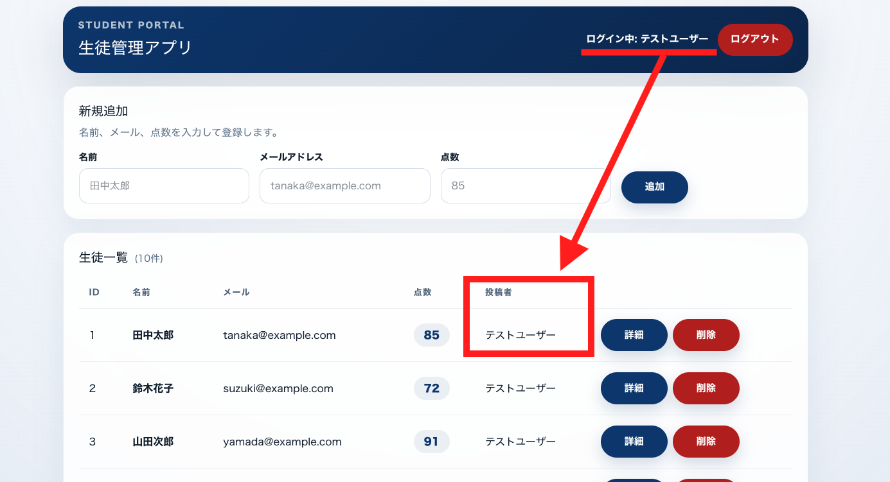
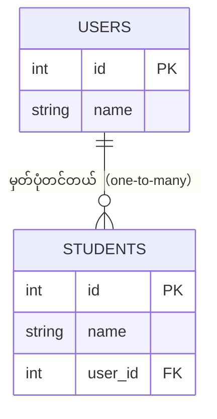

# အတန်းချိန် 25｜Users ⇔ Students ကို relation ချိတ်ခြင်း

> 🇯🇵 မူရင်း (ဂျပန်ဘာသာဖြင့်): [2026_07_23_課題.md](<../../../2年生_システム開発実践/前期/2026_07_23/2026_07_23_課題.md>) <!-- original-ja-link -->

---

# ဒီအထိ လုပ်ပြီးသွားတဲ့သူတွေ နောက်တစ်ဆင့်အနေနဲ့ Users table နဲ့ Students table ကို relation ချိတ်ကြရအောင်

[Relational database အကြောင်း](./リレーショナルデータベース入門.md)

လက်ရှိ အခြေအနေမှာ `students` table ထဲမှာ "အဲဒီ ကျောင်းသား data ကို ဘယ်သူ မှတ်ပုံတင်ခဲ့လဲ" ဆိုတဲ့ အချက်အလက် မရှိပါဘူး။ ဘယ်သူမဆို စာရင်းတစ်ခုတည်းကိုပဲ မြင်ရပြီး "ဒီ data ကို ကိုယ် (login ဝင်ထားတဲ့ user) မှတ်ပုံတင်ခဲ့တာ" ဆိုတာ မသိနိုင်တဲ့ ပုံစံ ဖြစ်နေပါတယ်။

`users` table နဲ့ `students` table ကို relation (ဆက်စပ်ချိတ်ဆက်မှု) ချိတ်ပြီး စာရင်းစာမျက်နှာ နဲ့ အသေးစိတ်စာမျက်နှာမှာ မှတ်ပုံတင်ခဲ့တဲ့ user ရဲ့ အမည်ကို 「投稿者」(တင်သူ) အဖြစ် ပြပေးအောင် လုပ်ပါမယ်။

## ဘာကို တည်ဆောက်မလဲ

ကျောင်းသားအသစ် မှတ်ပုံတင်လိုက်ရင် အဲဒီ ကျောင်းသား data နဲ့ "အခု login ဝင်ထားတဲ့ user" ကို အလိုအလျောက် ချိတ်ပေးအောင် လုပ်ပါမယ်။ ပြီးတော့ စာရင်းစာမျက်နှာ နဲ့ အသေးစိတ်စာမျက်နှာ နှစ်ခုလုံးမှာ အဲဒီ ကျောင်းသားကို မှတ်ပုံတင်ခဲ့တဲ့ user အမည် (တင်သူ) ကို ပြပါမယ်။

အဓိက အချက်က **login ဝင်ထားတဲ့ user အမည် (ညာဘက်အပေါ်) နဲ့ စာရင်းရဲ့ 「投稿者」(တင်သူ) column မှာ ပေါ်တဲ့ အမည် တူညီနေရမယ်** ဆိုတာပါ။ ဒီတစ်ခါ test user ဆိုရင် ဘယ်ကျောင်းသား row ကို ကြည့်ကြည့် 「投稿者：テストユーザー」(တင်သူ：test user) လို့ ပေါ်နေရပါမယ် (လက်ရှိ seed data အားလုံးကို user တစ်ယောက်တည်းက မှတ်ပုံတင်ခဲ့တယ်လို့ သတ်မှတ်ထားလို့ပါ)။

## Relation ဆိုတာ ဘာလဲ？

`users` table နဲ့ `students` table က အခုအချိန်မှာ လုံးဝ သီးခြားစီ table တွေအဖြစ် ရှိနေပါတယ်။ ဒါတွေကို "user တစ်ယောက်က ကျောင်းသား အများအပြားကို မှတ်ပုံတင်နိုင်တယ်" ဆိုတဲ့ ဆက်ဆံရေးနဲ့ ချိတ်ဆက်တာက ဒီတစ်ခါရဲ့ relation ပါ။

- `users` table：record 1 ခု＝user 1 ယောက် (ဆရာ)
- `students` table：record 1 ခု＝ကျောင်းသား 1 ယောက်

ဒီနှစ်ခုကို `students` ဘက်မှာ "ဘယ် user က မှတ်ပုံတင်ခဲ့လဲ" ဆိုတာ ပြတဲ့ column (**foreign key**) ထည့်ပေးခြင်းအားဖြင့် ချိတ်ဆက်ပါတယ်။ ဒါကြောင့်

- user တစ်ယောက်က ကျောင်းသား အများအပြားကို ပိုင်ဆိုင်နိုင်တယ် (**one-to-many** ဆက်ဆံရေး)
- ကျောင်းသား data 1 ခုက user တစ်ယောက်နဲ့ အမြဲ သက်ဆိုင်တယ်

ဆိုတဲ့ ဆက်ဆံရေးကို database ပေါ်မှာ ဖော်ပြနိုင်ပါတယ်။ ပုံနဲ့ ပြရရင် အောက်ပါအတိုင်းပါ (`user_id` က foreign key ပါ)။

Laravel မှာ ဒီ foreign key ကို အခြေခံပြီး `User` model၊ `Student` model တွေမှာ relation သတ်မှတ်ပေးခြင်းအားဖြင့် "ဒီ user မှတ်ပုံတင်ခဲ့တဲ့ ကျောင်းသားစာရင်း" ဒါမှမဟုတ် "ဒီကျောင်းသားကို မှတ်ပုံတင်ခဲ့တဲ့ user" ကို လွယ်လွယ်ကူကူ ရယူနိုင်သွားပါတယ်။

## Screen အတွက် လိုအပ်တဲ့ အစိတ်အပိုင်းများ

- ကျောင်းသားစာရင်း စာမျက်နှာ (`/students`) ရဲ့ row တစ်ခုချင်းစီမှာ **投稿者** (တင်သူ၊ မှတ်ပုံတင်ခဲ့တဲ့ user အမည်) ကို ပြတဲ့ column
- ကျောင်းသား အသေးစိတ်စာမျက်နှာ (`/students/{id}`) မှာလည်း အလားတူ **投稿者** (တင်သူ) ကို ပြတဲ့ item
- ကျောင်းသားအသစ် မှတ်ပုံတင်တဲ့အခါ အဲဒီ ကျောင်းသား data က "အခု login ဝင်ထားတဲ့ user" နဲ့ အလိုအလျောက် ချိတ်သွားရမယ် (တခြား user က မှတ်ပုံတင်ခဲ့တယ်လို့ မဖြစ်ရဘူး)

## အကောင်အထည်ဖော်ဖို့ hint များ (အခုထိ သင်ခဲ့တာတွေနဲ့ ဆက်စပ်နေပါတယ်)

- Database ဘက်မှာ `students` table ထဲကို `users` table ကို ရည်ညွှန်းတဲ့ foreign key column (ဥပမာ：`user_id`) ကို ထည့်ပါ။ အလုပ်လုပ်နေပြီးသား table ရဲ့ migration ကို တိုက်ရိုက် ပြန်ရေးတာထက် column ထည့်ဖို့ **migration အသစ်** ဖန်တီးတာက ပိုလုံခြုံပါတယ်
- Foreign key ထည့်ရင် "ရည်ညွှန်းရာ user ကို ဖျက်လိုက်တဲ့အခါ ဘာလုပ်မလဲ" ဆိုတာကိုလည်း ဆုံးဖြတ်ဖို့ လိုပါတယ် (ဖျက်တာနဲ့ တွဲပြီး ကျောင်းသား data ကိုလည်း ဖျက်မယ်၊ စသဖြင့်)
- Laravel မှာ `User` model ထဲမှာ "user တစ်ယောက်က ကျောင်းသား အများအပြားကို ပိုင်ဆိုင်တယ်" ဆိုတဲ့ relation (`hasMany`)၊ `Student` model ထဲမှာ "ကျောင်းသားမှတ်တမ်းတစ်ခုစီက user တစ်ယောက်နဲ့ သက်ဆိုင်တယ်" ဆိုတဲ့ relation (`belongsTo`) ကို သတ်မှတ်ပါ
- ကျောင်းသားစာရင်းကို ပြန်ပေးတဲ့ API (`index()`) မှာ ကျောင်းသား data နဲ့အတူ မှတ်ပုံတင်ခဲ့တဲ့ user ရဲ့ အချက်အလက်ကိုပါ ရယူပြီး response ထဲမှာ တင်သူအမည် ပါအောင် လုပ်ပါ။ User အချက်အလက်ကို တစ်ခုချင်း သွားယူရင် ဆက်သွယ်မှု (SQL) တွေ အလကား များလာတယ် ဆိုတာကိုလည်း သတိထားပါ (`with()` ကို သုံးတဲ့ ကြိုတင်ဖတ်ယူခြင်းက အသုံးဝင်ပါတယ်)
- ကျောင်းသားအသစ် မှတ်ပုံတင်တဲ့ API (`store()`) မှာ `$request->user()` (အခု login ဝင်ထားတဲ့ user) ကနေတစ်ဆင့် data ဖန်တီးခြင်းအားဖြင့် foreign key က အဲဒီ user ရဲ့ ID ဖြစ်သွားအောင် အလိုအလျောက် လုပ်ပါ
- Frontend ဘက်မှာ API response ရဲ့ type (`type Student`) ထဲကို တင်သူအမည် field ကို ထည့်ပြီး စာရင်း table နဲ့ အသေးစိတ်စာမျက်နှာ တစ်ခုချင်းစီမှာ ပြမယ့် JSX ကို ထည့်ပါ

## အကောင်အထည်ဖော်ပုံ အဆင့်ဆင့်

**1. DB ဘက်မှာ foreign key ထည့်ခြင်း**

`students` table ထဲကို `user_id` column ထည့်ပါ။ ရှိပြီးသား migration ကို ပြန်မရေးဘဲ migration file အသစ် ဖန်တီးပြီး ထည့်တာက ပိုလုံခြုံပါတယ် (production မှာ အလုပ်လုပ်နေတဲ့ table ဖွဲ့စည်းပုံကို နောက်မှ ပြောင်းတဲ့အခါ စံနည်းလမ်းပါ)။

**↓**

**2. ဖျက်တဲ့အခါ ဘယ်လို ပြုမူမလဲ ဆုံးဖြတ်ခြင်း**

Foreign key သတ်မှတ်တဲ့အခါ ရည်ညွှန်းထားတဲ့ `users` ထဲက user ကို ဖျက်လိုက်ရင် ဘာလုပ်မလဲ (`onDelete('cascade')` နဲ့ ကျောင်းသား data ကိုလည်း တစ်ပါတည်း ဖျက်မယ်၊ စသဖြင့်) ဆိုတာကိုလည်း တစ်ခါတည်း သတ်မှတ်ဖို့ လိုပါတယ်။

**↓**

**3. Model မှာ relation သတ်မှတ်ခြင်း**

- `User` model → `hasMany(Student::class)` (user တစ်ယောက်က ကျောင်းသား အများအပြားကို ပိုင်ဆိုင်နိုင်တယ်)
- `Student` model → `belongsTo(User::class)` (ကျောင်းသားမှတ်တမ်းတစ်ခုစီက user တစ်ယောက်နဲ့ သက်ဆိုင်တယ်)

**↓**

**4. စာရင်း API ကို ပြင်ခြင်း (`index()`)**

ကျောင်းသား data ကို ရယူတဲ့အခါ တင်သူ (user) အချက်အလက်ကိုပါ တစ်ပါတည်း ရယူပါ။ ဒီနေရာမှာ query ကို တစ်ခုချင်း ပို့ရင် N+1 ပြဿနာကြောင့် SQL တွေ အလကား များလာလို့ `with('user')` လို Eager Loading ကို သုံးပါ။

**↓**

**5. မှတ်ပုံတင် API ကို ပြင်ခြင်း (`store()`)**

ကျောင်းသားအသစ် ဖန်တီးတဲ့အခါ `$request->user()` ကနေ ရယူထားတဲ့ "အခု login ဝင်ထားတဲ့ user" ကနေတစ်ဆင့် record ကို ဖန်တီးပါ။ ဒီလိုလုပ်ရင် `user_id` က အဲဒီ user ရဲ့ ID ဖြစ်သွားအောင် အလိုအလျောက် သတ်မှတ်ပေးလို့ ဘယ်သူမဆို တခြားသူရဲ့ ID ကို သတ်မှတ်လို့ရနေတယ် ဆိုတဲ့ မတရားလုပ်ရပ်မျိုး မဖြစ်တော့ပါဘူး။

**↓**

**6. Frontend ဘက်ကို ပြင်ခြင်း**

`type Student` type သတ်မှတ်ချက်ထဲကို တင်သူအမည် field ထည့်ပါ → စာရင်း table ရဲ့ row နဲ့ အသေးစိတ်စာမျက်နှာရဲ့ JSX ထဲမှာ 「投稿者：〇〇」(တင်သူ：〇〇) ကို ပြမယ့် အပိုင်းကို ထည့်ပါ။
