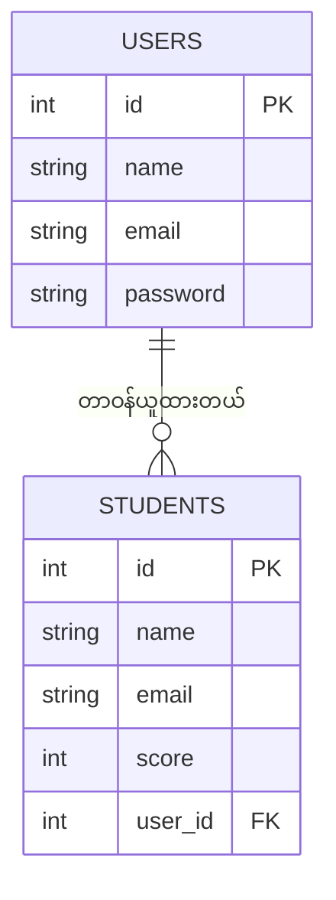

> 🇯🇵 မူရင်း (ဂျပန်ဘာသာဖြင့်): [リレーショナルデータベース入門.md](<../../../2年生_システム開発実践/前期/2026_07_23/リレーショナルデータベース入門.md>) <!-- original-ja-link -->

## ဒီဆောင်းပါးမှာ သိရမယ့်အရာများ

- Table၊ row၊ column
- Primary key
- Foreign key နဲ့ table အချင်းချင်း ချိတ်ဆက်မှု
- Table တွေကို ခွဲထားရတဲ့ အကြောင်းရင်း

## Database = စနစ်တကျ စီထားတဲ့ ဇယားတွေရဲ့ အစုအဝေး

စာရွက်ပေါ်မှာ ဟိုနေရာဒီနေရာ ရေးမှတ်ထားတာ မဟုတ်ဘဲ ဇယားပုံစံနဲ့ စနစ်တကျ စီပြီး သိမ်းဆည်းတဲ့ စနစ်ကို "database" လို့ ခေါ်ပါတယ်။ RDB (relational database) ရဲ့ ထူးခြားချက်က ဒီဇယား (table) တွေကို အများအပြား ချိတ်ဆက်ပြီး (=relation ချိတ်ပြီး) ကိုင်တွယ်နိုင်တာပါ။

## Table၊ row၊ column

ဒီ app မှာ တာဝန်မတူတဲ့ table 2 ခု ရှိပါတယ်။ တစ်ခုချင်းစီကို ဥပမာအဖြစ် ယူပြီး အစိတ်အပိုင်း တစ်ခုချင်းစီရဲ့ အမည်ကို လေ့လာကြည့်ရအောင်။

### 🎓 students table (ကျောင်းသား data)

| id | name | email | score |
|----|------|-------|-------|
| 1  | 田中太郎 | tanaka@example.com | 80 |
| 2  | 佐藤花子 | sato@example.com | 95 |

- **Table**: ဒီဇယား ကိုယ်တိုင် (အသုံးပြုပုံအလိုက် အများအပြား ဖန်တီးတယ်)
- **Column**: `id` `name` `email` `score` လို ဒေါင်လိုက် item တွေ
- **Row (record)**: data 1 ခုစာ (ဒီမှာဆိုရင် ကျောင်းသား 1 ယောက်စာ အချက်အလက်)

### 🔑 users table (ဆရာ၊ စီမံခန့်ခွဲသူတွေရဲ့ login အချက်အလက်)

| id | name | email | password |
|----|------|-------|----------|
| 1  | 小山先生 | koyama@example.com | $2y$10$abcdefGhIjKlmn...(hash လုပ်ပြီးသား) |
| 2  | 田中先生 | tanaka-t@example.com | $2y$10$OpQrStUvWxYz...(hash လုပ်ပြီးသား) |

- **Table**: `users` (login အတွက် account အချက်အလက်။ students နဲ့ တာဝန်မတူ)
- **Column**: `id` `name` `email` `password`
- **Row (record)**: data 1 ခုစာ (ဒီမှာဆိုရင် ဆရာ၊ စီမံခန့်ခွဲသူ 1 ယောက်စာ login အချက်အလက်)

> 💡 `password` ကို ရိုက်ထည့်လိုက်တဲ့ စာသားအတိုင်း (plain text) မသိမ်းဘဲ hash လုပ်ခြင်း ဆိုတဲ့ ပြန်ပြောင်းလို့မရတဲ့ ပြောင်းလဲမှုကို လုပ်ပြီးမှ သိမ်းပါတယ်။ တကယ်လို့ database ထဲက အချက်အလက်တွေ ပေါက်ကြားသွားခဲ့ရင်တောင် မူလ password ကို မသိနိုင်အောင်ပါ။

## Primary key：data ကို တစ်ခုတည်းအဖြစ် ခွဲခြားသိနိုင်တဲ့ ID

`name` (အမည်) တစ်ခုတည်းနဲ့ ရှာရင် နာမည်တူသူ ရှိနေတဲ့အခါ ဘယ်သူလဲ အတိအကျ မသိနိုင်ပါဘူး။ ဒါကြောင့် တခြား row တွေနဲ့ ဘယ်တော့မှ မထပ်တဲ့ နံပါတ် (**primary key**) ကို သုံးပါတယ်။ အပေါ်က ဇယားရဲ့ `id` က အဲဒါပါ။ "id = 1 ရဲ့ data ကို ပေးပါ" လို့ ပြောရင် 田中太郎 (Tanaka Taro) ရဲ့ data 1 ခုတည်းကို ရွေးထုတ်နိုင်ပါတယ်။ Primary key = မှတ်ပုံတင်နံပါတ် ဒါမှမဟုတ် အသင်းဝင်နံပါတ်လိုမျိုး လို့ မြင်ကြည့်ရင် နားလည်ရလွယ်ပါတယ်။

## Foreign key：table အချင်းချင်း ချိတ်ဆက်မှု

Table အများအပြားကို ID နဲ့ ဆက်စပ်ချိတ်ဆက်နိုင်တာက RDB ရဲ့ အနှစ်သာရ (= "relational" ဆိုတဲ့ အမည်ရဲ့ မူလအစ) ပါ။

ဒီ app မှာ login အတွက် `users` table (ဆရာ၊ စီမံခန့်ခွဲသူ account) နဲ့ ကျောင်းသား data ရဲ့ `students` table ဆိုပြီး 2 ခု ရှိပါတယ်။ လောလောဆယ်တော့ ဒီ 2 ခုက ID နဲ့ ချိတ်ဆက်မထားတဲ့ သီးခြား table တွေပါ။

တကယ်လို့ "ဘယ်ဆရာ (user) က ဘယ်ကျောင်းသား (student) ကို မှတ်ပုံတင်ထား/တာဝန်ယူထားလဲ" ဆိုတာကို မှတ်တမ်းတင်ချင်လာရင် `students` table ထဲကို `user_id` ဆိုတဲ့ column ထည့်ပြီး ချိတ်ဆက်ပါတယ်။

`USERS.id` (primary key) ကို `STUDENTS.user_id` (foreign key) က ရည်ညွှန်းတဲ့ ပုံစံ လုပ်လိုက်ရင် ဆရာ (user) တစ်ယောက်က ကျောင်းသား (student) အများအပြားကို တာဝန်ယူနိုင်တဲ့ ဆက်ဆံရေး (one-to-many) ကို ဖော်ပြနိုင်ပါတယ်။

## ဘာကြောင့် table တွေကို ခွဲထားရတာလဲ

Table မခွဲဘဲ ဇယားတစ်ခုတည်းထဲ စုထည့်လိုက်ရင် တာဝန်ယူတဲ့ ဆရာတစ်ယောက်တည်းရဲ့ အမည်နဲ့ email လိပ်စာက သူတာဝန်ယူတဲ့ ကျောင်းသား အရေအတွက်အတိုင်း ထပ်နေပါလိမ့်မယ်။

| student_id | student_name | staff_name | staff_email |
|-----------|-------|-------------|---------------|
| 101 | 田中花子 | 小山先生 | koyama@example.com |
| 103 | 田中次郎 | 小山先生 | koyama@example.com |

ဒီလိုဆိုရင် 小山先生 (Koyama ဆရာ) က email လိပ်စာ ပြောင်းတဲ့အခါ သက်ဆိုင်တဲ့ row အားလုံးကို ရှာပြီး ပြင်ရပါမယ်၊ ပြင်ဖို့ ကျန်ခဲ့တာမျိုး ဖြစ်လွယ်ပါတယ်။ users table နဲ့ students table ကို ခွဲပြီး ID နဲ့ ဆက်စပ်ထားရင် 小山先生 (Koyama ဆရာ) ရဲ့ အချက်အလက်က နေရာ 1 ခုတည်းမှာပဲ ရှိပြီး ပြင်တာလည်း နေရာ 1 ခုတည်းမှာ ပြင်ရုံနဲ့ ပြီးပါတယ်။ ဒီလို "ထပ်နေတာကို ရှောင်ဖို့ table တွေကို ခွဲတဲ့" အတွေးအခေါ်ကို **normalization** လို့ ခေါ်ပါတယ်။

## အနှစ်ချုပ်

- Database ဆိုတာ data တွေကို စနစ်တကျ စီပြီး သိမ်းဆည်းထားတဲ့ စနစ်
- RDB က data တွေကို "table (ဇယား)" ပုံစံနဲ့ စီမံပြီး table က "column (item)" နဲ့ "row (data 1 ခုစာ)" တွေနဲ့ ဖွဲ့စည်းထားတယ်
- Primary key ဆိုတာ data တစ်ခုချင်းစီကို မထပ်အောင် ခွဲခြားသိနိုင်ဖို့ အမှတ်အသား (ID)
- Foreign key ဆိုတာ တခြား table ရဲ့ primary key ကို ရည်ညွှန်းပြီး table အချင်းချင်းကို ဆက်စပ်ပေးတဲ့ စနစ်
- Table တွေကို ခွဲပြီး ဆက်စပ်ထားခြင်းအားဖြင့် အချက်အလက်တူ ထပ်နေတာကို ကာကွယ်ပြီး data ကို စီမံရ လွယ်ကူစေတယ်

ဒီနောက်ပိုင်းမှာ "SQL" "index" "transaction" စတာတွေလည်း ပါလာပေမယ့် အရင်ဆုံး ဒီအခြေခံကို မြင်ယောင်နိုင်ရင် ရပါပြီ။
