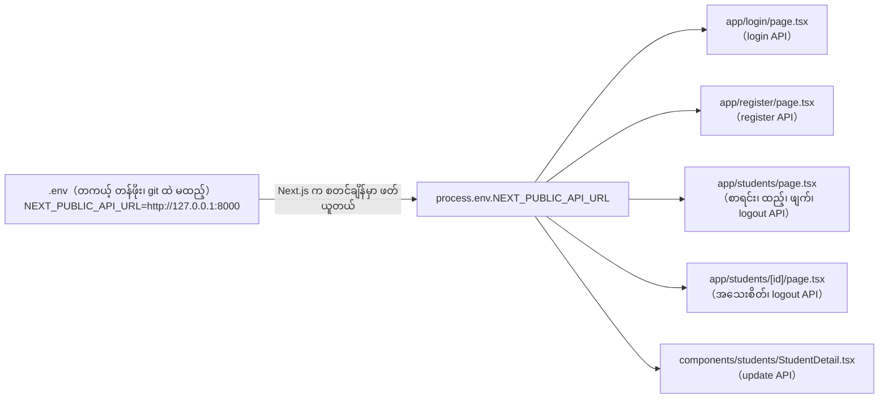
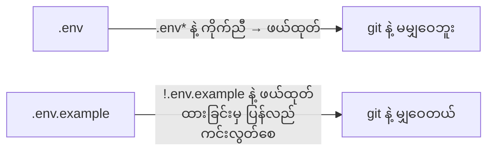

# အတန်းချိန် 26｜API ရဲ့ URL ကို environment variable (.env) အဖြစ် ခွဲထုတ်ခြင်း - အကောင်အထည်ဖော်ပုံ အဆင့်များ

> 🇯🇵 မူရင်း (ဂျပန်ဘာသာဖြင့်): [2026_07_30_実装.md](<../../../2年生_システム開発実践/前期/2026_07_30/2026_07_30_実装.md>) <!-- original-ja-link -->

## ယနေ့ ရည်မှန်းချက်

- `school-frontend` ရဲ့ စာမျက်နှာ တစ်ခုချင်းစီမှာ တိုက်ရိုက်ရေးထားခဲ့တဲ့ `http://localhost:8000` / `http://127.0.0.1:8000` ကို နေရာ 1 ခုတည်းမှာ စုမယ်
- `.env` file ကို ဖန်တီးပြီး API ရဲ့ URL ကို environment variable `NEXT_PUBLIC_API_URL` အဖြစ် စီမံမယ်
- `.env.example` (တန်ဖိုး မထည့်ထားတဲ့ template) ကို git နဲ့ မျှဝေပြီး `.env` (တကယ့် တန်ဖိုး) ကိုတော့ git စီမံမှုကနေ ဖယ်ထုတ်မယ်
- fetch သုံးထားတဲ့ နေရာအားလုံးကို `process.env.NEXT_PUBLIC_API_URL` ကနေတစ်ဆင့် ဖြစ်အောင် ပြန်ရေးမယ်

> **ဒီသင်ခန်းစာရဲ့ နေရာ：** အခုထိ `fetch("http://127.0.0.1:8000/api/students")` လိုမျိုး API ရဲ့ URL ကို file တစ်ခုချင်းစီမှာ တိုက်ရိုက် ရေးခဲ့ပါတယ်။ ဒီလိုရေးရင် development environment နဲ့ production environment မှာ URL မတူတဲ့အခါ file တွေရဲ့ နေရာအများကြီးကို ပြန်ပြင်ရပြီး ပြင်ဖို့ မေ့သွားလို့ bug ဖြစ်တတ်ပါတယ်။ ဒီတစ်ခါ "ပြောင်းလဲနိုင်တဲ့ တန်ဖိုး (URL၊ API key စသည်) တွေကို code ထဲ မထည့်ဘဲ environment variable အဖြစ် အပြင်ကို ထုတ်ထားမယ်" ဆိုတဲ့ အတွေးအခေါ်ကို လေ့လာပါမယ်။

---

## အလုံးစုံ ပုံကြမ်း：ဘာကို တည်ဆောက်မလဲ



> 💡 **ဥပမာပေးရရင်… လိပ်စာတွေကို တစ်နေရာတည်းမှာ စုထားတဲ့ လိပ်စာစာအုပ်**
>
> အခုထိ လုပ်ခဲ့တာက သူငယ်ချင်းဆီ စာပို့တိုင်း "Tanaka ရဲ့အိမ်က ◯◯ ရပ်ကွက် 3-1" လို့ ကိုယ်တိုင် လိပ်စာကို အကြိမ်တိုင်း ရေးနေသလိုပါပဲ။ တကယ်လို့ Tanaka အိမ်ပြောင်းသွားရင် ရေးခဲ့တဲ့ စာအားလုံးကို ပြန်ရေးရပါလိမ့်မယ်။ `.env` က "လိပ်စာစာအုပ်" လိုမျိုးပါ။ လိပ်စာ (API ရဲ့ URL) ကို နေရာ 1 ခုတည်းမှာပဲ ရေးထားပြီး စာ (file တစ်ခုချင်းစီရဲ့ fetch) တွေကနေ "လိပ်စာစာအုပ်ထဲက Tanaka ရဲ့ လိပ်စာ" ကို ရည်ညွှန်းအောင် လုပ်ပါတယ်။ အိမ်ပြောင်းတာ (URL ပြောင်းတာ) ရှိလာရင်တောင် လိပ်စာစာအုပ်ကို 1 ကြိမ် ပြင်ရုံနဲ့ ပြီးပါတယ်။

### ဘာကြောင့် `.env` နဲ့ `.env.example` ကို ခွဲထားတာလဲ

ဒီ app မှာတော့ `.env` ထဲမှာ လျှို့ဝှက်တန်ဖိုး မပါပေမယ့် ယေဘုယျအားဖြင့် ချိတ်ဆက်မယ့် DB ရဲ့ password ဒါမှမဟုတ် API key လို တခြားသူ မမြင်စေချင်တဲ့ တန်ဖိုးတွေ ပါပါတယ်။ ဒါကြောင့် `.env` ကိုယ်တိုင်ကို `.gitignore` နဲ့ ဖယ်ထုတ်ပြီး git နဲ့ မမျှဝေပါဘူး။ တစ်ဖက်မှာတော့ "ဘယ်လို variable အမည်တွေ လိုလဲ" ဆိုတာကို team နဲ့ မျှဝေချင်လို့ တန်ဖိုးကို ဗလာ (ဒါမှမဟုတ် dummy တန်ဖိုး) ထားတဲ့ `.env.example` ကိုပဲ commit လုပ်ပါတယ်။ Project ကို အသစ်ဝင်လာတဲ့သူက `.env.example` ကို copy ကူးပြီး `.env` ကို ဖန်တီးကာ ကိုယ့် environment နဲ့ ကိုက်ညီတဲ့ တန်ဖိုးတွေ ထည့်ပါတယ်။

### File ဖွဲ့စည်းပုံ (ဒီတစ်ခါ ပြင်မယ့် file များ)

| သင်္ကေတ | အဓိပ္ပာယ် |
|---|---|
| 🆕 အသစ် | File အသစ် ဖန်တီးမယ် |
| ➕ ထပ်ထည့် | ရှိပြီးသား file ထဲကို code ထပ်ရေးထည့်မယ် |
| 🔁 အစားထိုး | ရှိပြီးသား လုပ်ဆောင်ချက်ကို ပြန်ရေးမယ် |

```
school-frontend/
├── .env                                       🆕 အသစ်（တကယ့် တန်ဖိုး၊ git ထဲ မထည့်）
├── .env.example                               🆕 အသစ်（template၊ git ထဲ ထည့်）
├── .gitignore                                 ➕ .env.example တစ်ခုတည်းကိုသာ ဖယ်ထုတ်ထားခြင်းမှ ပြန်လည်ကင်းလွတ်စေမယ်
├── app/login/page.tsx                         🔁 fetch ရဲ့ URL ကို environment variable နဲ့ အစားထိုးမယ်
├── app/register/page.tsx                      🔁 fetch ရဲ့ URL ကို environment variable နဲ့ အစားထိုးမယ်
├── app/students/page.tsx                      🔁 fetch ရဲ့ URL ကို environment variable နဲ့ အစားထိုးမယ်（4 နေရာ）
├── app/students/[id]/page.tsx                 🔁 fetch ရဲ့ URL ကို environment variable နဲ့ အစားထိုးမယ်（2 နေရာ）
└── components/students/StudentDetail.tsx      🔁 fetch ရဲ့ URL ကို environment variable နဲ့ အစားထိုးမယ်
```

---

## Step 1｜`.env` ကို ဖန်တီးခြင်း

**🆕 File အသစ်** — `school-frontend` folder အောက်မှာပဲ `.env` ကို တိုက်ရိုက် ဖန်တီးပါ။

```bash
# ▼ school-frontend/.env
NEXT_PUBLIC_API_URL=http://127.0.0.1:8000
```

- Key အမည်ရဲ့ ရှေ့မှာ `NEXT_PUBLIC_` ထည့်တာက အဓိက အချက်ပါ။ Next.js က `NEXT_PUBLIC_` ပါတဲ့ environment variable တွေကိုပဲ browser ဘက် (client component) ကနေလည်း ဖတ်နိုင်အောင် build ထဲမှာ ထည့်ပေးပါတယ်။ ဒီတစ်ခါ ပြန်ရေးမယ့် `fetch` အားလုံးက `"use client"` ပါတဲ့ component ထဲမှာ ရှိလို့ ဒီ prefix က မဖြစ်မနေ လိုအပ်ပါတယ်။
- `NEXT_PUBLIC_` မပါတဲ့ environment variable (ဥပမာ：DB ရဲ့ password စသည်) တွေကို server ဘက် code ကနေပဲ ဖတ်နိုင်ပါတယ်။ Browser က မမြင်စေချင်တဲ့ တန်ဖိုးတွေမှာ မထည့်ပါနဲ့။

---

## Step 2｜`.env.example` ကို ဖန်တီးခြင်း

**🆕 File အသစ်** — Team နဲ့ မျှဝေမယ့် template အဖြစ် အကြောင်းအရာတူတဲ့ file တစ်ခု ဖန်တီးပါ။ ဒီတစ်ခါက လျှို့ဝှက်အချက်အလက် မပါတဲ့ URL ဖြစ်လို့ တန်ဖိုးတူကိုပဲ ဒီအတိုင်း ရေးထားပါမယ်။

```bash
# ▼ school-frontend/.env.example
NEXT_PUBLIC_API_URL=http://127.0.0.1:8000
```

> ⚠️ Password ဒါမှမဟုတ် API key လို တကယ့် လျှို့ဝှက်တန်ဖိုးတွေကို ကိုင်တွယ်တဲ့အခါ `.env.example` ထဲမှာ တကယ့်တန်ဖိုးကို မရေးဘဲ `DB_PASSWORD=` လို ဗလာထားတာ ဒါမှမဟုတ် `your-api-key-here` လို dummy တန်ဖိုး ထားတာမျိုး လုပ်ပါ။

---

## Step 3｜`.gitignore` မှာ `.env.example` တစ်ခုတည်းကိုသာ ဖယ်ထုတ်ထားခြင်းမှ ပြန်လည်ကင်းလွတ်စေခြင်း

`create-next-app` က အစကတည်းက ပြင်ဆင်ပေးထားတဲ့ `.gitignore` ထဲမှာ အောက်ပါအတိုင်း `.env*` ဆိုတဲ့ wildcard rule ပါပါတယ်။

```
# env files (can opt-in for committing if needed)
.env*
```

ဒီ rule က `.env` တစ်ခုတည်း မဟုတ်ဘဲ `.env.example` ပါအပါအဝင် "`.env` နဲ့ စတဲ့ file အားလုံး" ကို ဖယ်ထုတ်လိုက်ပါတယ်။ လျှို့ဝှက်အချက်အလက်ကို မှားပြီး commit မလုပ်မိအောင် ကာကွယ်တဲ့ နည်းလမ်းအနေနဲ့ မှန်ကန်တဲ့ setting ပေမယ့် ဒီအတိုင်းဆိုရင် မျှဝေချင်တဲ့ `.env.example` ပါ git စီမံမှုကနေ ထွက်သွားပါတယ်။ ဒါကြောင့် `.env.example` တစ်ခုတည်းကိုပဲ ခြွင်းချက်အနေနဲ့ မဖယ်ထုတ်ဖို့ setting ကို 1 ကြောင်း ထပ်ထည့်ပါမယ်။

**➕ ထပ်ထည့်**

```
# env files (can opt-in for committing if needed)
.env*
!.env.example
```

ရှေ့မှာ `!` ထည့်ရင် "ဒီ pattern ကို မဖယ်ထုတ်ဘူး (＝git နဲ့ စီမံမယ်)" လို့ အဓိပ္ပာယ်ရပါတယ်။ `.env*` နဲ့ အရင် အားလုံးကို ဖယ်ထုတ်ပြီးမှ `!.env.example` နဲ့ `.env.example` တစ်ခုတည်းကိုပဲ ပြန်ထည့်တယ် ဆိုတဲ့ အစီအစဉ်က အရေးကြီးပါတယ် (ပြောင်းပြန် အစီအစဉ်ဆိုရင် အလုပ်မလုပ်ပါဘူး)။

ဒီ setting နဲ့ဆိုရင် file 2 ခုကို အောက်ပါအတိုင်း ကိုင်တွယ်ပါတယ်။



---

## Step 4｜fetch ရဲ့ URL ကို environment variable နဲ့ အစားထိုးခြင်း

ဒီအထိနဲ့ `.env` ပြင်ဆင်မှု ပြီးသွားပေမယ့် တကယ့် code ကတော့ `http://127.0.0.1:8000` ကို တိုက်ရိုက် ကြည့်နေတုန်းပါ။ File တစ်ခုချင်းစီရဲ့ fetch ခေါ်တဲ့နေရာတွေကို `process.env.NEXT_PUBLIC_API_URL` သုံးတဲ့ template literal အဖြစ် ပြန်ရေးပါမယ်။

### 4-1. `app/login/page.tsx`

**🔁 အစားထိုး**

```tsx
// Before
const res = await fetch("http://127.0.0.1:8000/api/login", {

// After
const res = await fetch(`${process.env.NEXT_PUBLIC_API_URL}/api/login`, {
```

### 4-2. `app/register/page.tsx`

**🔁 အစားထိုး**

```tsx
// Before
const res = await fetch("http://127.0.0.1:8000/api/register", {

// After
const res = await fetch(`${process.env.NEXT_PUBLIC_API_URL}/api/register`, {
```

### 4-3. `app/students/page.tsx` (4 နေရာ)

**🔁 အစားထိုး** — စာရင်းရယူခြင်း၊ ကျောင်းသားထည့်ခြင်း၊ ကျောင်းသားဖျက်ခြင်း၊ logout ဆိုတဲ့ fetch 4 ခုကို တစ်ခုချင်း ပြန်ရေးပါ။

```tsx
// စာရင်းရယူခြင်း（Before → After）
const res = await fetch("http://127.0.0.1:8000/api/students", {
const res = await fetch(`${process.env.NEXT_PUBLIC_API_URL}/api/students`, {

// ကျောင်းသားထည့်ခြင်း（Before → After）
const res = await fetch("http://127.0.0.1:8000/api/students", {
const res = await fetch(`${process.env.NEXT_PUBLIC_API_URL}/api/students`, {

// ကျောင်းသားဖျက်ခြင်း（Before → After）
const res = await fetch(`http://127.0.0.1:8000/api/students/${id}`, {
const res = await fetch(`${process.env.NEXT_PUBLIC_API_URL}/api/students/${id}`, {

// Logout（Before → After）
await fetch("http://127.0.0.1:8000/api/logout", {
await fetch(`${process.env.NEXT_PUBLIC_API_URL}/api/logout`, {
```

### 4-4. `app/students/[id]/page.tsx` (2 နေရာ)

**🔁 အစားထိုး** — ဒီ file ကို မူလက `http://localhost:8000` (`127.0.0.1` မဟုတ်ဘဲ `localhost` ပုံစံ) နဲ့ ရေးထားခဲ့ပါတယ်။ ရေးပုံ မညီညွတ်နေတာကိုယ်တိုင်က "URL ကို နေရာ 1 ခုတည်းမှာ စုထားဖို့" လိုအပ်ကြောင်းကို ပြနေပါတယ်။

```tsx
// အသေးစိတ်ရယူခြင်း（Before → After）
const res = await fetch(`http://localhost:8000/api/students/${params.id}`, {
const res = await fetch(`${process.env.NEXT_PUBLIC_API_URL}/api/students/${params.id}`, {

// Logout（Before → After）
await fetch("http://localhost:8000/api/logout", {
await fetch(`${process.env.NEXT_PUBLIC_API_URL}/api/logout`, {
```

### 4-5. `components/students/StudentDetail.tsx`

**🔁 အစားထိုး**

```tsx
// Before
const res = await fetch(`http://localhost:8000/api/students/${student.id}`, {

// After
const res = await fetch(`${process.env.NEXT_PUBLIC_API_URL}/api/students/${student.id}`, {
```

> 💡 မူလ string က `"http://..."` လို double quote (ရိုးရိုး string) ဖြစ်ခဲ့တဲ့ နေရာတွေကိုလည်း `${...}` ကို ထည့်နိုင်ဖို့ backquote (\` \`) နဲ့ template literal အဖြစ် ပြောင်းဖို့ လိုပါတယ်။ Template literal ဖြစ်ပြီးသား နေရာ (`` `http://127.0.0.1:8000/api/students/${id}` `` စသည်) တွေမှာတော့ backquote ကို ဒီအတိုင်း သုံးပြီး အထဲက string အပိုင်းကိုပဲ အစားထိုးပါ။

---

## လုပ်ဆောင်ချက် စစ်ဆေးခြင်း

```bash
# Backend
cd Laravel && php artisan serve   # http://localhost:8000

# Frontend
cd school-frontend && npm run dev # http://localhost:3000
```

> ⚠️ `.env` ကို အသစ် ဖန်တီးတာ ဒါမှမဟုတ် တန်ဖိုး ပြောင်းတာ လုပ်ရင် `npm run dev` ကို တစ်ခါ ရပ်ပြီး ပြန်စတင်ပါ။ Next.js က environment variable တွေကို build၊ စတင်ချိန်မှာ ဖတ်ယူတာမို့ server ဖွင့်ထားရင်း `.env` ကို ပြင်လိုက်ရင် ပြောင်းလဲမှုတွေက hot reload နဲ့ အလိုအလျောက် ထင်ဟပ်မလာပါဘူး။

| စစ်ဆေးမယ့်အချက် | လုပ်ဆောင်ချက် | မျှော်မှန်းထားတဲ့ ရလဒ် |
|---|---|---|
| Code ထဲမှာ တိုက်ရိုက်ရေးထားတဲ့ URL ကျန်မနေဘူးလား | `grep -rn "localhost:8000\|127.0.0.1:8000" app components` ကို run မယ် | ဘာမှ မထွက်ဘူး (အားလုံး `process.env` ကနေတစ်ဆင့် ဖြစ်အောင် အစားထိုးပြီးသား) |
| Login | `/login` ကနေ login ဝင်မယ် | အရင်အတိုင်း login ဝင်နိုင်ပြီး `/students` ကို ရောက်သွားတယ် |
| စာရင်း၊ အသေးစိတ်၊ ထည့်၊ ဖျက် | `/students` မှာ လုပ်ဆောင်ချက် အစဉ်လိုက် လုပ်မယ် | အားလုံး အရင်အတိုင်း အလုပ်လုပ်တယ် (URL ရေးပုံပဲ ပြောင်းသွားပြီး ပြုမူပုံ မပြောင်းဘူး) |
| Environment variable ပြောင်းကြည့်ခြင်း | `.env` ရဲ့ တန်ဖိုးကို ယာယီ တခြား port (ဥပမာ：မရှိတဲ့ port) ပြောင်းပြီး ပြန်စတင်မယ် | API နဲ့ ချိတ်ဆက်မှု မအောင်မြင်ဘူး＝ `.env` ရဲ့ တန်ဖိုးကို တကယ် သုံးနေတာ သေချာတယ် (စစ်ပြီးရင် မူလတန်ဖိုး ပြန်ထားပါ) |
| Git မှာ ပေါ်ပုံ | `git status` ကို run မယ် | `.env` မပေါ်ဘူး (ဖယ်ထုတ်ထားလို့)၊ `.env.example` က untracked file အဖြစ် ပေါ်တယ် |

---

## အနှစ်ချုပ်

| သဘောတရား | ဒီတစ်ခါ ပြင်ခဲ့တဲ့ နေရာ |
|---|---|
| Environment variable အဖြစ် ခွဲထုတ်ခြင်း | `.env` ရဲ့ `NEXT_PUBLIC_API_URL` |
| Client ဘက်မှာ environment variable ဖတ်နိုင်ဖို့ အခြေအနေ | `NEXT_PUBLIC_` prefix |
| လျှို့ဝှက်အချက်အလက်ကို git ထဲ မထည့်အောင် လုပ်တဲ့ နည်းလမ်း | `.gitignore` ရဲ့ `.env*` |
| Template ကိုပဲ team နဲ့ မျှဝေအောင် လုပ်တဲ့ နည်းလမ်း | `.env.example` ＋ `!.env.example` နဲ့ ဖယ်ထုတ်ထားခြင်းမှ ပြန်လည်ကင်းလွတ်စေခြင်း |
| Environment variable သက်ရောက်တဲ့ အချိန် | `.env` ပြောင်းပြီးရင် development server ကို ပြန်စတင်ဖို့ လိုတယ် |

## ပြီးဆုံးကြောင်း checklist (Definition of Done)

- [ ] `school-frontend/.env` မှာ `NEXT_PUBLIC_API_URL=http://127.0.0.1:8000` ကို သတ်မှတ်ထားတယ်
- [ ] `school-frontend/.env.example` ကို ဖန်တီးထားပြီး variable အမည်တူကို template အဖြစ် ရေးထားတယ်
- [ ] `.gitignore` မှာ `!.env.example` ထည့်ထားပြီး `.env.example` တစ်ခုတည်းကိုပဲ git နဲ့ စီမံနိုင်တယ်
- [ ] `app/login/page.tsx` / `app/register/page.tsx` / `app/students/page.tsx` / `app/students/[id]/page.tsx` / `components/students/StudentDetail.tsx` ရဲ့ fetch အားလုံးက `process.env.NEXT_PUBLIC_API_URL` ကနေတစ်ဆင့် ဖြစ်နေတယ်
- [ ] `grep -rn "localhost:8000\|127.0.0.1:8000" app components` နဲ့ ဘာမှ မတွေ့ဘူး
- [ ] `npm run dev` ကို ပြန်စတင်ထားတဲ့ အခြေအနေမှာ login〜စာရင်း〜အသေးစိတ်〜ထည့်〜ဖျက် အားလုံး အရင်အတိုင်း အလုပ်လုပ်တယ်
- [ ] `git status` မှာ `.env` မပေါ်ဘဲ `.env.example` တစ်ခုတည်းပဲ စီမံမှုအောက်မှာ ရှိတယ်

## စတင် run တဲ့ command များ

```bash
# Backend
cd Laravel && php artisan serve   # http://localhost:8000

# Frontend
cd school-frontend && npm run dev # http://localhost:3000
```
