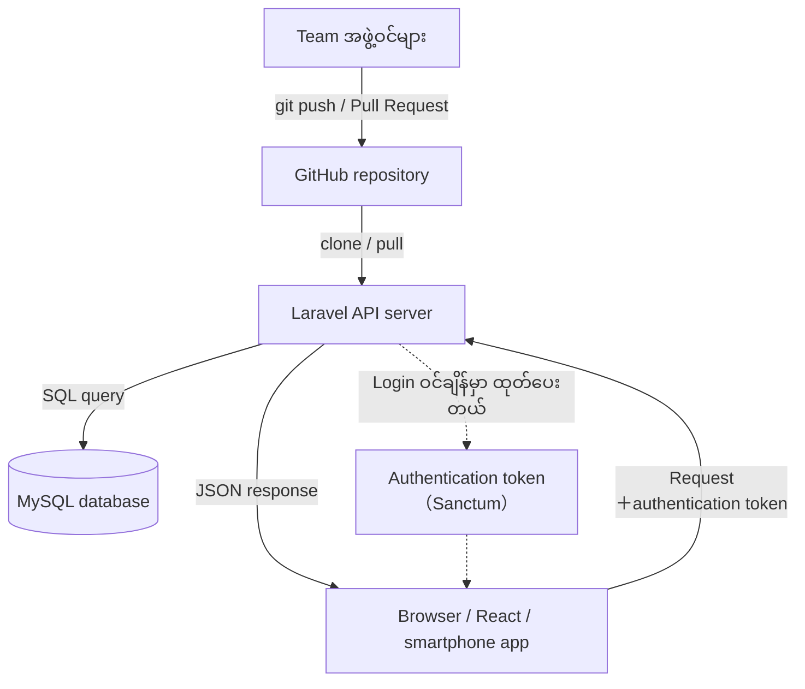
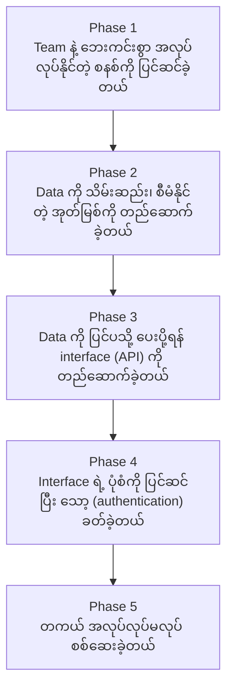

# Development လုပ်ငန်းစဉ်：သုညကနေ API တစ်ခု ဖန်တီးပြီးတဲ့အထိ

> 🇯🇵 မူရင်း (ဂျပန်ဘာသာဖြင့်): [開発の流れ_まとめ.md](<../../2年生_システム開発実践/前期/開発の流れ_まとめ.md>) <!-- original-ja-link -->

---

## နိဒါန်း

ဒီစာတမ်းမှာ "ဘာလုပ်ခဲ့လဲ" ဆိုတာတင် မကဘဲ "**ဘာကြောင့် အဲဒီ အစီအစဉ်အတိုင်း လုပ်ခဲ့တာလဲ**" ဆိုတာကိုပါ ရှင်းပြပါမယ်။

---

## အလုံးစုံ ပုံကြမ်း：ဘာကို တည်ဆောက်ခဲ့လဲ

### ပြီးစီးသွားတဲ့ system ရဲ့ ခြုံငုံပုံ



### အဆင့် (phase) 5 ခု

| Phase | ခေါင်းစဉ် | Keyword | သက်ဆိုင်ရာ သင်ခန်းစာ |
|---------|--------|-----------|---------|
| 1 | Team development အတွက် ပြင်ဆင်ခြင်း | Branch၊ PR၊ review | 04/30 |
| 2 | App ရဲ့ အုတ်မြစ်ကို တည်ဆောက်ခြင်း | Laravel၊ DB၊ migration | 05/06 |
| 3 | Data ရယူအသုံးပြုရန် interface တည်ဆောက်ခြင်း | REST API၊ JSON၊ routing | 05/14 |
| 4 | ပုံစံနဲ့ ကာကွယ်မှုကို ပြင်ဆင်ခြင်း | Resource၊ validation၊ Sanctum | 05/21 |
| 5 | အလုပ်လုပ်မလုပ် စစ်ဆေးခြင်း | curl၊ browser test | 05/28 |

---

## Phase 1：Team development အတွက် ပြင်ဆင်ခြင်း

### ဘာလုပ်ခဲ့လဲ

Git ရဲ့ branch၊ merge၊ Pull Request (PR)၊ code review ကို လေ့လာပြီး
App ကို team နဲ့အတူ GitHub ပေါ် တင်ကာ အားလုံး run နိုင်တဲ့ အခြေအနေ ဖြစ်အောင် လုပ်ခဲ့ပါတယ်။

### ဘာကြောင့် လိုအပ်ခဲ့တာလဲ

> 💡 **ဥပမာပေးရရင်… ဆောက်လုပ်ရေးလုပ်ငန်းခွင်ရဲ့ ပုံစံ (drawing) စီမံခန့်ခွဲမှု**
>
> အဆောက်အအုံကြီးတစ်ခုကို ကုမ္ပဏီအများအပြားက အတူတူ ဆောက်တဲ့အခါ အားလုံးက "ပုံစံ မူရင်းတစ်ခုတည်း" ပေါ်မှာ
> တိုက်ရိုက် ရေးကြမယ်ဆိုရင် ရှုပ်ထွေးသွားပါလိမ့်မယ်။ ဒါကြောင့် ကုမ္ပဏီတစ်ခုချင်းစီက "ကိုယ်ပိုင် မိတ္တူ (branch)"
> ပေါ်မှာ ရေးပြီး ပြီးသွားရင် စုပြီး တိုက်စစ် (review) ပြီးမှ မူရင်းထဲကို ထည့်ပါတယ်။

Team development မှာ လူအများအပြားက file တစ်ခုတည်းကို တစ်ပြိုင်နက် ပြင်ကြပါတယ်။
Branch ခွဲခြင်းအားဖြင့် "main code ကို မပျက်စေဘဲ လုပ်ဆောင်ချက် အသစ်ကို develop လုပ်" နိုင်ပါတယ်။
PR ဆိုတာ "ဒီ code ကို main ထဲ ထည့်လို့ ရမလား？" ဆိုတဲ့ တောင်းဆိုချက်ဖြစ်ပြီး
Review ဆိုတာ အဲဒီ code မှန်ရဲ့လား၊ ဖတ်ရလွယ်ရဲ့လား ဆိုတာကို team နဲ့ စစ်ဆေးတဲ့ နေရာပါ။

> ⚠️ **ဒါမရှိရင်…** တစ်ယောက်ရဲ့ code က တခြားတစ်ယောက်ရဲ့ code ကို overwrite လုပ်ပြီး ပျောက်သွားပါလိမ့်မယ်။
> "ခုနကပဲ အလုပ်လုပ်နေတာ၊ အခု အလုပ်မလုပ်တော့ဘူး" ဆိုတာ မကြာခဏ ဖြစ်ပါလိမ့်မယ်။

### ဒီ phase မှာ လုပ်နိုင်လာတဲ့အရာများ

- `git switch -c feature/xxxx` နဲ့ branch ဖန်တီးပြီး အလုပ်လုပ်နိုင်တယ်
- `git push origin feature/xxxx` နဲ့ team ကို မျှဝေနိုင်တယ်
- GitHub မှာ PR ဖန်တီးပြီး review တောင်းနိုင်တယ်
- Review comment တွေကို လက်ခံပြီး code ကို ပြင်နိုင်တယ်

### အသေးစိတ် အဆင့်များ

→ [`2026_04_30/2026_04_30.md`](2026_04_30/2026_04_30.md)

---

## Phase 2：App ရဲ့ အုတ်မြစ်ကို တည်ဆောက်ခြင်း

### ဘာလုပ်ခဲ့လဲ

Laravel project ကို ဖန်တီးပြီး database (`school_api`) ကို ပြင်ဆင်ကာ
`students` table ကို သတ်မှတ်၊ ဖန်တီးခဲ့တယ်။ Test data 10 ခု ထည့်ပြီး server ကို စတင်ခဲ့ပါတယ်။

### ဘာကြောင့် လိုအပ်ခဲ့တာလဲ

> 💡 **ဥပမာပေးရရင်… စားသောက်ဆိုင်ရဲ့ မီးဖိုချောင် တည်ဆောက်ခြင်း**
>
> ဧည့်သည်ကို ဟင်းလျာ (API ရဲ့ response) ချပေးဖို့ဆိုရင်
> ပထမဆုံး မီးဖိုချောင် (Laravel) နဲ့ ကုန်ကြမ်းထားရာနေရာ (database) လိုပါတယ်။
> မီးဖိုချောင်ရဲ့ ပုံစံ (migration) ကို အရင် လုပ်ထားရင်
> Team ထဲက ဘယ်သူမဆို တူညီတဲ့ environment ကို ပြန်လည်ဖန်တီးနိုင်ပါတယ်။

Laravel ဆိုတာ "မကြာခဏ သုံးတဲ့ လုပ်ဆောင်ချက်တွေ (routing၊ DB လုပ်ဆောင်ချက်၊ authentication စသည်) အစကတည်းက ပါပြီးသား သေတ္တာ" ပါ။
Migration က database ရဲ့ ဒီဇိုင်းစာတမ်း ဖြစ်ပြီး `php artisan migrate` ကို run ရုံနဲ့
Team အဖွဲ့ဝင်အားလုံးက တူညီတဲ့ table ဖွဲ့စည်းပုံကို ကိုယ့်စက်ပေါ်မှာ ပြန်လည်ဖန်တီးနိုင်ပါတယ်။
Seeder က test data ကို အလိုအလျောက် ထုတ်ပေးပြီး data ကို လက်နဲ့ ရိုက်ထည့်ရတဲ့ ဒုက္ခကို လျှော့ပေးပါတယ်။

> ⚠️ **ဒါမရှိရင်…** API code ရေးထားရင်တောင် data သိမ်းစရာနေရာ မရှိလို့
> Request တစ်ခါလာတိုင်း data တွေ ပျောက်သွားပါလိမ့်မယ်။

### ဒီ phase မှာ လုပ်နိုင်လာတဲ့အရာများ

- `composer create-project laravel/laravel` နဲ့ project ဖန်တီးနိုင်တယ်
- `.env` မှာ DB ချိတ်ဆက်မှု အချက်အလက်ကို သတ်မှတ်နိုင်တယ်
- `php artisan make:model Student -mf` နဲ့ model၊ migration၊ factory ကို တစ်ခါတည်း ထုတ်နိုင်တယ်
- `php artisan migrate` နဲ့ table ဖန်တီးနိုင်တယ်
- `php artisan db:seed` နဲ့ test data ထည့်နိုင်တယ်
- `php artisan serve` နဲ့ local server ကို စတင်နိုင်တယ်

### အသေးစိတ် အဆင့်များ

→ [`2026_05_06/20260506.md`](2026_05_06/20260506.md)

---

## Phase 3：Data ရယူအသုံးပြုရန် interface တည်ဆောက်ခြင်း

### ဘာလုပ်ခဲ့လဲ

REST API ရဲ့ သဘောတရား (URL × HTTP method၊ JSON response၊ status code) ကို လေ့လာပြီး
`StudentController` ကို ဖန်တီးကာ `GET /api/students` အပါအဝင် endpoint 5 ခုကို အကောင်အထည်ဖော်ခဲ့ပါတယ်။

### ဘာကြောင့် လိုအပ်ခဲ့တာလဲ

> 💡 **ဥပမာပေးရရင်… အလိုအလျောက် အရောင်းစက် (vending machine) ရဲ့ ခလုတ်များ**
>
> Vending machine မှာ "ကိုကာကိုလာ" "လက်ဖက်ရည်" "ရေ" စတဲ့ ခလုတ်တွေ ရှိပြီး
> နှိပ်လိုက်ရင် သက်ဆိုင်ရာ ပစ္စည်း ထွက်လာပါတယ်။
> API ရဲ့ endpoint လည်း အတူတူပါပဲ။
> "`GET /api/students` (အားလုံးကို ပေးပါ)" "`DELETE /api/students/3` (နံပါတ် 3 ကို ဖျက်ပါ)"
> ဆိုသလို URL×HTTP method ပေါင်းစပ်မှုနဲ့ လုပ်ရမယ့်အရာကို ဆုံးဖြတ်ပါတယ်။

ပထမနှစ်မှာ ဖန်တီးခဲ့တဲ့ Blade app က HTML စာမျက်နှာကို ပြန်ပေးခဲ့ပါတယ်။
API ကတော့ အဲဒီအစား JSON data ကိုပဲ ပြန်ပေးပါတယ်။
JSON ဖြစ်အောင် လုပ်ခြင်းအားဖြင့် React၊ Vue၊ smartphone app စတဲ့
**မတူညီတဲ့ screen တွေကနေ တူညီတဲ့ data ကို ပြန်လည်အသုံးပြုနိုင်** လာပါတယ်။

> ⚠️ **ဒါမရှိရင်…** Frontend နဲ့ server က စကားပြောလို့ မရပါဘူး။
> React ကနေ API ကို ခေါ်ရင်တောင် "ဘယ်ကို ပို့ရမလဲ မသိဘူး" ဆိုတဲ့ အခြေအနေ ဖြစ်ပါလိမ့်မယ်။

### ဒီ phase မှာ လုပ်နိုင်လာတဲ့အရာများ

- REST API ရဲ့ URL ဒီဇိုင်း (resource အမည်၊ HTTP method) ကို နားလည်နိုင်တယ်
- `php artisan make:controller Api/StudentController --api` နဲ့ API controller ကို ထုတ်နိုင်တယ်
- `routes/api.php` မှာ routing ထည့်နိုင်တယ်
- `response()->json()` နဲ့ JSON response ပြန်ပေးနိုင်တယ်
- HTTP status code (200၊ 201၊ 404၊ 422) ရဲ့ အဓိပ္ပာယ်ကို သိတယ်

### အသေးစိတ် အဆင့်များ

→ [`2026_05_14/20260514.md`](2026_05_14/20260514.md)

---

## Phase 4：ပုံစံနဲ့ ကာကွယ်မှုကို ပြင်ဆင်ခြင်း

### ဘာလုပ်ခဲ့လဲ

`StudentResource` နဲ့ response ပုံစံကို တစ်ပြေးညီ ဖြစ်အောင် လုပ်ပြီး validation နဲ့ data input စစ်ဆေးမှုကို ထည့်ခဲ့တယ်။
Laravel Sanctum နဲ့ authentication လုပ်ဆောင်ချက် (login၊ token ထုတ်ပေးခြင်း၊ logout) ကို အကောင်အထည်ဖော်ခဲ့ပါတယ်။

### ဘာကြောင့် လိုအပ်ခဲ့တာလဲ

> 💡 **ဥပမာပေးရရင်… ပါဆယ်ပို့ဆောင်ရေးရဲ့ ပို့စာလွှာ ပုံစံ＋ဝင်ခွင့်ကတ်**
>
> ပါဆယ်ပို့တဲ့အခါ "ပို့သူ၊ ပို့မယ့်လိပ်စာ၊ ပစ္စည်းအမည်" ကို သတ်မှတ်ထားတဲ့ နေရာမှာ ရေးထားပါတယ်။
> ပုံစံ တစ်ပြေးညီ ဖြစ်နေလို့ လက်ခံတဲ့ဘက်က မရှုပ်မထွေး ကိုင်တွယ်နိုင်ပါတယ်။
> `StudentResource` က response ရဲ့ ပုံစံကို သတ်မှတ်ပေးတဲ့ "ပို့စာလွှာ ပုံစံ" ပါ။
>
> Sanctum ရဲ့ token က "ဝင်ခွင့်ကတ်" ပါ။
> Login ဝင်ချိန်မှာ ထုတ်ပေးတဲ့ ဝင်ခွင့်ကတ် (token) ကိုင်ထားတဲ့သူတွေပဲ
> အဆောက်အအုံ (API) ထဲကို ဝင်နိုင်ပါတယ်။

Phase 3 မှာ API အလုပ်လုပ်လာပေမယ့် ဘယ်သူမဆို access လုပ်နိုင်တဲ့ အခြေအနေ ဖြစ်နေသေးတယ်။
Authentication မရှိရင် မသိတဲ့သူက data ကို စိတ်ကြိုက် ရယူ၊ ဖျက် နိုင်သွားပါတယ်။
ပြီးတော့ API ရဲ့ response ပုံစံတွေ မညီညွတ်ရင် frontend က data ကို ကိုင်တွယ်ရ ခက်လာပါတယ်။

> ⚠️ **ဒါမရှိရင်…** Internet ပေါ်က ဘယ်သူမဆို data ကို ပြင်၊ ဖျက် နိုင်ပါတယ်။
> Password ဒါမှမဟုတ် email လိပ်စာလို ကိုယ်ရေးအချက်အလက်တွေ အကုန်ပေါ်နေမယ့် အန္တရာယ်လည်း ရှိပါတယ်။

### ဒီ phase မှာ လုပ်နိုင်လာတဲ့အရာများ

- `php artisan make:resource StudentResource` နဲ့ response ပုံစံချ class ကို ဖန်တီးနိုင်တယ်
- `$request->validate()` နဲ့ validation ရေးနိုင်တယ်
- `composer require laravel/sanctum` နဲ့ authentication package ကို ထည့်သွင်းနိုင်တယ်
- `POST /api/login` နဲ့ token ရယူနိုင်တယ်
- `auth:sanctum` middleware နဲ့ authentication လိုအပ်တဲ့ route တွေကို ကာကွယ်နိုင်တယ်

### အသေးစိတ် အဆင့်များ

→ [`2026_05_21/20260521.md`](2026_05_21/20260521.md)

---

## Phase 5：အလုပ်လုပ်မလုပ် စစ်ဆေးခြင်း

### ဘာလုပ်ခဲ့လဲ

`curl` command နဲ့ API ကို request ပို့ပြီး လုပ်ဆောင်ချက်ကို စစ်ဆေးခဲ့တယ်၊
ပြီးတော့ browser ကနေ ကိုင်တွယ်နိုင်တဲ့ test စာမျက်နှာ (`/api-test`) ကို ဖန်တီးပြီး
Login〜ကျောင်းသားစာရင်း ရယူခြင်း〜ထည့်ခြင်း〜ဖျက်ခြင်း ဆိုတဲ့ လုပ်ငန်းစဉ် တစ်ခုလုံးကို စစ်ဆေးခဲ့ပါတယ်။

### ဘာကြောင့် လိုအပ်ခဲ့တာလဲ

> 💡 **ဥပမာပေးရရင်… ပြီးစီးသွားတဲ့ vending machine ထဲကို တကယ် ပိုက်ဆံ ထည့်ကြည့်ခြင်း**
>
> Vending machine ကို ဒီဇိုင်းဆွဲ၊ ထုတ်လုပ်ပြီးရင်တောင် တကယ် ပိုက်ဆံထည့်ပြီး ခလုတ်နှိပ်ကြည့်တဲ့အထိ
> "ပစ္စည်း တကယ် ထွက်လာမလား" ဆိုတာ မသိနိုင်ပါဘူး။
> API လည်း အတူတူပါပဲ။ Code ရေးရုံနဲ့ မှန်မှန်ကန်ကန် အလုပ်လုပ်မလုပ် မသိနိုင်ပါဘူး။
> တကယ် request ပို့ပြီး မျှော်မှန်းထားတဲ့အတိုင်း JSON ပြန်လာမလာ စစ်ဆေးဖို့ လိုပါတယ်။

`curl` ဆိုတာ "terminal ကနေ HTTP request ပို့တဲ့ command" ပါ။
Browser မဖွင့်ဘဲ API ရဲ့ လုပ်ဆောင်ချက်ကို ချက်ချင်း စစ်ဆေးနိုင်ပါတယ်။
Browser test စာမျက်နှာက curl နဲ့ အတူတူကို graphical ပုံစံနဲ့ လုပ်နိုင်တဲ့ စာမျက်နှာဖြစ်ပြီး
"React ကနေ ကြည့်ရင် ဒီလိုဖြစ်မယ်" ဆိုတာကို မြင်ယောင်ကြည့်ဖို့လည်း အသုံးဝင်ပါတယ်။

> ⚠️ **ဒါမရှိရင်…** Bug ကို သတိမထားမိဘဲ production environment ထဲ ရောက်သွားပါလိမ့်မယ်။
> "Development environment မှာ အလုပ်လုပ်ခဲ့ပေမယ့် production မှာ ပျက်သွားတယ်" ဆိုတာကို ကာကွယ်ဖို့အတွက်လည်း လုပ်ဆောင်ချက် စစ်ဆေးခြင်းက မဖြစ်မနေ လိုအပ်ပါတယ်။

### ဒီ phase မှာ လုပ်နိုင်လာတဲ့အရာများ

- `curl` နဲ့ GET၊ POST၊ DELETE request ပို့နိုင်တယ်
- `Authorization: Bearer <token>` header နဲ့ authentication ပါတဲ့ request ပို့နိုင်တယ်
- Browser ကနေ API ရဲ့ login၊ စာရင်းရယူခြင်း၊ ထည့်ခြင်း၊ ဖျက်ခြင်း ကို လုပ်ဆောင်နိုင်တယ်
- HTTP status code နဲ့ response JSON ကို ဖတ်ပြီး "မှန်မှန်ကန်ကန် အလုပ်လုပ်နေလား" ဆုံးဖြတ်နိုင်တယ်

### အသေးစိတ် အဆင့်များ

→ [`2026_05_28/20260528.md`](2026_05_28/20260528.md)

---

## အနှစ်ချုပ်：phase 5 ခု ဆက်စပ်သွားပြီ

Phase 5 ခုကို ပြန်ကြည့်ရင် တစ်ခုချင်းစီက ရှေ့ phase ရဲ့ အပေါ်မှာ ဆင့်ပြီး တည်ဆောက်ထားတာကို တွေ့ရပါတယ်။



ဆိုလိုတာက phase တိုင်းက "နောက် phase အတွက် လိုအပ်ခဲ့တာ" ပါ။
အစီအစဉ် ပြောင်းသွားရင် အဆင်မပြေတော့ပါဘူး။

### နောက်တစ်ဆင့်

ဒီ API က **React စတဲ့ frontend ကနေ ခေါ်သုံးနိုင်တဲ့ အခြေအနေ** ဖြစ်နေပါပြီ။
```javascript
fetch('/api/students', { headers: { Authorization: 'Bearer ' + token } })
```
လို့ ရေးရုံနဲ့ browser ပေါ်မှာ data ကို ရယူ၊ ပြသနိုင်ပါတယ်။

နောက်ပိုင်း သင်ယူမှုမှာ "ဒီ API ကို သုံးပြီး screen ဖန်တီးတဲ့" frontend development ဆီကို ရှေ့ဆက်ပါမယ်။
