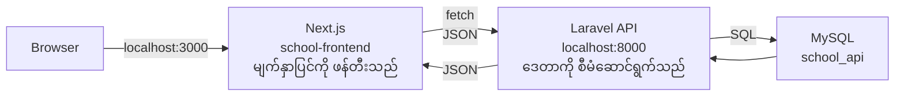
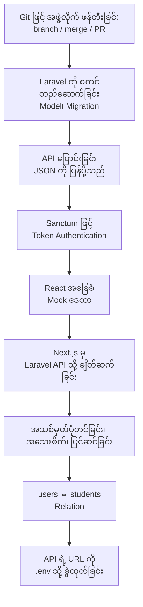
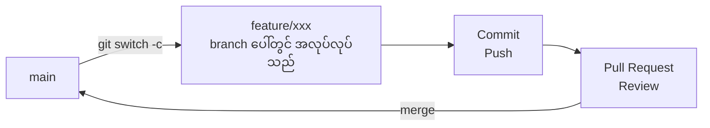
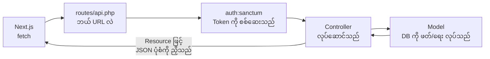
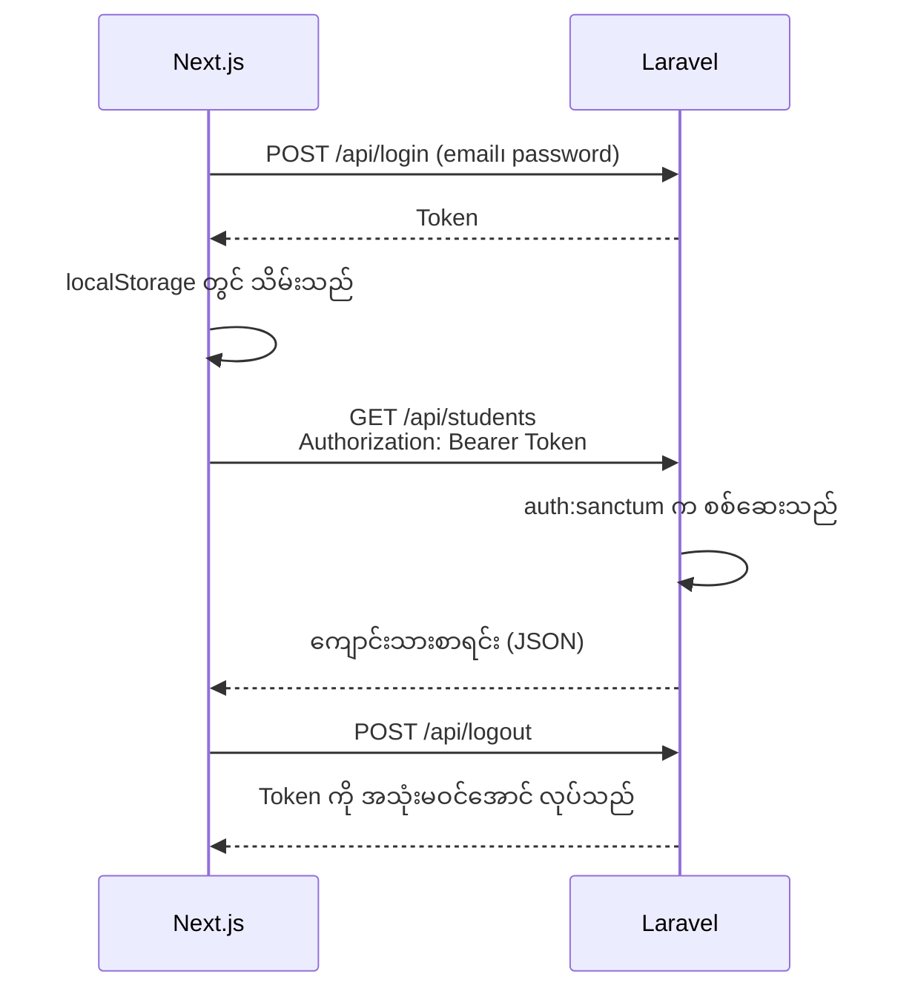
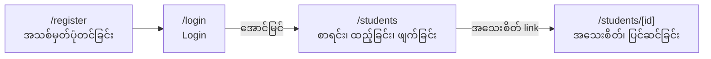
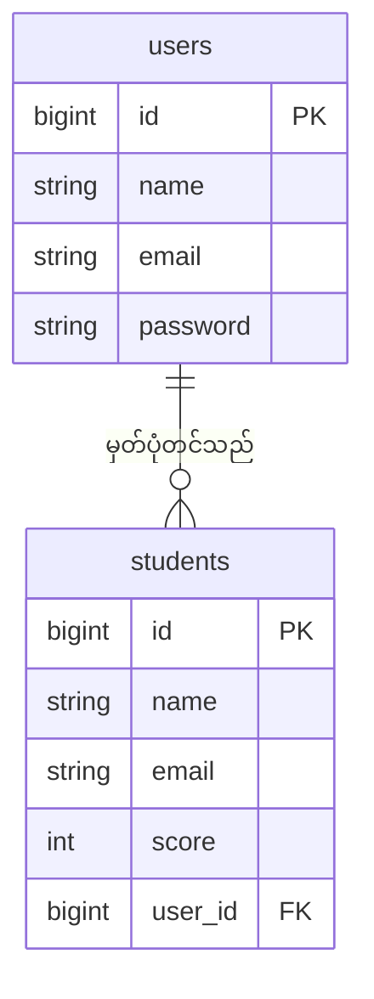
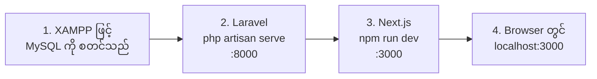

# ပထမစာသင်နှစ်ဝက်ကို ပြန်လည်သုံးသပ်ခြင်း (ပြန်လေ့ကျင့်ခြင်း)

> 🇯🇵 မူရင်း (ဂျပန်ဘာသာဖြင့်): [2026_10_02_資料1.md](<../../../2年生_システム開発実践/後期/2026_10_02/2026_10_02_資料1.md>) <!-- original-ja-link -->

ဒုတိယစာသင်နှစ်ဝက် မစခင်မှာ ပထမစာသင်နှစ်ဝက်တုန်းက လုပ်ခဲ့တဲ့ **ကျောင်းသားစီမံခန့်ခွဲမှု app** ရဲ့ အလုံးစုံဖွဲ့စည်းပုံကို ပြန်လည်သုံးသပ်ကြရအောင်။
ပထမစာသင်နှစ်ဝက်မှာ မျက်နှာပြင် (frontend) နဲ့ ဒေတာလုပ်ဆောင်မှု (backend) ကို **သီးခြား app နှစ်ခု** အဖြစ် လုပ်ပြီး API နဲ့ ချိတ်ဆက်ခဲ့ပါတယ်။



- **Next.js**: မျက်နှာပြင်ကို ဖန်တီးတဲ့ တာဝန်ခံ။ ခလုတ်နှိပ်လိုက်ရင် Laravel ဆီကို တောင်းဆိုချက် (request) ပို့ပေးတယ်
- **Laravel**: တောင်းဆိုချက်ကို လက်ခံပြီး database ကို ဖတ်/ရေး လုပ်ကာ ရလဒ်ကို **JSON** နဲ့ ပြန်ပို့ပေးတဲ့ တာဝန်ခံ
- **MySQL**: ဒေတာတွေကို သိမ်းထားပေးတဲ့ တာဝန်ခံ

---

## 1. ပထမစာသင်နှစ်ဝက်ရဲ့ အစီအစဉ်

ပထမစာသင်နှစ်ဝက်မှာ app ကို အောက်ပါအစီအစဉ်အတိုင်း တစ်ဆင့်ချင်း တည်ဆောက်ခဲ့ပါတယ်။



| အကြိမ် | အကြောင်းအရာ | သင်ခန်းစာ |
|----|------|------|
| 4/30 | Git ဖြင့် အဖွဲ့လိုက် ဖန်တီးခြင်း (branch၊ merge၊ Pull Request) | [သင်ခန်းစာ](../../前期/2026_04_30/2026_04_30.md) |
| 5/6 | Laravel project ကို စတင်တည်ဆောက်ခြင်း | [သင်ခန်းစာ](../../前期/2026_05_06/20260506.md) |
| 5/14 | Blade app ကို API အဖြစ် ပြောင်းခြင်း | [သင်ခန်းစာ](../../前期/2026_05_14/20260514.md) |
| 5/21 | Resource Controller၊ Sanctum ဖြင့် Token Authentication | [သင်ခန်းစာ](../../前期/2026_05_21/20260521.md) |
| 5/28 | Browser မှာ Token Authentication ကို စစ်ဆေးခြင်း | [သင်ခန်းစာ](../../前期/2026_05_28/20260528.md) |
| 6/11 | React အခြေခံ (Component၊ JSX၊ props၊ useState) | [သင်ခန်းစာ](../../前期/2026_06_11/2026_06_11.md) |
| 7/2 | Next.js မိတ်ဆက် → Laravel API နဲ့ ချိတ်ဆက်ခြင်း | [သင်ခန်းစာ](../../前期/2026_07_02/2026_07_02.md) |
| 7/9 | User အသစ်မှတ်ပုံတင်ခြင်း ＋ Token၊ CRUD၊ MVC ကို ပြန်လေ့ကျင့်ခြင်း | [သင်ခန်းစာ](../../前期/2026_07_09/2026_07_09.md) |
| 7/16 | အသေးစိတ်မျက်နှာပြင်၊ ပြင်ဆင်ခြင်း လုပ်ဆောင်ချက် | [သင်ခန်းစာ](../../前期/2026_07_16/2026_07_16_実装.md) |
| 7/23 | users ⇔ students ရဲ့ Relation | [သင်ခန်းစာ](../../前期/2026_07_23/2026_07_23_実装%20.md) |
| 7/30 | API ရဲ့ URL ကို .env သို့ ခွဲထုတ်ခြင်း | [သင်ခန်းစာ](../../前期/2026_07_30/2026_07_30_実装.md) |

---

## 2. Git ဖြင့် အဖွဲ့လိုက် ဖန်တီးခြင်း

အဖွဲ့နဲ့ repository တစ်ခုတည်းကို အတူတူ ပြင်ကြတဲ့အခါ **branch** ခွဲပြီး အလုပ်လုပ်ကာ **Pull Request (PR)** နဲ့ review လုပ်ပြီးမှ main ထဲကို ပေါင်းထည့်ခဲ့ပါတယ် (GitHub Flow)။



- **main ကို တိုက်ရိုက် မပြင်ရ**: အချိန်မရွေး run လို့ရတဲ့ အခြေအနေမှာ ထားရမယ်
- လူ ၂ ယောက်က စာကြောင်းတစ်ကြောင်းတည်းကို ပြင်ရင် **conflict** ဖြစ်တယ် → ဖိုင်ကိုဖွင့်ပြီး လက်နဲ့ ပြင်ပြီးမှ commit လုပ်ရမယ်

---

## 3. Laravel API

### MVC (စားသောက်ဆိုင် ဥပမာ)

| တာဝန် | ဖိုင် ဥပမာ | ဥပမာပေးရရင် |
|------|------------|-----------|
| **Model** | `app/Models/Student.php` | မီးဖိုချောင်၊ ရေခဲသေတ္တာ (ဒေတာကို ကိုင်တွယ်သည်) |
| **Controller** | `app/Http/Controllers/Api/StudentController.php` | စားပွဲထိုး (မှာယူချက်ကို လက်ခံပြီး သယ်ပို့သည်) |
| **View** | → API ပြောင်းပြီး **Next.js ဆီ ပြောင်းရွှေ့သွားသည်** | ပန်းကန်ထဲ အလှဆင်ထည့်ခြင်း (အသွင်အပြင်) |

API အဖြစ် ပြောင်းလိုက်တဲ့အတွက် Laravel က မျက်နှာပြင်ကို မဖန်တီးတော့ဘဲ **JSON (ဒေတာသက်သက်)** ကိုပဲ ပြန်ပို့ပေးလာပါတယ်။

### Request ဖြတ်သွားတဲ့ လမ်းကြောင်း



### ဖန်တီးခဲ့တဲ့ API

`Route::apiResource('students', ...)` ဆိုတဲ့ စာကြောင်းတစ်ကြောင်းတည်းနဲ့ CRUD ရဲ့ လမ်းကြောင်း ၅ ခုလုံး တစ်ပြိုင်နက် ရခဲ့ပါတယ်။

| CRUD | Method | URL | Controller | Authentication |
|------|---------|-----|-----------|:----:|
| — | POST | `/api/register` | `AuthController@register` | မလို |
| — | POST | `/api/login` | `AuthController@login` | မလို |
| — | POST | `/api/logout` | `AuthController@logout` | 🔒 |
| Read | GET | `/api/students` | `index` (စာရင်း) | 🔒 |
| Create | POST | `/api/students` | `store` (ထည့်ခြင်း) | 🔒 |
| Read | GET | `/api/students/{id}` | `show` (အသေးစိတ်) | 🔒 |
| Update | PUT | `/api/students/{id}` | `update` (ပြင်ဆင်ခြင်း) | 🔒 |
| Delete | DELETE | `/api/students/{id}` | `destroy` (ဖျက်ခြင်း) | 🔒 |

🔒 ပါတာတွေက `auth:sanctum` ထဲမှာ ရှိတဲ့အတွက် **token မပါရင် 401 error** ဖြစ်ပါတယ်။

---

## 4. Token Authentication

Login ဝင်လိုက်ရင် Laravel က **token** (အပန်းဖြေဥယျာဉ်မှာ ပေးတဲ့ လက်ပတ်ကြိုးလိုမျိုး) ကို ထုတ်ပေးပါတယ်။
Next.js က အဲဒါကို သိမ်းထားပြီး API ကို ခေါ်တိုင်း ပြပါတယ်။



အဆင်မပြေတဲ့အခါ browser ရဲ့ **Developer Tools** မှာ စစ်ဆေးပါ။

- `Application` tab → `Local Storage`: token သိမ်းထားလား
- `Network` tab: request မှာ `Authorization: Bearer ...` ပါလား

---

## 5. Next.js ရဲ့ မျက်နှာပြင်များ

`app/` ထဲက folder တွေဟာ အဲဒီအတိုင်း **URL** ဖြစ်သွားပါတယ်။



| URL | ဖိုင် | သုံးတဲ့ API |
|-----|---------|--------|
| `/login` | `app/login/page.tsx` | `POST /api/login` |
| `/register` | `app/register/page.tsx` | `POST /api/register` |
| `/students` | `app/students/page.tsx` | စာရင်း၊ ထည့်ခြင်း၊ ဖျက်ခြင်း၊ Logout |
| `/students/[id]` | `app/students/[id]/page.tsx` ＋ `components/students/StudentDetail.tsx` | အသေးစိတ်၊ ပြင်ဆင်ခြင်း |

folder နာမည်ကို `[id]` လိုမျိုး `[ ]` နဲ့ ဝိုင်းထားတဲ့ ပုံစံနဲ့ ပေးရင် `/students/1`၊ `/students/2` … စသဖြင့် **URL ရဲ့ အစိတ်အပိုင်းတစ်ခုကို variable အဖြစ် လက်ခံနိုင်ပါတယ်**။

React ရဲ့ အခြေခံတွေကိုလည်း ပြန်သတိရအောင် လုပ်ကြရအောင်။

| နာမည် | တာဝန် |
|------|------|
| **Component** | မျက်နှာပြင်ရဲ့ အစိတ်အပိုင်း (`LoginForm`၊ `StudentList` စသည်) |
| **props** | parent ကနေ child component ဆီ ဒေတာ ပေးပို့သည် |
| **useState** | မျက်နှာပြင်ထဲမှာ ပြောင်းလဲနိုင်တဲ့ တန်ဖိုး (ရိုက်ထည့်ထားတဲ့ အကြောင်းအရာ၊ စာရင်းဒေတာ စသည်) ကို သိမ်းထားသည် |
| **useEffect** | မျက်နှာပြင် ပေါ်လာတဲ့အချိန် စသည်တို့မှာ API ကိုခေါ်ပြီး ဒေတာကို ယူလာသည် |

---

## 6. Table နဲ့ Relation

ကျောင်းသားကို "ဘယ်သူ မှတ်ပုံတင်ခဲ့လဲ" ဆိုတာ သိနိုင်အောင် `students` ထဲကို `user_id` (foreign key) ထည့်ခဲ့ပါတယ်။



- User တစ်ယောက်က ကျောင်းသား အများကြီးကို မှတ်ပုံတင်နိုင်တယ် (**တစ်ခုနှင့် အများ / one-to-many**)
- Model မှာ `hasMany` / `belongsTo` ကို ရေးထားရင် `$student->user->name` နဲ့ မှတ်ပုံတင်ခဲ့သူရဲ့ နာမည်ကို ယူနိုင်တယ်

---

## 7. .env နှစ်ခု

Laravel နဲ့ Next.js မှာ တစ်ခုစီအတွက် **သီးခြား `.env`** ရှိပါတယ်။

| ဖိုင် | ရေးထားတဲ့ အကြောင်းအရာ | ဥပမာ |
|---------|--------------|----|
| Laravel ရဲ့ `.env` | Database ချိတ်ဆက်ရမယ့် နေရာ | `DB_DATABASE=school_api` |
| Next.js ရဲ့ `.env` | API ရဲ့ URL | `NEXT_PUBLIC_API_URL=http://127.0.0.1:8000` |

- `.env` ကို **Git ထဲ မထည့်ရ** (password စတာတွေ ပါနိုင်လို့)
- အဲဒီအစား တန်ဖိုးတွေကို ဗလာထားတဲ့ `.env.example` ကို မျှဝေပါ
- `.env` ကို ပြင်ပြီးရင် **development server ကို ပြန်စတင် (restart) ပါ**

---

## 8. App ကို run တဲ့ အစီအစဉ်

သုံးခုလုံး run နေမှ app က အလုပ်လုပ်ပါတယ်။ အောက်ပါအစီအစဉ်အတိုင်း စတင်ပါ။



Terminal **၂ ခု** ဖွင့်ပါ။

```bash
# Terminal ① Backend
cd Laravel
php artisan serve        # → http://localhost:8000

# Terminal ② Frontend
cd school-frontend
npm run dev              # → http://localhost:3000
```

---

## စစ်ဆေးမှု Quiz

ရှင်းပြနိုင်လား စစ်ကြည့်ရအောင်။

- [ ] Next.js နဲ့ Laravel က တစ်ခုစီ ဘာတာဝန်ကို ယူထားလဲ?
- [ ] `GET /api/students` နဲ့ `POST /api/students` ဘာကွာလဲ?
- [ ] Token မပါဘဲ `/api/students` ကို ခေါ်ရင် ဘာပြန်လာမလဲ?
- [ ] `students` table ထဲက `user_id` က ဘာအတွက် ရှိတာလဲ?
- [ ] `.env` ကို Git ထဲ ဘာကြောင့် မထည့်ရတာလဲ? အဲဒီအစား ဘာကို မျှဝေရမလဲ?
- [ ] App ကို run ဖို့ ဘာတွေကို ဘယ်အစီအစဉ်အတိုင်း စတင်ရမလဲ?
