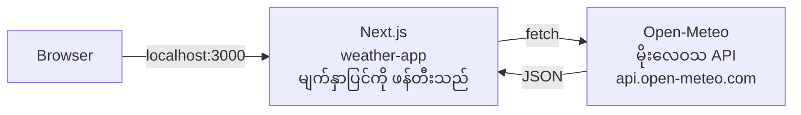
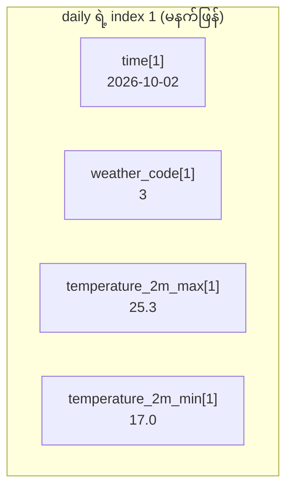
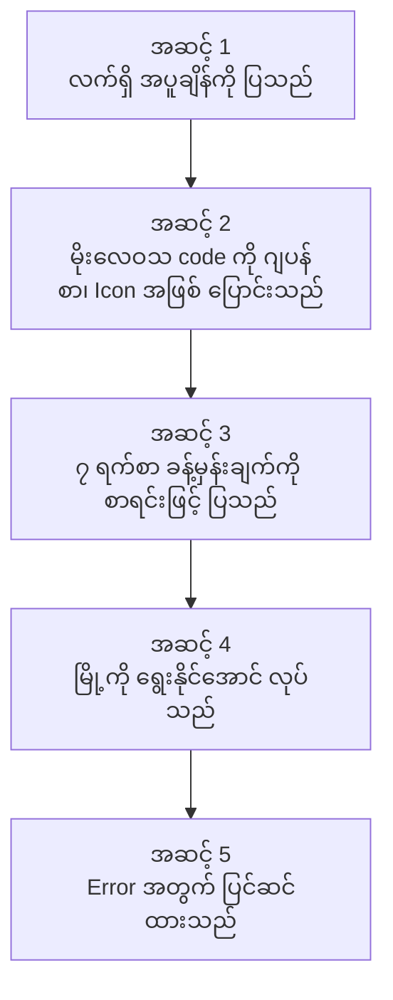

# အဆင့်မြင့်လေ့ကျင့်ခန်း: မိုးလေဝသ API ဖြင့် မိုးလေဝသခန့်မှန်းချက် app ကို ဖန်တီးကြမယ်

> 🇯🇵 မူရင်း (ဂျပန်ဘာသာဖြင့်): [2026_10_02_資料2.md](<../../../2年生_システム開発実践/後期/2026_10_02/2026_10_02_資料2.md>) <!-- original-ja-link -->

**ကျောင်းသားစီမံခန့်ခွဲမှု app ကို ပြီးအောင်လုပ်ပြီးသူ** တွေ ဒီလေ့ကျင့်ခန်းကို ဆက်လုပ်ကြပါ။
ပထမစာသင်နှစ်ဝက်မှာ "ကိုယ်တိုင်ဖန်တီးထားတဲ့ Laravel API" ကနေ JSON ကို လက်ခံပြီး မျက်နှာပြင်မှာ ပြခဲ့ပါတယ်။
ဒီတစ်ခါတော့ **အင်တာနက်ပေါ်မှာ အများသုံးဖို့ ဖွင့်ထားတဲ့ မိုးလေဝသ API (Open-Meteo)** ကနေ JSON ကို လက်ခံပြီး **Next.js project အသစ်** နဲ့ မိုးလေဝသခန့်မှန်းချက် app ကို ဖန်တီးပါမယ်။



### ပြီးဆုံးသွားရင် ဒီလိုပုံစံ ဖြစ်မယ်

```
┌─────────────────────────────────────────┐
│ 天気予報（東京）              [ 東京 ▼ ]  │  ← မြို့ကို ရွေးနိုင်သည်
├─────────────────────────────────────────┤
│        ☀️                                │
│      晴れ   28℃                          │  ← လက်ရှိ မိုးလေဝသ
│      風速 0.7 km/h                       │
├─────────────────────────────────────────┤
│ 10/1(木)  ☀️ 晴れ    29℃ / 18℃  ☔ 0%    │
│ 10/2(金)  ☁️ くもり  25℃ / 17℃  ☔ 20%   │  ← ၇ ရက်စာ ခန့်မှန်းချက်
│ 10/3(土)  🌧️ 雨      21℃ / 16℃  ☔ 80%   │
│   …                                     │
└─────────────────────────────────────────┘
```

### ဒီနေ့ရဲ့ ပန်းတိုင်

- **Next.js project ကို အစကနေ ဖန်တီး** နိုင်ရမယ်
- အများသုံးဖွင့်ထားတဲ့ **ပြင်ပ API** ကို ခေါ်ပြီး JSON ကို မျက်နှာပြင်မှာ ပြနိုင်ရမယ်
- JSON ထဲကနေ **လိုအပ်တဲ့ တန်ဖိုးကို ထုတ်ယူ** နိုင်ရမယ်
- ရွေးထားတဲ့ တန်ဖိုး (မြို့) ပြောင်းသွားရင် **API ကို ပြန်ခေါ်** နိုင်ရမယ်

> ဒီသင်ခန်းစာမှာ **အဖြေ code ကို ထည့်မပေးထားပါဘူး။**
> ပထမစာသင်နှစ်ဝက်က ကျောင်းသားစီမံခန့်ခွဲမှု app (`school-frontend`) ရဲ့ code ကို ကိုးကားရင်း ကိုယ်တိုင် စဉ်းစားပြီး ရေးကြည့်ပါ။

---

## 1. သုံးမယ့် API: Open-Meteo

[Open-Meteo](https://open-meteo.com/) က အခမဲ့သုံးနိုင်တဲ့ မိုးလေဝသ API ဖြစ်ပါတယ်။

- **အကောင့်မှတ်ပုံတင်ဖို့၊ API key မလိုပါ** (URL ကို ဖွင့်လိုက်ရုံနဲ့ သုံးနိုင်တယ်)
- နေရာကို **latitude (လတ္တီတွဒ်)၊ longitude (လောင်ဂျီတွဒ်)** နဲ့ သတ်မှတ်ရတယ်
- **အများဆုံး ၁၆ ရက်စာ** ခန့်မှန်းချက် ရနိုင်တယ် (ဒီတစ်ခါ ၇ ရက်စာကို သုံးမယ်)

ကျောင်းသားစီမံခန့်ခွဲမှု app နဲ့ နှိုင်းယှဉ်ကြည့်ရအောင်။

| | ကျောင်းသားစီမံခန့်ခွဲမှု app | မိုးလေဝသခန့်မှန်းချက် app |
|---|---|---|
| API ကို ဖန်တီးခဲ့သူ | ကိုယ်တိုင် (Laravel) | Open-Meteo |
| URL | `http://localhost:8000/api/students` | `https://api.open-meteo.com/v1/forecast?...` |
| Authentication | Token လိုအပ် (🔒) | **မလို** |
| သုံးမယ့် Method | GET / POST / PUT / DELETE | GET တစ်ခုတည်း (ဖတ်ရုံသာ) |

> အခမဲ့ အများသုံးဖွင့်ထားတဲ့ API ဖြစ်ပါတယ်။ **ခလုတ်ကို ဆက်တိုက်နှိပ်တာ၊ loop နဲ့ အကြိမ်ကြိမ် ခေါ်တာမျိုး မလုပ်ပါနဲ့။**

---

## 2. ပထမဆုံး Browser မှာ API ကို ကြည့်ကြမယ်

Code မရေးခင်မှာ **ဘယ်လို JSON ပြန်လာမလဲ** ဆိုတာ စစ်ကြည့်ဖို့ အရေးကြီးပါတယ်။
အောက်ပါ URL ကို browser ရဲ့ address bar မှာ paste လုပ်ပြီး ဖွင့်ကြည့်ပါ (တိုကျိုရဲ့ မိုးလေဝသ ဖြစ်ပါတယ်)။

```
https://api.open-meteo.com/v1/forecast?latitude=35.68&longitude=139.77&current=temperature_2m,weather_code,wind_speed_10m&daily=weather_code,temperature_2m_max,temperature_2m_min,precipitation_probability_max&timezone=Asia%2FTokyo
```

> Chrome မှာ "プリティ プリント" (JSON ကို ဖတ်ရလွယ်အောင် ပြသခြင်း) ကို check လုပ်လိုက်ရင် JSON ကို ဖတ်ရတာ ပိုလွယ်သွားပါတယ်။

### URL ကို ဖတ်နည်း

`?` ရဲ့ နောက်က အပိုင်းကို **query parameter** (API ဆီ မှာယူတဲ့ အကြောင်းအရာ) လို့ ခေါ်ပါတယ်။ `&` နဲ့ ခြားပြီး စီရေးပါတယ်။

| Parameter | အဓိပ္ပာယ် |
|-----------|------|
| `latitude=35.68` | Latitude |
| `longitude=139.77` | Longitude |
| `current=temperature_2m,weather_code,wind_speed_10m` | **လက်ရှိ** အပူချိန်၊ မိုးလေဝသ code၊ လေတိုက်နှုန်း ကို လိုချင်တယ် |
| `daily=weather_code,temperature_2m_max,...` | **နေ့အလိုက်** မိုးလေဝသ code၊ အမြင့်ဆုံးအပူချိန်၊ အနိမ့်ဆုံးအပူချိန်၊ မိုး သို့မဟုတ် နှင်းရွာသွန်းနိုင်ခြေကို လိုချင်တယ် |
| `timezone=Asia%2FTokyo` | ဂျပန်စံတော်ချိန်နဲ့ ပြန်ပို့စေချင်တယ် (`%2F` ဆိုတာ `/` ကို ဆိုလိုတယ်) |

> `current=` နဲ့ `daily=` ရဲ့ နောက်က အရာတွေကို လျှော့တာ၊ တိုးတာ လုပ်ရင် ပြန်လာတဲ့ JSON လည်း ပြောင်းသွားပါတယ်။ စမ်းကြည့်ပါ။
> ဘယ်လို item တွေ ရှိလဲဆိုတာကို [Open-Meteo ရဲ့ document](https://open-meteo.com/en/docs) မှာ ရှာကြည့်နိုင်ပါတယ်။

### ပြန်လာတဲ့ JSON (တစ်စိတ်တစ်ပိုင်း)

```json
{
  "current": {
    "time": "2026-10-01T17:00",
    "temperature_2m": 28.2,
    "weather_code": 0,
    "wind_speed_10m": 0.7
  },
  "daily": {
    "time": ["2026-10-01", "2026-10-02", "2026-10-03", ...],
    "weather_code": [0, 3, 61, ...],
    "temperature_2m_max": [29.1, 25.3, 21.0, ...],
    "temperature_2m_min": [18.2, 17.0, 16.4, ...],
    "precipitation_probability_max": [0, 20, 80, ...]
  }
}
```

### ဘယ်နေရာမှာ ဘာပါလဲ?

| ပြချင်တဲ့အရာ | JSON ရဲ့ ဘယ်နေရာလဲ? |
|--------------|-------------|
| လက်ရှိ အပူချိန် | `current.temperature_2m` |
| လက်ရှိ မိုးလေဝသ code | `current.weather_code` |
| လက်ရှိ လေတိုက်နှုန်း | `current.wind_speed_10m` (km/h) |
| ရက်စွဲ (၇ ရက်စာ) | `daily.time` ← **array** |
| နေ့အလိုက် မိုးလေဝသ code | `daily.weather_code` ← **array** |
| နေ့အလိုက် အမြင့်ဆုံး၊ အနိမ့်ဆုံး အပူချိန် | `daily.temperature_2m_max`၊ `daily.temperature_2m_min` ← **array** |
| နေ့အလိုက် မိုး သို့မဟုတ် နှင်းရွာသွန်းနိုင်ခြေ (%) | `daily.precipitation_probability_max` ← **array** |

ဒီနေရာက အဓိကအချက်ပါ။

- `current` ထဲမှာ **တန်ဖိုး တစ်ခုစီ** ပါတယ်
- `daily` က **item တစ်ခုချင်းစီအလိုက် array** ဖြစ်နေပြီး **နံပါတ် (index) တူတာတွေက နေ့တစ်နေ့တည်း** ရဲ့ ဒေတာ ဖြစ်တယ်



### မိုးလေဝသ code (weather_code)

မိုးလေဝသကို "晴れ" (နေသာ) လိုမျိုး စာလုံးနဲ့ မဟုတ်ဘဲ **နံပါတ် (WMO code)** နဲ့ ပြန်ပို့ပါတယ်။
မျက်နှာပြင်မှာ ပြတဲ့အခါ ကိုယ်တိုင် ဂျပန်စာအဖြစ် ပြောင်းရပါမယ်။

| Code | မိုးလေဝသ | Icon ဥပမာ |
|-------|------|-----------|
| 0 | နေသာ | ☀️ |
| 1, 2 | နေသာပြီး တစ်ခါတစ်ရံ တိမ်ထူ | 🌤️ |
| 3 | တိမ်ထူ | ☁️ |
| 45, 48 | မြူ | 🌫️ |
| 51〜57 | မိုးဖွဲဖွဲ | 🌦️ |
| 61〜67 | မိုးရွာ | 🌧️ |
| 71〜77 | နှင်းကျ | ❄️ |
| 80〜82 | မိုးတစ်ခဏရွာ | 🌦️ |
| 85, 86 | နှင်းတစ်ခဏကျ | 🌨️ |
| 95〜99 | မိုးကြိုးမုန်တိုင်း | ⛈️ |

---

## 3. Next.js project ကို ဖန်တီးမယ်

ကျောင်းသားစီမံခန့်ခွဲမှု app (`school-frontend`) နဲ့ **သီးခြား folder** ထဲမှာ ဖန်တီးပါမယ်။
`school-frontend` ထဲမှာ မဖန်တီးမိအောင် သတိထားပါ။

```bash
npx create-next-app@latest weather-app
```

မေးခွန်းတွေကို ပထမစာသင်နှစ်ဝက်တုန်းကအတိုင်း ဖြေပါ။

```
Would you like to use TypeScript?             → Yes
Would you like to use ESLint?                 → Yes
Would you like to use Tailwind CSS?           → Yes
Would you like your code inside a src/ dir?   → No
Would you like to use App Router?             → Yes
Would you like to use Turbopack?              → No
Would you like to customize the import alias? → No
```

```bash
cd weather-app
npm run dev
```

http://localhost:3000 ကို ဖွင့်ပြီး Next.js ရဲ့ နမူနာ မျက်နှာပြင် ပေါ်လာရင် အောင်မြင်ပါပြီ။

### ဖန်တီးပြီးပြီးချင်း လုပ်ထားရမယ့်အရာ

| ဖိုင် | လုပ်ရမယ့်အရာ | ကိုးကား |
|---------|---------|------|
| `app/layout.tsx` | `lang="en"` ကို `lang="ja"` ပြောင်း၊ `title` ကို "天気予報アプリ" (မိုးလေဝသခန့်မှန်းချက် app) လို့ ပြောင်းပါ | `school-frontend/app/layout.tsx` |
| `app/globals.css` | `@import "tailwindcss";` ကလွဲပြီး ကျန်တာအားလုံး ဖျက်၊ `body` ရဲ့ နောက်ခံအရောင်၊ စာလုံးအရောင်ကို ကိုယ်တိုင် ဆုံးဖြတ်ပါ | — |
| `app/page.tsx` | နမူနာ အကြောင်းအရာအားလုံးကို ဖျက်ပြီး မိုးလေဝသခန့်မှန်းချက် မျက်နှာပြင်ကို ရေးသွားပါ | — |

> **globals.css ကို ပြင်ရတဲ့ အကြောင်းရင်း**
> မူလ `globals.css` က ကွန်ပျူတာ dark mode ဖြစ်နေရင် **စာလုံးအရောင် အဖြူ** ဖြစ်သွားအောင် setting လုပ်ထားပါတယ်။
> အဖြူရောင် card ပေါ်မှာ စာလုံးတင်ရင် မမြင်ရတော့လို့ အရောင်ကို ကိုယ်တိုင် သတ်မှတ်ထားပါ။

> ဒီတစ်ခါ API key မလိုတဲ့အတွက် `.env` ကို ဖန်တီးစရာ မလိုပါဘူး။
> ပြီးတော့ Laravel ကို မသုံးတဲ့အတွက် XAMPP နဲ့ `php artisan serve` ကိုလည်း စတင်စရာ မလိုပါဘူး။

---

## 4. ဖန်တီးသွားမယ့် အစီအစဉ်

တစ်ခါတည်း အားလုံးကို ဖန်တီးဖို့ မကြိုးစားဘဲ **တစ်ဆင့်ချင်း run ပြီး စစ်ဆေး** ရင်း ရှေ့ဆက်ပါ။



### အဆင့် 1: လက်ရှိ အပူချိန်ကို ပြမယ်

**လုပ်ရမယ့်အရာ**
- `app/page.tsx` မှာ စာမျက်နှာ ပေါ်လာတဲ့အချိန် API ကိုခေါ်ပြီး တိုကျိုရဲ့ **လက်ရှိ အပူချိန်၊ မိုးလေဝသ code၊ လေတိုက်နှုန်း** ကို ပြပါ

**အကြံပြုချက်**
- ပထမစာကြောင်းမှာ `"use client";` ကို ရေးပါ (`useState`၊ `useEffect` ကို သုံးမှာမို့လို့)
- ကျောင်းသားစီမံခန့်ခွဲမှု app ရဲ့ `app/students/page.tsx` ထဲက **`useEffect` နဲ့ `loadStudents`** ရဲ့ ပုံစံကို အဲဒီအတိုင်း ကိုးကားနိုင်တယ်
- ဒီတစ်ခါ **token (`Authorization` header) မလိုပါ**။ URL ကို `fetch` လုပ်ရုံပါပဲ
- အစပိုင်းမှာ URL ထဲ `current=` ပဲ ပါရင် ရပါပြီ (`daily=` ကို အဆင့် 3 မှာ ထပ်ထည့်မယ်)
- လက်မခံရခင်မှာ ဒေတာက ဗလာ (`null`) ဖြစ်နေလို့ "読み込み中..." (loading ဖြစ်နေသည်...) ကို အရင်ပြထားပါ
- TypeScript မှာ `useState(null)` လို့ ရေးရင် နောက်ပိုင်း `weather.current` မှာ error တက်လိမ့်မယ် → `useState<any>(null)` လို့ ရေးပါ

**✅ စစ်ဆေးရန်**: အပူချိန်၊ မိုးလေဝသ code (နံပါတ်)၊ လေတိုက်နှုန်း ပေါ်လာပြီ

### အဆင့် 2: မိုးလေဝသ code ကို ဂျပန်စာနဲ့ Icon အဖြစ် ပြောင်းမယ်

**လုပ်ရမယ့်အရာ**
- မိုးလေဝသ code ကို လက်ခံပြီး "晴れ" (နေသာ) လိုမျိုး ဂျပန်စာနဲ့ emoji icon ကို ပြန်ပေးတဲ့ **function** ကို ဖန်တီးပါ
- လက်ရှိ မိုးလေဝသကို အဖြူရောင် card ထဲမှာ **icon၊ မိုးလေဝသ၊ အပူချိန်၊ လေတိုက်နှုန်း** နဲ့ ပြပါ

**အကြံပြုချက်**
- Function ကို `export default function ...` ရဲ့ **အပြင်ဘက် (အပေါ်)** မှာ ဖန်တီးတာ ကောင်းတယ်
- 2. ထဲက မိုးလေဝသ code ဇယားကို ကြည့်ရင်း `if` နဲ့ code အငယ်ကနေ အစဉ်လိုက် စစ်သွားပါ
- ဂျပန်စာနဲ့ icon နှစ်ခုလုံးကို ပြန်ပေးချင်ရင် `{ label: "晴れ", icon: "☀️" }` လိုမျိုး **object** ကို ပြန်ပေးပါ
- အပူချိန်က `28.2` လိုမျိုး ဒသမကိန်းနဲ့ လာတယ် → `Math.round()` နဲ့ အနီးဆုံး ကိန်းပြည့်ကို ပြောင်းရင် ဖတ်ရလွယ်တယ်

**✅ စစ်ဆေးရန်**: Icon နဲ့ "晴れ" (နေသာ) စတဲ့ ဂျပန်စာ ပေါ်လာပြီ

### အဆင့် 3: ၇ ရက်စာ ခန့်မှန်းချက်ကို စာရင်းနဲ့ ပြမယ်

**လုပ်ရမယ့်အရာ**
- URL ထဲကို `daily=...` ထည့်ပြီး ၇ ရက်စာ ခန့်မှန်းချက်ကို စာရင်းနဲ့ ပြပါ
- တစ်ကြောင်းမှာ "ရက်စွဲ၊ icon၊ မိုးလေဝသ၊ အမြင့်ဆုံးအပူချိန်၊ အနိမ့်ဆုံးအပူချိန်၊ မိုး သို့မဟုတ် နှင်းရွာသွန်းနိုင်ခြေ" ကို စီပြပါ

**အကြံပြုချက်**
- စာရင်းပြတာက ကျောင်းသားစာရင်းလိုပဲ `map` ကို သုံးပါ။ `key` အတွက် မထပ်တဲ့ တန်ဖိုး (ရက်စွဲ) ကို သုံးပါ
- `daily.time` ကို `map` နဲ့ ပတ်ရင် ဒုတိယ argument မှာ **နံပါတ် `i`** ကို ရတယ် → `(date, i) => ...`
- အဲဒီ `i` ကိုသုံးပြီး `daily.weather_code[i]` လိုမျိုး **နံပါတ်တူ** နဲ့ တခြား array တွေကနေ ထုတ်ယူပါ
- ရက်စွဲ `2026-10-02` ကို `10/2(金)` ပုံစံ ဖြစ်စေချင်သူတွေက `new Date(date)` ကို ဖန်တီးပြီး `getMonth()` (**0 ကနေ စတာ** မို့ +1 လုပ်ပါ)၊ `getDate()`၊ `getDay()` (0 က တနင်္ဂနွေ) ကို သုံးပါ

**✅ စစ်ဆေးရန်**: ၇ ရက်စာ ခန့်မှန်းချက်တွေ စီပြီး ပေါ်လာပြီ

### အဆင့် 4: မြို့ကို ရွေးနိုင်အောင် လုပ်မယ်

**လုပ်ရမယ့်အရာ**
- Select box မှာ မြို့ကို ရွေးလိုက်ရင် အဲဒီမြို့ရဲ့ မိုးလေဝသ၊ ခန့်မှန်းချက်ကို ပြောင်းပြအောင် လုပ်ပါ

မြို့တွေရဲ့ latitude၊ longitude ကို အောက်ပါဇယားကို သုံးပါ။

| မြို့ | Latitude | Longitude |
|-----|---------------|----------------|
| 東京 (တိုကျို) | 35.68 | 139.77 |
| 大阪 (အိုဆာကာ) | 34.69 | 135.50 |
| 札幌 (ဆပ်ပိုရို) | 43.06 | 141.35 |
| 那覇 (နာဟ) | 26.21 | 127.68 |

**အကြံပြုချက်**
- မြို့စာရင်းကို `{ name: "東京", latitude: 35.68, longitude: 139.77 }` လိုမျိုး object တွေရဲ့ **array** အဖြစ် ထားပါ
- "ရွေးထားတဲ့ မြို့" ကို `useState` နဲ့ သိမ်းထားပါ
- URL ထဲက `latitude=` နဲ့ `longitude=` အပိုင်းကို ရွေးထားတဲ့ မြို့ရဲ့ တန်ဖိုးနဲ့ အစားထိုးပါ (template string `` `...${ }...` `` က အသုံးဝင်တယ်)
- `useEffect` ရဲ့ dependency array ကို ပြန်သတိရကြည့်ပါ


| Dependency array ရေးပုံ | ဘယ်အချိန် run မလဲ? |
|----------------|----------------|
| `[]` | စာမျက်နှာ ပေါ်လာတဲ့အချိန် **တစ်ကြိမ်တည်း** (ကျောင်းသားစာရင်းမှာ သုံးခဲ့တယ်) |
| `[city]` | ပထမဆုံး တစ်ကြိမ် ＋ **city ပြောင်းတိုင်း** |

**✅ စစ်ဆေးရန်**: မြို့ကို ပြောင်းလိုက်ရင် မိုးလေဝသနဲ့ ခန့်မှန်းချက် ပြောင်းသွားပြီ (ဆပ်ပိုရိုနဲ့ နာဟရဲ့ အပူချိန်ကို နှိုင်းယှဉ်ကြည့်ပါ)

### အဆင့် 5: Error အတွက် ပြင်ဆင်ထားမယ်

**လုပ်ရမယ့်အရာ**
- API မအောင်မြင်တဲ့အခါ မျက်နှာပြင် အဖြူဖြစ်မသွားဘဲ **error message** ပေါ်အောင် လုပ်ပါ

**အကြံပြုချက်**
- ကျောင်းသားစီမံခန့်ခွဲမှု app မှာလည်း `res.ok` နဲ့ မအောင်မြင်တာကို စစ်ခဲ့တယ်
- အင်တာနက် မချိတ်ထားတဲ့အခါ `fetch` ကိုယ်တိုင်က fail ဖြစ်တယ် → `try` / `catch` နဲ့ ဖမ်းယူပါ
- အောင်မြင်သည်ဖြစ်စေ၊ မအောင်မြင်သည်ဖြစ်စေ "読み込み中" (loading ဖြစ်နေသည်) ကို ရပ်ရမယ် → `finally`

**✅ စစ်ဆေးရန်**: URL ထဲက `latitude=` ကို တမင် `latitude=999` လို့ ပြောင်းလိုက်ရင် error message ပေါ်လာပြီ (စစ်ပြီးရင် မူလအတိုင်း ပြန်ပြင်ပါ)

---

## 5. အဆင်မပြေတဲ့အခါ

| ဖြစ်နေတဲ့ ပြဿနာ | စစ်ဆေးရမယ့်အရာ |
|------|-------------|
| `useState is not defined` | ပထမစာကြောင်းမှာ `"use client";`၊ အဲဒီအောက်မှာ `import { useState, useEffect } from "react";` ရှိလား |
| `Cannot read properties of null` | ဒေတာ မရောက်ခင် ပြဖို့ ကြိုးစားနေတယ် → "読み込み中" (loading) စစ်တဲ့ အပိုင်းရဲ့ **အောက်** မှာ သုံးထားလား |
| `Cannot read properties of undefined` | JSON ကနေ ထုတ်ယူပုံ မှားနေတယ်／URL ထဲ `daily=` ထည့်ဖို့ မေ့နေလား → 2. ထဲက ဇယားနဲ့ တိုက်ကြည့်ပါ |
| အချိန် သို့မဟုတ် ရက်စွဲ ၉ နာရီ လွဲနေတယ် | URL ထဲ `timezone=Asia%2FTokyo` ထည့်ထားလား |
| စာလုံး မမြင်ရဘူး (အဖြူ) | `globals.css` ထဲက dark mode setting ကို ဖျက်ပြီးပြီလား |
| တန်ဖိုး မှားနေတယ်၊ မပေါ်ဘူး | Developer Tools ရဲ့ `Network` tab မှာ API ရဲ့ response (JSON) ကို စစ်ကြည့်ပါ |

---

## 6. ထပ်ပြီး စိန်ခေါ်ကြည့်ပါ (ပြီးသူတွေ စလုပ်ပါ)

- [ ] **Component ခွဲမယ်**: "လက်ရှိ မိုးလေဝသ" နဲ့ "ခန့်မှန်းချက်စာရင်း" ကို `components/` ထဲက သီးခြားဖိုင်တွေအဖြစ် ခွဲပြီး `props` နဲ့ ဒေတာ ပေးပို့ပါ
- [ ] **မြို့ ထပ်တိုးမယ်**: ကိုယ့်ဇာတိမြို့ကို ထည့်ပါ (latitude၊ longitude ကို Google Maps မှာ နေရာကို right-click လုပ်ရင် ပေါ်လာပါတယ်)
- [ ] **မြို့နာမည်နဲ့ ရှာမယ်**: Input box မှာ မြို့နာမည် ရိုက်ထည့်ပြီး ရှာနိုင်အောင် လုပ်ပါ ([Geocoding API](https://open-meteo.com/en/docs/geocoding-api) နဲ့ မြို့နာမည် → latitude၊ longitude ကို ပြောင်းနိုင်တယ်။ ဒါလည်း key မလိုပါ)
- [ ] **နာရီအလိုက် ခန့်မှန်းချက်**: URL ထဲ `hourly=temperature_2m&forecast_days=1` ကို ထည့်ပြီး ဒီနေ့ရဲ့ တစ်နာရီချင်း အပူချိန်ကို ပြပါ
- [ ] **လက်ရှိနေရာရဲ့ မိုးလေဝသ**: `navigator.geolocation.getCurrentPosition()` နဲ့ ကိုယ့်ရဲ့ latitude၊ longitude ကို ယူပြီး အဲဒီနေရာရဲ့ မိုးလေဝသကို ပြပါ
- [ ] **အသွင်အပြင် ပြောင်းမယ်**: မိုးလေဝသပေါ် မူတည်ပြီး နောက်ခံအရောင် ပြောင်းပါ (နေသာရင် လိမ္မော်ရောင်၊ မိုးရွာရင် အပြာရောင် စသည်)／Tailwind CSS နဲ့ ရေးကြည့်ပါ

> အချိန်ပိုရှိသေးသူတွေက [သင်ခန်းစာ 3](./2026_10_02_資料3.md) မှာ **Gemini နဲ့ ကိုယ်ပိုင် မိုးလေဝသ icon ဖန်တီးခြင်း**၊ **Vercel ပေါ်မှာ အခမဲ့ deploy လုပ်ခြင်း** ကို စိန်ခေါ်ကြည့်ပါ။

---

## စစ်ဆေးမှု Quiz

- [ ] ကျောင်းသားစီမံခန့်ခွဲမှု app ရဲ့ API နဲ့ Open-Meteo ရဲ့ API ဘာကွာလဲ? (ဖန်တီးခဲ့သူ၊ Authentication)
- [ ] URL ထဲ `?` ရဲ့ နောက်က `latitude=35.68&longitude=139.77` က ဘာကို ကိုယ်စားပြုလဲ?
- [ ] `daily` ထဲမှာ နေ့တစ်နေ့တည်းရဲ့ ဒေတာကို ဘယ်လို ရှာမလဲ?
- [ ] မိုးလေဝသ code `3` က ဘယ်လို မိုးလေဝသလဲ? အဲဒါကို မျက်နှာပြင်မှာ "くもり" (တိမ်ထူ) လို့ ပြဖို့ ဘယ်လိုလုပ်မလဲ?
- [ ] `useEffect(() => { ... }, [city])` က ဘယ်အချိန်မှာ run မလဲ?
- [ ] `try` / `catch` / `finally` ထဲက `finally` က ဘယ်အချိန်မှာ run မလဲ?
