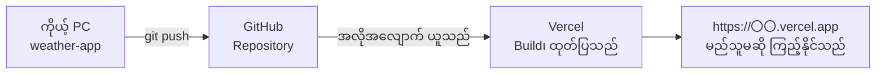
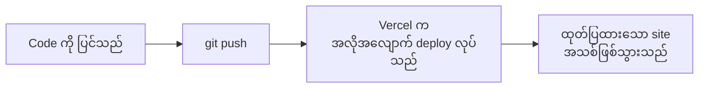

# အဆင့်မြင့်လေ့ကျင့်ခန်း: မိုးလေဝသခန့်မှန်းချက် app ကို ပိုကောင်းအောင် အဆင့်မြှင့်ကြမယ်

> 🇯🇵 မူရင်း (ဂျပန်ဘာသာဖြင့်): [2026_10_02_資料3.md](<../../../2年生_システム開発実践/後期/2026_10_02/2026_10_02_資料3.md>) <!-- original-ja-link -->

[သင်ခန်းစာ 2](./2026_10_02_資料2.md) ထဲက မိုးလေဝသခန့်မှန်းချက် app (`weather-app`) ကို **ပြီးအောင်လုပ်ပြီးသူ** တွေ ဒီသင်ခန်းစာကို ဆက်လုပ်ကြပါ။

| | လုပ်ရမယ့်အရာ |
|---|---|
| 1. | Gemini နဲ့ ကိုယ်ပိုင် မိုးလေဝသ icon တွေကို ဖန်တီးပြီး emoji အစား ပြမယ် |
| 2. | Vercel ပေါ်မှာ အခမဲ့ deploy လုပ်ပြီး ဖုန်းကနေလည်း ကြည့်နိုင်အောင် လုပ်မယ် |

---

## 1. Gemini နဲ့ ကိုယ်ပိုင် မိုးလေဝသ icon တွေကို ဖန်တီးမယ်

Open-Meteo က **icon ပုံတွေကို မပို့ပေးပါဘူး** (ပြန်လာတာက မိုးလေဝသ code နံပါတ်တွေပဲ)။
ဒါကြောင့် **Gemini နဲ့ ပုံကို generate လုပ်** ပြီး `public/` folder ထဲ ထည့်ကာ မိုးလေဝသ code နဲ့ ကိုက်ညီအောင် ပြကြည့်ကြရအောင်။


### 1-1. Gemini နဲ့ ပုံ ဖန်တီးမယ်

[Gemini](https://gemini.google.com/) ကို ဖွင့်ပြီး မိုးလေဝသ အမျိုးအစားတစ်ခုစီအတွက် ပုံတွေကို ဖန်တီးခိုင်းပါမယ်။

| မိုးလေဝသ | ဖိုင်နာမည် ဥပမာ |
|-----|-------------|
| နေသာ | `sunny.png` |
| နေသာပြီး တစ်ခါတစ်ရံ တိမ်ထူ | `partly-cloudy.png` |
| တိမ်ထူ | `cloudy.png` |
| မြူ | `fog.png` |
| မိုးရွာ (မိုးဖွဲဖွဲ၊ မိုးတစ်ခဏရွာ အပါအဝင်) | `rainy.png` |
| နှင်းကျ | `snowy.png` |
| မိုးကြိုးမုန်တိုင်း | `thunder.png` |

Prompt (တောင်းဆိုတဲ့ စာသား) ဥပမာ:

```
မိုးလေဝသခန့်မှန်းချက် app မှာ သုံးဖို့ "နေသာ" icon ကို ဖန်တီးပေးပါ။
ရိုးရှင်းပြီး ချစ်စရာကောင်းတဲ့ ပုံ၊ စတုရန်းပုံ၊ အဖြူရောင် နောက်ခံ၊ စာလုံး မထည့်ပါနဲ့။
```

> **အဓိကအချက်**
> - ပထမတစ်ခု ရပြီးရင် "**ဒီပုံစံအတိုင်း** 'တိမ်ထူ' icon ကိုလည်း ဖန်တီးပေးပါ" လို့ ဆက်တောင်းဆိုရင် ပုံစံတွေ တစ်သမတ်တည်း ဖြစ်လာပါတယ်
> - ရလာတဲ့ ပုံတွေကို download လုပ်ပြီး အပေါ်ကဇယားထဲက နာမည်တွေအတိုင်း ပြောင်းထားပါ
> - ဖိုင်နာမည်ကို **half-width အင်္ဂလိပ်စာလုံးနဲ့ ဂဏန်း** သာ သုံးပါ (ဂျပန်စာ ဖိုင်နာမည်ကို ရှောင်ပါ)

### 1-2. public folder ထဲ ထည့်မယ်

```
weather-app/
└── public/
    └── icons/          ← ဖန်တီးပါ
        ├── sunny.png
        ├── cloudy.png
        └── ...
```

`public/` ထဲ ထည့်ထားတဲ့ ဖိုင်တွေကို **`/` နဲ့ စတဲ့ path** နဲ့ ပြနိုင်ပါတယ်။
ဥပမာ `public/icons/sunny.png` ကို `` နဲ့ ပြနိုင်ပါတယ်။

> Browser မှာ http://localhost:3000/icons/sunny.png ကို ဖွင့်ပြီး ပုံ ပေါ်လား အရင် စစ်ကြည့်ပါ။

### 1-3. မိုးလေဝသ code နဲ့ ကိုက်ညီအောင် ပြမယ်

**လုပ်ရမယ့်အရာ**
- သင်ခန်းစာ 2 ရဲ့ အဆင့် 2 မှာ ဖန်တီးခဲ့တဲ့ function ကို ပြုပြင်ပြီး ဂျပန်စာ၊ emoji အပြင် **ပုံရဲ့ path** (`/icons/sunny.png` စသည်) ကိုပါ ပြန်ပေးအောင် လုပ်ပါ
- လက်ရှိ မိုးလေဝသနဲ့ ၇ ရက်စာ ခန့်မှန်းချက်မှာ emoji အစား `` နဲ့ ပုံကို ပြပါ

**အကြံပြုချက်**
- ပြန်ပေးတဲ့ object ထဲကို `image: "/icons/sunny.png"` လိုမျိုး item ကို ထပ်ထည့်ပါ
- ပုံရဲ့ အရွယ်အစားကို `` ရဲ့ `width` သို့မဟုတ် `style` နဲ့ သတ်မှတ်ပါ (ခန့်မှန်းချက်စာရင်းမှာ နည်းနည်း သေးသေးထားပါ)
- `alt` ထဲမှာ "晴れ" (နေသာ) လိုမျိုး ဂျပန်စာကို ထည့်ထားရင် ပုံ load မဖြစ်တဲ့အခါမှာလည်း မိုးလေဝသကို သိနိုင်တယ်

**✅ စစ်ဆေးရန်**: မြို့ကို ပြောင်းလိုက်ရင် မိုးလေဝသနဲ့ ကိုက်ညီတဲ့ ကိုယ်ပိုင် icon ပေါ်လာပြီ

---

## 2. Vercel ပေါ်မှာ အခမဲ့ deploy လုပ်မယ်

အခုလက်ရှိ app က `localhost:3000` ဖြစ်နေလို့ **ကိုယ့်ကွန်ပျူတာကနေပဲ ကြည့်လို့ရပါတယ်။**
[Vercel](https://vercel.com/) (Next.js ကို ဖန်တီးတဲ့ ကုမ္ပဏီရဲ့ service) ကို သုံးရင် အခမဲ့ အင်တာနက်ပေါ်မှာ ထုတ်ပြနိုင်ပါတယ်။
ထုတ်ပြလိုက်ရင် `https://weather-app-xxxx.vercel.app` လိုမျိုး URL ရလာပြီး **ဖုန်း သို့မဟုတ် သူငယ်ချင်းရဲ့ ကွန်ပျူတာကနေလည်း ကြည့်နိုင်** လာပါတယ်။



> **Deploy** ဆိုတာ ဖန်တီးထားတဲ့ app ကို server ပေါ်တင်ပြီး အင်တာနက်ကနေ သုံးနိုင်အောင် လုပ်တာ ဖြစ်ပါတယ်။

### 2-1. ကိုယ့်စက်မှာ build လုပ်လို့ရလား စစ်မယ်

Vercel မှာလည်း `npm run build` ကိုပဲ run ပါတယ်။ ကိုယ့်စက်မှာ error မတက်လား အရင် စစ်ထားပါ။

```bash
# npm run dev ကို Ctrl + C ဖြင့် ရပ်ပြီးမှ
npm run build
```

- နောက်ဆုံးမှာ `✓ Compiled successfully` စတာတွေ ပေါ်ပြီး error နဲ့ မရပ်သွားရင် OK
- **အနီရောင် error** ပေါ်ရင် message မှာ ရေးထားတဲ့ ဖိုင်၊ စာကြောင်းကို ပြင်ပြီး `npm run build` ကို ထပ် run ပါ
- စစ်ပြီးရင် `npm run dev` နဲ့ development ကို ပြန်ဆက်လုပ်နိုင်ပါတယ်

### 2-2. GitHub ကို push လုပ်မယ်

`create-next-app` နဲ့ ဖန်တီးထားတဲ့ project က **အစကတည်းက Git repository** ဖြစ်နေပါပြီ။

1. GitHub မှာ **repository အသစ်** ကို ဖန်တီးပါ (နာမည်က `weather-app`၊ **README စတာတွေ မထည့်ပါနဲ့**)
2. ဖန်တီးထားတဲ့ repository စာမျက်နှာမှာ ပေါ်လာတဲ့ command တွေကို ကိုးကားပြီး `git remote add origin ...` နဲ့ ချိတ်ဆက်ပါ
3. `git add` → `git commit` → `git push` နဲ့ ဒီအထိ ရေးထားတဲ့ code ကို push လုပ်ပါ

> Git သုံးနည်းကို ပထမစာသင်နှစ်ဝက် 4/30 ရဲ့ သင်ခန်းစာမှာ ပြန်ကြည့်ပါ။
> `public/icons/` ထဲက ပုံတွေပါ တစ်ခါတည်း push ဖြစ်သွားလား GitHub မျက်နှာပြင်မှာ စစ်ကြည့်ပါ။

### 2-3. Vercel မှာ ထုတ်ပြမယ်

1. https://vercel.com/ ကို ဖွင့်ပြီး **Sign Up** → Plan ကို **Hobby (အခမဲ့)** ရွေးပါ
2. **Continue with GitHub** နဲ့ GitHub account ဖြင့် login ဝင်ပါ
3. **Add New...** → **Project** ကို ရွေးပါ
4. စာရင်းထဲက `weather-app` ရဲ့ **Import** ကို နှိပ်ပါ (မပေါ်ရင် GitHub ကို access ခွင့်ပြုပေးပါ)
5. Setting တွေကို **ဒီအတိုင်းထားရင် OK** (Next.js ဆိုရင် အလိုအလျောက် သိပေးပါတယ်) → **Deploy** ကို နှိပ်ပါ
6. ၁〜၂ မိနစ်လောက် စောင့်ပြီး ဂုဏ်ပြုမျက်နှာပြင် ပေါ်လာရင် ပြီးပါပြီ! ပြထားတဲ့ URL ကို ဖွင့်ကြည့်ပါ

> ဒီတစ်ခါ API key မသုံးထားတဲ့အတွက် Vercel မှာ environment variable သတ်မှတ်စရာ မလိုပါဘူး။

### 2-4. ပြင်ပြီးရင် push လုပ်ရုံနဲ့ update ဖြစ်သွားမယ်

တစ်ကြိမ် ချိတ်ဆက်ထားပြီးရင် နောက်ပိုင်း **GitHub ကို `git push` လုပ်တိုင်း Vercel က အလိုအလျောက် ပြန် deploy လုပ်ပေး** ပါတယ်။



> **သတိပြုရန်**
> - ထုတ်ပြထားတဲ့ URL ကို **မည်သူမဆို ကြည့်နိုင်ပါတယ်**။ နာမည်စတဲ့ ကိုယ်ရေးကိုယ်တာ အချက်အလက်တွေကို မျက်နှာပြင်မှာ မထည့်ပါနဲ့
> - Hobby plan က **ကိုယ်ပိုင်၊ သင်ယူမှုအတွက်** ဖြစ်ပါတယ် (ငွေရှာတဲ့ site အတွက် မသုံးရပါ)
> - Deploy မအောင်မြင်တဲ့အခါ Vercel မျက်နှာပြင်ရဲ့ **Build Logs** မှာ error ပေါ်နေပါတယ်။ ကိုယ့်စက်က `npm run build` မှာလည်း အဲဒီ error ပဲ ပေါ်လား စစ်ကြည့်ပါ

**✅ စစ်ဆေးရန်**: ဖုန်းမှာ Vercel ရဲ့ URL ကို ဖွင့်ပြီး မိုးလေဝသခန့်မှန်းချက် ပေါ်လာပြီ
