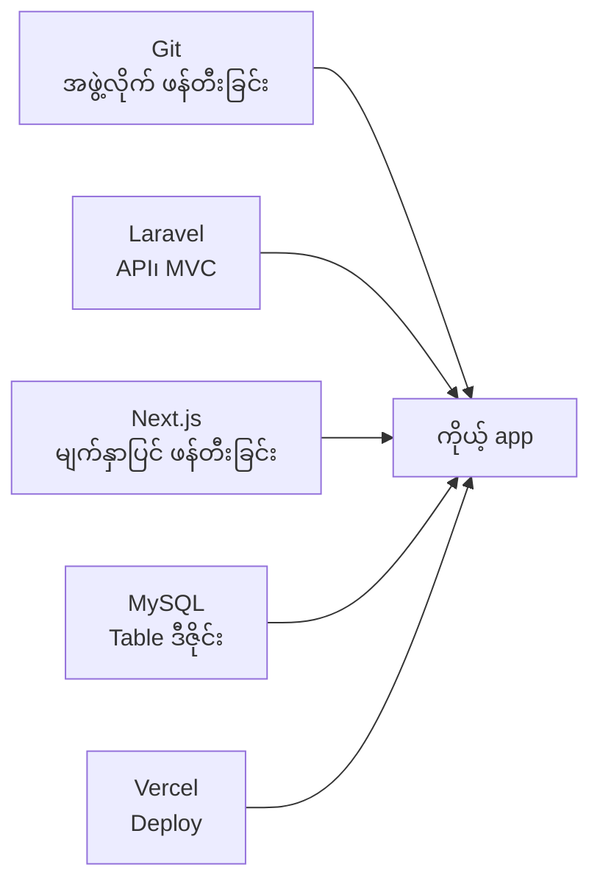
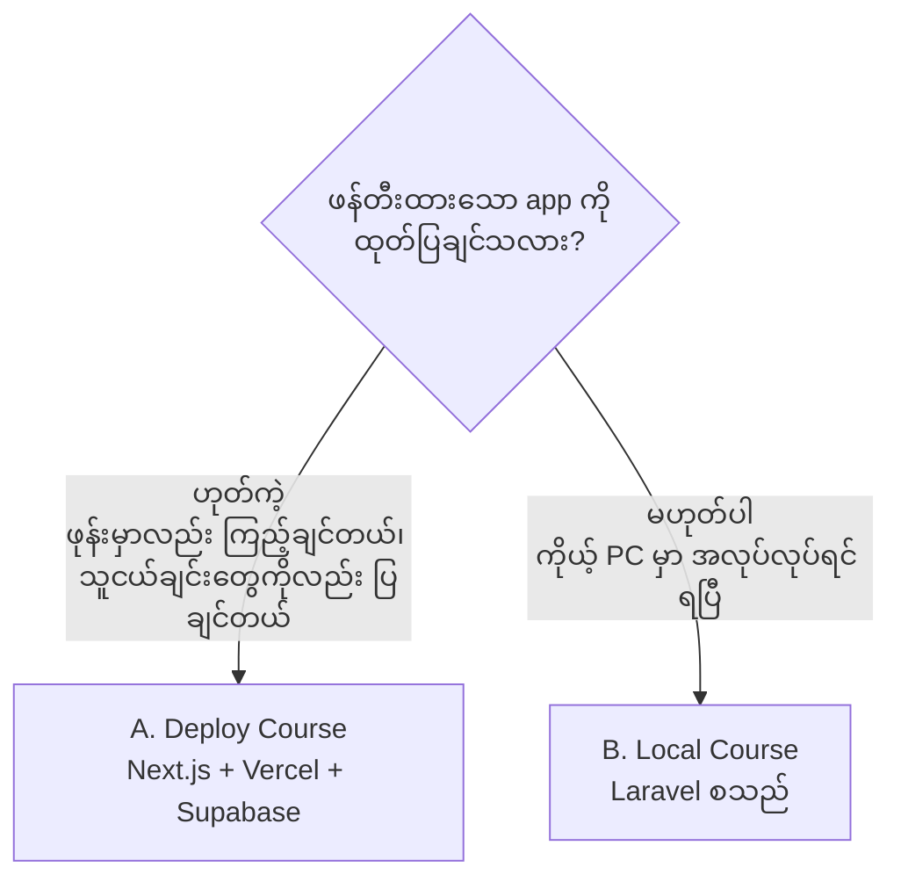
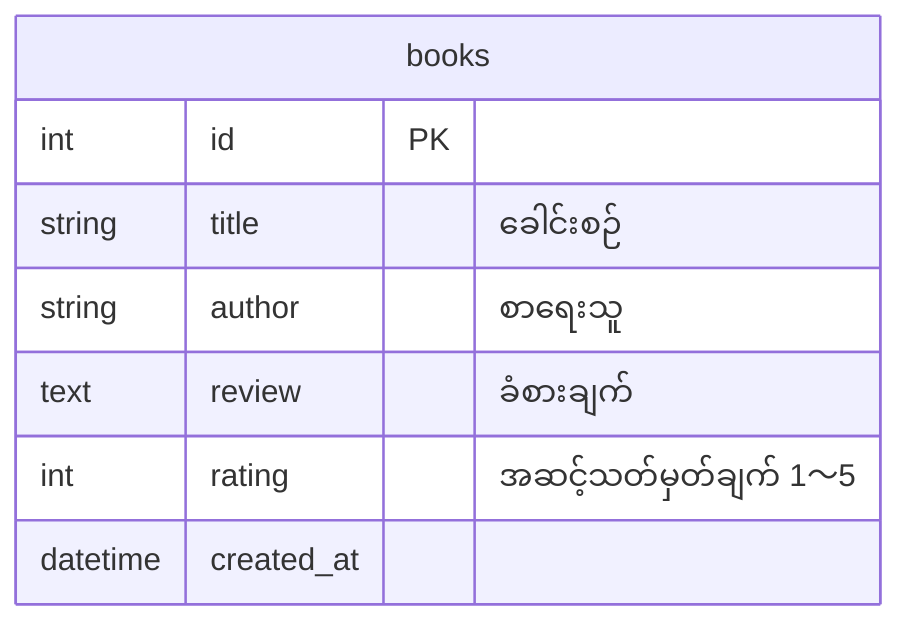
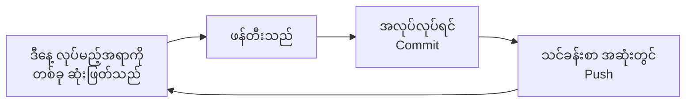

# ကိုယ်ပိုင် ဖန်တီးမှု: အခြေခံတွေ သင်ပြီးပြီမို့ ဒီကစပြီး ဖန်တီးချင်တာကို ဖန်တီးရင်း သင်ယူသွားမယ်

> 🇯🇵 မူရင်း (ဂျပန်ဘာသာဖြင့်): [2026_10_09_資料1.md](<../../../2年生_システム開発実践/後期/2026_10_09/2026_10_09_資料1.md>) <!-- original-ja-link -->

## ဒီနေ့ရဲ့ ပန်းတိုင်
- ဖန်တီးချင်တဲ့ app ကို ဆုံးဖြတ်နိုင်ရမယ်
- ပြီးဆုံးသွားတဲ့ app ကို အလုပ်ရှာတဲ့အခါ **portfolio အဖြစ် တင်သွင်းနိုင်ဖို့** ကို ပန်းတိုင်ထားမယ်
- ကိုယ်နဲ့ကိုက်ညီတဲ့ course (deploy လုပ်မယ် / local မှာပဲ) ကို ရွေးနိုင်ရမယ်
- Development စတင်ဖို့ ပြင်ဆင်မှု (repository ဖန်တီးခြင်း၊ project ဖန်တီးခြင်း) ကို လုပ်နိုင်ရမယ်
- "ဖန်တီးရင်း သင်ယူခြင်း" နဲ့ "ကိုယ့်ရဲ့ စိတ်ကြိုက်အသေးစိတ်ကို တန်ဖိုးထားခြင်း" ဆိုတဲ့ နှစ်ချက်ကို သတိထားနိုင်ရမယ်

---

## 1. ကိုယ်ပိုင် ဖန်တီးမှု ဆိုတာ

ဒီအထိ သင်ယူခဲ့တာတွေကို အသုံးချပြီး **ကိုယ်ကြိုက်တဲ့အရာ** ကို ဖန်တီးပါမယ်။
ခေါင်းစဉ်က လွတ်လပ်ပါတယ်။ ဝါသနာ၊ ကျောင်းအသင်း လှုပ်ရှားမှု၊ အချိန်ပိုင်းအလုပ်၊ နေ့စဉ်ဘဝမှာ "ရှိရင် အဆင်ပြေမှာပဲ" ဆိုတာတွေကို ပုံဖော်ကြည့်ကြပါ။

> 🎯 **ပန်းတိုင်: အလုပ်ရှာတဲ့အခါ ကုမ္ပဏီကို portfolio အဖြစ် တင်သွင်းနိုင်တဲ့ app ဖြစ်အောင် လုပ်မယ်**
> ဘယ် course ကို ရွေးရွေး ပြီးဆုံးသွားတဲ့ app ကို **"ကိုယ်တိုင် develop လုပ်ခဲ့တဲ့အရာ" အဖြစ် ကုမ္ပဏီကို ပြနိုင်အောင်** လုပ်ပါမယ်။
> တင်သွင်းနည်းကို [5. Portfolio အဖြစ် တင်သွင်းခြင်း](#5-portfolio-အဖြစ်-တင်သွင်းခြင်း) မှာ ကြည့်ပါ။



### ဘာကြောင့် ကိုယ်ဖန်တီးချင်တာကို ဖန်တီးရတာလဲ?

အခြေခံတွေကို ဒီအထိ သင်ခန်းစာတွေမှာ သင်ယူခဲ့ပြီးပါပြီ။ ဒီကစပြီး အဲဒါတွေရဲ့ **အသုံးချမှု** ပါ။
ဆရာ သတ်မှတ်ပေးတဲ့ လေ့ကျင့်ခန်း မဟုတ်ဘဲ **ကိုယ်ဖန်တီးချင်တာကို ကိုယ်တိုင် ဆုံးဖြတ်ပြီး ဖန်တီးရတဲ့** အကြောင်းရင်း ၃ ချက် ရှိပါတယ်။

#### ① ကိုယ်ဖန်တီးချင်တဲ့အရာ ဆိုရင် စိတ်အားထက်သန်မှု ကြာရှည်ခံတယ်

App ကို ပြီးအောင် လုပ်တဲ့အထိ error တွေ၊ "နားမလည်ဘူး" ဆိုတာတွေ အများကြီး ကြုံရပါမယ်။
**ကိုယ်တကယ် လိုချင်တဲ့အရာ** ဆိုရင် "ပြီးအောင် လုပ်ချင်တယ်!" ဆိုတဲ့ စိတ်နဲ့ နောက်ဆုံးအထိ ကြိုးစားနိုင်ပါတယ်။

#### ② AI က code ရေးနိုင်တဲ့ ခေတ်မို့ "ဘာကို ဖန်တီးမလဲ" ဆိုတာကို ကြည့်ကြတယ်

အခုခေတ်က AI ကို ခိုင်းရင် code ရေးပေးနိုင်တဲ့ ခေတ်ပါ။
ဒါကြောင့်ပဲ **"ဘာကို ဖန်တီးမလဲ" "ဘာကို အဆင်ပြေအောင် လုပ်ချင်တာလဲ" "ဘာကြောင့် အဲဒါကို ဖန်တီးခဲ့တာလဲ"** ဆိုတာတွေက အရေးကြီးလာပါတယ်။
Code ရေးနိုင်တာတစ်ခုတည်း မဟုတ်ဘဲ **ကိုယ်တိုင် ပြဿနာကို ရှာဖွေပြီး ပုံဖော်နိုင်စွမ်း** ကိုပါ ကြည့်ကြပါတယ်။

#### ③ Portfolio အဖြစ် ကုမ္ပဏီကို တင်သွင်းနိုင်တယ်

ပြီးဆုံးသွားတဲ့ app ကို အလုပ်ရှာတဲ့အခါ **portfolio အဖြစ် ကုမ္ပဏီကို တင်သွင်း** နိုင်ပါတယ်။
ဒါပေမဲ့ လူတိုင်း ဆင်တူတူတွေ ဖန်တီးရင် ကုမ္ပဏီက လူတွေရဲ့ မှတ်ဉာဏ်ထဲမှာ ကျန်မှာ မဟုတ်ပါဘူး။
**လျှောက်မယ့် ကုမ္ပဏီက လူတွေ "အိုး!" လို့ အံ့သြသွားစေမယ့် ကိုယ်ပိုင် product** ကို ဖန်တီးကြပါ။

### ခေါင်းစဉ် ဥပမာများ

| အမျိုးအစား | ဥပမာ |
|---------|-----|
| မှတ်တမ်းတင်ခြင်း | စာဖတ်မှတ်တမ်း၊ ကိုယ်ကာယလေ့ကျင့်ခန်းမှတ်တမ်း၊ အိမ်သုံးငွေစာရင်း၊ ဂိမ်းရလဒ်မှတ်စု |
| စုဆောင်းခြင်း၊ ပြသခြင်း | အားပေးရတဲ့ idol/ဇာတ်ကောင် သတင်းစုစည်းမှု၊ အကြံပြုဆိုင်စာရင်း၊ လက်ရာပြခန်း |
| အသုံးဝင်တာ | ကျောင်းအသင်း တက်ရောက်မှုဇယား၊ အိမ်စာ နောက်ဆုံးရက် စီမံခန့်ခွဲမှု၊ ဟင်းလျာ roulette |
| API ကို သုံးခြင်း | မိုးလေဝသ ＋ ဝတ်စားဆင်ယင်မှု အကြံပြုချက်၊ Pokémon စွယ်စုံကျမ်း၊ ရုပ်ရှင်ရှာဖွေခြင်း |

---

## 2. Course ကို ရွေးမယ်

ဖန်တီးထားတဲ့ app ကို **အင်တာနက်ပေါ်မှာ ထုတ်ပြချင်လား** ဆိုတာပေါ် မူတည်ပြီး course ကို ရွေးပါ။



| | A. Deploy Course | B. Local Course |
|---|---|---|
| သင်ခန်းစာ | [သင်ခန်းစာ 2](./2026_10_09_資料2.md) | [သင်ခန်းစာ 3](./2026_10_09_資料3.md) |
| သုံးမယ့်အရာ | Next.js + **Vercel** + **Supabase** | Laravel + MySQL (+ Next.js) |
| ကြည့်နိုင်တဲ့နေရာ | အင်တာနက် (`https://〇〇.vercel.app`) | ကိုယ့် PC (`localhost`) |
| Database | Supabase (အင်တာနက်ပေါ်က database) | MySQL (ကိုယ့် PC) |
| အသစ် သင်ရမယ့်အရာ | Supabase သုံးနည်း | နည်းတယ် (ပထမစာသင်နှစ်ဝက်ရဲ့ အသုံးချမှု) |
| ဘယ်သူတွေအတွက် အကြံပြုလဲ | နည်းပညာအသစ်တွေကိုလည်း စမ်းသပ်လေ့လာချင်သူ | ပထမစာသင်နှစ်ဝက်ရဲ့ အကြောင်းအရာကို ခိုင်ခိုင်မာမာ ဖြစ်အောင် လုပ်ချင်သူ |
| Portfolio တင်သွင်းခြင်း | **URL** ＋ GitHub | **GitHub** (README၊ screenshot) |

> ဘယ်ဟာကို ရွေးရွေး အမှတ်ပေးပုံ မပြောင်းပါဘူး။ **ဘယ် course ဖြစ်ဖြစ် portfolio အဖြစ် တင်သွင်းနိုင်ပါတယ်။**
> ဝေခွဲမရရင် ဆရာနဲ့ တိုင်ပင်ပါ။

---

## 3. မဖန်တီးခင်မှာ

### အရင်ဆုံး သေးသေးလေးနဲ့ ဖန်တီးမယ်

အစကတည်းက လုပ်ဆောင်ချက်တွေ အများကြီး ထည့်ရင် မပြီးဘဲ ဆုံးသွားတတ်ပါတယ်။
**အရင်ဆုံး သေးသေးလေးနဲ့ ပြီးအောင်လုပ်ပြီး နောက်မှ ထပ်ထည့်သွားတာ** က အဓိကနည်းလမ်းပါ။


### Table ကို စဉ်းစားမယ်

ပထမစာသင်နှစ်ဝက်မှာ သင်ခဲ့တဲ့ table ဒီဇိုင်းကို သုံးပြီး လိုအပ်တဲ့ table နဲ့ column တွေကို ချရေးပါ။



---

## 4. ဖန်တီးရင်း သင်ယူမယ်

ဒီကစပြီး ဆရာက အဆင့်တွေ အားလုံးကို ပြင်ဆင်ပေးတာ မဟုတ်ဘဲ **ကိုယ်ဖန်တီးချင်တာကို ဖန်တီးရင်း သင်ယူသွားပါမယ်။**


- လိုအပ်လာတဲ့အချိန်မှာ လိုအပ်တာကို ရှာဖွေပါ။ **အားလုံး နားလည်ပြီးမှ စဖန်တီးစရာ မလိုပါဘူး**
- Error ဆိုတာ ကျရှုံးမှု မဟုတ်ဘဲ **နောက်ထပ် ဘာကို ရှာရမလဲဆိုတဲ့ အရိပ်အမြွက်** ပါ
- ပထမစာသင်နှစ်ဝက်ရဲ့ သင်ခန်းစာတွေ၊ ပြီးဆုံးဗားရှင်း code တွေကို အချိန်မရွေး ပြန်ကြည့်လို့ ရပါတယ်

### အဓိကအချက်: ကိုယ့်ရဲ့ စိတ်ကြိုက်အသေးစိတ်ကို တန်ဖိုးထားပါ

ကိုယ်ပိုင် ဖန်တီးမှုမှာ အရေးအကြီးဆုံးက **"ဒီနေရာလေးကတော့ ဒီလိုဖြစ်စေချင်တယ်" ဆိုတဲ့ ကိုယ့်ရဲ့ စိတ်ကြိုက်အသေးစိတ်** ပါ။

| စိတ်ကြိုက်အသေးစိတ် ဥပမာ |
|------------|
| ကိုယ်အားပေးတဲ့ idol/ဇာတ်ကောင်ရဲ့ အရောင်နဲ့ မျက်နှာပြင်ကို ညှိချင်တယ် |
| ဖုန်းမှာ လက်တစ်ဖက်တည်းနဲ့ သုံးရလွယ်အောင် လုပ်ချင်တယ် |
| ကိုယ်တိုင် နေ့တိုင်း တကယ်သုံးမယ့် app ဖြစ်စေချင်တယ် |
| ခလုတ်နှိပ်လိုက်တဲ့အခါ ရွေ့လျားပုံကို စိတ်ကျေနပ်စရာ ဖြစ်စေချင်တယ် |

စိတ်ကြိုက်အသေးစိတ် ရှိရင်

- "ဘယ်လိုလုပ်ရင် ဖြစ်နိုင်မလဲ?" ဆိုပြီး **ကိုယ်တိုင် ရှာဖွေချင်စိတ် ဖြစ်လာတယ်**
- ပြီးသွားတဲ့အခါ **တခြားသူတွေကို ပြချင်လာတယ်** (portfolio ဖြစ်လာတယ်)
- Interview မှာ **"ဘာကြောင့် ဒါကို ဖန်တီးခဲ့တာလဲ" ဆိုတာကို ကိုယ့်စကားနဲ့ ပြောနိုင်တယ်**

လုပ်ဆောင်ချက် အရေအတွက်ထက် **ကိုယ်အလေးထား ဖန်တီးထားတဲ့အချက်တွေကို အခြားသူတွေ နားလည်နိုင်ဖို့** ကို တန်ဖိုးထားပါ။

---

## 5. Portfolio အဖြစ် တင်သွင်းခြင်း

**Portfolio** ဆိုတာ "ကျွန်တော်/ကျွန်မ ဒီလိုအရာတွေ ဖန်တီးနိုင်ပါတယ်" လို့ ကုမ္ပဏီကို ပြဖို့ လက်ရာ ဖြစ်ပါတယ်။
အလုပ်ရှာတဲ့အခါ entry sheet (အလုပ်လျှောက်လွှာ) တင်တဲ့အချိန် ဒါမှမဟုတ် interview ဖြေတဲ့အချိန်မှာ ဖန်တီးထားတဲ့ app ကို တင်သွင်းရတာမျိုး ရှိပါတယ်။

### ကုမ္ပဏီက လူတွေ ကြည့်တဲ့နေရာ

ကုမ္ပဏီက လူတွေက အလုပ်များတဲ့ကြားကနေ **အချိန်တိုတို** နဲ့ ကြည့်ကြပါတယ်။ "ချက်ချင်း ကြည့်နိုင်တာ" "ချက်ချင်း နားလည်နိုင်တာ" က အရေးကြီးပါတယ်။


### Course အလိုက် တင်သွင်းနည်း

| | A. Deploy Course | B. Local Course |
|---|---|---|
| တင်သွင်းရမယ့်အရာ | **ထုတ်ပြထားတဲ့ URL** ＋ GitHub ရဲ့ URL | GitHub ရဲ့ URL |
| ကုမ္ပဏီက လူတွေ မျက်နှာပြင်ကို ကြည့်နည်း | URL ကို ဖွင့်လိုက်တာနဲ့ ချက်ချင်း သုံးနိုင်တယ် | README ထဲက **screenshot၊ video** နဲ့ ကြည့်တယ် |

Local course ရဲ့ app ကို ကုမ္ပဏီက လူတွေရဲ့ PC မှာ run လို့ မရပါဘူး။
ဒါကြောင့် **README ထဲမှာ screenshot တွေ၊ မျက်နှာပြင် video (GIF) တွေ ထည့်ပြီး app အလုပ်လုပ်နေပုံကို သိနိုင်အောင်** လုပ်ပါ။

### README ထဲမှာ ရေးရမယ့်အရာ

ဘယ် course ဖြစ်ဖြစ် GitHub ရဲ့ `README.md` က app ရဲ့ **မျက်နှာ** ဖြစ်ပါတယ်။

```markdown
# App နာမည်


## ဘယ်လို app လဲ?
ဖတ်ပြီးသား စာအုပ်တွေနဲ့ ခံစားချက်တွေကို မှတ်တမ်းတင်ပြီး စာအုပ်စင်လိုမျိုး ပြန်ကြည့်နိုင်တဲ့ app ဖြစ်ပါတယ်။

## စိတ်ကြိုက်အသေးစိတ် ထည့်သွင်းခဲ့တဲ့နေရာ
- စာအုပ်မျက်နှာဖုံးတွေ စီပြီး စာအုပ်စင်လိုမျိုး မြင်ရအောင် လုပ်ထားပါတယ်
- ဖုန်းမှာလည်း ကြည့်ရလွယ်တဲ့ layout ဖြစ်အောင် လုပ်ထားပါတယ်

## သုံးခဲ့တဲ့ နည်းပညာ
- Next.js / Supabase / Vercel

## URL (Deploy Course သာ)
https://〇〇.vercel.app
```

- **စိတ်ကြိုက်အသေးစိတ် ထည့်သွင်းခဲ့တဲ့နေရာ** က interview မှာ "ဘာကြောင့် ဒါကို ဖန်တီးခဲ့တာလဲ?" လို့ မေးတဲ့အခါ အဖြေ ဖြစ်လာပါမယ်
- Development လုပ်နေရင်းကတည်းက နည်းနည်းချင်း ရေးသွားရင် နောက်ဆုံးမှ အလောတကြီး မဖြစ်တော့ပါဘူး

### မတင်သွင်းခင် စစ်ဆေးရန်

| စစ်ဆေးရန် | ✅ |
|---------|---|
| GitHub repository က **Public (အများမြင်)** ဖြစ်နေတယ် | |
| README ထဲမှာ app ရှင်းလင်းချက်၊ စိတ်ကြိုက်အသေးစိတ်၊ သုံးခဲ့တဲ့နည်းပညာ၊ မျက်နှာပြင် ပါတယ် | |
| API key သို့မဟုတ် password တွေ GitHub ပေါ် မရောက်နေဘူး | |
| (Deploy Course) ထုတ်ပြထားတဲ့ URL ကို ဖွင့်ရင် ကောင်းကောင်း အလုပ်လုပ်တယ် | |

> ⚠️ **Public လုပ်ရင် ကမ္ဘာပေါ်က မည်သူမဆို ကြည့်နိုင်ပါတယ်**
> နာမည်အရင်း၊ နေရပ်လိပ်စာ၊ ကျောင်းရဲ့ အတွင်းရေး အချက်အလက် စတာတွေ ပါမနေဘူးလား မတင်သွင်းခင် စစ်ဆေးပါ။

---

## 6. Development ကို ဆက်လုပ်သွားပုံ

ဘယ် course ဖြစ်ဖြစ် သင်ခန်းစာတိုင်းကို အောက်ပါ အစီအစဉ်အတိုင်း လုပ်သွားပါမယ်။



- **GitHub မှာ repository ဖန်တီးပါ**: ကိုယ့် account နဲ့ app နာမည်ရှိတဲ့ repository ကို ဖန်တီးပါ
- **ခဏခဏ commit လုပ်ပါ**: "ဒီအထိ အလုပ်လုပ်ပြီ" လို့ ထင်ရင် save လုပ်ပါ
- **သင်ခန်းစာ အဆုံးမှာ push လုပ်ပါ**: အိမ်က PC ဒါမှမဟုတ် တခြား PC မှာလည်း ဆက်လုပ်နိုင်တယ်
- **README ကိုလည်း နည်းနည်းချင်း ရေးပါ**: portfolio အဖြစ် တင်သွင်းတဲ့အခါ အဲဒီအတိုင်း သုံးနိုင်တယ်
- **အခက်အခဲရှိရင် ၁၅ မိနစ် စည်းမျဉ်း**: ၁၅ မိနစ် ရှာဖွေတာတောင် နားမလည်ရင် ဆရာ ဒါမှမဟုတ် သူငယ်ချင်းကို မေးပါ

> ⚠️ **API key နဲ့ password တွေကို GitHub ပေါ် မတင်ပါနဲ့**
> `.env` ဒါမှမဟုတ် `.env.local` ထဲမှာ ရေးပြီး push မဖြစ်သွားဘူးလား GitHub မျက်နှာပြင်မှာ စစ်ဆေးပါ။

---

## 7. ဒီနေ့ လုပ်ရမယ့်အရာ

| လုပ်ရမယ့်အရာ | ပြီးရင် ✅ |
|---------|-----------|
| ဖန်တီးချင်တဲ့ app နဲ့ course ကို ဆုံးဖြတ်ပါ | |
| Table ကို စဉ်းစားပါ | |
| GitHub မှာ repository ဖန်တီးပါ | |
| ရွေးထားတဲ့ course ရဲ့ သင်ခန်းစာ ([သင်ခန်းစာ 2](./2026_10_09_資料2.md) / [သင်ခန်းစာ 3](./2026_10_09_資料3.md)) နဲ့ ပြင်ဆင်ပါ | |
| ပထမဆုံး push ကို လုပ်ပါ | |
