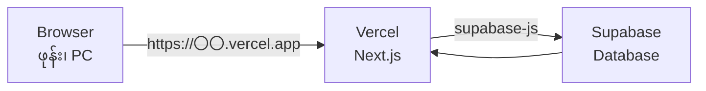
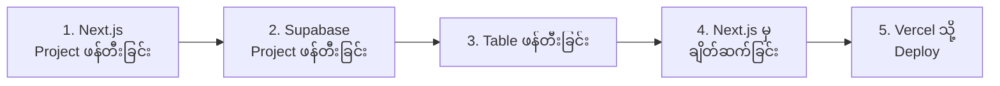
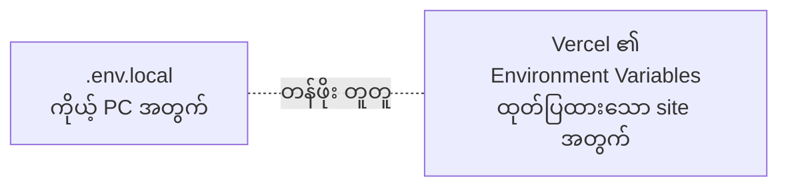

# ကိုယ်ပိုင် ဖန်တီးမှု A. Deploy Course — Next.js + Vercel + Supabase

> 🇯🇵 မူရင်း (ဂျပန်ဘာသာဖြင့်): [2026_10_09_資料2.md](<../../../2年生_システム開発実践/後期/2026_10_09/2026_10_09_資料2.md>) <!-- original-ja-link -->

ဖန်တီးထားတဲ့ app ကို **အင်တာနက်ပေါ်မှာ ထုတ်ပြ** ပြီး ဖုန်း သို့မဟုတ် သူငယ်ချင်းရဲ့ PC ကနေလည်း သုံးနိုင်အောင် လုပ်မယ့် course ဖြစ်ပါတယ်။

> 💰 **အားလုံး အခမဲ့ ဖန်တီးနိုင်ပါတယ်**
> | Service | သုံးမယ့် Plan |
> |---------|----------|
> | Next.js | အခမဲ့ (open source) |
> | Vercel | **Hobby** (အခမဲ့။ ကိုယ်ပိုင်၊ စီးပွားဖြစ်မဟုတ်သော အသုံးပြုမှု) |
> | Supabase | **Free** (အခမဲ့) |
>
> Credit card မှတ်ပုံတင်စရာ မလိုပါဘူး။ ငွေပေးရတဲ့ plan ကို upgrade လုပ်ဖို့ အကြံပြုလာရင်လည်း မရွေးပါနဲ့။

[ကိုယ်ပိုင် ဖန်တီးမှု: ကိုယ်ကြိုက်တဲ့အရာကို develop လုပ်ကြမယ် သို့ ပြန်သွားရန်](./2026_10_09_資料1.md)

---

## 1. အလုပ်လုပ်ပုံ

ပထမစာသင်နှစ်ဝက်မှာ ဒေတာလုပ်ဆောင်မှုကို Laravel က၊ ဒေတာသိမ်းဆည်းမှုကို MySQL က လုပ်ခဲ့ပါတယ်။
ဒီ course မှာတော့ အဲဒီနှစ်ခုအစား **Supabase** ကို သုံးပါမယ်။



| နာမည် | ဘာလဲ? | ပထမစာသင်နှစ်ဝက်နဲ့ ယှဉ်ရင် |
|------|-----------|------------|
| **Next.js** | မျက်နှာပြင်ကို ဖန်တီးတယ် (**backend API ကိုလည်း ဖန်တီးနိုင်တယ်**) | school-frontend (＋ Laravel API) |
| **Vercel** | Next.js ကို အင်တာနက်ပေါ်မှာ ထုတ်ပြပေးတယ် | (မရှိ) |
| **Supabase** | အင်တာနက်ပေါ်က database။ API ကိုလည်း အလိုအလျောက် ပြင်ဆင်ပေးတယ် | Laravel API ＋ MySQL |

### Next.js က full-stack framework ပါ

ပထမစာသင်နှစ်ဝက်မှာ "မျက်နှာပြင်က Next.js၊ API က Laravel" ဆိုပြီး app နှစ်ခု ခွဲဖန်တီးခဲ့ပါတယ်။
ဒါပေမဲ့ Next.js က **full-stack framework** ဖြစ်တဲ့အတွက် **မျက်နှာပြင် (frontend) နဲ့ API (backend) ကို project တစ်ခုတည်းမှာ ဖန်တီးနိုင်ပါတယ်။**

```mermaid
graph LR
    subgraph ပထမစာသင်နှစ်ဝက် app နှစ်ခု
        F1[Next.js<br>မျက်နှာပြင်] -->|fetch| L[Laravel<br>API]
    end
    subgraph ဒီ course app တစ်ခု
        F2[Next.js<br>မျက်နှာပြင်] -->|fetch| A2[Next.js<br>API<br>app/api/...]
    end
```

`app/api/` ထဲမှာ `route.ts` ကို ဖန်တီးရင် အဲဒါက API ဖြစ်သွားပါတယ် (**Route Handler** လို့ ခေါ်ပါတယ်)။

```ts
// app/api/hello/route.ts
export async function GET() {
  return Response.json({ message: "こんにちは" });
}
```

`npm run dev` နဲ့ စတင်ပြီး http://localhost:3000/api/hello ကို ဖွင့်ရင် JSON ပြန်လာပါတယ်။ `"こんにちは"` က “မင်္ဂလာပါ” လို့ အဓိပ္ပာယ်ရပါတယ်။

| | ပထမစာသင်နှစ်ဝက် (Laravel) | Next.js |
|---|---|---|
| URL ကို သတ်မှတ်ခြင်း | `routes/api.php` ထဲမှာ ရေးတယ် | `app/api/〇〇/route.ts` ရဲ့ **folder တည်နေရာ** နဲ့ သတ်မှတ်တယ် |
| လုပ်ဆောင်ချက်ကို ရေးခြင်း | Controller ရဲ့ method | `GET` / `POST` စတဲ့ function |
| JSON ပြန်ပို့ခြင်း | `return response()->json([...])` | `return Response.json({...})` |

**ဒီလိုအခါမျိုးမှာ Next.js ရဲ့ API ကို သုံးပါ**

- ပြင်ပ API (AI စသည်) ကို သုံးတဲ့အခါ **API key ကို browser မှာ မမြင်စေချင်ဘူး**
  (API ထဲက လုပ်ဆောင်ချက်တွေက server ပေါ်မှာ run တဲ့အတွက် `NEXT_PUBLIC_` မပါတဲ့ environment variable တွေကို လုံလုံခြုံခြုံ သုံးနိုင်ပါတယ်)
- ဒေတာကို မသိမ်းခင် server ဘက်မှာ စစ်ဆေးချင်တယ်

> ရိုးရှင်းတဲ့ ဒေတာ ထည့်/ထုတ် လုပ်တာဆိုရင် မျက်နှာပြင်ကနေ Supabase ကို တိုက်ရိုက်ချိတ်ရင် ရပါပြီ။
> "Server ဘက်မှာ လုပ်ချင်တဲ့အရာ" ပေါ်လာတဲ့အခါ Next.js ရဲ့ API ကို ဖန်တီးပါ။

## 2. ပြင်ဆင်မှု အဆင့်ဆင့်



### 2-1. Next.js project ကို ဖန်တီးမယ်

မိုးလေဝသခန့်မှန်းချက် app လိုပဲ `create-next-app` နဲ့ ဖန်တီးပြီး GitHub ကို push လုပ်ထားပါ။
→ [မိုးလေဝသခန့်မှန်းချက် app ရဲ့ သင်ခန်းစာ](../2026_10_02/2026_10_02_資料2.md)

### 2-2. Supabase project ကို ဖန်တီးမယ်

1. https://supabase.com/ ကို ဖွင့်ပြီး `Start your project` → **GitHub နဲ့ login ဝင်ပါ**
2. `New project` ကို နှိပ်ပြီး အောက်ပါအတိုင်း ဖြည့်ပါ

| Item | ဖြည့်ရမယ့် အကြောင်းအရာ |
|------|------------|
| Project name | App နာမည် |
| Database Password | ခိုင်မာတဲ့ password (`Generate a password` နဲ့ ရပါတယ်။ မှတ်ထားပါ) |
| Region | **Northeast Asia (Tokyo)** |
| Plan | **Free (အခမဲ့)** |

### 2-3. Table ကို ဖန်တီးမယ်

ဘယ်ဘက် menu ရဲ့ `Table Editor` → `Create a new table` မှာ project စီမံချက်စာရွက် (planning sheet) မှာ စဉ်းစားထားတဲ့ table ကို ဖန်တီးပါ။
`Enable Row Level Security (RLS)` ကို **ဖွင့်ထားတဲ့အတိုင်းပဲ ထားပါ** (အောက်က သတိပေးချက်ကို ကြည့်ပါ)။

### 2-4. Next.js ကနေ ချိတ်ဆက်မယ်

Supabase ရဲ့ `Project Settings` → `API Keys` မှာ **Project URL** နဲ့ **Publishable key** (သို့မဟုတ် anon key) ကို copy ကူးပါ။
Next.js project မှာ Supabase ကို သုံးဖို့ package ကို install လုပ်ပါ။

```bash
npm install @supabase/supabase-js
```

Project ရဲ့ root folder မှာ `.env.local` ကို ဖန်တီးပြီး copy ကူးထားတဲ့ တန်ဖိုးတွေကို ရေးပါ။

```bash
NEXT_PUBLIC_SUPABASE_URL=https://xxxxxxxx.supabase.co
NEXT_PUBLIC_SUPABASE_KEY=copy ကူးထားတဲ့ Publishable key
```

`lib/supabase.ts` ကို ဖန်တီးပြီး Supabase နဲ့ ချိတ်ဆက်ဖို့ ပြင်ဆင်ပါ။

```ts
import { createClient } from "@supabase/supabase-js";

export const supabase = createClient(
  process.env.NEXT_PUBLIC_SUPABASE_URL!,
  process.env.NEXT_PUBLIC_SUPABASE_KEY!
);
```

ဒါဆိုရင် ဒေတာကို ယူလာတာ၊ ထည့်တာ စတာတွေ လုပ်နိုင်ပါပြီ။

| လုပ်ချင်တဲ့အရာ | Supabase | ပထမစာသင်နှစ်ဝက်ရဲ့ Laravel နဲ့ ယှဉ်ရင် |
|------------|---------|----------------------|
| အားလုံးကို ယူလာမယ် | `supabase.from("books").select("*")` | `Book::all()` |
| ထည့်မယ် | `supabase.from("books").insert({ title: "..." })` | `Book::create([...])` |
| ဖျက်မယ် | `supabase.from("books").delete().eq("id", 1)` | `Book::find(1)->delete()` |

> ⚠️ **RLS (Row Level Security) ကို သတိထားပါ**
> RLS ဖွင့်ထားတဲ့ table မှာ **policy (ဘယ်သူ ဖတ်/ရေး လုပ်ခွင့်ရှိလဲဆိုတဲ့ စည်းမျဉ်း)** ကို မဖန်တီးရင် ဒေတာက ဗလာနဲ့ ပြန်လာပါတယ်။
> `Authentication` → `Policies` ကနေ table တစ်ခုချင်းစီအတွက် policy ကို ထည့်ပါ။
> "ဒေတာ မရဘူး!" ဆိုတဲ့အခါ ဒီနေရာကို အရင်စစ်ပါ။ နားမလည်ရင် ဆရာကို ခေါ်ပါ။

> ⚠️ **`secret` key (service_role key) ကို မသုံးပါနဲ့**
> `NEXT_PUBLIC_` ပါတဲ့ တန်ဖိုးတွေကို browser ကနေ မည်သူမဆို ကြည့်နိုင်ပါတယ်။
> ဒီနေရာမှာ **Publishable key (anon key) ကိုပဲ** ထည့်ပါ။ `secret` key ကို ထည့်ရင် database ကို မည်သူမဆို ပြင်နိုင်သွားပါလိမ့်မယ်။

### 2-5. Vercel ကို deploy လုပ်မယ်

မိုးလေဝသခန့်မှန်းချက် app နဲ့ အဆင့်တူတူ deploy လုပ်ပါ။ → [Vercel ကို deploy လုပ်ခြင်း](../2026_10_02/2026_10_02_資料3.md#2-vercel-ပေါ်မှာ-အခမဲ့-deploy-လုပ်မယ်)

ဒါပေမဲ့ ဒီတစ်ခါ **environment variable သတ်မှတ်ဖို့ လိုအပ်ပါတယ်**။
Vercel project ရဲ့ `Settings` → `Environment Variables` မှာ `.env.local` နဲ့ အတူတူ နှစ်ခုကို မှတ်ပုံတင်ပြီးမှ ပြန် deploy လုပ်ပါ။



> `.env.local` က GitHub ကို push မဖြစ်ပါဘူး (`.gitignore` ထဲမှာ ပါနေပါတယ်)။
> ဒါကြောင့် Vercel မှာလည်း သီးခြား မှတ်ပုံတင်ဖို့ လိုပါတယ်။

---

## 3. ဒီကစပြီး ဖန်တီးရင်း သင်ယူမယ်

ပြင်ဆင်ပြီးရင် ကျန်တာက **ကိုယ်ဖန်တီးချင်တာကို ဖန်တီးရင်း** သင်ယူသွားပါမယ်။
"ဒီလုပ်ဆောင်ချက်ကို ဖန်တီးချင်တယ် → ရှာဖွေတယ် → စမ်းကြည့်တယ် → အလုပ်လုပ်ပြီ!" ကို ထပ်ခါထပ်ခါ လုပ်ရင်း သုံးနိုင်တဲ့ နည်းပညာတွေ များလာပါလိမ့်မယ်။

ဝေခွဲမရဖြစ်တဲ့အခါ **ကိုယ်အလေးထားတဲ့အရာ** ကို ပြန်စဉ်းစားပါ။ "ဒီနေရာလေးကတော့ ဒီလိုဖြစ်စေချင်တယ်" ဆိုတဲ့ စိတ်က နောက်ထပ် ဘာသင်ယူရမလဲဆိုတာကို ပြောပြပေးပါလိမ့်မယ်။

ပြီးသွားရင် **ထုတ်ပြထားတဲ့ URL နဲ့ GitHub ရဲ့ URL** ကို portfolio အဖြစ် တင်သွင်းနိုင်ပါတယ်။

> ⚠️ **Supabase ကို တစ်ချိန်လောက် မသုံးရင် ယာယီ ရပ်သွားတယ်**
> Free plan မှာ **တစ်ပတ်လောက် access မရှိရင် project က ယာယီ ရပ်သွား** ပါတယ်။
> ရပ်နေတဲ့အချိန်မှာ ထုတ်ပြထားတဲ့ URL ကို ဖွင့်ရင်လည်း ဒေတာ မပေါ်ပါဘူး။
> Supabase dashboard ကနေ ပြန်စတင်ရင် မူလအတိုင်း ပြန်ဖြစ်ပါတယ် (ဒေတာ မပျောက်ပါဘူး)။
> **မတင်သွင်းခင်နဲ့ interview မဖြေခင်မှာ ကိုယ်တိုင် ထုတ်ပြထားတဲ့ URL ကို ဖွင့်ပြီး အလုပ်လုပ်လား စစ်ဆေးပါ။**
→ [Portfolio အဖြစ် တင်သွင်းခြင်း](./2026_10_09_資料1.md#5-portfolio-အဖြစ်-တင်သွင်းခြင်း)

[သင်ခန်းစာ 1 ရဲ့ "ဖန်တီးရင်း သင်ယူမယ်"](./2026_10_09_資料1.md#4-ဖန်တီးရင်း-သင်ယူမယ်) ကိုလည်း တွဲဖတ်ပါ။
