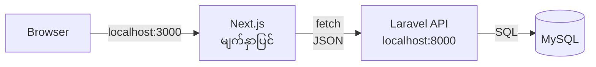
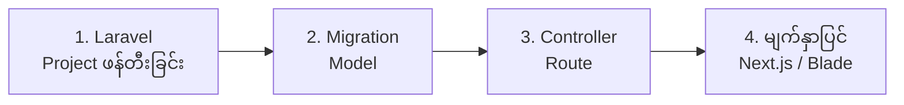

# ကိုယ်ပိုင် ဖန်တီးမှု B. Local Course — Laravel စသည်

> 🇯🇵 မူရင်း (ဂျပန်ဘာသာဖြင့်): [2026_10_09_資料3.md](<../../../2年生_システム開発実践/後期/2026_10_09/2026_10_09_資料3.md>) <!-- original-ja-link -->

ကိုယ့် PC (`localhost`) မှာ run မယ့် course ဖြစ်ပါတယ်။

[ကိုယ်ပိုင် ဖန်တီးမှု: ကိုယ်ကြိုက်တဲ့အရာကို develop လုပ်ကြမယ် သို့ ပြန်သွားရန်](./2026_10_09_資料1.md)

---

ပထမစာသင်နှစ်ဝက်ရဲ့ **ကျောင်းသားစီမံခန့်ခွဲမှု app** နဲ့ တူညီတဲ့ ပေါင်းစပ်မှုနဲ့ ဖန်တီးပါမယ်။ အသစ် မှတ်ရမယ့်အရာ နည်းတဲ့အတွက် **လုပ်ဆောင်ချက် ဖန်တီးခြင်းမှာ အာရုံစိုက်** နိုင်ပါတယ်။

---

## 1. ဖန်တီးနည်းကို ရွေးမယ်

ဖန်တီးနည်း ၂ မျိုး ရှိပါတယ်။

| ဖန်တီးနည်း | အကြောင်းအရာ | ဘယ်သူတွေအတွက် အကြံပြုလဲ |
|-------|------|---------|
| **Laravel API ＋ Next.js** | ပထမစာသင်နှစ်ဝက်နဲ့ အတူတူ။ မျက်နှာပြင်က Next.js၊ ဒေတာက Laravel | ပထမစာသင်နှစ်ဝက်ကို ပြန်လေ့ကျင့်ရင်း ဖန်တီးချင်သူ |
| **Laravel တစ်ခုတည်း (Blade)** | မျက်နှာပြင်ကိုလည်း Laravel ရဲ့ Blade နဲ့ ဖန်တီးတယ် | ဖွဲ့စည်းပုံကို ရိုးရှင်းစေချင်သူ |

---

## 2. ပြင်ဆင်မှု အဆင့်ဆင့်

ပထမစာသင်နှစ်ဝက်ရဲ့ သင်ခန်းစာတွေ၊ ပြီးစီးထားတဲ့ code တွေကို ကိုးကားပါ။

- တစ်ခုလုံးရဲ့ အဆင့်ဆင့် → [Development အဆင့်ဆင့်: သုညကနေ API ဖန်တီးတဲ့အထိ](../../前期/開発の流れ_まとめ.md)
- ပထမစာသင်နှစ်ဝက်ကို ပြန်လည်သုံးသပ်ခြင်း → [ပထမစာသင်နှစ်ဝက်ကို ပြန်လည်သုံးသပ်ခြင်း (ပြန်လေ့ကျင့်ခြင်း)](../2026_10_02/2026_10_02_資料1.md)
- ပြီးစီးထားတဲ့ code → [portfolio](../../前期/portfolio/)

> **"Laravel စသည်" ထဲက "စသည်"**
> ပထမစာသင်နှစ်ဝက်မှာ သုံးခဲ့တာတွေကလွဲပြီး တခြားအရာတွေ (Python စသည်) နဲ့ ဖန်တီးချင်သူတွေက ဆရာနဲ့ တိုင်ပင်ပါ။

---

## 3. ဒီကစပြီး ဖန်တီးရင်း သင်ယူမယ်

ပြင်ဆင်ပြီးရင်တော့ **ကိုယ်ဖန်တီးချင်တာကို ဖန်တီးရင်း** သင်ယူသွားပါမယ်။
"ဒီလုပ်ဆောင်ချက်ကို ဖန်တီးချင်တယ် → ရှာဖွေတယ် → စမ်းကြည့်တယ် → အလုပ်လုပ်ပြီ!" ကို ထပ်ခါထပ်ခါ လုပ်ရင်း သုံးနိုင်တဲ့ နည်းပညာတွေ များလာပါလိမ့်မယ်။

ဝေခွဲမရဖြစ်တဲ့အခါ **ကိုယ်အလေးထားတဲ့အချက်** ကို ပြန်စဉ်းစားကြည့်ပါ။ "ဒီနေရာမှာတော့ ဒီလိုဖြစ်စေချင်တယ်" ဆိုတဲ့ စိတ်က နောက်ထပ် ဘာသင်ယူရမလဲဆိုတာကို ပြောပြပေးပါလိမ့်မယ်။

ပြီးသွားရင် **GitHub ရဲ့ URL** ကို portfolio အဖြစ် တင်သွင်းနိုင်ပါတယ်။ README ထဲမှာ **screenshot တွေ၊ မျက်နှာပြင် video တွေ** ထည့်ပြီး app အလုပ်လုပ်နေပုံကို သိနိုင်အောင် လုပ်ပါ။
→ [Portfolio အဖြစ် တင်သွင်းခြင်း](./2026_10_09_資料1.md#5-portfolio-အဖြစ်-တင်သွင်းခြင်း)

[သင်ခန်းစာ 1 ရဲ့ "ဖန်တီးရင်း သင်ယူမယ်"](./2026_10_09_資料1.md#4-ဖန်တီးရင်း-သင်ယူမယ်) ကိုလည်း တွဲဖတ်ပါ။
