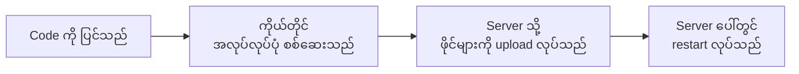
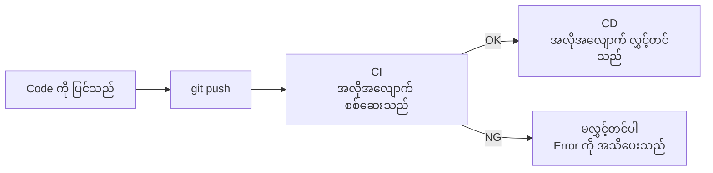
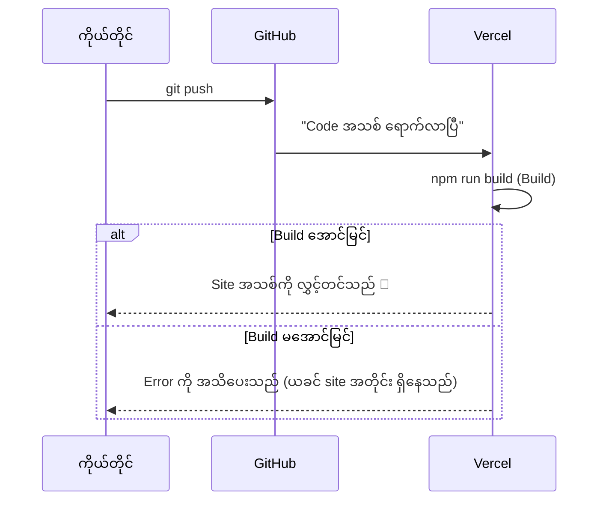
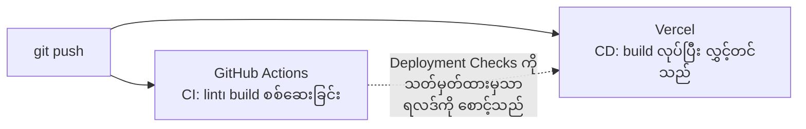

# CI/CD အကြောင်း

> 🇯🇵 မူရင်း (ဂျပန်ဘာသာဖြင့်): [CICDについて.md](<../../../2年生_システム開発実践/後期/2026_10_09/CICDについて.md>) <!-- original-ja-link -->

Deploy course မှာ GitHub ကို push လုပ်ရုံနဲ့ Vercel ပေါ်က site ကို update လုပ်နိုင်ခဲ့ပါတယ်။
တကယ်တော့ ဒါက **CI/CD (စီအိုင်၊ စီဒီ)** ရဲ့ အလုပ်လုပ်ပုံ ဖြစ်ပါတယ်။
ဒီနေရာမှာ CI/CD ဆိုတာ ဘာလဲဆိုတာကို လေ့လာကြည့်ကြရအောင်။

[ကိုယ်ပိုင် ဖန်တီးမှု A. Deploy Course သို့ ပြန်သွားရန်](./2026_10_09_資料2.md)

---

## 1. CI/CD ဆိုတာ

**CI/CD** ဆိုတာ "code ရေးပြီးနောက် လုပ်ရမယ့် အလုပ်တွေကို **အလိုအလျောက်** လုပ်ပေးတဲ့" စနစ် ဖြစ်ပါတယ်။

| နာမည် | အမည်အပြည့်အစုံ | အဓိပ္ပာယ် | တစ်ခွန်းတည်းနဲ့ ပြောရရင် |
|------|----------|------|-----------|
| **CI** | Continuous Integration (စဉ်ဆက်မပြတ် ပေါင်းစည်းခြင်း) | Push လုပ်တိုင်း **အလိုအလျောက် စစ်ဆေး** ပေးတယ် | အလိုအလျောက် စစ်ဆေးခြင်း |
| **CD** | Continuous Delivery / Deployment (စဉ်ဆက်မပြတ် ပေးပို့ခြင်း／deploy လုပ်ခြင်း) | စစ်ဆေးမှု အောင်မြင်ရင် **အလိုအလျောက် လွှင့်တင်** ပေးတယ် | အလိုအလျောက် လွှင့်တင်ခြင်း |

> 💡 **ဥပမာပေးရရင် "အစီရင်ခံစာ တင်သွင်းခြင်း"**
> - **CI** ＝ မတင်သွင်းခင် စာလုံးပေါင်းအမှား စစ်တာ၊ စာမျက်နှာအရေအတွက် စစ်တာကို **အလိုအလျောက် လုပ်ပေးတဲ့** လုပ်ဆောင်ချက်
> - **CD** ＝ စစ်ဆေးမှု အောင်ရင် **ဆရာဆီ အလိုအလျောက် တင်သွင်းပေးတဲ့** လုပ်ဆောင်ချက်
>
> လူကိုယ်တိုင် လုပ်ရင် "စစ်ဖို့ မေ့သွားတယ်" "တင်ဖို့ မေ့သွားတယ်" ဆိုတာတွေ ဖြစ်တတ်ပါတယ်။ အလိုအလျောက် လုပ်ထားရင် အကြိမ်တိုင်း တစ်ပုံစံတည်း လုပ်နိုင်ပါတယ်။

> 📝 **CD ရဲ့ အဓိပ္ပာယ် ၂ မျိုး**
> CD မှာ **Continuous Delivery** (အချိန်မရွေး လွှင့်တင်နိုင်တဲ့ အခြေအနေမှာ ထားပြီး လွှင့်တင်တဲ့ ခလုတ်ကိုတော့ လူက နှိပ်တယ်) နဲ့ **Continuous Deployment** (လွှင့်တင်တဲ့အထိ အားလုံး အလိုအလျောက် လုပ်တယ်) ဆိုပြီး အဓိပ္ပာယ် ၂ မျိုး ရှိပါတယ်။
> ဒီသင်ခန်းစာထဲက Vercel လိုမျိုး push လုပ်လိုက်ရင် အလိုအလျောက် လွှင့်တင်တာက **Continuous Deployment** ဖြစ်ပါတယ်။

---

## 2. CI/CD မရှိရင် ဘာဖြစ်မလဲ?

CI/CD မရှိရင် code ကို ပြင်တိုင်း **လူကိုယ်တိုင်** အလုပ်လုပ်ရပါတယ်။



- စစ်ဆေးဖို့ မေ့ပြီး **error ပါတဲ့ code ကို လွှင့်တင်** မိသွားတယ်
- Upload လုပ်ရမယ့် ဖိုင်ကို **မှားသွားတယ်**
- အကြိမ်တိုင်း တူညီတဲ့ အလုပ်ကို လုပ်ရလို့ **အချိန်ကုန်တယ်**

CI/CD ရှိရင် ဒီလို ဖြစ်သွားပါတယ်။



**ကိုယ်လုပ်ရမှာက `git push` တစ်ခုတည်း** ပါပဲ။

---

## 3. Vercel က CD ကို လုပ်ပေးနေတယ်

Vercel နဲ့ GitHub ကို ချိတ်ဆက်ထားရင် **push လုပ်တိုင်း အလိုအလျောက် deploy** ဖြစ်ပါတယ်။ ဒါက **CD** ပါ။



> 📝 **Build မအောင်မြင်ရင်တောင် site က မပျက်ပါဘူး**
> Build မအောင်မြင်တဲ့အခါ **ယခင် version ရဲ့ site က အဲဒီအတိုင်း** ပေါ်နေပါတယ်။
> Vercel ရဲ့ `Deployments` မျက်နှာပြင်မှာ မအောင်မြင်ရတဲ့ အကြောင်းရင်း (error message) ကို စစ်ကြည့်ပါ။

### Branch တစ်ခုချင်းစီအတွက် "စမ်းသပ် URL" ရတယ်

Vercel မှာ branch ပေါ်မူတည်ပြီး လွှင့်တင်ပုံ ကွာပါတယ်။

| Push လုပ်တဲ့ branch | ဘာဖြစ်မလဲ? | URL |
|------------------|-----------|-----|
| `main` | **Production site** က အသစ်ဖြစ်သွားတယ် | `https://〇〇.vercel.app` |
| တခြား branch (`feature/login` စသည်) | **စမ်းသပ်ဖို့ site (Preview)** ကို ဖန်တီးပေးတယ် | `https://〇〇-git-feature-login-〇〇.vercel.app` စသည် |


လုပ်ဆောင်ချက် အသစ်တွေကို **branch ဖန်တီးပြီး Preview URL မှာ စစ်ဆေးပြီးမှ main ထဲ merge လုပ်** ရင် production site ကို မပျက်စေဘဲ ထားနိုင်ပါတယ်။
ပထမစာသင်နှစ်ဝက်ရဲ့ အဖွဲ့လိုက် ဖန်တီးခြင်းမှာ သင်ခဲ့တဲ့ **branch → pull request → merge** အဆင့်ဆင့်နဲ့ အတူတူပါပဲ။

---

## 4. CI ကို လုပ်ကြည့်မယ် (GitHub Actions)

Vercel က လုပ်ပေးတာက အဓိကအားဖြင့် CD ပါ။
**CI (အလိုအလျောက် စစ်ဆေးခြင်း)** ကိုတော့ **GitHub Actions** ဆိုတဲ့ GitHub ရဲ့ လုပ်ဆောင်ချက်နဲ့ ထပ်ထည့်နိုင်ပါတယ် (public repository ဆိုရင် အခမဲ့။ private repository မှာလည်း လစဉ် သတ်မှတ်ထားတဲ့ အချိန်အထိ အခမဲ့)။

### 4-1. Setting ဖိုင်ကို ဖန်တီးမယ်

Project ထဲမှာ `.github/workflows/ci.yml` ကို ဖန်တီးပါ။

```yaml
# .github/workflows/ci.yml
name: CI

# ဘယ်အချိန် run မလဲ: push နဲ့ pull request လုပ်တဲ့အခါ
on:
  push:
  pull_request:

jobs:
  check:
    runs-on: ubuntu-latest   # GitHub က ပြင်ဆင်ပေးထားတဲ့ PC ပေါ်မှာ run တယ်
    steps:
      - uses: actions/checkout@v6      # Code ကို ယူလာတယ်
      - uses: actions/setup-node@v6    # Node.js ကို install လုပ်တယ်
        with:
          node-version: 24
      - run: npm ci                    # Package တွေကို install လုပ်တယ်
      - run: npm run lint              # Code ရေးပုံကို စစ်တယ်
      - run: npm run build             # Build လုပ်လို့ရလား စစ်တယ်
```

> ⚠️ **`npm run lint` အလုပ်မလုပ်တဲ့အခါ**
> `create-next-app` မှာ **Linter အတွက် None ကို ရွေးခဲ့တဲ့** project မှာ `lint` script မရှိပါဘူး။ အဲဒီလိုဆိုရင် `npm run lint` စာကြောင်းကို ဖျက်ပါ။
> ပြီးတော့ Next.js 16 ကစပြီး `next lint` command မရှိတော့ပါဘူး။ Project အဟောင်းမှာ `"lint": "next lint"` ဖြစ်နေရင် `"lint": "eslint"` လို့ ပြင်ရေးပါ။
> `package.json` ထဲက `"scripts"` ကို ကြည့်ပြီး `lint` ရှိလား စစ်ကြည့်ပါ။

| စာကြောင်း | အဓိပ္ပာယ် |
|----|------|
| `on:` | **ဘယ်အချိန်** run မလဲ |
| `runs-on:` | **ဘယ်မှာ** run မလဲ (GitHub က ပေးထားတဲ့ PC ကို အသုံးပြုတယ်) |
| `steps:` | **ဘာ** လုပ်မလဲ (အပေါ်ကနေ အစဉ်လိုက် run တယ်) |

### 4-2. ရလဒ်ကို ကြည့်မယ်

ဖိုင်ကို push လုပ်လိုက်ရင် GitHub repository ရဲ့ **`Actions`** tab မှာ ရလဒ်ကို ကြည့်နိုင်ပါတယ်။

| ပြသချက် | အဓိပ္ပာယ် |
|------|------|
| ✅ အစိမ်းရောင် check | စစ်ဆေးမှု အားလုံး အောင်တယ် |
| ❌ အနီရောင် ကြက်ခြေခတ် | တစ်နေရာရာမှာ မအောင်မြင်ဘူး → click လုပ်ရင် error ကို ကြည့်နိုင်တယ် |

Pull request မျက်နှာပြင်မှာလည်း ရလဒ် ပေါ်တဲ့အတွက် **merge မလုပ်ခင် ပြဿနာကို သိနိုင်ပါတယ်**။

> ⚠️ **GitHub Actions မအောင်မြင်ရင်တောင် Vercel က deploy လုပ်တယ်**
> GitHub Actions (CI) နဲ့ Vercel (CD) က **တစ်ခုစီ သီးခြား** အလုပ်လုပ်နေပါတယ်။
> ဒါကြောင့် ဘာမှ setting မလုပ်ထားရင် CI က ❌ ဖြစ်နေရင်တောင် Vercel ရဲ့ build အောင်မြင်ရင် **production site ကို update လုပ်သွားပါတယ်**။
> "CI က ✅ ဖြစ်မှသာ production မှာ လွှင့်တင်မယ်" လို့ လုပ်ချင်ရင် Vercel ရဲ့ **Deployment Checks** ဆိုတဲ့ လုပ်ဆောင်ချက်ကို သုံးပါ။
> Project ရဲ့ `Settings` ထဲက `Build and Deployment` မှာရှိတဲ့ Deployment Checks မှာ `Add Checks` ကို နှိပ်ပြီး GitHub Actions ရဲ့ check ကို ရွေးပါ (အသေးစိတ်ကို [Vercel ရဲ့ document](https://vercel.com/docs/deployment-checks) မှာ ကြည့်ပါ)။

CI နဲ့ CD ရဲ့ ဆက်စပ်မှုကို ပုံနဲ့ပြရင် အောက်ပါအတိုင်း ဖြစ်ပါတယ်။



> 💡 **README မှာ badge ကပ်ထားရင် portfolio မှာ ကိုယ့်ရဲ့ အားသာချက်ကို ပြနိုင်တယ်**
> `Actions` tab ထဲက workflow ကို ဖွင့်ပြီး `Filter workflow runs` ဘေးက `⋮` → `Create status badge` → `Copy status badge Markdown` နဲ့ badge code ကို ရနိုင်ပါတယ်။
> README မှာ ကပ်ထားရင် "CI/CD ကို သုံးပြီး develop လုပ်နေတယ်" ဆိုတာ တစ်ချက်ကြည့်ရုံနဲ့ သိသာပါတယ်။

---

## 5. CI/CD ရဲ့ ကောင်းကွက်များ

- **အမှားကို စောစော သိနိုင်တယ်**: push လုပ်တာနဲ့ ချက်ချင်း စစ်ဆေးပေးတယ်
- **လွှင့်တင်ရတာ လွယ်တယ်**: `git push` တစ်ခုတည်းနဲ့ production မှာ အပြောင်းအလဲတွေ ပေါ်လာတယ်
- **အကြိမ်တိုင်း တူညီတဲ့ အဆင့်တွေနဲ့ လုပ်နိုင်တယ်**: လက်နဲ့လုပ်တဲ့ အမှားတွေ မရှိတော့ဘူး
- **အဖွဲ့လိုက် development လုပ်ရာမှာ အသုံးဝင်တယ်**: ဘယ်သူ့ code ကိုမဆို တူညီတဲ့ စည်းမျဉ်းတွေနဲ့ စစ်ဆေးတယ်

တကယ့် development လုပ်ငန်းခွင်တွေမှာ CI/CD ကို **အမြဲလိုလို** သုံးကြပါတယ်။
ကိုယ်ပိုင် ဖန်တီးမှုမှာ သုံးထားရင် အလုပ်ရှာတဲ့အခါမှာလည်း ပြောပြနိုင်တဲ့ အတွေ့အကြုံ ဖြစ်လာပါလိမ့်မယ်။

---

## 6. အနှစ်ချုပ်

- **CI** ＝ push လုပ်ရင် **အလိုအလျောက် စစ်ဆေး**၊ **CD** ＝ စစ်ဆေးမှု အောင်မြင်ရင် **အလိုအလျောက် လွှင့်တင်**
- Vercel က အလိုအလျောက် စစ်ဆေးတာက **build အောင်မြင်လား မအောင်မြင်လား** ဆိုတာ တစ်ခုတည်းပါ။ GitHub Actions ရဲ့ ရလဒ်အပေါ် မူတည်ပြီး လွှင့်တင်မှုကို တားချင်ရင် **Deployment Checks** ကို သတ်မှတ်ပါ
- Vercel က GitHub နဲ့ ချိတ်ဆက်ပြီး **push လုပ်တိုင်း အလိုအလျောက် deploy (CD)** လုပ်ပေးတယ်
- `main` မဟုတ်တဲ့ branch တွေကို **Preview URL** နဲ့ စစ်ဆေးနိုင်တယ်
- **GitHub Actions** ကို သုံးရင် lint နဲ့ build ရဲ့ **အလိုအလျောက် စစ်ဆေးခြင်း (CI)** ကို ထပ်ထည့်နိုင်တယ်
- ကိုယ်လုပ်ရမှာက **`git push` တစ်ခုတည်း**

[ကိုယ်ပိုင် ဖန်တီးမှု A. Deploy Course သို့ ပြန်သွားရန်](./2026_10_09_資料2.md)
