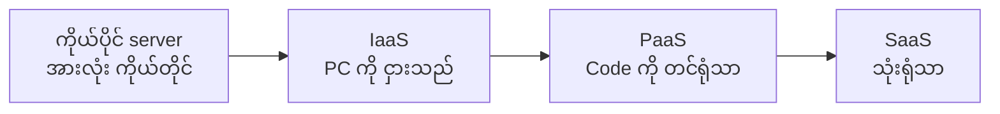
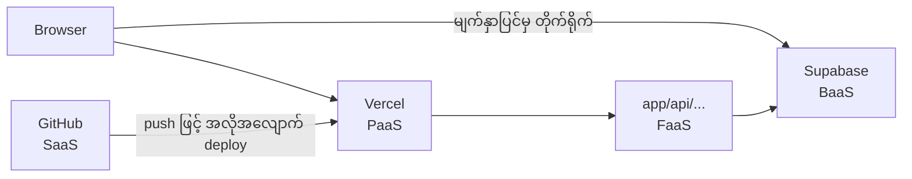

# IaaS၊ PaaS၊ SaaS၊ BaaS အကြောင်း

> 🇯🇵 မူရင်း (ဂျပန်ဘာသာဖြင့်): [IaaS_PaaS_SaaS_BaaSについて.md](<../../../2年生_システム開発実践/後期/2026_10_09/IaaS_PaaS_SaaS_BaaSについて.md>) <!-- original-ja-link -->

Cloud service တွေအကြောင်း ရှာကြည့်ရင် **IaaS (အိုင်ယက်စ်)**၊ **PaaS (ပက်စ်)**၊ **SaaS (ဆက်စ်)**၊ **BaaS (ဘက်စ်)** ဆိုတဲ့ စကားလုံးတွေ မကြာခဏ တွေ့ရပါတယ်။
အားလုံးက "〇〇 as a Service (〇〇 ကို service အဖြစ် သုံးခြင်း)" ရဲ့ အတိုကောက်တွေဖြစ်ပြီး **ဘယ်အထိကို service ဆီ လွှဲအပ်မလဲ** ဆိုတဲ့ ကွာခြားချက်ကို ဖော်ပြပါတယ်။

[ကိုယ်ပိုင် ဖန်တီးမှု A. Deploy Course သို့ ပြန်သွားရန်](./2026_10_09_資料2.md)

---

## 1. တစ်ခွန်းတည်းနဲ့ ပြောရရင်

| နာမည် | အမည်အပြည့်အစုံ | ငှားသုံးတဲ့အရာ | တစ်ခွန်းတည်းနဲ့ ပြောရရင် |
|------|----------|-----------|-----------|
| **IaaS** | Infrastructure as a Service | **Server (PC) ကိုယ်တိုင်** | ဗလာ PC ကို ငှားတယ် |
| **PaaS** | Platform as a Service | **App ကို run မယ့်နေရာ** | Code ကို တင်လိုက်ရင် အလုပ်လုပ်တယ် |
| **BaaS** | Backend as a Service | **Backend လုပ်ဆောင်ချက်များ** | Database နဲ့ login က အစကတည်းက ပါပြီးသား |
| **FaaS** | Function as a Service | **Function ကို run မယ့်နေရာ** | Function ကိုပဲ ရေးလိုက်ရင် အလုပ်လုပ်တယ် |
| **SaaS** | Software as a Service | **ပြီးပြည့်စုံတဲ့ app** | အဲဒီအတိုင်း သုံးရုံပဲ |

အောက်ကို ဆင်းလေ **ကိုယ်တိုင် လုပ်ရမယ့်အရာ နည်းလာလေ** ဖြစ်ပါတယ်။

---

## 2. Pizza နဲ့ ဥပမာပေးရရင်

| | ကိုယ်တိုင် လုပ်ရမယ့်အရာ | Pizza နဲ့ ယှဉ်ရင် |
|---|---|---|
| **ကိုယ်ပိုင် server** | အားလုံး | ဂျုံမှုန့်ကနေ pizza မုန့်စိမ်းကို လုပ်ပြီး မီးဖိုကိုလည်း ကိုယ်တိုင် ဝယ်တယ် |
| **IaaS** | OS၊ software ပြင်ဆင်ခြင်း၊ app | မီးဖိုချောင်နဲ့ မီးဖိုကို ငှားပြီး ပါဝင်ပစ္စည်းကနေ ကိုယ်တိုင် လုပ်တယ် |
| **PaaS** | App (code) တစ်ခုတည်း | မုန့်စိမ်းနဲ့ မီးဖိုကို ပြင်ဆင်ထားပြီးသား။ Topping ကိုပဲ ကိုယ်တိုင် တင်တယ် |
| **SaaS** | ဘာမှ မလုပ်ရ (သုံးရုံပဲ) | Pizza delivery မှာပြီး စားရုံပဲ |

→ ညာဘက်ကို သွားလေ **လွယ်ကူလေ**။ ဘယ်ဘက်ကို သွားလေ **လွတ်လပ်စွာ customize လုပ်နိုင်လေ**။

---

## 3. ဘယ်သူက ဘာကို စီမံခန့်ခွဲမလဲ?

App ကို run ဖို့ "အလွှာ" အမျိုးမျိုး လိုအပ်ပါတယ်။
**🟦 = ကိုယ်တိုင် စီမံခန့်ခွဲရမယ်**၊ **⬜ = service က စီမံခန့်ခွဲပေးတယ်** ဖြစ်ပါတယ်။

| အလွှာ | ကိုယ်ပိုင် server | IaaS | PaaS | SaaS |
|----|:---:|:---:|:---:|:---:|
| App (ကိုယ့် code) | 🟦 | 🟦 | 🟦 | ⬜ |
| ဒေတာ | 🟦 | 🟦 | 🟦 | ⬜ |
| PHP၊ Node.js စတဲ့ runtime environment | 🟦 | 🟦 | ⬜ | ⬜ |
| OS (Linux စသည်) | 🟦 | 🟦 | ⬜ | ⬜ |
| Server (PC စက်ကိုယ်တိုင်) | 🟦 | ⬜ | ⬜ | ⬜ |
| Network၊ အဆောက်အအုံ၊ လျှပ်စစ်မီး | 🟦 | ⬜ | ⬜ | ⬜ |

---

## 4. တစ်ခုချင်းစီကို အသေးစိတ်

### 4-1. IaaS (အိုင်ယက်စ်) — ဗလာ PC ကို ငှားတယ်

အင်တာနက်ရဲ့ တစ်ဖက်မှာရှိတဲ့ **PC တစ်လုံးကို ငှားတယ်** လို့ မြင်ကြည့်ပါ။
OS ထည့်တာ၊ PHP နဲ့ MySQL ကို install လုပ်တာတွေက **ကိုယ်တိုင်** လုပ်ရပါတယ်။

- **ဥပမာ**: AWS ရဲ့ EC2၊ Google Cloud ရဲ့ Compute Engine၊ Sakura Cloud
- **ကောင်းကွက်**: ဘာမဆို လွတ်လပ်စွာ လုပ်နိုင်တယ်
- **ခက်ခဲတဲ့အချက်**: Setting နဲ့ security ကာကွယ်မှုတွေကို အားလုံး ကိုယ်တိုင် လုပ်ရတယ်

> ပထမစာသင်နှစ်ဝက်မှာ သင်ခဲ့တဲ့ Laravel app ကို IaaS နဲ့ အင်တာနက်ပေါ် တင်မယ်ဆိုရင် "Linux ထည့် → PHP၊ MySQL ထည့် → code တင် → ၂၄ နာရီ run ထား" ဆိုတာတွေ အားလုံးကို ကိုယ်တိုင် လုပ်ရပါတယ်။

### 4-2. PaaS (ပက်စ်) — Code ကို တင်လိုက်ရင် အလုပ်လုပ်တယ်

**App ကို run ဖို့ environment က အစကတည်းက အဆင်သင့် ရှိနေတဲ့** service ဖြစ်ပါတယ်။
ကိုယ်က **code ကို ပြင်ဆင်ရုံပဲ** ဖြစ်ပြီး အင်တာနက်ပေါ် တင်တဲ့အထိ service က တာဝန်ယူပေးပါတယ်။

- **ဥပမာ**: **Vercel**၊ Render၊ Heroku၊ Google App Engine
  (Heroku က ၂၀၂၆ ခုနှစ်မှာ လုပ်ဆောင်ချက် အသစ် ဖန်တီးမှုကို ရပ်မယ်လို့ ကြေညာထားပါတယ်။ ဒါပေမဲ့ PaaS ရဲ့ ရှေးကတည်းက ကိုယ်စားပြု ဥပမာအဖြစ် နာမည်ကို မကြာခဏ တွေ့ရပါတယ်)
- **ကောင်းကွက်**: Server setting မလိုဘူး။ `git push` တစ်ခုတည်းနဲ့ အင်တာနက်ပေါ် တင်နိုင်တယ်
- **ခက်ခဲတဲ့အချက်**: Service က ထောက်ပံ့တဲ့ language၊ သုံးနည်းတွေနဲ့ ကန့်သတ်ခံရတယ်

> 🎯 **Deploy course မှာ သုံးတဲ့ Vercel က PaaS ဖြစ်ပါတယ်။**
> Next.js ရဲ့ code ကို GitHub ကို push လုပ်ရုံနဲ့ အင်တာနက်ပေါ်မှာ အသုံးပြုနိုင်အောင် တင်နိုင်ခဲ့ပါတယ်။

### 4-3. BaaS (ဘက်စ်) — Backend က အစကတည်းက ရှိပြီးသား

**Database၊ login လုပ်ဆောင်ချက်၊ ဖိုင်သိမ်းဆည်းခြင်း စတဲ့ backend လုပ်ဆောင်ချက်တွေကို စုစည်းပြီး ပေးတဲ့** service ဖြစ်ပါတယ်။
Backend code (ပထမစာသင်နှစ်ဝက်ရဲ့ Laravel API လိုမျိုး) ကို **ကိုယ်တိုင် မရေးဘဲနဲ့** app ကို ဖန်တီးနိုင်ပါတယ်။

- **ဥပမာ**: **Supabase**၊ Firebase
- **ကောင်းကွက်**: Frontend (မျက်နှာပြင်) ဖန်တီးခြင်းမှာ အာရုံစိုက်နိုင်တယ်
- **ခက်ခဲတဲ့အချက်**: ရှုပ်ထွေးတဲ့ လုပ်ဆောင်ချက်တွေအတွက် API ကို သီးခြား ဖန်တီးဖို့ လိုတယ်

| လုပ်ချင်တဲ့အရာ | ပထမစာသင်နှစ်ဝက် (ကိုယ်တိုင် ဖန်တီး) | Supabase (BaaS) |
|------------|-----------------|-----------------|
| ဒေတာ သိမ်းဆည်းခြင်း | Laravel API ＋ MySQL | အစကတည်းက ပါပြီးသား |
| Login လုပ်ဆောင်ချက် | ကိုယ်တိုင် ဖန်တီး | အစကတည်းက ပါပြီးသား (Authentication) |
| ပုံ သိမ်းဆည်းခြင်း | ကိုယ်တိုင် ဖန်တီး | အစကတည်းက ပါပြီးသား (Storage) |

> 🎯 **Deploy course မှာ သုံးတဲ့ Supabase က BaaS ဖြစ်ပါတယ်။**

### 4-4. FaaS (ဖက်စ်) — Function ကိုပဲ ရေးလိုက်ရင် အလုပ်လုပ်တယ်

**Function တစ်ခု ရေးထားရင် ခေါ်တဲ့အချိန်မှာပဲ run ပေးတဲ့** service ဖြစ်ပါတယ်။
"Serverless" ရဲ့ အဓိက အယူအဆ ဖြစ်ပါတယ်။ → [Serverless အကြောင်း](./サーバレスについて.md)

- **ဥပမာ**: **Vercel Functions** (Next.js ရဲ့ `app/api/〇〇/route.ts`)၊ AWS Lambda၊ Cloudflare Workers
- **ကောင်းကွက်**: သုံးသလောက်ပဲ ငွေကုန်တယ်။ Access များလာရင်လည်း အလိုအလျောက် ကိုင်တွယ်ပေးတယ်
- **ခက်ခဲတဲ့အချက်**: ကြာရှည်တဲ့ လုပ်ဆောင်ချက်တွေအတွက် မသင့်တော်ဘူး။ Function ထဲမှာ ဒေတာကို သိမ်းမထားနိုင်ဘူး

### 4-5. SaaS (ဆက်စ်) — ပြီးပြည့်စုံတဲ့ app ကို သုံးတယ်

**ပြီးသွားပြီဖြစ်တဲ့ app ကို အင်တာနက်ကနေတဆင့် အဲဒီအတိုင်း သုံးတဲ့** service ဖြစ်ပါတယ်။
ကျောင်းသားတွေ နေ့တိုင်း သုံးနေတဲ့ အရာတွေထဲမှာ SaaS ဖြစ်တာတွေ အများကြီး ရှိပါတယ်။

- **ဥပမာ**: Gmail၊ Google Docs၊ **GitHub**၊ Slack၊ Zoom၊ Notion
- **ကောင်းကွက်**: Install လုပ်စရာ၊ စီမံခန့်ခွဲစရာ မလိုဘူး။ ချက်ချင်း သုံးနိုင်တယ်
- **ခက်ခဲတဲ့အချက်**: အတွင်းပိုင်းကို ကိုယ်တိုင် ပြောင်းလဲလို့ မရဘူး

> ကိုယ်ပိုင် ဖန်တီးမှုမှာ ဖန်တီးထားတဲ့ app ကို အင်တာနက်ပေါ် တင်ပြီး အခြားသူတွေကို အသုံးပြုစေမယ်ဆိုရင် အဲဒါလည်း **SaaS** ပါပဲ။

---

## 5. Deploy course ရဲ့ ဖွဲ့စည်းပုံနဲ့ ယှဉ်ကြည့်ရင်

| သုံးနေတဲ့အရာ | အမျိုးအစား |
|--------------|------|
| GitHub | SaaS (code ကို စီမံခန့်ခွဲတဲ့ ပြီးပြည့်စုံတဲ့ service) |
| Vercel | PaaS (Next.js ကို run တဲ့နေရာ) |
| Next.js ရဲ့ API (`app/api/`) | FaaS (Vercel ပေါ်မှာ ခေါ်တဲ့အချိန်မှပဲ run တဲ့ function) |
| Supabase | BaaS (database၊ login စတဲ့ backend) |

> 📝 **တိတိကျကျ ခွဲခြားလို့ မရတာမျိုးလည်း ရှိတယ်**
> "Vercel က PaaS ဖြစ်ပြီး FaaS ကိုလည်း ပေးတယ်" ဆိုသလိုမျိုး service တစ်ခုမှာ မျက်နှာစာ အများကြီး ရှိနိုင်ပါတယ်။
> နာမည်တွေကို အလွတ်ကျက်တာထက် **"ဘယ်အထိကို service ဆီ လွှဲအပ်ထားလဲ"** ဆိုပြီး စဉ်းစားနိုင်အောင် လုပ်ကြပါ။

---

## 6. အနှစ်ချုပ်

- "〇〇 as a Service" ဆိုတာ **ဘယ်အထိကို service ဆီ လွှဲအပ်မလဲ** ဆိုတဲ့ ကွာခြားချက်
- **IaaS**: PC ကို ငှားတယ် (လွတ်လပ်ပေမဲ့ ခက်တယ်)
- **PaaS**: Code ကို တင်လိုက်ရင် အလုပ်လုပ်တယ် (Vercel)
- **BaaS**: Backend လုပ်ဆောင်ချက်တွေ အစကတည်းက ပါပြီးသား (Supabase)
- **FaaS**: Function ကိုပဲ ရေးလိုက်ရင် အလုပ်လုပ်တယ် (Vercel ပေါ်က Next.js ရဲ့ API)
- **SaaS**: ပြီးပြည့်စုံတဲ့ app ကို သုံးရုံပဲ (Gmail၊ GitHub)
- လွှဲအပ်လေ **လွယ်ကူလေ**၊ ကိုယ်တိုင်လုပ်လေ **လွတ်လပ်လေ**

[ကိုယ်ပိုင် ဖန်တီးမှု A. Deploy Course သို့ ပြန်သွားရန်](./2026_10_09_資料2.md)
