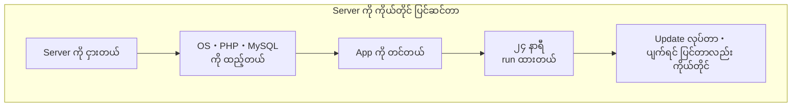
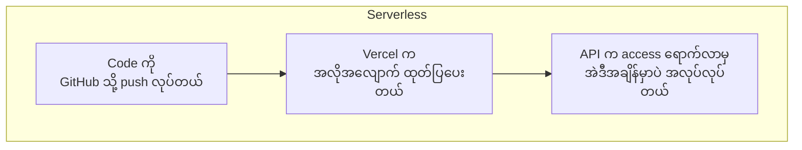
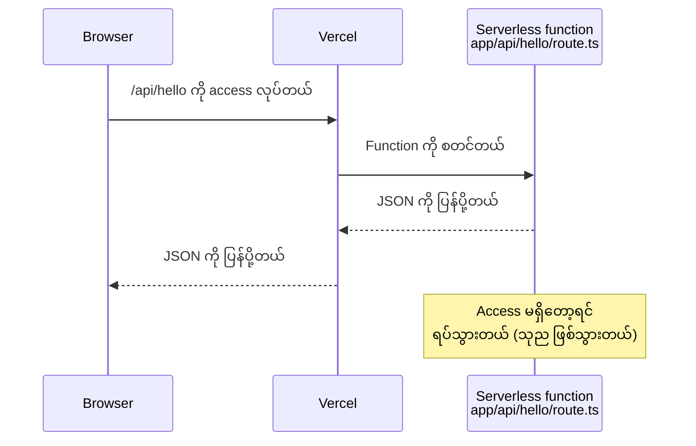
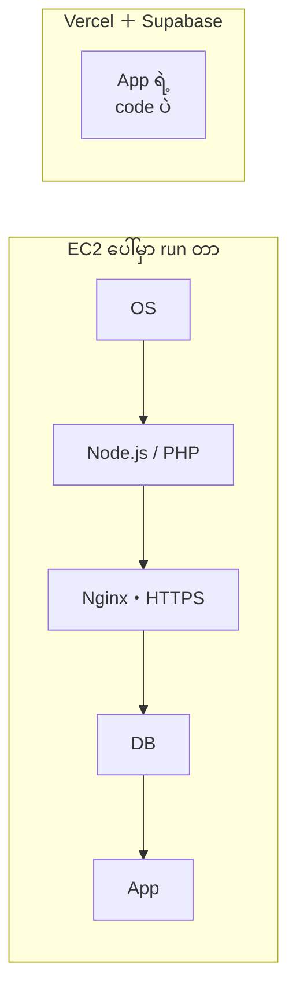

# Serverless အကြောင်း

> 🇯🇵 မူရင်း (ဂျပန်ဘာသာဖြင့်): [サーバレスについて.md](<../../../2年生_システム開発実践/後期/2026_10_09/サーバレスについて.md>) <!-- original-ja-link -->

Deploy သင်တန်းမှာ သုံးမယ့် **Vercel** မှာ Next.js ရဲ့ API တွေဟာ "**Serverless**" လို့ခေါ်တဲ့ စနစ်နဲ့ အလုပ်လုပ်ပါတယ်။
ဒီမှာ Serverless ဆိုတာ ဘာလဲဆိုတာကို ပထမ term က Laravel နဲ့ နှိုင်းယှဉ်ပြီး ကြည့်သွားပါမယ်။

[ကိုယ်ပိုင် ဖန်တီးမှု A. Deploy Course သို့ ပြန်သွားရန်](./2026_10_09_資料2.md)

---

## 1. Serverless ဆိုတာ ဘာလဲ

**Serverless** ဆိုတာ "server မရှိဘူး" ဆိုတဲ့ အဓိပ္ပာယ် မဟုတ်ပါဘူး။
Server က **တကယ် ရှိပါတယ်**။ ဒါပေမဲ့ **server ကို ပြင်ဆင်တာ၊ စီမံတာတွေကို ကိုယ်တိုင် လုပ်စရာမလိုတဲ့** စနစ်ကို ဆိုလိုတာပါ။

> 💡 **ဥပမာပေးရရင် "Taxi"**
> - **Server ကို ကိုယ်တိုင် ပြင်ဆင်တာ** ＝ ကားဝယ်တာနဲ့ တူပါတယ်။ ကားရပ်နားစရာနေရာ၊ ကားစစ်ဆေးမှု၊ ဓာတ်ဆီ၊ ပျက်ရင် ပြင်တာ အားလုံး ကိုယ်တိုင် လုပ်ရပါတယ်
> - **Serverless** ＝ Taxi စီးတာနဲ့ တူပါတယ်။ သွားချင်တဲ့နေရာကို ပြောလိုက်ရုံပဲ၊ ကားကို စီမံတာကို ယာဉ်မောင်း (ကုမ္ပဏီ) က လုပ်ပေးပါတယ်
>
> နှစ်ခုလုံးမှာ "ကား" ကို သုံးနေတာ အတူတူပါပဲ။ ကွာခြားတာက **ဘယ်သူက စီမံသလဲ** ဆိုတာပါ။

---

## 2. ပထမ term က နည်းလမ်းနဲ့ နှိုင်းယှဉ်ကြည့်ရအောင်

ပထမ term မှာ ကိုယ့် PC ပေါ်မှာ `php artisan serve` ကို run ပြီး Laravel ရဲ့ server ကို စတင်ခဲ့ပါတယ်။
ဒါကို internet ပေါ်မှာ အများသုံးနိုင်အောင် ထုတ်ပြမယ်ဆိုရင် **အမြဲတမ်း run နေတဲ့ server** ကို ကိုယ်တိုင် ပြင်ဆင်ထားဖို့ လိုပါတယ်။





| | Server ကို ကိုယ်တိုင် ပြင်ဆင်တာ | Serverless (Vercel စသည်) |
|---|---|---|
| Server ပြင်ဆင်ခြင်း | ကိုယ်တိုင် လုပ်ရ (OS・software ထည့်ရ) | **မလိုပါ** |
| အလုပ်လုပ်နေတဲ့ အချိန် | **၂၄ နာရီ အမြဲတမ်း** | **Access ရောက်လာတဲ့အချိန်မှာပဲ** |
| Access ရုတ်တရက် များလာရင် | Server ကို ကိုယ်တိုင် တိုးရ | **အလိုအလျောက် တိုးပေး** |
| Update・လုံခြုံရေး အစီအမံ | ကိုယ်တိုင် လုပ်ရ | Service က လုပ်ပေး |
| ကုန်ကျစရိတ် | မသုံးရင်တောင် ကုန်ကျ | **သုံးသလောက်ပဲ** (နည်းနည်းဆိုရင် အခမဲ့) |

---

## 3. "Access ရောက်လာတဲ့အချိန်မှာပဲ အလုပ်လုပ်တယ်" ဆိုတာ

Serverless ရဲ့ အဓိက ထူးခြားချက်က **ခေါ်လိုက်တဲ့အချိန်မှာပဲ အလုပ်လုပ်တာ** ပါ။

သင်ခန်းစာ 2 မှာ ရေးခဲ့တဲ့ Next.js ရဲ့ API (`app/api/〇〇/route.ts`) ကို Vercel ပေါ် deploy လုပ်လိုက်ရင် **Serverless function (Vercel Functions)** အနေနဲ့ အလုပ်လုပ်ပါတယ်။



```ts
// app/api/hello/route.ts
export async function GET() {
  return Response.json({ message: "こんにちは" });
}
```

ကိုယ်တိုင် ရေးရမှာက **ဒီ function တစ်ခုတည်း** ပါ။ `"こんにちは"` ဆိုတာ “မင်္ဂလာပါ” လို့ အဓိပ္ပာယ်ရပါတယ်။
"Server ကို စတင်တာ"၊ "Port နံပါတ် သတ်မှတ်တာ" စတဲ့ အလုပ်တွေကို Vercel က လုပ်ပေးပါတယ်။

---

## 4. Supabase က Serverless လား?

Supabase မှာလည်း **server ကို စီမံစရာ မလိုဘူး** ဆိုတဲ့ အချက်က အတူတူပါပဲ။ ပထမ term မှာ MySQL ကို ကိုယ့် PC (XAMPP သို့မဟုတ် Homebrew) ပေါ်မှာ run ခဲ့ပေမဲ့၊
Supabase မှာတော့ **database ပြင်ဆင်တာနဲ့ API ဖန်တီးတာကို Supabase က လုပ်ပေးပါတယ်**။

| လုပ်ရမယ့်အရာ | ပထမ term (Laravel ＋ MySQL) | Supabase |
|---------|------------------------|----------|
| Database ကို run တာ | XAMPP စသည်နဲ့ ကိုယ်တိုင် စတင်ရ | Supabase က run ပေး |
| Table ဖန်တီးတာ | Migration ရေးရ | Table Editor နဲ့ ဖန်တီးနိုင် |
| Data ထည့်/ထုတ်တဲ့ API | Controller・Route ကို ကိုယ်တိုင် ရေးရ | **အလိုအလျောက် ပြင်ဆင်ပေး** |

ဒါပေမဲ့ Supabase ရဲ့ database က **ခေါ်တဲ့အချိန်မှာပဲ အလုပ်လုပ်တာ မဟုတ်ပါဘူး**။
Project တစ်ခုချင်းစီအတွက် database server တစ်လုံး ပြင်ဆင်ပေးထားပြီး **အမြဲတမ်း run နေပါတယ်** (အခမဲ့ plan မှာ တစ်ပတ်လောက် မသုံးရင် ခဏရပ်ထားတာ ဒါကြောင့်ပါ)။

| | Vercel ရဲ့ API (Serverless function) | Supabase ရဲ့ database |
|---|---|---|
| Server စီမံခြင်း | မလုပ်ရ | မလုပ်ရ |
| အလုပ်လုပ်နေတဲ့ အချိန် | **ခေါ်တဲ့အချိန်မှာပဲ** | **အမြဲတမ်း run နေ** |
| အမျိုးအစား | Serverless (FaaS) | **BaaS** (Backend ကို အပ်ထားနိုင်တဲ့ service) |

> ⚠️ **အခမဲ့ plan မှာ အလိုအလျောက် backup မရှိပါ**
> Supabase က နေ့တိုင်း အလိုအလျောက် backup ယူပေးတာက ပိုက်ဆံပေးရတဲ့ plan မှာပဲ ရှိပါတယ်။
> အခမဲ့ plan မှာတော့ ပျောက်သွားရင် ဒုက္ခရောက်မယ့် data တွေကို ကိုယ်တိုင် export လုပ်ပြီး သိမ်းထားပါ။

> 📝 **"Serverless" ဆိုတဲ့ စကားလုံးကို သုံးပုံ**
> "Server ကို စီမံစရာမလို" ဆိုတဲ့ ကျယ်ပြန့်တဲ့ အဓိပ္ပာယ်နဲ့ Supabase လို service တွေကိုလည်း "Serverless" လို့ ခေါ်တာ ရှိပါတယ်။
> ဒါပေမဲ့ ဒီသင်ခန်းစာမှာ ပြောတဲ့ "ခေါ်တဲ့အချိန်မှာပဲ အလုပ်လုပ်တဲ့" Serverless နဲ့ နည်းနည်း ကွာလို့ Supabase ကို **BaaS** အဖြစ် မှတ်ထားပါ။
> → [IaaS・PaaS・SaaS・BaaS အကြောင်း](./IaaS_PaaS_SaaS_BaaSについて.md)

---

## 5. ကောင်းတဲ့အချက်・သတိထားရမယ့်အချက်

### ကောင်းတဲ့အချက် 👍

- **ချက်ချင်း ထုတ်ပြနိုင်တယ်**: GitHub ကို push လုပ်ရုံနဲ့ deploy လုပ်နိုင်တယ်
- **ကုန်ကျစရိတ် နည်းတယ်**: သုံးသလောက်ပဲ ပေးရတယ်။ ကျောင်းသားရဲ့ ကိုယ်ပိုင် app ဆိုရင် အခမဲ့ plan နဲ့ လုံလောက်တယ်
- **Access များလာလည်း စိတ်ချရတယ်**: ကိုင်တွယ်နိုင်တဲ့ ပမာဏ အလိုအလျောက် တိုးလာတယ်
- **App ဖန်တီးတာကိုပဲ အာရုံစိုက်နိုင်တယ်**: Server စီမံတာကို စဉ်းစားစရာမလိုဘူး

### သတိထားရမယ့်အချက် ⚠️

| သတိထားရမယ့်အချက် | ဘာကို ဆိုလိုတာလဲ? |
|---------------|--------------|
| **ပထမဆုံး access က နည်းနည်း နှေးတတ်တယ်** | ခဏကြာ မသုံးရင် function က ရပ်နေလို့ စတင်ဖို့ အချိန်ယူတယ် (**Cold start** လို့ ခေါ်တယ်)။ အခု Vercel မှာတော့ အတော်တိုအောင် လုပ်ထားတယ် |
| **ကြာမြင့်တဲ့ processing တွေအတွက် မသင့်တော်ဘူး** | တစ်ကြိမ် processing အတွက် အချိန်ကန့်သတ်ချက် ရှိတယ် (Vercel အခမဲ့ plan မှာ **အများဆုံး ၅ မိနစ်**)။ လေးလံတဲ့ processing အတွက် မသင့်ဘူး |
| **Data ကို function ထဲမှာ သိမ်းလို့ မရဘူး** | Function က ဘယ်အချိန် ရပ်သွားမလဲ မသိလို့ variable သို့မဟုတ် file ထဲ သိမ်းထားရင်တောင် **နောက်တစ်ကြိမ်မှာ ကျန်နေမယ်လို့ အာမမခံနိုင်ဘူး** → **Data ကို Supabase မှာ သိမ်းပါ** |
| **အခမဲ့ plan မှာ ကန့်သတ်ချက် ရှိတယ်** | အရမ်းသုံးရင် ရပ်သွားနိုင်တယ်။ ပိုက်ဆံပေးရတဲ့ plan ကို မရွေးပါနဲ့ |

> 📝 **"Data က function ထဲမှာ မကျန်ဘူး" ဆိုတာ အရမ်းအရေးကြီးပါတယ်**
> Laravel တုန်းကလိုပဲ **data ကို database မှာ သိမ်းတာ** က အခြေခံပါ။
> Serverless function ထဲက variable တွေဟာ နောက်တစ်ကြိမ် access မှာ **ပျောက်နေနိုင်တယ်** လို့ စဉ်းစားထားပါ။
> တစ်ဖက်မှာလည်း Vercel မှာ function တစ်ခုက access အများကို တစ်ပြိုင်နက် ကိုင်တွယ်တာလည်း ရှိလို့ **တခြားလူရဲ့ access နဲ့ variable ကို မျှသုံးမိသွားတာ** လည်း ဖြစ်နိုင်ပါတယ်။ User တစ်ယောက်ချင်းစီရဲ့ data ကို function အပြင်ဘက်က variable ထဲ မထည့်ပါနဲ့။

---

## 6. Serverless မသုံးဘူးဆိုရင်ရော? (EC2 ပေါ်မှာ run တဲ့အခါ)

Serverless ရဲ့ အကျိုးကျေးဇူးကို **server ကို ကိုယ်တိုင် ပြင်ဆင်တဲ့အခါ** နဲ့ နှိုင်းယှဉ်ကြည့်ရင် ကောင်းကောင်း နားလည်နိုင်ပါတယ်။
ဒီမှာ AWS ရဲ့ **EC2** (Internet ရဲ့ ဟိုဘက်မှာရှိတဲ့ PC တစ်လုံးကို ငှားပေးတဲ့ service) ပေါ်မှာ run တဲ့အခါကို ကြည့်ကြရအောင်။

EC2 က **ဘာမှမပါတဲ့ PC (Linux)** ကို ငှားတာပဲ ဖြစ်ပါတယ်။ Node.js ရော PHP ရော မပါပါဘူး။
→ အသေးစိတ်ကို [IaaS・PaaS・SaaS・BaaS အကြောင်း](./IaaS_PaaS_SaaS_BaaSについて.md) ထဲက IaaS မှာ ကြည့်ပါ။

### 6-1. Next.js ကို EC2 ပေါ်မှာ run မယ်ဆိုရင်

| လုပ်ရမယ့်အရာ | အကြောင်းအရာ | Vercel ဆိုရင် |
|---|---|---|
| 1. EC2 ဖန်တီးတာ | OS (Ubuntu စသည်) ကို ရွေးပြီး စတင်တယ် | မလိုပါ |
| 2. Node.js ထည့်တာ | `nvm` စသည်နဲ့ Node.js ကို install လုပ်တယ် | မလိုပါ |
| 3. Code ကို ယူလာတာ | `git clone` လုပ်တယ် | GitHub ကို ချိတ်ရုံပဲ |
| 4. Environment variable ထားတာ | `.env.local` စသည်ကို ကိုယ်တိုင် ဖန်တီးတယ် | Screen ပေါ်မှာ မှတ်ပုံတင် |
| 5. Build လုပ်ပြီး စတင်တာ | `npm ci` → `npm run build` → `npm run start` | အလိုအလျောက် |
| 6. အမြဲ run ထားတာ | Terminal ပိတ်လိုက်လည်း မရပ်သွားအောင် **PM2** စတဲ့ tool ကို သုံးတယ် | အလိုအလျောက် |
| 7. Port ဖွင့်တာ | EC2 ရဲ့ **Security group** မှာ port 80・443 ကို ဖွင့်တယ် | မလိုပါ |
| 8. Nginx ထားတာ | Next.js က port 3000 မှာ run လို့ **Nginx** နဲ့ port 80・443 ကနေ လွှဲပေးတယ် | မလိုပါ |
| 9. HTTPS ပြောင်းတာ | **Let's Encrypt** စသည်နဲ့ certificate ယူပြီး သက်တမ်းတိုးတာကိုလည်း ဆက်လုပ်ရတယ် | အလိုအလျောက် |
| 10. Update လုပ်တဲ့အခါ | အကြိမ်တိုင်း login ဝင်ပြီး `git pull` → build → restart | `git push` ပဲ |
| 11. ဆက်လက် စီမံတာ | OS update၊ လုံခြုံရေး အစီအမံ၊ server ကျသွားရင် ကိုင်တွယ်တာ | မလိုပါ |

### 6-2. Laravel ကို EC2 ပေါ်မှာ run မယ်ဆိုရင်

Laravel ဆိုရင် ထည့်ရမယ့်အရာတွေ ပိုများလာပါတယ်။

| လုပ်ရမယ့်အရာ | အကြောင်းအရာ | ပထမ term (ကိုယ့် PC) မှာတော့ |
|---|---|---|
| 1. EC2 ဖန်တီးတာ | OS (Ubuntu စသည်) ကို ရွေးပြီး စတင်တယ် | ကိုယ့် PC |
| 2. PHP ထည့်တာ | PHP ကိုယ်တိုင်နဲ့ Laravel သုံးတဲ့ extension တွေ (`mbstring`・`xml`・`curl`၊ MySQL နဲ့ ချိတ်ဖို့ `pdo_mysql` စသည်) | XAMPP သို့မဟုတ် Homebrew |
| 3. Composer ထည့်တာ | PHP package တွေကို စီမံတဲ့ tool | ထည့်ခဲ့ပြီး |
| 4. Web server ထည့်တာ | **Nginx ＋ PHP-FPM** (PHP ကို run တဲ့ စနစ်) ကို ထည့်ပြီး `public/` folder ကို ထုတ်ပြဖို့ setting လုပ်တယ် | `php artisan serve` |
| 5. MySQL ပြင်ဆင်တာ | EC2 ထဲ ကိုယ်တိုင် ထည့်မလား၊ AWS ရဲ့ **RDS** (database service) ကို သုံးမလား | XAMPP သို့မဟုတ် Homebrew |
| 6. Code ကို ယူလာတာ | `git clone` → `composer install --no-dev` | အတူတူ |
| 7. `.env` ဖန်တီးတာ | `APP_ENV=production`・`APP_DEBUG=false`・DB ချိတ်ဆက်ရမယ့်နေရာ စသည်ကို ရေးပြီး `php artisan key:generate` | အတူတူ (Production အတွက် သင့်တော်တဲ့ တန်ဖိုးတွေ သတ်မှတ်ရမယ်) |
| 8. Table ဖန်တီးတာ | `php artisan migrate --force` | `php artisan migrate` |
| 9. Permission သတ်မှတ်တာ | `storage/` နဲ့ `bootstrap/cache/` ကို web server က ရေးလို့ရအောင် လုပ်တယ် | ဂရုစိုက်စရာ မလိုခဲ့ |
| 10. Port ဖွင့်တာ・HTTPS | Port 80・443 ကို ဖွင့်ပြီး Let's Encrypt နဲ့ certificate ယူတယ် | မလိုခဲ့ |
| 11. Update လုပ်တဲ့အခါ | `git pull` → `composer install` → `migrate` → cache ပြန်ဖန်တီးတာ (`php artisan optimize`) | — |
| 12. ဆက်လက် စီမံတာ | OS・PHP update၊ လုံခြုံရေး အစီအမံ၊ ပြဿနာ ဖြေရှင်းတာ | — |

> ⚠️ **Production မှာ သတိထားရမယ့်အချက်**
> - **`php artisan serve` ကို production မှာ မသုံးပါဘူး။** ဒါက development အတွက် ရိုးရှင်းတဲ့ server ဖြစ်ပြီး access အများကြီးကို ကိုင်တွယ်နိုင်အောင် ဖန်တီးထားတာ မဟုတ်လို့ပါ။ အစားထိုးပြီး Nginx ＋ PHP-FPM ကို သုံးပါတယ် (ဒါကြောင့် Next.js တုန်းကလို PM2 ကို ပုံမှန်အားဖြင့် မလိုပါဘူး)။
> - **`APP_DEBUG=true` အတိုင်း ထုတ်ပြလို့ မရပါဘူး။** Error screen မှာ password စတဲ့ အရေးကြီးတဲ့ အချက်အလက်တွေ ပေါ်သွားနိုင်ပါတယ်။

### 6-3. နှိုင်းယှဉ်ကြည့်ရင်



ပထမ term က ကျောင်းသား စီမံခန့်ခွဲမှု app (Next.js ＋ Laravel API ＋ MySQL) ကို EC2 ပေါ်မှာ ထုတ်ပြမယ်ဆိုရင် **6-1 ရော 6-2 ရော နှစ်ခုလုံး** လိုအပ်ပါတယ်။
Deploy သင်တန်းမှာ **Vercel ＋ Supabase** ကို သုံးတာက ဒီလို ပြင်ဆင်မှု၊ စီမံမှုတွေကို အပ်ထားပြီး **App ဖန်တီးတာကိုပဲ အာရုံစိုက်ဖို့** ဖြစ်ပါတယ်။

> 💡 **EC2 ပေါ်မှာ run တာမှာလည်း အဓိပ္ပာယ် ရှိပါတယ်**
> အားလုံး ကိုယ်တိုင် လုပ်ရတာ ပင်ပန်းပေမဲ့ အဲဒီအစား **server ရဲ့ အလုပ်လုပ်ပုံကို ကောင်းကောင်း နားလည်လာပြီး** ကြိုက်သလို setting လုပ်နိုင်ပါတယ်။
> တကယ့်ကုမ္ပဏီတွေမှာလည်း EC2 လို server တွေကို အများကြီး သုံးပါတယ်။ စိတ်ဝင်စားတဲ့သူတွေ ကိုယ်ပိုင် ဖန်တီးမှု ပြီးရင် စမ်းကြည့်ပါ။

---

## 7. အနှစ်ချုပ်

- Serverless ဆိုတာ "server မရှိဘူး" မဟုတ်ဘဲ **server ကို စီမံစရာမလိုတဲ့** စနစ်
- **Access ရောက်လာတဲ့အချိန်မှာပဲ** အလုပ်လုပ်ပြီး **သုံးသလောက်ပဲ** ကုန်ကျတယ်
- Vercel ပေါ် deploy လုပ်ထားတဲ့ Next.js ရဲ့ API က **Serverless function** အနေနဲ့ အလုပ်လုပ်တယ်
- Supabase ကိုလည်း စီမံမှုကို အပ်ထားနိုင်ပေမဲ့ database က **အမြဲတမ်း run နေတယ်**။ Serverless ထက် **BaaS** လို့ ခေါ်တာ ပိုသင့်တော်တယ်
- Data ကို function ထဲမှာ မဟုတ်ဘဲ **database မှာ သိမ်းရမယ်**
- EC2 လို server ပေါ်မှာ run ရင် Node.js・PHP・Nginx・HTTPS・database စတာတွေကို **အားလုံး ကိုယ်တိုင် ပြင်ဆင်・စီမံရ** တယ်

[ကိုယ်ပိုင် ဖန်တီးမှု A. Deploy Course သို့ ပြန်သွားရန်](./2026_10_09_資料2.md)
