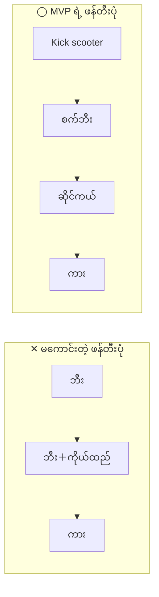
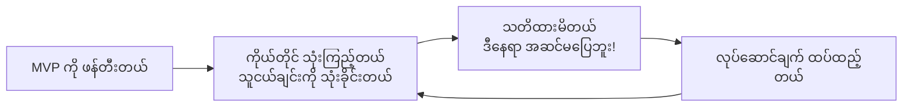
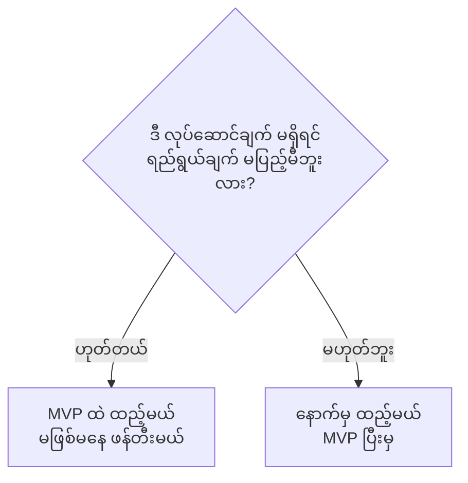
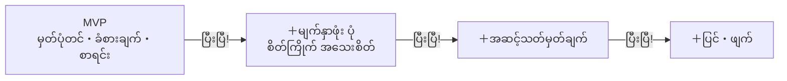
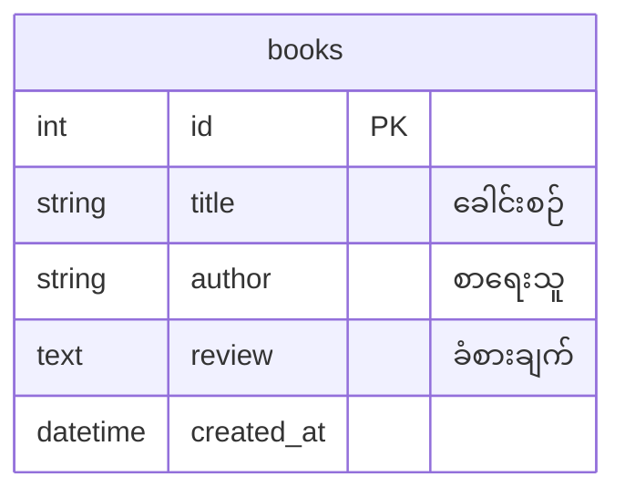

# MVP: အရင်ဆုံး "အနည်းဆုံး သုံးလို့ရတဲ့အရာ" ကို အပြီးသတ်ကြရအောင်

> 🇯🇵 မူရင်း (ဂျပန်ဘာသာဖြင့်): [2026_10_16_資料1.md](<../../../2年生_システム開発実践/後期/2026_10_16/2026_10_16_資料1.md>) <!-- original-ja-link -->

## 1. MVP ဆိုတာ ဘာလဲ

ပြီးခဲ့တဲ့အကြိမ်က [အရင်ဆုံး သေးသေးလေးနဲ့ ဖန်တီးမယ်](../2026_10_09/2026_10_09_資料1.md#အရင်ဆုံး-သေးသေးလေးနဲ့-ဖန်တီးမယ်) ဆိုတဲ့ အကြောင်းကို ပြောခဲ့ပါတယ်။
ဒီ "သေးသေးလေး ဖန်တီးထားတဲ့အရာ" မှာ နာမည်တစ်ခု ရှိပါတယ်။ အဲဒါက **MVP** ပါ။

| အတိုမကောက်ခင် | အဓိပ္ပာယ် |
|-------|------|
| **M**inimum | အနည်းဆုံး |
| **V**iable | သုံးလို့ရတဲ့・အလုပ်ဖြစ်တဲ့ |
| **P**roduct | ထုတ်ကုန်・App |

ဆိုလိုတာက MVP ဆိုတာ **"ဒါလေးရှိရင် သုံးလို့ရပြီ" ဆိုတဲ့ အနည်းဆုံး app** ကို ဆိုလိုတာပါ။
တကယ့်ကုမ္ပဏီတွေမှာလည်း service အသစ်တစ်ခု ဖန်တီးတဲ့အခါ အရင်ဆုံး MVP ကို ဖန်တီးပြီး အသုံးပြုသူတွေအတွက် ထုတ်ပေးပါတယ်။ အဲဒီနောက် သုံးတဲ့သူတွေရဲ့ တုံ့ပြန်မှုကို ကြည့်ရင်း တဖြည်းဖြည်း ပိုကောင်းအောင် ပြုပြင်တိုးတက်စေပါတယ်။

> 💡 **ဥပမာပေးရရင် "Curry ထမင်း"**
> Curry ရဲ့ MVP က "ထမင်း＋curry ဟင်းရည်" ပါ။ ဒါလေးနဲ့တင် **Curry အနေနဲ့ ကောင်းကောင်း စားလို့ရပါတယ်**။
> တုံကတ်ဆု (ဂျပန်စတိုင် ဝက်သားကပ်ကြော်)၊ ဒိန်ခဲနဲ့ ဖုခုဂျင်ဇုကဲ (ဂျပန်ချဉ်ဖတ်) တို့က နောက်မှ ထပ်ထည့်လို့ရတဲ့ topping တွေပါ။
> ပြောင်းပြန်အနေနဲ့ topping တွေပဲ အများကြီးရှိပြီး **curry ဟင်းရည် မရှိရင်** curry အနေနဲ့ စားလို့ မရပါဘူး။

---

## 2. MVP အကြောင်း မကြာခဏ နားလည်မှုလွဲတတ်တာ

MVP ဆိုတာ "တစ်ဝက်တစ်ပျက် ဖန်တီးထားတာ" မဟုတ်ပါဘူး။ **သေးပေမဲ့ ကောင်းကောင်း သုံးလို့ရတာ** က အရေးကြီးပါတယ်။



| | ✕ မကောင်းတဲ့ ဖန်တီးပုံ | ◯ MVP ရဲ့ ဖန်တီးပုံ |
|---|---|---|
| ပထမအကြိမ် | ဘီးပဲ → **ရွေ့လို့ မရဘူး** | Kick scooter → **ရွေ့လို့ ရတယ်!** |
| ဒုတိယအကြိမ် | ဘီး＋ကိုယ်ထည် → **ရွေ့လို့ မရသေးဘူး** | စက်ဘီး → **ပိုမြန်မြန် ရွေ့လို့ ရတယ်** |
| ကြားမှာ အချိန်ကုန်သွားရင် | **ဘာမှ သုံးလို့ မရဘူး** | **သုံးလို့ရတဲ့အရာ လက်ထဲမှာ ကျန်တယ်** |

- ✕ ဘက်က အဆုံးထိ ဖန်တီးပြီးမှသာ သုံးလို့ရလို့ အဲဒီမတိုင်ခင် **တစ်ခါမှ သုံးလို့ မရပါဘူး**
- ◯ ဘက်က ဘယ်အဆင့်မှာ ရပ်သွားသွား **"သွားလာဖို့" ဆိုတဲ့ ရည်ရွယ်ချက်ကို ပြည့်မီစေပါတယ်**

App မှာလည်း အတူတူပါပဲ။ "Login screen ပဲ ပြီးပြည့်စုံတယ်"၊ "Design ပဲ ပြီးပြည့်စုံတယ်" ဆိုပြီး **အဓိက လုပ်ဆောင်ချက် က အလုပ်မလုပ်ဘူး** ဆိုရင် ✕ ပုံစံပါ။

---

## 3. ဘာကြောင့် MVP ကနေ စဖန်တီးတာလဲ?

### ① မပြီးဘဲ ကုန်ဆုံးသွားတာကို ကာကွယ်နိုင်တယ်

ကိုယ်ပိုင် ဖန်တီးမှုမှာ အဖြစ်အများဆုံး ကျရှုံးမှုက **လုပ်ဆောင်ချက် တွေကို အရမ်းများများ ထည့်လွန်းလို့ မပြီးဘဲ ကုန်ဆုံးသွားတာ** ပါ။
MVP ကို အရင် ဖန်တီးထားရင် **ဘယ်နေရာမှာ အချိန်ကုန်သွားသွား "အလုပ်လုပ်တဲ့ app" က လက်ထဲမှာ ကျန်နေပါတယ်**။

### ② စောစော သုံးကြည့်ရင် တကယ်လိုအပ်တာကို သိလာတယ်

မဖန်တီးခင် စဉ်းစားထားတဲ့ "ရှိရင် ကောင်းမှာပဲ" ဆိုတာတွေဟာ တကယ်သုံးကြည့်တဲ့အခါ **မလိုအပ်မှန်း သိရတာ** မကြာခဏ ရှိပါတယ်။
ပြောင်းပြန်အနေနဲ့ သုံးကြည့်မှ "ဒါမရှိရင် အဆင်မပြေဘူး!" လို့ သတိထားမိတဲ့ လုပ်ဆောင်ချက် တွေလည်း ရှိပါတယ်။



### ③ Portfolio အနေနဲ့ အရင်ဆုံး "ပြလို့ရတဲ့" အခြေအနေ ဖြစ်လာတယ်

အလုပ်ရှာတဲ့အခါ တင်ပြရမယ်ဆိုရင် **မပြီးသေးတဲ့ app** ကို ပြရတာ ခက်ပါတယ်။
MVP ပြီးထားရင် ဘယ်အချိန်မဆို **"အလုပ်လုပ်တဲ့အရာ" အနေနဲ့ တင်ပြလို့ရတဲ့ အခြေအနေ** ဖြစ်နေပါပြီ။
ကိုယ့်စိတ်ကြိုက် အသေးစိတ်တွေကို အဲဒီအပေါ်မှာ **တဖြည်းဖြည်း ထပ်ဆင့်သွားရင်** ရပါပြီ။

---

## 4. MVP ကို ဆုံးဖြတ်ပုံ

### အဆင့် 1: App ရဲ့ ရည်ရွယ်ချက်ကို စာကြောင်းတစ်ကြောင်းနဲ့ ရေးပါ

အရင်ဆုံး **"ဘယ်သူက" "ဘာလုပ်ဖို့"** app လဲဆိုတာကို စာကြောင်းတစ်ကြောင်းနဲ့ ရေးပါ။

```
〇〇 ဖြစ်တဲ့သူတွေ △△ လုပ်ဖို့အတွက် အသုံးပြုမယ့် app
```

| App | ရည်ရွယ်ချက် (စာကြောင်းတစ်ကြောင်း) |
|-------|-----------|
| စာဖတ်မှတ်တမ်း | စာအုပ်ကြိုက်တဲ့သူက **ဖတ်ပြီးသား စာအုပ်နဲ့ ခံစားချက်ကို မှတ်တမ်းတင်ပြီး ပြန်ကြည့်ဖို့** အတွက် app |
| ကြွက်သားလေ့ကျင့်ခန်း မှတ်တမ်း | ကြွက်သားလေ့ကျင့်ခန်း လုပ်နေတဲ့သူက **နေ့စဉ် menu နဲ့ အကြိမ်ရေကို မှတ်တမ်းတင်ဖို့** အတွက် app |
| Club ရဲ့ တက်ရောက်မှုစာရင်း | Club ရဲ့ manager က **လေ့ကျင့်မှုမှာ တက်/မတက် စုစည်းဖို့** အတွက် app |

> ဒီစာကြောင်းထဲက **စာလုံးမည်း အပိုင်း** က app ရဲ့ "curry ဟင်းရည်" ပါ။ ဒီအပိုင်း မပြီးရင် app အနေနဲ့ အလုပ်မဖြစ်ပါဘူး။

### အဆင့် 2: ဖန်တီးချင်တဲ့ လုပ်ဆောင်ချက် အားလုံးကို ချရေးပါ

စဉ်းစားမိသမျှ လုပ်ဆောင်ချက် တွေကို အားမနာဘဲ **အားလုံး** ချရေးပါ။ ဒီအဆင့်မှာ လုပ်နိုင်မလား မလုပ်နိုင်ဘူးလား ဆိုတာ မစဉ်းစားသေးလည်း ရပါတယ်။

**စာဖတ်မှတ်တမ်း app ရဲ့ ဥပမာ**

- စာအုပ် မှတ်ပုံတင်တယ် (ခေါင်းစဉ်・စာရေးသူ)
- ခံစားချက် ရေးတယ်
- အဆင့်သတ်မှတ်ချက် (ကြယ် 1〜5) ပေးတယ်
- မှတ်ပုံတင်ထားတဲ့ စာအုပ်တွေကို စာရင်းနဲ့ ကြည့်တယ်
- စာအုပ်ကို ပြင်တယ်・ဖျက်တယ်
- မျက်နှာဖုံး ပုံကို ပြတယ်
- စာအုပ် ရှာတယ်
- အမျိုးအစားအလိုက် ခွဲတယ်
- Login လုပ်ဆောင်ချက်
- သူငယ်ချင်းတွေနဲ့ စာအုပ် share လုပ်တယ်
- ဖတ်ပြီးတဲ့ စာအုပ်အရေအတွက်ကို graph နဲ့ ပြတယ်

### အဆင့် 3: "မရှိရင် ရည်ရွယ်ချက် မပြည့်မီဘူးလား?" ဆိုပြီး ခွဲပါ

ချရေးထားတဲ့ လုပ်ဆောင်ချက် တွေကို တစ်ခုချင်း ကြည့်ပြီး **"ဒါမရှိရင် ရည်ရွယ်ချက် (အဆင့် 1 ရဲ့ စာကြောင်း) ကို မပြည့်မီဘူးလား?"** လို့ ကိုယ့်ကိုယ်ကို မေးပါ။



**စာဖတ်မှတ်တမ်း app ရဲ့ ဥပမာ** (ရည်ရွယ်ချက်: ဖတ်ပြီးသား စာအုပ်နဲ့ ခံစားချက်ကို မှတ်တမ်းတင်ပြီး ပြန်ကြည့်ဖို့)

| လုပ်ဆောင်ချက် | မရှိရင် ရည်ရွယ်ချက် မပြည့်မီဘူးလား? | အမျိုးအစား |
|------|-------------------|------|
| စာအုပ် မှတ်ပုံတင်တယ် (ခေါင်းစဉ်・စာရေးသူ) | ဟုတ်တယ် (မှတ်တမ်းတင်လို့ မရ) | **MVP** |
| ခံစားချက် ရေးတယ် | ဟုတ်တယ် (ခံစားချက်ကို မှတ်တမ်းတင်လို့ မရ) | **MVP** |
| မှတ်ပုံတင်ထားတဲ့ စာအုပ်တွေကို စာရင်းနဲ့ ကြည့်တယ် | ဟုတ်တယ် (ပြန်ကြည့်လို့ မရ) | **MVP** |
| အဆင့်သတ်မှတ်ချက် (ကြယ် 1〜5) ပေးတယ် | မဟုတ်ဘူး (ခံစားချက် ရှိရင် မှတ်တမ်းတင်လို့ရ) | နောက်မှ |
| စာအုပ်ကို ပြင်တယ်・ဖျက်တယ် | မဟုတ်ဘူး (မရှိလည်း မှတ်တမ်းတင်တာ・ပြန်ကြည့်တာ လုပ်လို့ရ) | နောက်မှ |
| မျက်နှာဖုံး ပုံကို ပြတယ် | မဟုတ်ဘူး | နောက်မှ |
| စာအုပ် ရှာတယ် | မဟုတ်ဘူး (စာအုပ် နည်းသေးသရွေ့ စာရင်းနဲ့ လုံလောက်) | နောက်မှ |
| အမျိုးအစားအလိုက် ခွဲတယ် | မဟုတ်ဘူး | နောက်မှ |
| Login လုပ်ဆောင်ချက် | မဟုတ်ဘူး (ကိုယ်တစ်ယောက်တည်း သုံးမယ်ဆိုရင် မလို) | နောက်မှ |
| သူငယ်ချင်းတွေနဲ့ စာအုပ် share လုပ်တယ် | မဟုတ်ဘူး | နောက်မှ |
| ဖတ်ပြီးတဲ့ စာအုပ်အရေအတွက်ကို graph နဲ့ ပြတယ် | မဟုတ်ဘူး | နောက်မှ |

> 💡 **MVP မှာ လုပ်ဆောင်ချက် ၃ ခုလောက် ပါဝင်ဖို့ကို အကြမ်းဖျင်း စံထားပါ**။ ၅ ခုနဲ့အထက် ဖြစ်လာရင် "တကယ်ပဲ မရှိရင် ရည်ရွယ်ချက် မပြည့်မီဘူးလား?" လို့ နောက်တစ်ခါ ပြန်မေးကြည့်ပါ။

> ⚠️ **Login လုပ်ဆောင်ချက် ကို MVP ထဲ မထည့်တာ များပါတယ်**
> Login က ခက်ပြီး အချိန်လည်း ကြာပေမဲ့ အများအားဖြင့် **app ရဲ့ ရည်ရွယ်ချက် ကိုယ်တိုင် မဟုတ်ပါဘူး**။
> အရင်ဆုံး login မပါဘဲ အလုပ်လုပ်တဲ့အရာကို ဖန်တီးပြီး လိုအပ်လာမှ နောက်မှ ထပ်ထည့်ပါ။

### အဆင့် 4: "နောက်မှ ထည့်မယ်" တွေကို အစီအစဉ် သတ်မှတ်ပါ

"နောက်မှ ထည့်မယ်" လုပ်ဆောင်ချက် တွေကို **ဖန်တီးချင်တဲ့ အစီအစဉ်** အတိုင်း နံပါတ်တပ်ပါ။
ဒီနေရာမှာ အရေးထားချင်တာက ပြီးခဲ့တဲ့အကြိမ်က ပြောခဲ့တဲ့ **ကိုယ့်ရဲ့ စိတ်ကြိုက် အသေးစိတ်** ပါ။

| အစီအစဉ် | လုပ်ဆောင်ချက် | အကြောင်းပြချက် |
|-----|------|------|
| 1 | မျက်နှာဖုံး ပုံကို ပြတယ် | **စာအုပ်စင်လို ပြချင်တယ်** (အဓိက စိတ်ကြိုက် အသေးစိတ်) |
| 2 | အဆင့်သတ်မှတ်ချက် (ကြယ် 1〜5) ပေးတယ် | အကြံပြုချင်တဲ့ စာအုပ်ကို တစ်ချက်ကြည့်ရုံနဲ့ သိနိုင်တယ် |
| 3 | စာအုပ်ကို ပြင်တယ်・ဖျက်တယ် | မှားသွားရင် ပြင်ချင်တယ် |
| 4 | အမျိုးအစားအလိုက် ခွဲတယ် | စာအုပ် များလာရင် လိုအပ်တယ် |
| … | … | … |



စိတ်ကြိုက် အသေးစိတ် လုပ်ဆောင်ချက် ကို **MVP ပြီးပြီးချင်း** ဖန်တီးတာကို အကြံပြုပါတယ်။
MVP တစ်ခုတည်းဆိုရင် တခြားသူတွေရဲ့ app နဲ့ ဆင်တူသွားတတ်ပေမဲ့ စိတ်ကြိုက် အသေးစိတ် ပါလာတာနဲ့ **"ကိုယ့်ရဲ့ ကိုယ်ပိုင် app"** ဖြစ်လာပါတယ်။

---

## 5. MVP ရဲ့ table ကို စဉ်းစားပါ

Table ကိုလည်း **MVP အတွက် လိုအပ်တဲ့ column တွေနဲ့ပဲ** စပါ။ Column တွေကို နောက်မှ migration (Supabase ဆိုရင် management screen) နဲ့ ထပ်ထည့်လို့ ရပါတယ်။



အဆင့်သတ်မှတ်ချက် (`rating`) ဒါမှမဟုတ် မျက်နှာဖုံး ပုံ (`image_url`) တွေကို အဲဒီ လုပ်ဆောင်ချက် ကို ဖန်တီးတဲ့အခါမှ ထည့်ရင် ရပါတယ်။

