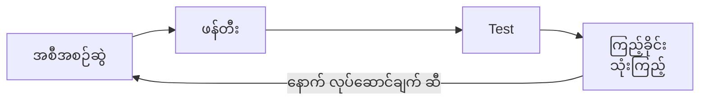
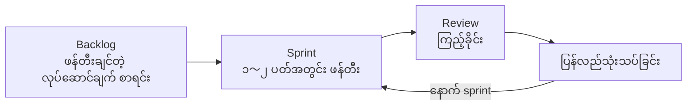

# Agile development အကြောင်း

> 🇯🇵 မူရင်း (ဂျပန်ဘာသာဖြင့်): [アジャイル開発について.md](<../../../2年生_システム開発実践/後期/2026_10_23/アジャイル開発について.md>) <!-- original-ja-link -->

ပြီးခဲ့တဲ့အကြိမ်က အရင်ဆုံး သေးသေးလေး အပြီးသတ်တဲ့ **MVP** အကြောင်းကို လေ့လာခဲ့ပါတယ်။
"သေးသေးလေး ဖန်တီး၊ သုံးကြည့်၊ တဖြည်းဖြည်း ကြီးထွားအောင် လုပ်" ဆိုတဲ့ ဖန်တီးပုံမှာ နာမည်တစ်ခု ရှိပါတယ်။ အဲဒါက **Agile development** ပါ။
ဒီမှာ ရှေးကတည်းက ရှိခဲ့တဲ့ **Waterfall development** နဲ့ နှိုင်းယှဉ်ပြီး ကြည့်သွားပါမယ်။

[ကိုယ်ပိုင် ဖန်တီးမှုသို့ ပြန်သွားရန်](../2026_10_09/2026_10_09_資料1.md)

---

## 1. တစ်ခွန်းတည်းနဲ့ ပြောရရင်

| နာမည် | ဖတ်ပုံ | လုပ်ဆောင်ပုံ | တစ်ခွန်းတည်းနဲ့ |
|------|-------|-------|-----------|
| **Waterfall development** | Waterfall (ရေတံခွန်) | အားလုံး ဆုံးဖြတ်ပြီးမှ အစီအစဉ်အတိုင်း တစ်ကြိမ်တည်းနဲ့ ဖန်တီးတယ် | အစီအစဉ်အတိုင်း ဖန်တီးတယ် |
| **Agile development** | Agile (လျင်မြန်တဲ့) | သေးသေးလေး ဖန်တီးပြီး ထပ်ခါထပ်ခါ ပိုကောင်းအောင် လုပ်တယ် | ဖန်တီးရင်း ကြီးထွားအောင် လုပ်တယ် |

---

## 2. Waterfall development

**ရေတံခွန်က ရေတွေ အပေါ်ကနေ အောက်ကို စီးဆင်းသလို** လုပ်ငန်းအဆင့်တွေကို တစ်ဆင့်ချင်း အစီအစဉ်အတိုင်း လုပ်သွားပါတယ်။
အရင်အဆင့် မပြီးမချင်း နောက်အဆင့်ကို မသွားပါဘူး။ အခြေခံအားဖြင့် **နောက်ပြန်မလှည့်ဘူး** ဆိုတာကို ကြိုတင်ယူဆထားပါတယ်။

| ကောင်းတဲ့အချက် 👍 | သတိထားရမယ့်အချက် ⚠️ |
|------------|-----------------|
| အစကတည်းက အားလုံး ဆုံးဖြတ်ထားလို့ **အချိန်ဇယားနဲ့ ကုန်ကျစရိတ်ကို ခန့်မှန်းရလွယ်တယ်** | ကြားထဲမှာ "ဒီလို ပြောင်းချင်တယ်" လို့ **ပြောရခက်တယ်** |
| အဆင့်တစ်ခုချင်းစီအလိုက် တာဝန်ခွဲရလွယ်တယ် | သုံးမယ့်သူက အလုပ်လုပ်တဲ့အရာကို မြင်ရတာ **နောက်ဆုံးမှ** |
| ဘဏ်・အစိုးရရုံး စတဲ့ **အမှားမခံနိုင်တဲ့** system တွေအတွက် သင့်တော်တယ် | နောက်ဆုံးမှ "ထင်ထားတာနဲ့ မတူဘူး" ဖြစ်သွားရင် **ပြန်လုပ်ရတာ အရမ်းခက်တယ်** |

---

## 3. Agile development

**လုပ်ဆောင်ချက် သေးသေးလေးတစ်ခုချင်းစီအတွက် "အစီအစဉ်ဆွဲ → ဖန်တီး → စစ်ဆေး" ကို ထပ်ခါထပ်ခါ လုပ်ပြီး** app ကို တဖြည်းဖြည်း ကြီးထွားအောင် လုပ်သွားပါတယ်။
တစ်ကြိမ် ထပ်လုပ်တာက **၁〜၄ ပတ်လောက်** ရှိတဲ့ ကာလတိုလေး ဖြစ်ပါတယ်။

| ကောင်းတဲ့အချက် 👍 | သတိထားရမယ့်အချက် ⚠️ |
|------------|-----------------|
| **အစောပိုင်းအဆင့်မှာတင် အလုပ်လုပ်တဲ့အရာ** ကို မြင်ရတယ် | နောက်ဆုံးမှာ ဘယ်အထိ ဖန်တီးနိုင်မလဲဆိုတာ **အစမှာ မြင်ရခက်တယ်** |
| သုံးတဲ့သူရဲ့ အကြံပြုချက်ကို **နောက်တစ်ကြိမ်မှာ ချက်ချင်း ထည့်သွင်း** နိုင်တယ် | "အရင်ဆုံး ဒီအတိုင်းပဲ ဖန်တီးလိုက်မယ်" ဖြစ်သွားရင် **ဒီဇိုင်းက ရှုပ်ပွသွား** တတ်တယ် |
| ကြားထဲမှာ ဦးတည်ချက် ပြောင်းရလွယ်တယ် | Team အနေနဲ့ **မကြာခဏ ဆွေးနွေး** ဖို့ လိုတယ် |

> 💡 **MVP က Agile development ရဲ့ "ပထမအကြိမ်"**
> MVP ကို ဖန်တီး၊ သုံးကြည့်၊ စိတ်ကြိုက် လုပ်ဆောင်ချက် တွေကို တစ်ခုချင်း ထပ်ထည့်သွားတယ်——
> ကိုယ်ပိုင် ဖန်တီးမှုရဲ့ လုပ်ဆောင်ပုံက Agile development အစစ်ပါပဲ။

---

## 4. နှိုင်းယှဉ်ကြည့်ရအောင်

**"ဟင်းချက်တာ"** နဲ့ ဥပမာပေးကြည့်ပါမယ်။

| | Waterfall | Agile |
|---|---|---|
| လုပ်ဆောင်ပုံ | Course ဟင်းလျာအားလုံးကို **ကြိုတင်ဆုံးဖြတ်ပြီး** အမြည်းကနေ အချိုပွဲအထိ အစီအစဉ်အတိုင်း ချက်ကာ **နောက်ဆုံးမှ အားလုံးကို တစ်ပြိုင်နက် တည်ခင်းတယ်** | အရင်ဆုံး ဟင်းတစ်မျိုး ချက်ပြီး **မြည်းကြည့်စေတယ်**၊ ပြောပြတဲ့ အမြင်ကို နားထောင်ပြီး နောက်ဟင်းကို ဆုံးဖြတ်တယ် |
| ကြားထဲ ပြောင်းလဲမှု | "ငါးမဟုတ်ဘဲ အသားပဲ ကောင်းမယ်" လို့ ပြောလာရင် ခက်တယ် | နောက်ဟင်းတစ်မျိုးမှာ ပြောင်းလိုက်ရုံပဲ |
| သင့်တော်တဲ့ အခြေအနေ | မင်္ဂလာဆောင် ဟင်းလျာ (Menu ကို အစကတည်းက ဆုံးဖြတ်ထားပြီး) | မိသားစု ထမင်းဝိုင်း (အဲဒီနေ့ရဲ့ စိတ်အလိုက် ပြောင်းတယ်) |

ဘယ်ဟာက မှန်တယ်ဆိုတာ မရှိပါဘူး။ **ဖန်တီးမယ့်အရာပေါ် မူတည်ပြီး ခွဲခြားသုံးပါတယ်။**

---

## 5. Scrum — Agile development ရဲ့ လုပ်ဆောင်ပုံ တစ်မျိုး

Agile development ရဲ့ နည်းလမ်းတွေထဲမှာ အကျော်ကြားဆုံးက **Scrum** ပါ။ Rugby မှာ team အဖွဲ့ဝင်တွေ ပခုံးချင်းချိတ်တဲ့ "Scrum" ကနေ နာမည်ယူထားတာပါ။

| စကားလုံး | အဓိပ္ပာယ် | ကိုယ်ပိုင် ဖန်တီးမှုနဲ့ ပြောရရင် |
|-----|------|---------------|
| **Sprint** | တစ်ကြိမ် ထပ်လုပ်တဲ့ ကာလ (၁〜၄ ပတ်) | အတန်း ၁〜၂ ကြိမ်စာ |
| **Product backlog** | ဖန်တီးချင်တဲ့ လုပ်ဆောင်ချက် တွေကို **အရေးကြီးဆုံးကနေ အစဉ်လိုက်** စီထားတဲ့ စာရင်း | MVP သင်ခန်းစာမှာ ရေးခဲ့တဲ့ "နောက်မှ ထည့်မယ့် လုပ်ဆောင်ချက် (ဖန်တီးမယ့် အစီအစဉ်)" |
| **Daily scrum** | နေ့တိုင်း ၁၅ မိနစ်လောက် လုပ်တဲ့ အစည်းအဝေးတို | အတန်းအစမှာ "ဒီနေ့ လုပ်မယ့်အရာ" ကို ဆုံးဖြတ်တယ် |
| **Sprint review** | ပြီးတဲ့အရာကို ပြပြီး အကြံပြုချက် ယူတယ် | သူငယ်ချင်း ဒါမှမဟုတ် ဆရာကို သုံးခိုင်းတယ် |
| **ပြန်လည်သုံးသပ်ခြင်း (Retrospective)** | လုပ်ဆောင်ပုံကို ပြန်သုံးသပ်ပြီး နောက်တစ်ကြိမ်မှာ အသုံးချတယ် | အတန်းအဆုံးမှာ "အဆင်ပြေခဲ့တာ・အခက်အခဲ ဖြစ်ခဲ့တာ" ကို စဉ်းစားတယ် |

> 💡 **GitHub မှာ backlog ဖန်တီးလို့ ရပါတယ်**
> GitHub ရဲ့ **Issues** မှာ "ဖန်တီးချင်တဲ့ လုပ်ဆောင်ချက်" တွေကို တစ်ခုချင်း မှတ်ပုံတင်ပြီး **Projects** မှာ "လုပ်ရန်・လုပ်နေဆဲ・ပြီးပြီ" ဆိုပြီး စီထားရင် တကယ့်လုပ်ငန်းခွင်လိုပဲ backlog ကို စီမံနိုင်ပါတယ်။

---

## 6. လုပ်ငန်းခွင်မှာ ဘယ်ဟာ ပိုများလဲ?

အခုခေတ် Web service တွေ၊ smartphone app တွေ ဖန်တီးရာမှာ **Agile development** ကို အများကြီး သုံးပါတယ်။
သုံးတဲ့သူတွေရဲ့ တုံ့ပြန်မှုကို ကြည့်ရင်း အပတ်တိုင်း・နေ့တိုင်းနီးပါး update လုပ်သွားလို့ ဖြစ်ပါတယ်။

တစ်ဖက်မှာတော့ ဘဏ်ရဲ့ system တွေ၊ စက်ရုံက စက်တွေကို ထိန်းချုပ်တဲ့ system တွေမှာ အခုထိ **Waterfall development** ကို သုံးနေပါသေးတယ်။
ဒါ့အပြင် အကြမ်းဖျင်း လမ်းကြောင်းကို Waterfall နဲ့ ဆုံးဖြတ်ပြီး အသေးစိတ် အပိုင်းတွေကို Agile နဲ့ လုပ်သွားတဲ့ **ပေါင်းစပ်နည်း** လည်း ရှိပါတယ်။

> 💡 **အင်တာဗျူးမှာ ပြောလို့ရပါတယ်**
> "ကိုယ်ပိုင် ဖန်တီးမှုမှာ အရင်ဆုံး MVP ကို ဖန်တီးပြီး သုံးကြည့်ရင်း လုပ်ဆောင်ချက် တွေ ထပ်ထည့်သွားတဲ့ **Agile ဆန်တဲ့ လုပ်ဆောင်ပုံ** နဲ့ လုပ်ခဲ့ပါတယ်" လို့ ပြောနိုင်ရင် development လုပ်ဆောင်ပုံကို နားလည်ထားတယ်ဆိုတာ သိသာစေပါတယ်။

---

## 7. အနှစ်ချုပ်

- **Waterfall development** ＝ အားလုံး ဆုံးဖြတ်ပြီးမှ အစီအစဉ်အတိုင်း တစ်ကြိမ်တည်းနဲ့ ဖန်တီးတယ် (နောက်ပြန်မလှည့်ဘူး)
- **Agile development** ＝ သေးသေးလေး ဖန်တီး၊ သုံးကြည့်၊ ထပ်ခါထပ်ခါ ပိုကောင်းအောင် လုပ်တယ်
- **Scrum** က Agile development ရဲ့ လုပ်ဆောင်ပုံ တစ်မျိုး။ **Sprint** (ကာလတို) ကို ထပ်ခါထပ်ခါ လုပ်တယ်
- **MVP → လုပ်ဆောင်ချက် ထပ်ထည့်သွားတဲ့** ကိုယ်ပိုင် ဖန်တီးမှုရဲ့ လုပ်ဆောင်ပုံက Agile development ကိုယ်တိုင်ပါပဲ
- ဘယ်ဟာ မှန်တယ်ဆိုတာ မဟုတ်ဘဲ **ဖန်တီးမယ့်အရာပေါ် မူတည်ပြီး ခွဲခြားသုံးတယ်**

[ကိုယ်ပိုင် ဖန်တီးမှုသို့ ပြန်သွားရန်](../2026_10_09/2026_10_09_資料1.md)
