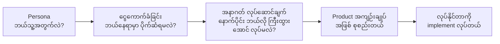
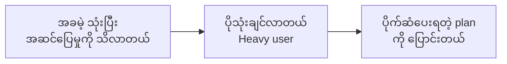
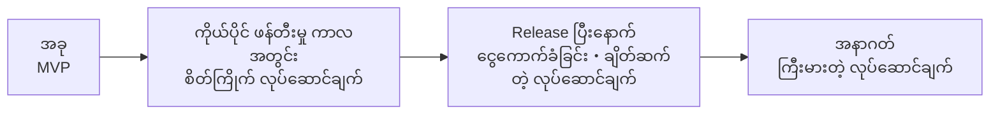
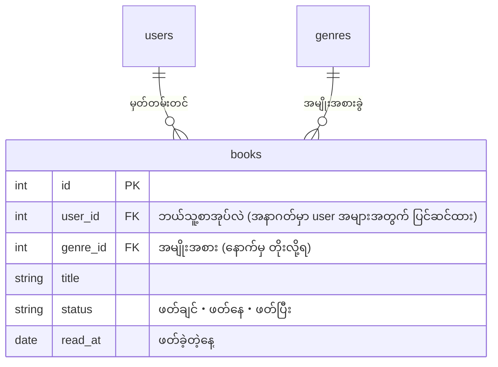
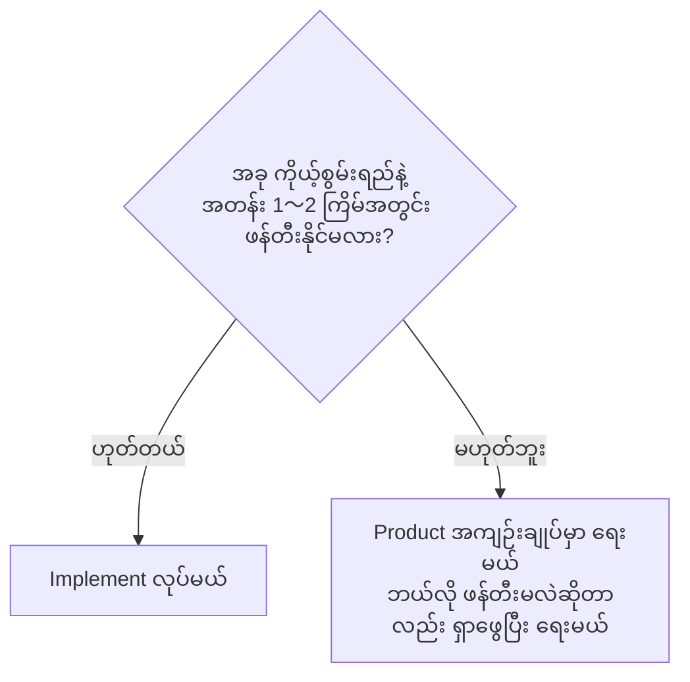

# ကိုယ်ပိုင် ဖန်တီးမှုရဲ့ အနာဂတ်ပုံရိပ်ကိုပါ စဉ်းစားပြီး ဖန်တီးပါ

> 🇯🇵 မူရင်း (ဂျပန်ဘာသာဖြင့်): [自由制作の将来像も考えて作る.md](<../../../2年生_システム開発実践/後期/2026_10_23/自由制作の将来像も考えて作る.md>) <!-- original-ja-link -->

ကိုယ်ပိုင် ဖန်တီးမှု app ကို "အတန်းရဲ့ assignment" အနေနဲ့ မဟုတ်ဘဲ **တကယ် release လုပ်မယ့် service** လို့ သဘောထားပြီး စဉ်းစားကြည့်ပါမယ်။
**ဘယ်သူ သုံးမလဲ (Persona)**၊ **ဘယ်နေရာမှာ ပိုက်ဆံရမလဲ (ငွေကောက်ခံခြင်း)**၊ **နောက်ပိုင်း ဘယ်လို လုပ်ဆောင်ချက် တွေ ထပ်ထည့်သွားမလဲ** ဆိုတာတွေကို စဉ်းစားပြီး **Product အကျဉ်းချုပ်** document အဖြစ် စုစည်းပါမယ်။

[ကိုယ်ပိုင် ဖန်တီးမှုသို့ ပြန်သွားရန်](../2026_10_09/2026_10_09_資料1.md)

---

## 1. ဘာကြောင့် အနာဂတ်ပုံရိပ်ကို စဉ်းစားတာလဲ?



- **ဘယ် လုပ်ဆောင်ချက် ကို ဖန်တီးရမလဲဆိုတာ မဝေခွဲနိုင်ဘဲ မဖြစ်တော့ဘူး**: "ဒီလူ (Persona) အတွက် လိုအပ်လား?" ဆိုပြီး ဆုံးဖြတ်နိုင်တယ်
- **အင်တာဗျူးမှာ ပြောလို့ရတယ်**: "ဘယ်သူ့ရဲ့ ဘယ်လို အခက်အခဲကို ဖြေရှင်းပေးတဲ့ app လဲ၊ ဘယ်လို ဆက်လက် လည်ပတ်သွားမယ့် service လဲ" ဆိုတာအထိ ပြောနိုင်ရင် **စဉ်းစားပြီး ဖန်တီးခဲ့တဲ့သူ** ဆိုတာ သိသာစေတယ်
- **တကယ့်ကုမ္ပဏီနဲ့ အတူတူပဲ**: ကုမ္ပဏီမှာ app ဖန်တီးတဲ့အခါ မဖန်တီးခင် **စီမံကိန်း (Planning)** ကို မဖြစ်မနေ စဉ်းစားရတယ်

> 💡 အားလုံးကို implement လုပ်ဖို့ မလိုပါဘူး။ **စဉ်းစားခဲ့တာတွေကို Product အကျဉ်းချုပ်ထဲ ရေးထားရုံ** နဲ့တင် portfolio အနေနဲ့ တန်ဖိုး ရှိပါတယ်။

---

## 2. Persona သတ်မှတ်ပါ

### Persona ဆိုတာ ဘာလဲ

**Persona** ဆိုတာ app ကို သုံးမယ့်သူကို **တိကျတဲ့ လူတစ်ယောက်အဖြစ်** အသေးစိတ် သတ်မှတ်ထားတာ ဖြစ်ပါတယ်။
"အသက် ၂၀ ကျော်အရွယ်တွေ" လို အကြမ်းဖျင်း ခွဲတာမျိုး မဟုတ်ဘဲ **တကယ် ရှိနိုင်လောက်တဲ့ လူတစ်ယောက်** ကို မြင်ယောင်ကြည့်ပါ။

| ✕ အကြမ်းဖျင်း | ◯ Persona |
|----------|----------|
| စာအုပ်ကြိုက်တဲ့သူ | 田中 さくら (Tanaka Sakura၊ အသက် 21 နှစ်・တက္ကသိုလ် တတိယနှစ်)။ ကျောင်းသွားတဲ့ ရထားပေါ်မှာ တစ်လကို စာအုပ် 3〜4 အုပ် ဖတ်တယ်။ ဖတ်ပြီးတဲ့ စာအုပ်ရဲ့ အကြောင်းအရာကို ချက်ချင်း မေ့သွားတတ်ပြီး သူငယ်ချင်းက ဘာစာအုပ်ကောင်းလဲလို့ မေးတဲ့အခါ မဖြေနိုင်တာကို စိတ်ညစ်တယ် |

> 💡 **ဘာကြောင့် လူတစ်ယောက်တည်းကို ရွေးတာလဲ?**
> "လူတိုင်းအတွက်" ဆိုပြီး ဖန်တီးရင် ဘယ်သူ့အတွက်မဆို **နည်းနည်း သုံးရခက်တဲ့** app ဖြစ်သွားတတ်ပါတယ်။
> လူတစ်ယောက်တည်းကို ရွေးလိုက်ရင် "さくら ဆိုရင် ရထားပေါ်မှာ **လက်တစ်ဖက်တည်းနဲ့** မှတ်တမ်းတင်ချင်မှာပဲ" ဆိုပြီး **တိတိကျကျ စဉ်းစားနိုင်ပါတယ်**။

### Persona မှာ ဆုံးဖြတ်ရမယ့်အရာ

| အချက် | ဥပမာ (စာဖတ်မှတ်တမ်း app) |
|-----|-----------------|
| နာမည်・အသက်・အလုပ် | 田中 さくら (Tanaka Sakura)・အသက် 21 နှစ်・တက္ကသိုလ် တတိယနှစ် |
| နေ့စဉ်ဘဝ | ကျောင်းသွားတဲ့ ရထားပေါ်မှာ နေ့တိုင်း မိနစ် 30 စာဖတ်တယ်။ Smartphone ကို အမြဲ ယူသွားတယ် |
| IT နဲ့ ရင်းနှီးမှု | SNS ကို မကြာခဏ သုံးတယ်။ ခက်တဲ့ setting တွေကို မကျွမ်းဘူး |
| အခက်အခဲ | ဖတ်ပြီးတဲ့ စာအုပ်ရဲ့ အကြောင်းအရာကို ချက်ချင်း မေ့တယ်။ ဘာစာအုပ်ကောင်းလဲလို့ မေးရင် မဖြေနိုင်ဘူး |
| ပန်းတိုင် (ဘယ်လို ဖြစ်ချင်လဲ?) | ဖတ်ပြီးတဲ့ စာအုပ်နဲ့ ခံစားချက်ကို နောက်မှ ချက်ချင်း ပြန်ကြည့်နိုင်ချင်တယ် |
| App ကို သုံးမယ့် အခြေအနေ | ရထားပေါ်မှာ ဖတ်ပြီးပြီးချင်း **smartphone နဲ့** မှတ်တမ်းတင်တယ် |

> ⚠️ **ကိုယ့်အတွက် အဆင်ပြေတဲ့ လူမျိုး မလုပ်ပါနဲ့**
> "နေ့တိုင်း app ကို ဖွင့်ပြီး လုပ်ဆောင်ချက် အားလုံးကို သုံးပေးမယ့်သူ" ဆိုတာ မရှိသလောက်ပါပဲ။
> **အလုပ်များတတ်တဲ့၊ အလုပ်ရှုပ်တာကို မလုပ်ချင်တတ်တဲ့၊ မြန်မြန် ငြီးငွေ့တတ်တဲ့** လက်တွေ့ကျတဲ့ လူတစ်ယောက်ကို စဉ်းစားပါ။

---

## 3. ဘယ်နေရာမှာ ငွေကောက်မလဲ စဉ်းစားပါ

### ပိုက်ဆံရပုံ (ဝင်ငွေ model)

| Model | အလုပ်လုပ်ပုံ | ဥပမာ |
|-------|------|-----|
| **ကြော်ငြာ** | App က အခမဲ့။ Screen ပေါ်မှာ ကြော်ငြာ တင်ပြီး ကြော်ငြာရှင်ဆီက ပိုက်ဆံရတယ် | YouTube (အခမဲ့ plan)၊ သတင်း app |
| **တစ်ခါတည်း ဝယ်ခြင်း** | အစမှာ တစ်ကြိမ်ပဲ ပိုက်ဆံပေးရတယ် | ပိုက်ဆံပေးရတဲ့ smartphone game၊ software |
| **Subscription** | လစဉ်・နှစ်စဉ် ပိုက်ဆံပေးရတယ် | Netflix၊ Spotify |
| **Freemium** | အခြေခံက **အခမဲ့**။ ပိုအဆင်ပြေတဲ့ လုပ်ဆောင်ချက် သုံးချင်သူတွေပဲ **ပိုက်ဆံပေးရ** | Spotify၊ Notion၊ LINE sticker |

တစ်ဦးချင်း ဖန်တီးတဲ့ Web app ဆိုရင် **Freemium** က စဉ်းစားရ အလွယ်ဆုံးပါ။

### "အခမဲ့" နဲ့ "ပိုက်ဆံပေးရ" ကြားမှာ မျဉ်းဆွဲပါ

Freemium မှာ အရေးအကြီးဆုံးက **ဘယ်အထိ အခမဲ့ ဖြစ်ပြီး ဘယ်ကစပြီး ပိုက်ဆံပေးရမလဲ** ဆိုတာပါ။



| စဉ်းစားပုံ | ရှင်းလင်းချက် |
|-------|------|
| **App ရဲ့ "ရည်ရွယ်ချက်" ကို အခမဲ့ ထားပါ** | MVP ရဲ့ လုပ်ဆောင်ချက် (အရေးအကြီးဆုံး လုပ်ဆောင်ချက်) ကို ပိုက်ဆံပေးရရင် ဘယ်သူမှ စသုံးကြမှာ မဟုတ်ဘူး |
| **များများ သုံးလေ ပိုက်ဆံ ပေးရလေ** | "〇 ခုအထိ အခမဲ့" လိုမျိုး **ပမာဏ** နဲ့ မျဉ်းဆွဲတယ် |
| **ရှိရင် အဆင်ပြေပေမဲ့ မရှိလည်း ပြဿနာမရှိတဲ့အရာ** ကို ပိုက်ဆံပေးရအောင် လုပ်ပါ | ကြည့်ရလွယ်တဲ့ graph၊ data export၊ design ပြောင်းတာ စသည် |
| **Persona က ပိုက်ဆံပေးမယ့် အကြောင်းပြချက်** ကို စဉ်းစားပါ | "さくら က ဘာအတွက်ဆိုရင် တစ်လ ယန်း 300 ပေးမလဲ?" |

**စာဖတ်မှတ်တမ်း app ရဲ့ ဥပမာ**

| | အခမဲ့ plan | ပိုက်ဆံပေးရတဲ့ plan (တစ်လ ယန်း 300) |
|---|---|---|
| စာအုပ် မှတ်ပုံတင်ခြင်း | **50 အုပ်အထိ** | အကန့်အသတ်မရှိ |
| ခံစားချက် ရေးခြင်း | ◯ | ◯ |
| စာရင်းနဲ့ ပြန်ကြည့်ခြင်း | ◯ | ◯ |
| ဖတ်ပြီးတဲ့ စာအုပ်အရေအတွက် graph | ✕ | ◯ |
| စာအုပ်စင် design ပြောင်းခြင်း | 1 မျိုး | 10 မျိုး |
| ကြော်ငြာ | ပါတယ် | **မပါဘူး** |

> 💡 **"さくら" ကို နမူနာထားပြီး စဉ်းစားကြည့်ရင်**
> ကျောင်းသူ ဖြစ်လို့ ပိုက်ဆံ အများကြီး မပေးနိုင်ပါဘူး။ ဒါပေမဲ့ တစ်နှစ်လောက် ဆက်သုံးပြီး **စာအုပ် 50 အုပ် ကျော်လာတဲ့** အချိန်ဆိုရင် မှတ်တမ်းတွေ စုမိနေပြီဖြစ်လို့ app ကို ဆက်မသုံးဘဲ မနေနိုင်တော့ပါဘူး။
> အဲဒီအချိန်မှာ "အကန့်အသတ်မရှိ＋graph" ကို တစ်လ ယန်း 300 နဲ့ ကမ်းလှမ်းရင် ငွေပေးသုံးဖို့ လက်ခံနိုင်ပါတယ်။

---

## 4. အနာဂတ် လုပ်ဆောင်ချက် တွေကို စဉ်းစားပါ

### လုပ်ဆောင်ချက် တွေကို ကာလအလိုက် ခွဲပါ

[MVP](../2026_10_16/2026_10_16_資料1.md) မှာ "နောက်မှ ထည့်မယ့် လုပ်ဆောင်ချက်" တွေကို ချရေးခဲ့ပါတယ်။ အဲဒါတွေကို **ကာလ** အလိုက် ခွဲပြီး စီပါ။
ဒီ "ဘယ်အချိန်・ဘာကို ဖန်တီးမလဲ" ဆိုတဲ့ အစီအစဉ်ကို **Roadmap** လို့ ခေါ်ပါတယ်။



| ကာလ | လုပ်ဆောင်ချက် ဥပမာ (စာဖတ်မှတ်တမ်း app) |
|-----|-----------------------|
| **အခု (MVP)** | စာအုပ် မှတ်ပုံတင်ခြင်း・ခံစားချက်・စာရင်း |
| **ကိုယ်ပိုင် ဖန်တီးမှု ကာလအတွင်း** | မျက်နှာဖုံး ပုံ၊ အဆင့်သတ်မှတ်ချက် (ကြယ်)၊ ရှာဖွေခြင်း |
| **Release ပြီးနောက်** | Login၊ ပိုက်ဆံပေးရတဲ့ plan၊ ဖတ်ပြီးတဲ့ စာအုပ်အရေအတွက် graph |
| **အနာဂတ်** | သူငယ်ချင်းတွေနဲ့ စာအုပ်စင် share လုပ်ခြင်း၊ barcode ဖတ်ပြီး စာအုပ် မှတ်ပုံတင်ခြင်း၊ AI က အကြံပြုစာအုပ် အဆိုပြုခြင်း |

### Idea ထုတ်ပုံ

- **Persona ရဲ့ တစ်နေ့တာ** ကို မြင်ယောင်ပြီး "ဒီနေရာမှာလည်း သုံးလို့ရရင် အဆင်ပြေမယ်" ဆိုတဲ့ အခြေအနေကို ရှာပါ
- **ဆင်တူတဲ့ app** 3 ခုကို သုံးကြည့်ပြီး "ကောင်းတဲ့အချက်" နဲ့ "အဆင်မပြေတဲ့အချက်" ကို ချရေးပါ
- **Data တွေ စုမိလာရင်** ဘာလုပ်နိုင်မလဲ စဉ်းစားပါ (Graph・Ranking・အကြံပြုချက်)
- **တခြားလူတွေနဲ့ ချိတ်ဆက်မိရင်** ဘာလုပ်နိုင်မလဲ စဉ်းစားပါ (Share・Comment・Ranking)

---

## 5. ကောင်းတဲ့ ဒီဇိုင်းက အနာဂတ်ကိုပါ စဉ်းစားတယ်

### မပြောထားတဲ့ လုပ်ဆောင်ချက် ကို "ခန့်မှန်း" ပါ

အလုပ်အနေနဲ့ app ဖန်တီးတဲ့အခါ customer ဆီကနေ "ဒီလို app မျိုး ဖန်တီးပေးပါ" လို့ တောင်းဆိုခံရပါတယ်။
ဒါပေမဲ့ customer က **လိုအပ်တာ အားလုံးကို ပြောပြတာ မဟုတ်ပါဘူး**။ စသုံးပြီးမှ "ဒါလေးလည်း လိုချင်တယ်" လို့ ပြောလာတာ မကြာခဏ ရှိပါတယ်။

**ကောင်းတဲ့ ဒီဇိုင်း** ဆိုတာ ပြောထားတာကိုပဲ ဖန်တီးတာ မဟုတ်ဘဲ
**"မပြောထားပေမဲ့ ဒီလို လုပ်ဆောင်ချက် မျိုး ထည့်ပေးဖို့ တောင်းဆိုလာနိုင်တယ်" လို့ ခန့်မှန်းပြီး ဒီဇိုင်းဆွဲတာ** ဖြစ်ပါတယ်။

> 💡 **ဥပမာပေးရရင် "အိမ်ဆောက်တာ"**
> လင်မယား ၂ ယောက်အတွက် အိမ်ဆောက်တဲ့အခါ "နောက်ပိုင်း ကလေးမွေးလာရင် အခန်းလိုချင်တယ်လို့ ပြောလာမှာပဲ" လို့ စဉ်းစားပြီး
> **နောက်မှ နံရံထပ်ကာပြီး အခန်း ၂ ခန်း ခွဲလို့ရမယ့်** ကျယ်တဲ့ အခန်းအဖြစ် ထားလိုက်တယ်——ဒါက အနာဂတ်ကို စဉ်းစားထားတဲ့ ဒီဇိုင်းပါ။
> အခုချက်ချင်း ကလေးအခန်း ဖန်တီးမှာ မဟုတ်ပေမဲ့ **နောက်မှ ထပ်ထည့်ရလွယ်အောင်** လုပ်ထားတာပါ။

### ခန့်မှန်းထားတဲ့ ဥပမာ (စာဖတ်မှတ်တမ်း app)

| အခု တောင်းဆိုထားတာ | ပြောလာနိုင်တာ (ခန့်မှန်းချက်) | အခုကတည်းက လုပ်ထားမယ့် ဒီဇိုင်း |
|------------------|--------------------|-------------------|
| ကိုယ်ဖတ်ခဲ့တဲ့ စာအုပ်ကို မှတ်တမ်းတင်ချင်တယ် | "မိသားစု ဒါမှမဟုတ် သူငယ်ချင်းတွေလည်း သုံးချင်တယ်" | `books` table မှာ ဘယ်သူ့စာအုပ်လဲဆိုတာ ပြတဲ့ `user_id` ကို ထည့်လို့ရတဲ့ ပုံစံ ထားတယ် |
| "ဖတ်ပြီးပြီ" ကို မှတ်တမ်းတင်ချင်တယ် | "**ဖတ်ချင်တဲ့ စာအုပ်**・**ဖတ်နေတဲ့ စာအုပ်** ကိုလည်း ခွဲချင်တယ်" | "ဖတ်ပြီး／မဖတ်ရသေး" ၂ ခုရွေး (`true` / `false`) မဟုတ်ဘဲ **အခြေအနေ (`status`)** column အဖြစ် ထားတယ် |
| အမျိုးအစား ထည့်ချင်တယ် | "အမျိုးအစားကို ကိုယ်တိုင် တိုးချင်တယ်・နာမည် ပြောင်းချင်တယ်" | အမျိုးအစားကို စာသားနဲ့ တိုက်ရိုက် မရေးဘဲ **`genres` table ကို သီးခြားခွဲပြီး** ချိတ်တယ် |
| ခံစားချက် ရေးချင်တယ် | "နောက်မှ ခံစားချက်ကို **ပြန်ရေးချင်တယ်**"၊ "ဘယ်တုန်းက ဖတ်ခဲ့လဲ သိချင်တယ်" | `created_at`・`updated_at` ကို ထားပြီး **ဖတ်ခဲ့တဲ့နေ့ (`read_at`)** column ကို စဉ်းစားထားတယ် |



> ⚠️ **ခန့်မှန်းထားတဲ့ လုပ်ဆောင်ချက် တွေကို "အားလုံး ဖန်တီး" ဖို့ မဟုတ်ပါ**
> အနာဂတ်ကို စဉ်းစားရမှာက **ဒီဇိုင်း (Table ပုံစံ၊ code ခွဲပုံ)** ပါ။ လုပ်ဆောင်ချက် ကိုယ်တိုင်ကတော့ [MVP](../2026_10_16/2026_10_16_資料1.md) အတိုင်း သေးသေးလေး ဖန်တီးပြီး တဖြည်းဖြည်း ထပ်ထည့်ပါ။
> "ပြောလာနိုင်တာ" အားလုံးကို စဖန်တီးလိုက်ရင် ဘယ်တော့မှ မပြီးတော့ပါဘူး။
> **အခု မဖန်တီးဘူး။ ဒါပေမဲ့ နောက်မှ ထပ်ထည့်တဲ့အခါ ပြန်မဖန်တီးရအောင် ပုံစံ ထားလိုက်တယ်** ——ဒါက အဓိကအချက်ပါ။

### ခန့်မှန်းတဲ့အခါ အကြံပြုချက်

- **လူ 1 ယောက် → လူအများ**: အခု တစ်ယောက်တည်း သုံးတာဖြစ်ပေမဲ့ "တခြားလူတွေလည်း သုံးချင်တယ်" လို့ ပြောလာနိုင်မလား?
- **2 ခုရွေး → 3 ခုနဲ့ အထက်**: "ဟုတ်／မဟုတ်" နဲ့ ဖန်တီးထားတာကို "နောက်ထပ် ရွေးချယ်စရာ တစ်ခု လိုချင်တယ်" လို့ ပြောလာနိုင်မလား?
- **သတ်မှတ်ထားတဲ့ တန်ဖိုး → ကိုယ်တိုင် ပြောင်းချင်တယ်**: Program ထဲ ရေးထားတဲ့ ရွေးချယ်စရာတွေကို "သုံးတဲ့သူက တိုးချင်တယ်・ပြောင်းချင်တယ်" လို့ ပြောလာနိုင်မလား?
- **အခုအတွက်ပဲ → မှတ်တမ်း ထားချင်တယ်**: "ဘယ်တုန်းက ပြောင်းသွားလဲ"၊ "အရင်က ဘယ်လိုလဲ" ဆိုတာ သိချင်တယ်လို့ ပြောလာနိုင်မလား?
- **Persona** နဲ့ စဉ်းစားပါ: "さくら က ခြောက်လလောက် သုံးပြီးရင် နောက်ထပ် ဘာကို လိုချင်လာမလဲ?"

> 💡 **အင်တာဗျူးမှာ ပြောလို့ရပါတယ်**
> "အခု login လုပ်ဆောင်ချက် မရှိသေးပေမဲ့ အနာဂတ်မှာ တခြားလူတွေလည်း သုံးနိုင်အောင် `user_id` ထည့်လို့ရတဲ့ table ဒီဇိုင်း လုပ်ထားပါတယ်" လို့ ပြောနိုင်ရင်
> **ရှေ့ကို ကြိုမြင်ပြီး ဒီဇိုင်းဆွဲနိုင်တဲ့သူ** ဆိုတာ သိသာစေပါတယ်။ ခန့်မှန်းထားတာတွေကို Product အကျဉ်းချုပ်ရဲ့ roadmap မှာလည်း ရေးထားပါ။

---

## 6. Implement လုပ်မလား၊ Product အကျဉ်းချုပ်မှာ ရေးမလား

စဉ်းစားမိတဲ့ လုပ်ဆောင်ချက် တွေကို အားလုံး ဖန်တီးစရာ မလိုပါဘူး။
**မခက်ရင် implement လုပ်၊ ခက်မယ့်ပုံရှိရင် Product အကျဉ်းချုပ်မှာ ရေး** ဆိုပြီး ခွဲပါ။



| ဆုံးဖြတ်ဖို့ စံနှုန်း | ဥပမာ |
|-----------|-----|
| **Implement လုပ်မယ်** (အခု သိထားတာကို အသုံးချပြီး လုပ်နိုင်) | Column 1 ခု ထပ်ထည့်ခြင်း (အဆင့်သတ်မှတ်ချက်・အမျိုးအစား)၊ ရှာဖွေခြင်း၊ စီခြင်း၊ "〇 ခုအထိ" ကန့်သတ်ချက် စစ်ဆေးခြင်း၊ ပိုက်ဆံပေးရတဲ့ plan ရဲ့ **screen သက်သက်** (ဈေးနှုန်းဇယား စာမျက်နှာ) |
| **Product အကျဉ်းချုပ်မှာ ရေးမယ်** (နည်းပညာအသစ်၊ ပိုက်ဆံ・ကိုယ်ရေးအချက်အလက် ပါဝင်တာ) | တကယ့်ငွေပေးချေမှု (Credit card)၊ barcode ဖတ်ခြင်း၊ AI အကြံပြုချက်၊ smartphone app အဖြစ် ပြောင်းခြင်း၊ လူအများ တစ်ပြိုင်နက် သုံးနိုင်တဲ့ စနစ် |

> 💡 **"Product အကျဉ်းချုပ်မှာ ရေးတာ" ကလည်း ဂုဏ်ယူစရာ ရလဒ်ပါ**
> "ငွေပေးချေမှုကို **Stripe** ဆိုတဲ့ service သုံးရင် implement လုပ်နိုင်မယ့်ပုံပဲ" လိုမျိုး **ဘယ်လို ဖန်တီးမလဲဆိုတာ ရှာဖွေပြီး ရေးထားရင်**
> "အခု မဖန်တီးနိုင်သေးပေမဲ့ ဖန်တီးပုံကို သိထားတယ်" လို့ အင်တာဗျူးမှာ ပြောနိုင်ပါတယ်။

> ⚠️ **တကယ့်ငွေပေးချေမှုကို implement မလုပ်ပါနဲ့**
> Credit card ငွေပေးချေမှုမှာ မှားသွားရင် **ပိုက်ဆံ တကယ် ရွေ့သွားပါတယ်**။ ကိုယ်ပိုင် ဖန်တီးမှုမှာ **Product အကျဉ်းချုပ်မှာ ရေးတာ** အထိပဲ လုပ်ပါ။
> ငွေကောက်ခံတဲ့ စနစ်ကို စမ်းချင်ရင် "ပိုက်ဆံပေးရတဲ့ plan ရဲ့ user" ကို **database column (`is_premium` စသည်) နဲ့ ပြောင်းတာ** အထိပဲ လုပ်ပါ။

---

## 7. Product အကျဉ်းချုပ် ဖန်တီးပါ

စဉ်းစားခဲ့တာတွေကို **Product အကျဉ်းချုပ်** document အဖြစ် စုစည်းပါ။
Product အကျဉ်းချုပ်ဆိုတာ "**ဘယ်လို product လဲ၊ ဘယ်သူ့အတွက်လဲ၊ နောက်ပိုင်း ဘယ်လို ကြီးထွားအောင် လုပ်သွားမလဲ**" ဆိုတာကို ပထမဆုံးအကြိမ် ကြည့်တဲ့သူတောင် နားလည်အောင် စုစည်းထားတာ ဖြစ်ပါတယ်။
Repository ထဲမှာ `docs/プロダクト概要.md` ကို ဖန်တီးပြီး ရေးထားရင် GitHub မှာ အဲဒီအတိုင်း ပြလို့ရပါတယ်။ README ကနေ link ချိတ်ထားပါ။

### Product အကျဉ်းချုပ်ရဲ့ template

```markdown
# 〇〇 (App နာမည်) Product အကျဉ်းချုပ်

## 1. တစ်ခွန်းတည်းနဲ့ ပြောရရင်
〇〇 ဖြစ်တဲ့သူက △△ လုပ်ဖို့အတွက် app

## 2. Persona
- နာမည်・အသက်・အလုပ်:
- နေ့စဉ်ဘဝ:
- IT နဲ့ ရင်းနှီးမှု:
- အခက်အခဲ:
- ပန်းတိုင် (ဘယ်လို ဖြစ်ချင်လဲ?):
- App ကို သုံးမယ့် အခြေအနေ:

## 3. ဆင်တူတဲ့ app တွေနဲ့ ကွာခြားချက်
| App | ကောင်းတဲ့အချက် | အဆင်မပြေတဲ့အချက် |
|-------|----------|-----------|
|       |          |           |

ဒီ app ရဲ့ ထူးခြားအောင် အလေးထား ဖန်တီးမယ့်အချက်:

## 4. ဝင်ငွေ model (ဘယ်နေရာမှာ ငွေကောက်မလဲ)
- Model: (Freemium / ကြော်ငြာ / Subscription / တစ်ခါတည်း ဝယ်ခြင်း)
- ပိုက်ဆံပေးရတဲ့ plan ရဲ့ ဈေးနှုန်း:

| | အခမဲ့ plan | ပိုက်ဆံပေးရတဲ့ plan |
|---|---|---|
|   |   |   |

Persona က ပိုက်ဆံပေးမယ့် အကြောင်းပြချက်:

## 5. Roadmap (အနာဂတ် လုပ်ဆောင်ချက်)
| ကာလ | လုပ်ဆောင်ချက် | အခြေအနေ |
|-----|------|-----|
| အခု (MVP) |  | ✅ Implement ပြီး |
| ကိုယ်ပိုင် ဖန်တီးမှု ကာလအတွင်း |  | 🚧 ဖန်တီးနေဆဲ |
| Release ပြီးနောက် |  | 📝 မဖန်တီးရသေး |
| အနာဂတ် |  | 📝 မဖန်တီးရသေး |

## 6. မဖန်တီးရသေးတဲ့ လုပ်ဆောင်ချက် တွေရဲ့ ဖန်တီးပုံ မှတ်စု
- 〇〇 လုပ်ဆောင်ချက်: △△ ဆိုတဲ့ service・နည်းပညာကို သုံးရင် လုပ်နိုင်မယ့်ပုံပဲ
```

### ရေးတဲ့အခါ အဓိကအချက်

- **Persona → ငွေကောက်ခံခြင်း → Roadmap** တွေ အားလုံး **ဆက်စပ်နေအောင်** လုပ်ပါ (Persona လိုချင်တဲ့ လုပ်ဆောင်ချက် တွေက ပိုက်ဆံပေးရတဲ့ plan ဒါမှမဟုတ် roadmap ထဲမှာ ပါနေစေပါ)
- အခြေအနေ column (✅ 🚧 📝) နဲ့ **ဘယ်အထိ implement လုပ်ပြီးပြီလဲ** ဆိုတာ တစ်ချက်ကြည့်ရုံနဲ့ သိနိုင်အောင် လုပ်ပါ
- တစ်ခါရေးပြီး ပြီးသွားတာ မဟုတ်ဘဲ ဖန်တီးရင်း **မကြာခဏ ပြန်ပြင်ရေးပါ** ([Agile development](./アジャイル開発について.md) နဲ့ အတူတူ စဉ်းစားပုံ)

---

## 8. အနှစ်ချုပ်

- ကိုယ်ပိုင် ဖန်တီးမှု app ကို **တကယ် release လုပ်မယ့် service** လို့ သဘောထားပြီး စဉ်းစားပါ
- **Persona** ＝ သုံးမယ့်သူကို **တကယ်ရှိတဲ့ လူတစ်ယောက်လို** သတ်မှတ်တာ
- ငွေကောက်ခံခြင်းအတွက် **Freemium** က စဉ်းစားရလွယ်တယ်။ **ရည်ရွယ်ချက်ဖြစ်တဲ့ လုပ်ဆောင်ချက် က အခမဲ့**၊ **များများသုံးတဲ့သူ・ရှိရင် အဆင်ပြေတဲ့ လုပ်ဆောင်ချက် ကို ပိုက်ဆံပေးရ** အောင် လုပ်ပါ
- အနာဂတ် လုပ်ဆောင်ချက် တွေကို **ကာလအလိုက် ခွဲပြီး** roadmap အဖြစ် လုပ်ပါ
- **ကောင်းတဲ့ ဒီဇိုင်း** က customer မပြောထားတဲ့ လုပ်ဆောင်ချက် ကိုလည်း **ခန့်မှန်း** ပြီး **နောက်မှ ထပ်ထည့်ရလွယ်တဲ့ ပုံစံ** ထားတယ် (ဖန်တီးတာကတော့ တဖြည်းဖြည်း)
- **မခက်ရင် implement**၊ **ခက်ရင် Product အကျဉ်းချုပ်မှာ ရေး** (ဖန်တီးပုံကိုလည်း ရှာဖွေပြီး ရေး)
- တကယ့်ငွေပေးချေမှုကို implement မလုပ်ပါနဲ့။ ငွေကောက်ခံခြင်းကို **database column နဲ့ ပြောင်းတာ** အထိပဲ
- Product အကျဉ်းချုပ်ကို `docs/プロダクト概要.md` မှာ ရေးပြီး README ကနေ link ချိတ်ပါ

[ကိုယ်ပိုင် ဖန်တီးမှုသို့ ပြန်သွားရန်](../2026_10_09/2026_10_09_資料1.md)
