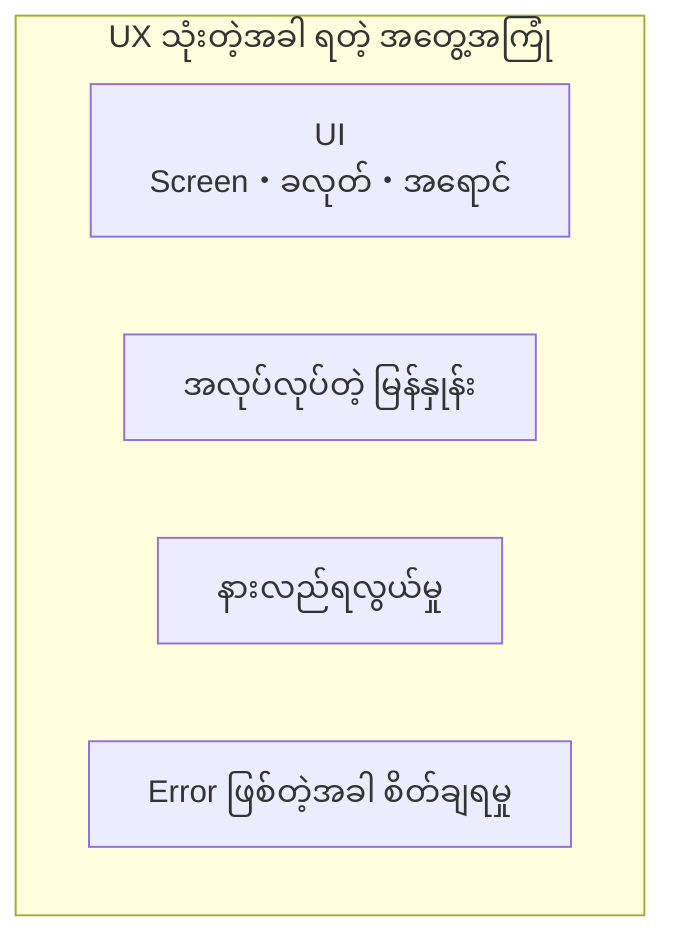
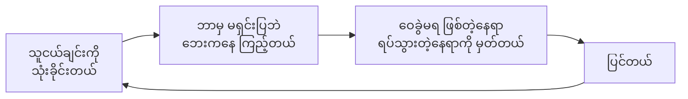

# UI・UX အကြောင်း

> 🇯🇵 မူရင်း (ဂျပန်ဘာသာဖြင့်): [UI_UXについて.md](<../../../2年生_システム開発実践/後期/2026_10_30/UI_UXについて.md>) <!-- original-ja-link -->

App အကြောင်း ပြောတဲ့အခါ **UI (ယူအိုင်)** နဲ့ **UX (ယူအိတ်ခ်စ်)** ဆိုတဲ့ စကားလုံးတွေ မကြာခဏ ပေါ်လာပါတယ်။
နှစ်ခုလုံး "သုံးတဲ့သူ" နဲ့ သက်ဆိုင်တဲ့ စကားလုံးတွေ ဖြစ်ပေမဲ့ အဓိပ္ပာယ်က နည်းနည်း ကွာပါတယ်။

[ကိုယ်ပိုင် ဖန်တီးမှုသို့ ပြန်သွားရန်](../2026_10_09/2026_10_09_資料1.md)

---

## 1. တစ်ခွန်းတည်းနဲ့ ပြောရရင်

| နာမည် | အပြည့်အစုံ နာမည် | အဓိပ္ပာယ် | တစ်ခွန်းတည်းနဲ့ |
|------|----------|------|-----------|
| **UI** | User Interface (ယူဇာ အင်တာဖေ့စ်) | သုံးသူက **မြင်တွေ့ပြီး ထိတွေ့အသုံးပြုရတဲ့ အပိုင်း** (မျက်နှာပြင်・ခလုတ်・စာသား・အရောင်) | မြင်ရပုံနဲ့ အသုံးပြုပုံ |
| **UX** | User Experience (ယူဇာ အတွေ့အကြုံ) | သုံးတဲ့သူက **သုံးပြီး ခံစားရတာ** (အဆင်ပြေတယ်・ပျော်စရာကောင်းတယ်・နားလည်ရလွယ်တယ်) | သုံးတဲ့အခါ ရတဲ့ အတွေ့အကြုံ |

> 💡 **ဥပမာပေးရရင် "စားသောက်ဆိုင်"**
> - **UI** ＝ Menu စာရွက်・ပန်းကန်・စားပွဲ・ဆိုင်ရဲ့ အတွင်းအလှဆင်ပုံ
> - **UX** ＝ "ချက်ချင်း ထိုင်ခုံရတယ်" "မှာရတာ လွယ်တယ်" "စားလို့ကောင်းတယ်" "နောက်လည်း လာချင်တယ်" လို့ ခံစားရတဲ့ **အတွေ့အကြုံ တစ်ခုလုံး**
>
> Menu စာရွက်က လှပနေ (UI ကောင်း) ပေမဲ့ ဟင်းပွဲ ရောက်လာဖို့ တစ်နာရီ ကြာရင် အတွေ့အကြုံ (UX) က မကောင်းပါဘူး။

---

## 2. UI နဲ့ UX ရဲ့ ဆက်စပ်မှု

UI က UX ရဲ့ **အစိတ်အပိုင်းတစ်ခု** ပါ။
ကောင်းတဲ့ UX ဖန်တီးဖို့ ကောင်းတဲ့ UI လိုအပ်ပေမဲ့ **UI တစ်ခုတည်း ကောင်းရုံနဲ့ UX မကောင်းလာပါဘူး**။

| ဥပမာ | UI | UX |
|----|----|----|
| ခလုတ်က မိုက်ပေမဲ့ နှိပ်လိုက်ရင် ဘာမှ တုံ့ပြန်မှု မရှိဘူး | ◯ | ✕ |
| ရိုးရိုးလေး ပုံစံဖြစ်ပေမဲ့ လိုချင်တဲ့ အချက်အလက်ဆီ ချက်ချင်း ရောက်နိုင်တယ် | △ | ◯ |
| ထည့်ထားတဲ့ data တွေ error ကြောင့် အားလုံး ပျောက်သွားတယ် | — | ✕✕ |

---

## 3. ကောင်းတဲ့ UI ရဲ့ အဓိကအချက်

### ① တူညီအောင် လုပ်ပါ (Consistency)

အဓိပ္ပာယ်တူတဲ့ အရာတွေကို **ပုံစံတူအောင် လုပ်ပြီး နေရာတူမှာ** ထားပါ။

| ✕ မကောင်းဘူး | ◯ ကောင်းတယ် |
|----------|-------|
| စာမျက်နှာပေါ် မူတည်ပြီး "保存" (သိမ်းဆည်းရန်) ခလုတ်ရဲ့ အရောင်နဲ့ နေရာ မတူဘူး | "保存" ခလုတ်က ဘယ်စာမျက်နှာမှာမဆို **အရောင်တူ・နေရာတူ** |
| "登録" (မှတ်ပုံတင်ရန်)၊ "追加" (ထည့်ရန်)၊ "作成" (ဖန်တီးရန်) ဆိုပြီး အဓိပ္ပာယ်တူ စကားလုံးတွေ ကွဲပြားနေတယ် | စကားလုံးကို **တစ်ခုတည်း သုံးအောင် ညီအောင်လုပ်တယ်** |

### ② နှိပ်လို့ရတဲ့အရာကို နှိပ်လို့ရမှန်း သိသာအောင် လုပ်ပါ

ခလုတ်တွေ၊ link တွေကို **တစ်ချက်ကြည့်ရုံနဲ့ နှိပ်လို့ရမှန်း သိနိုင်တဲ့** ပုံစံ ထားပါ။
Mouse တင်လိုက်တဲ့အခါ အရောင်ပြောင်းသွားရင် (`hover`) ပိုပြီး သိသာလာပါတယ်။

### ③ အရေးကြီးတဲ့အရာကို ထင်ရှားအောင် လုပ်ပါ

သုံးသူကို အနှိပ်စေချင်ဆုံး ခလုတ် ("保存" — သိမ်းဆည်းရန် — စသည်) ကို **အရောင်ရင့်** နဲ့၊ ကျန်တာ ("キャンセル" — ပယ်ဖျက်ရန် — စသည်) ကို **အရောင်ဖျော့** နဲ့ ထားပါ။
အားလုံး ထင်ရှားနေရင် **ဘယ်ဟာမှ မထင်ရှားတော့** ပါဘူး။

### ④ ဖတ်ရလွယ်အောင် လုပ်ပါ

- စာလုံးနဲ့ နောက်ခံအရောင် ကွာခြားမှု (**Contrast**) ကို ကောင်းကောင်း ထားပါ (မီးခိုးရောင်ဖျော့ စာလုံးက ဖတ်ရခက်တယ်)
- စာလုံးကို အရမ်း မသေးပါစေနဲ့
- ကွက်လပ် (Space) ထားပြီး အရမ်း မကျပ်ပါစေနဲ့

---

## 4. ကောင်းတဲ့ UX ရဲ့ အဓိကအချက်

### ① တုံ့ပြန်မှု ပြန်ပေးပါ (Feedback)

ခလုတ်နှိပ်လိုက်ရင် **ဘာဖြစ်သွားလဲဆိုတာ အသိပေးပါ**။ တုံ့ပြန်မှု မရှိရင် သုံးတဲ့သူက "နှိပ်လို့ ရသွားရဲ့လား?" လို့ စိုးရိမ်ပြီး အကြိမ်ကြိမ် နှိပ်မိသွားပါတယ်။

| အခြေအနေ | Feedback ဥပမာ |
|-----|----------------|
| သိမ်းနေတုန်း | "保存中…" (သိမ်းဆည်းနေသည်…) လို့ ပြတယ်・ခလုတ်ကို နှိပ်လို့မရအောင် လုပ်တယ် |
| သိမ်းပြီးသွားရင် | "保存しました" (သိမ်းဆည်းပြီးပါပြီ) လို့ ပြတယ် |
| Error | **ဘာက မှားနေလဲ၊ ဘယ်လို လုပ်ရမလဲ** ဆိုတာကို ပြတယ် |

### ② Error ကို နားလည်ရလွယ်အောင် လုပ်ပါ

| ✕ မကောင်းဘူး | ◯ ကောင်းတယ် |
|----------|-------|
| `Error 422` | "タイトルを入力してください" (ခေါင်းစဉ် ထည့်ပေးပါ) |
| Error ဖြစ်သွားရင် ထည့်ထားတဲ့ အကြောင်းအရာ အားလုံး ပျောက်သွားတယ် | ထည့်ထားတဲ့ အကြောင်းအရာကို **ဒီအတိုင်း ထားပြီး** error ဖြစ်တဲ့နေရာကို အနီရောင် ပြတယ် |

### ③ ပြန်လည်ပယ်ဖျက်လို့ မရတဲ့ လုပ်ဆောင်ချက်ကို အတည်ပြုပါ

**ဖျက်ခြင်း** လို ပြန်ပြင်လို့ မရတဲ့ လုပ်ဆောင်ချက်အတွက် "本当に削除しますか？" (တကယ် ဖျက်မှာလား?) လို့ အတည်ပြုပါ။

### ④ အဆင့်နည်းနည်းနဲ့ ပြီးအောင် လုပ်ပါ

မကြာခဏ သုံးတဲ့ လုပ်ဆောင်ချက် လေလေ **click နည်းနည်း** နဲ့ လုပ်နိုင်အောင် လုပ်ပါ။
"မှတ်တမ်းတင်တိုင်း စာမျက်နှာ 3 ခု ကူးရတဲ့" app ကို တဖြည်းဖြည်း မသုံးကြတော့ပါဘူး။

---

## 5. ကိုယ့် app မှာ စစ်ဆေးနည်း

အကောင်းဆုံးနည်းက **တခြားသူကို သုံးခိုင်းတာ** ပါ။

- ဖန်တီးတဲ့သူကိုယ်တိုင်က သုံးနည်းကို သိနေလို့ **နားလည်ရခက်တဲ့နေရာကို သတိမထားမိပါဘူး**
- သုံးနေတဲ့သူ **ရပ်သွားတဲ့နေရာ・ဝေခွဲမရ ဖြစ်တဲ့နေရာ** က ပြင်ရမယ့်နေရာ ဖြစ်ပါတယ်
- နှုတ်နဲ့ ရှင်းပြချင်လာရင် အဲဒါက **မျက်နှာပြင်ကနေတစ်ဆင့် နားလည်အောင် မဖော်ပြနိုင်သေးဘူး** ဆိုတဲ့ လက္ခဏာပါ

---

## 6. အနှစ်ချုပ်

- **UI** ＝ မျက်နှာပြင်・ခလုတ်・အရောင် စတဲ့ **မြင်တွေ့ပြီး ထိတွေ့အသုံးပြုရတဲ့ အပိုင်း**
- **UX** ＝ သုံးတဲ့အခါ **ခံစားရတာ・အတွေ့အကြုံ တစ်ခုလုံး**
- UI က UX ရဲ့ အစိတ်အပိုင်းတစ်ခု။ **ပုံစံ ကောင်းရုံနဲ့ ကောင်းတဲ့ အတွေ့အကြုံ မဖြစ်လာဘူး**
- ကောင်းတဲ့ UI: **တူညီအောင်・နှိပ်လို့ရမှန်း သိသာအောင်・အရေးကြီးတာကို ထင်ရှားအောင်・ဖတ်ရလွယ်အောင်**
- ကောင်းတဲ့ UX: **တုံ့ပြန်မှု ပြန်ပေး・Error ကို နားလည်ရလွယ်အောင်・ပြန်လည်ပယ်ဖျက်လို့မရတာကို အတည်ပြု・အဆင့်နည်းနည်း**
- အကောင်းဆုံး စစ်ဆေးနည်းက **တခြားသူကို သုံးခိုင်းတာ**

[ကိုယ်ပိုင် ဖန်တီးမှုသို့ ပြန်သွားရန်](../2026_10_09/2026_10_09_資料1.md)
