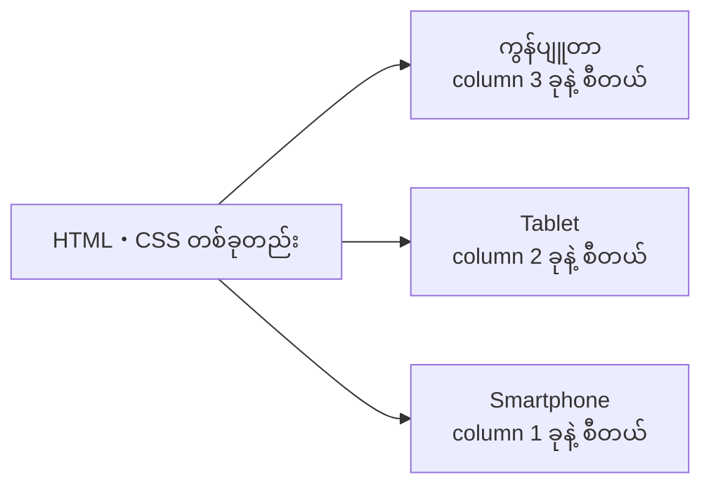
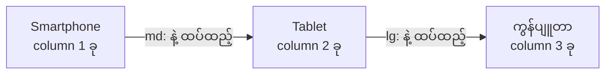
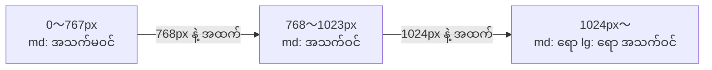
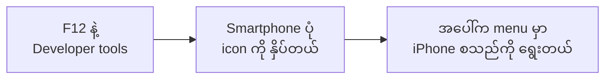

# Responsive design အကြောင်း

> 🇯🇵 မူရင်း (ဂျပန်ဘာသာဖြင့်): [レスポンシブデザインについて.md](<../../../2年生_システム開発実践/後期/2026_11_06/レスポンシブデザインについて.md>) <!-- original-ja-link -->

Website တွေကို ကွန်ပျူတာ・tablet・smartphone စတဲ့ **အရွယ်အစား အမျိုးမျိုးရှိတဲ့ screen** တွေမှာ ကြည့်ကြပါတယ်။
စာမျက်နှာတစ်ခုကို **ဘယ် screen မှာမဆို ကြည့်ရလွယ်အောင် ပြပေးတဲ့** ဖန်တီးပုံကို **Responsive design** လို့ ခေါ်ပါတယ်။

[ကိုယ်ပိုင် ဖန်တီးမှုသို့ ပြန်သွားရန်](../2026_10_09/2026_10_09_資料1.md)

---

## 1. Responsive design ဆိုတာ ဘာလဲ

**Responsive** ဆိုတာ "တုံ့ပြန်တယ်" ဆိုတဲ့ အဓိပ္ပာယ်ပါ။
Screen ရဲ့ **အကျယ် (width)** ကို တုံ့ပြန်ပြီး layout ကို အလိုအလျောက် ပြောင်းပေးပါတယ်။



> 💡 **အရင်က "Smartphone အတွက် site" ကို သီးသန့် ဖန်တီးခဲ့ကြတယ်**
> အရင်တုန်းက ကွန်ပျူတာအတွက် စာမျက်နှာနဲ့ smartphone အတွက် စာမျက်နှာ (`m.〇〇.com` စသည်) ကို **သီးခြားစီ** ဖန်တီးတာမျိုး ရှိခဲ့ပါတယ်။
> ဒီလိုဆိုရင် ပြင်တိုင်း **နှစ်ခုလုံးကို ပြင်ရ** ပါတယ်။ Responsive design ဆိုရင် **တစ်ခုပဲ ပြင်ရုံ** နဲ့ ရပါတယ်။

---

## 2. ဘာကြောင့် အရေးကြီးတာလဲ?

- အခုခေတ်မှာ website ကို **smartphone နဲ့ ကြည့်တဲ့သူ အရမ်းများ** တယ်
- ကုမ္ပဏီက လူတွေလည်း portfolio ရဲ့ URL ကို **smartphone နဲ့ ဖွင့်ကြည့်** နိုင်တယ်
- Smartphone နဲ့ ကြည့်တဲ့အခါ စာလုံးတွေ အရမ်းသေးနေရင်၊ ဘေးဘက်ကို ကျော်ထွက်နေရင် **အဲဒါတစ်ခုတည်းနဲ့တင် အထင်အမြင် ကျသွားတယ်**

---

## 3. အလုပ်လုပ်ပုံ ① viewport

Smartphone ရဲ့ browser က ဘာမှ မသတ်မှတ်ထားရင် **ကွန်ပျူတာအတွက် စာမျက်နှာကို ချုံ့ပြီး** ပြပါတယ် (စာလုံးတွေ အရမ်း သေးသွားတယ်)။
အဲဒါကို ကာကွယ်ပေးတာက HTML ရဲ့ `<head>` ထဲမှာ ရေးတဲ့ **viewport** setting ပါ။

```html
<meta name="viewport" content="width=device-width, initial-scale=1">
```

| အပိုင်း | အဓိပ္ပာယ် |
|-----|------|
| `width=device-width` | စာမျက်နှာရဲ့ အကျယ်ကို **အဲဒီ device ရဲ့ screen အကျယ်** နဲ့ ကိုက်အောင် လုပ်တယ် |
| `initial-scale=1` | အစမှာ **ချဲ့ခြင်း・ချုံ့ခြင်း မလုပ်ဘဲ** (မူလအရွယ်အတိုင်း) ပြတယ် |

> 📝 **Next.js က အလိုအလျောက် ထည့်ပေးတယ်**
> Next.js (App Router) မှာ ဒီ viewport setting က **အစကတည်းက အလိုအလျောက်** ပါပြီးသားပါ။
> Laravel ရဲ့ Blade နဲ့ ဖန်တီးတဲ့အခါ layout file ထဲမှာ ကိုယ်တိုင် ရေးပါ (`laravel new` နဲ့ ဖန်တီးထားတဲ့ စာမျက်နှာမှာ အစကတည်းက ပါပြီးသားပါ)။

---

## 4. အလုပ်လုပ်ပုံ ② Media query

**Media query** ဆိုတာ "Screen အကျယ်က 〇〇px နဲ့ အထက် ဖြစ်တဲ့အခါမှသာ ဒီ CSS ကို သုံးမယ်" လို့ သတ်မှတ်တဲ့ ရေးနည်းပါ။

```css
/* ပုံမှန် (smartphone) ဆိုရင် column 1 ခု */
.cards {
  display: grid;
  grid-template-columns: 1fr;
}

/* Screen အကျယ် 768px နဲ့ အထက်ဆိုရင် column 2 ခု */
@media (min-width: 768px) {
  .cards {
    grid-template-columns: 1fr 1fr;
  }
}

/* 1024px နဲ့ အထက်ဆိုရင် column 3 ခု */
@media (min-width: 1024px) {
  .cards {
    grid-template-columns: 1fr 1fr 1fr;
  }
}
```

ဒီလို layout ကို ပြောင်းလဲမယ့် **screen အကျယ် သတ်မှတ်ချက်** ကို **Breakpoint** လို့ ခေါ်ပါတယ်။

---

## 5. Tailwind CSS နဲ့ ရေးရင်

Tailwind CSS မှာ class နာမည်ရှေ့မှာ `md:` ဒါမှမဟုတ် `lg:` ထည့်ရုံနဲ့ media query နဲ့ အတူတူ လုပ်နိုင်ပါတယ်။

```html
<div class="grid grid-cols-1 md:grid-cols-2 lg:grid-cols-3 gap-4">
  <div>カード1</div>
  <div>カード2</div>
  <div>カード3</div>
</div>
```

| ရေးနည်း | ဘယ်အချိန်မှာ သုံးလဲ? |
|-------|------------|
| `grid-cols-1` | **အမြဲတမ်း** (Smartphone) |
| `sm:` | အကျယ် **640px နဲ့ အထက်** ဖြစ်တဲ့အခါ |
| `md:grid-cols-2` | အကျယ် **768px နဲ့ အထက်** ဖြစ်တဲ့အခါ (Tablet လောက်) |
| `lg:grid-cols-3` | အကျယ် **1024px နဲ့ အထက်** ဖြစ်တဲ့အခါ (ကွန်ပျူတာ လောက်) |

---

## 6. Mobile first

အပေါ်က ဥပမာ နှစ်ခုလုံးမှာ **smartphone ရဲ့ ပုံစံကို အရင်ရေးပြီး** screen ကြီးလာတဲ့အခါ ပြောင်းလဲမှုကို **နောက်မှ ထပ်ထည့်** ထားပါတယ်။
ဒီစဉ်းစားပုံကို **Mobile first** လို့ ခေါ်ပါတယ်။



- Screen သေးရင် ပြနိုင်တဲ့အရာ နည်းလို့ **တကယ်လိုအပ်တာကိုပဲ** စဉ်းစားရတယ်
- Screen သေးမှာ သေသေသပ်သပ် ပြထားတဲ့ layout ကို screen ကြီးအတွက် ချဲ့ပြင်ရတာက **ပိုလွယ်တယ်**

> ⚠️ **Tailwind ရဲ့ `md:` က "md နဲ့ အထက်" လို့ အဓိပ္ပာယ်ရတယ်**
> `md:hidden` က "Tablet မှာ **ပဲ** ဖျောက်မယ်" မဟုတ်ဘဲ "768px **နဲ့ အထက်** ဆိုရင် ဖျောက်မယ်" ဖြစ်ပါတယ်။
> Smartphone မှာ ပြမယ့် ပုံစံကို `md:` စတာ မထည့်တဲ့ **ပုံမှန် class** မှာ ရေးပါ။

Screen အကျယ်နဲ့ အသက်ဝင်တဲ့ class ရဲ့ ဆက်စပ်မှုက အောက်ပါအတိုင်းပါ။



---

## 7. Smartphone မှာ ပုံစံကို စစ်ဆေးပါ

Smartphone မရှိရင်တောင် **browser ရဲ့ developer tools** နဲ့ စစ်ဆေးနိုင်ပါတယ်။



| မကြာခဏ ကြုံရတဲ့ ပြဿနာ | ပြင်နည်း |
|-----------|------|
| ဘေးဘက်ကို scroll လုပ်လို့ ရနေတယ် (ကျော်ထွက်နေတယ်) | အကျယ်ကို `px` နဲ့ ပုံသေ သတ်မှတ်ထားတဲ့ element ရှိမရှိ ရှာပါ။ ပုံတွေအတွက် `max-width: 100%` |
| ခလုတ်က သေးလို့ နှိပ်ရခက်တယ် | လက်ချောင်းနဲ့ နှိပ်ရလွယ်တဲ့ အရွယ် (**44px လောက်**) ထားပါ |
| ဇယား (Table) က ဘေးဘက်ကို ကျော်ထွက်နေတယ် | ဇယားကို ဘေးဘက် scroll လုပ်လို့ရတဲ့ box ထဲ ထည့်ပါ၊ ဒါမှမဟုတ် smartphone မှာ card ပုံစံ ပြောင်းပါ |
| စာလုံး အရမ်း သေးတယ် | စာကိုယ်ရဲ့ အရွယ်အစားကို **16px လောက်** ထားပါ |

> 💡 Deploy သင်တန်းက လူတွေ Vercel ရဲ့ URL ကို **ကိုယ့် smartphone နဲ့ ဖွင့်ပြီး** စစ်ဆေးကြည့်ပါ။

---

## 8. အနှစ်ချုပ်

- **Responsive design** ＝ စာမျက်နှာတစ်ခုကို **screen အကျယ်နဲ့ ကိုက်အောင်** ကြည့်ရလွယ်အောင် ပြောင်းပေးတဲ့ ဖန်တီးပုံ
- **viewport** setting နဲ့ smartphone မှာလည်း **မူလအရွယ်အတိုင်း** ပြတယ် (Next.js က အလိုအလျောက်)
- **Media query** နဲ့ "〇〇px နဲ့ အထက်ဆိုရင် ဒီ CSS" လို့ သတ်မှတ်တယ်။ Layout ပြောင်းလဲမယ့် အကျယ် သတ်မှတ်ချက်ကို **Breakpoint** လို့ ခေါ်တယ်
- Tailwind CSS မှာ `md:` `lg:` ထည့်ရုံပဲ
- **Mobile first**: Smartphone ရဲ့ ပုံစံကို အရင် ဖန်တီးပြီး screen ကြီးအတွက် ပြောင်းလဲမှုကို ထပ်ထည့်တယ်
- စစ်ဆေးတာကို **developer tools** နဲ့ **ကိုယ့် smartphone** နဲ့ လုပ်ပါ

[ကိုယ်ပိုင် ဖန်တီးမှုသို့ ပြန်သွားရန်](../2026_10_09/2026_10_09_資料1.md)
