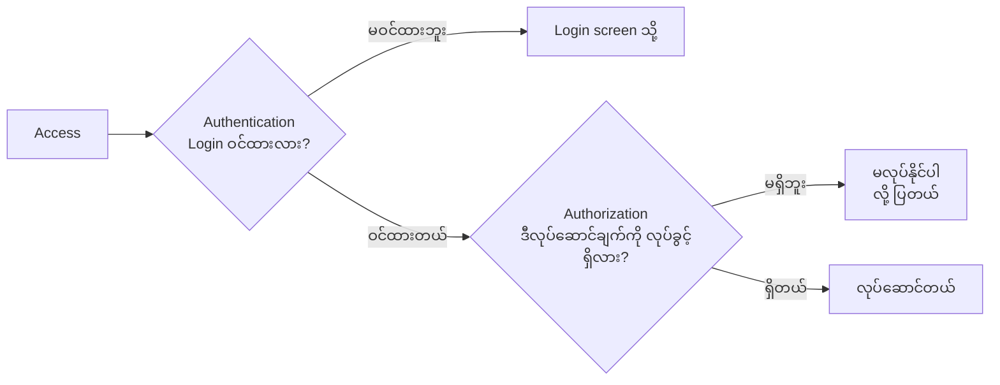
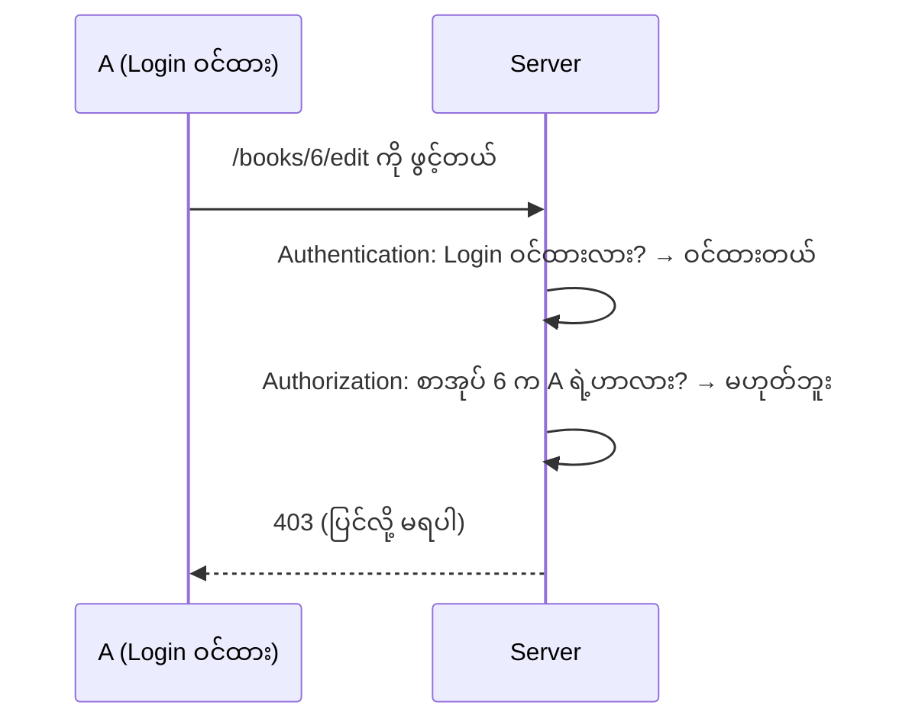
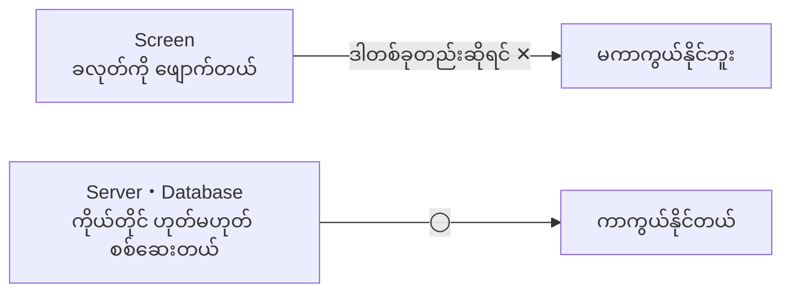

# Authentication နဲ့ Authorization အကြောင်း

> 🇯🇵 မူရင်း (ဂျပန်ဘာသာဖြင့်): [認証と認可について.md](<../../../2年生_システム開発実践/後期/2026_11_13/認証と認可について.md>) <!-- original-ja-link -->

Login လုပ်ဆောင်ချက် ဖန်တီးတဲ့အခါ **Authentication (認証)** နဲ့ **Authorization (認可)** ဆိုတဲ့ စကားလုံး ၂ ခု ပေါ်လာပါတယ်။
ဂျပန်လိုဆိုရင် ခန်းဂျီး တစ်လုံးပဲ ကွာပေမဲ့ လုပ်ဆောင်တာက မတူပါဘူး။

[ကိုယ်ပိုင် ဖန်တီးမှုသို့ ပြန်သွားရန်](../2026_10_09/2026_10_09_資料1.md)

---

## 1. တစ်ခွန်းတည်းနဲ့ ပြောရရင်

| နာမည် | အင်္ဂလိပ် | စစ်ဆေးတဲ့အရာ | တစ်ခွန်းတည်းနဲ့ |
|------|-----|-----------|-----------|
| **Authentication (အထောက်အထား စိစစ်ခြင်း)** | Authentication၊ အတိုကောက် **AuthN** | **မင်း ဘယ်သူလဲ?** | ကိုယ်တိုင် ဟုတ်မဟုတ် စစ်ဆေးခြင်း |
| **Authorization (ခွင့်ပြုချက် စိစစ်ခြင်း)** | Authorization၊ အတိုကောက် **AuthZ** | **မင်း ဘာလုပ်ခွင့် ရှိလဲ?** | ခွင့်ပြုချက် စစ်ဆေးခြင်း |

> 💡 **ဥပမာပေးရရင် "Concert"**
> - **Authentication** ＝ ဝင်ပေါက်မှာ **လက်မှတ်နဲ့ မှတ်ပုံတင်** ကို ပြပြီး ကိုယ်တိုင် ဟုတ်ကြောင်း စစ်ဆေးခံရတယ်
> - **Authorization** ＝ လက်မှတ် အမျိုးအစားပေါ် မူတည်ပြီး **ဝင်လို့ရတဲ့ နေရာ သတ်မှတ်ထားတယ်** (သာမန် ထိုင်ခုံ လက်မှတ်ရှိသူက ဝန်ထမ်းသီးသန့် နေရာကို ဝင်လို့ မရဘူး)
>
> မည်သူဖြစ်ကြောင်း စစ်ဆေးပြီးဖြစ်သော်လည်း (Authentication OK) ဘယ်နေရာမဆို ဝင်လို့ရတာ မဟုတ်ပါဘူး (Authorization က သီးခြားပါ)။

---

## 2. အစီအစဉ်က "Authentication → Authorization"

**ဘယ်သူလဲဆိုတာ မသိရင် ဘာလုပ်ခွင့် ရှိလဲဆိုတာလည်း ဆုံးဖြတ်လို့ မရပါဘူး။** ဒါကြောင့် Authentication က အမြဲ အရင် လာပါတယ်။



---

## 3. ကိုယ့် app မှာ အသုံးချကြည့်ရအောင်

**စာဖတ်မှတ်တမ်း app** ရဲ့ ဥပမာနဲ့ စဉ်းစားကြည့်ပါမယ်။

| အခြေအနေ | Authentication? Authorization? | စစ်ဆေးတဲ့အရာ |
|-----|-----------|-----------|
| Email နဲ့ password နဲ့ login ဝင်တယ် | **Authentication** | တကယ်ပဲ ဒီလူလား? |
| Login မဝင်ထားတဲ့သူက 「本を登録する」（စာအုပ်မှတ်ပုံတင်ရန်）စာမျက်နှာကို ဖွင့်တယ် | **Authentication** | Login ဝင်ထားလား? → မဝင်ထားရင် login screen သို့ |
| A က **B ရဲ့** စာအုပ်အပေါ် မှတ်ချက်ကို ပြင်ဖို့ ကြိုးစားတယ် | **Authorization** | ဒီစာအုပ်ကို မှတ်ပုံတင်ခဲ့တာ ကိုယ်လား? → မဟုတ်ရင် မလုပ်နိုင်ဘူး |
| Admin ပဲ တခြားသူတွေရဲ့ post ကို ဖျက်နိုင်တယ် | **Authorization** | ဒီလူက admin လား? |

> ⚠️ **မကြာခဏ ဖြစ်တတ်တဲ့ အမှား: Authentication ပဲ လုပ်ပြီး Authorization ကို မေ့သွားတာ**
> "Login ဝင်ထားတဲ့သူပဲ ပြင်ဆင်တဲ့ စာမျက်နှာကို ဖွင့်လို့ရတယ်" ဆိုတာတစ်ခုတည်းဆိုရင် login ဝင်ထားတဲ့ **ဘယ်သူမဆို** URL ထဲက နံပါတ်ကို ပြောင်းရုံနဲ့ **တခြားသူရဲ့ data** ကို ပြင်လို့ ရသွားပါတယ်။
>
> ```
> /books/5/edit   ← ကိုယ့်စာအုပ်
> /books/6/edit   ← နံပါတ်ပြောင်းလိုက်ရင်… တခြားသူရဲ့ စာအုပ်?
> ```
>
> ပြင်ဆင်ခြင်း၊ ဖျက်ခြင်း လုပ်တဲ့အခါ **"ဒီ data က login ဝင်ထားတဲ့သူ ကိုယ်တိုင်ရဲ့ data လား?"** ဆိုတာကို မဖြစ်မနေ စစ်ဆေးပါ။

Authorization စစ်ဆေးမှု ရှိရင် login ဝင်ထားတဲ့သူ ဖြစ်နေရင်တောင် တခြားသူရဲ့ data ကို ပြင်ဆင်ဖို့ ကြိုးစားတာကို အောက်ပါအတိုင်း တားဆီးနိုင်ပါတယ်။



---

## 4. HTTP ရဲ့ status code

Error ဖြစ်တဲ့အခါ ပြန်ပေးတဲ့ status code ကလည်း Authentication နဲ့ Authorization အလိုက် ခွဲထားပါတယ်။

| Code | နာမည် | အဓိပ္ပာယ် |
|-------|-----|------|
| **401** | Unauthorized | **Authentication** မခံရသေး (Login မဝင်ထား・ဘယ်သူလဲ မသိ) |
| **403** | Forbidden | Authentication ခံရပြီးပေမဲ့ **Authorization** မရ (အဲဒီ လုပ်ဆောင်ချက်ကို တားမြစ်ထား) |

> 📝 401 ရဲ့ နာမည်က "Unauthorized (Authorization မရ)" ဖြစ်ပေမဲ့ အဓိပ္ပာယ်က **Authentication မခံရသေး** ပါ။ နာမည်က ရှုပ်ထွေးစေလို့ အဓိပ္ပာယ်နဲ့ မှတ်ထားပါ။

---

## 5. နည်းပညာ တစ်ခုချင်းစီမှာ ဘယ်လို လုပ်လဲ?

### Laravel ဆိုရင်

| | သုံးတဲ့အရာ | ဥပမာ |
|---|---|---|
| Authentication | `Auth`၊ middleware `auth` | Login မဝင်ထားတဲ့သူကို login screen သို့ ရွှေ့ပေးတယ် |
| Authorization | **Policy**၊ `Gate` | "စာအုပ်ကို မှတ်ပုံတင်ခဲ့တဲ့သူ ကိုယ်တိုင်ပဲ ပြင်ဆင်နိုင်တယ်" ဆိုတဲ့ စည်းမျဉ်းကို ရေးတယ် |

```php
// routes/web.php: Login ဝင်ထားတဲ့သူပဲ (Authentication)
Route::middleware('auth')->group(function () {
    Route::get('/books/{book}/edit', [BookController::class, 'edit']);
});
```

```php
// BookController: ကိုယ့်စာအုပ် ဟုတ်မဟုတ် (Authorization)
public function edit(Book $book)
{
    if ($book->user_id !== Auth::id()) {
        abort(403); // ကိုယ့်စာအုပ် မဟုတ်ရင် 403
    }

    return view('books.edit', compact('book'));
}
```

### Supabase ဆိုရင်

| | သုံးတဲ့အရာ | ဥပမာ |
|---|---|---|
| Authentication | **Supabase Auth** | Email・password ဒါမှမဟုတ် Google account နဲ့ login ဝင်တယ် |
| Authorization | **RLS (Row Level Security)** | "`user_id` က login ဝင်ထားတဲ့သူရဲ့ ID နဲ့ ကိုက်ညီတဲ့ row တွေကိုပဲ ကြည့်ရှု၊ ပြင်ဆင်နိုင်တယ်" ဆိုတဲ့ စည်းမျဉ်းကို database မှာ ရေးတယ် |

> ⚠️ **Supabase မှာ RLS က အရမ်း အရေးကြီးပါတယ်**
> Supabase က browser ကနေ **database ကို တိုက်ရိုက် access** လုပ်ပါတယ်။
> RLS ကို setting မလုပ်ထားရင် **ဘယ်သူမဆို data အားလုံးကို ကြည့်လို့・ဖျက်လို့ ရတဲ့** အခြေအနေ ဖြစ်သွားနိုင်ပါတယ်။
> Supabase ရဲ့ management screen မှာ table တစ်ခုချင်းစီအတွက် RLS က **ဖွင့်ထား (Enabled)** လား စစ်ဆေးပါ။

---

## 6. Screen ပေါ်မှာ ဖျောက်ထားရုံနဲ့ Authorization မဖြစ်ပါဘူး

"တခြားသူရဲ့ စာအုပ်မှာ ပြင်မယ် ခလုတ်ကို မပြဘူး"——ဒါက **UI ပိုင်း ကြံဆမှု** ဖြစ်ပြီး **Authorization မဟုတ်ပါဘူး**။
ခလုတ် မရှိရင်တောင် URL ကို တိုက်ရိုက် ရိုက်ထည့်တာ၊ API ကို တိုက်ရိုက် ခေါ်တာ လုပ်ရင် လုပ်ဆောင်လို့ ရသွားလို့ပါ။



**Authorization စစ်ဆေးမှုကို server ဘက် (Laravel ရဲ့ controller၊ Supabase ရဲ့ RLS စသည်) မှာ မဖြစ်မနေ လုပ်ပါ။**

---

## 7. အနှစ်ချုပ်

- **Authentication** ＝ **မင်း ဘယ်သူလဲ?** (ကိုယ်တိုင် ဟုတ်မဟုတ် စစ်ဆေးခြင်း・Login)
- **Authorization** ＝ **မင်း ဘာလုပ်ခွင့် ရှိလဲ?** (ခွင့်ပြုချက် စစ်ဆေးခြင်း)
- အစီအစဉ်က **Authentication → Authorization**
- Login မဝင်ထား → **401**၊ Login ဝင်ထားပေမဲ့ တားမြစ်ထား → **403**
- Laravel က **auth middleware＋Policy**၊ Supabase က **Supabase Auth＋RLS**
- ခလုတ်ကို ဖျောက်ရုံနဲ့ မကာကွယ်နိုင်ဘူး။ **Server ဘက်မှာ မဖြစ်မနေ စစ်ဆေး** ပါ

[ကိုယ်ပိုင် ဖန်တီးမှုသို့ ပြန်သွားရန်](../2026_10_09/2026_10_09_資料1.md)
