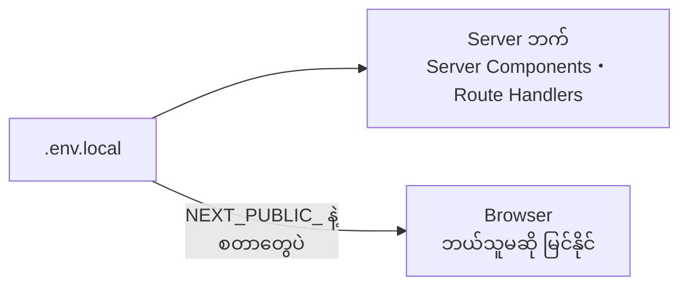
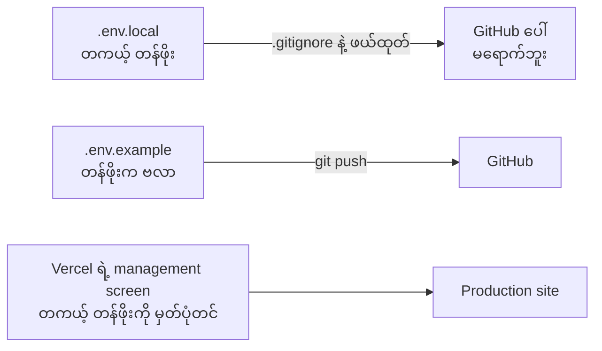

# Environment variable အကြောင်း

> 🇯🇵 မူရင်း (ဂျပန်ဘာသာဖြင့်): [環境変数について.md](<../../../2年生_システム開発実践/後期/2026_11_27/環境変数について.md>) <!-- original-ja-link -->

ကိုယ်ပိုင် ဖန်တီးမှု သင်ခန်းစာတွေမှာ "**API key နဲ့ password ကို GitHub ပေါ် မတင်ပါနဲ့**"၊ "`.env` မှာ ရေးပါ" လို့ အကြိမ်ကြိမ် ရေးခဲ့ပါတယ်။
ဒီ `.env` ထဲမှာ ရေးထားတဲ့အရာတွေက **Environment variable (ပတ်ဝန်းကျင် ကိန်းရှင်)** ပါ။
ဒီမှာ Environment variable ဆိုတာ ဘာလဲ၊ ဘာကြောင့် သုံးတာလဲဆိုတာကို ကြည့်သွားပါမယ်။

[ကိုယ်ပိုင် ဖန်တီးမှုသို့ ပြန်သွားရန်](../2026_10_09/2026_10_09_資料1.md)

---

## 1. Environment variable ဆိုတာ ဘာလဲ

**Environment variable** ဆိုတာ program ရဲ့ **အပြင်ဘက်** မှာ ထားတဲ့ setting တန်ဖိုး ဖြစ်ပါတယ်။
Program က run တဲ့အခါ အဲဒီတန်ဖိုးကို **ဖတ်ယူပြီး** သုံးပါတယ်။


| Environment variable ထဲ ထည့်တဲ့အရာ | ဥပမာ |
|------------------|-----|
| **လျှို့ဝှက်ရမယ့် တန်ဖိုး** | API key၊ database ရဲ့ password |
| **နေရာပေါ် မူတည်ပြီး ပြောင်းတဲ့ တန်ဖိုး** | Database ရဲ့ တည်နေရာ (ကိုယ့် PC လား production server လား)၊ API ရဲ့ URL |

> 💡 **ဥပမာပေးရရင် "အိမ်သော့"**
> အိမ်ရဲ့ **ဆောက်လုပ်ရေးပုံစံ (Blueprint)** (Program) ကို တခြားသူကို ပြလည်း ပြဿနာ မရှိပါဘူး။
> ဒါပေမဲ့ **သော့** (Password) ကိုတော့ ပုံစံကြမ်းမှာ မကပ်ထားဘဲ **သီးခြား သိမ်းထား** တယ် မဟုတ်လား။
> Environment variable က program နဲ့ သီးခြား သိမ်းထားတဲ့ **သော့** လိုမျိုးပါ။

---

## 2. ဘာကြောင့် Environment variable ကို သုံးတာလဲ?

### ① လျှို့ဝှက်ရမယ့် တန်ဖိုးကို GitHub ပေါ် မတင်ဖို့

API key ကို program ထဲ **တိုက်ရိုက် ရေးပြီး** GitHub မှာ public လုပ်လိုက်ရင် **ကမ္ဘာပေါ်က ဘယ်သူမဆို မြင်နိုင်ပါတယ်**။

```js
// ✕ အန္တရာယ်ရှိတယ်: Code ထဲမှာ တိုက်ရိုက် ရေးထားတယ်
const apiKey = "sk-abc123xyz...";
```

```js
// ◯ လုံခြုံတယ်: Environment variable ကနေ ဖတ်ယူတယ်
const apiKey = process.env.WEATHER_API_KEY;
```

> ⚠️ **GitHub ပေါ် တင်မိတဲ့ key ကို ချက်ချင်း အလွဲသုံးစား လုပ်ခံရပါတယ်**
> Public repository ပေါ် တင်ထားတဲ့ key တွေကို အလိုအလျောက် ရှာဖွေနေတဲ့ program တွေ ရှိပါတယ်။
> မှားပြီး push လုပ်မိသွားရင် **commit ကို ဖျက်ရုံနဲ့ မလုံလောက်ပါဘူး** (History ထဲမှာ ကျန်နေပါတယ်)။
> ချက်ချင်း service ရဲ့ management screen မှာ **key ကို ပိတ်ပြီး key အသစ် ပြန်ဖန်တီး** ပါ။

### ② နေရာပေါ် မူတည်ပြီး တန်ဖိုးကို ပြောင်းဖို့

Program တစ်ခုတည်း ဖြစ်ပေမဲ့ **ကိုယ့် PC** နဲ့ **Production (Vercel စသည်)** မှာ ချိတ်ဆက်ရမယ့်နေရာ မတူပါဘူး။

| | ကိုယ့် PC (Development environment) | Production environment |
|---|---|---|
| Database | ကိုယ့် PC ထဲက MySQL | Internet ပေါ်က database |
| API ရဲ့ URL | `http://localhost:8000` | `https://〇〇.com` |

Program ကို **ဒီအတိုင်းထားပြီး** Environment variable ကိုပဲ ပြောင်းလိုက်ရင် ချိတ်ဆက်ရမယ့်နေရာကို ပြောင်းနိုင်ပါတယ်။
"**Environment (ပတ်ဝန်းကျင်)** ပေါ် မူတည်ပြီး ပြောင်းတဲ့ **Variable (ကိန်းရှင်)**" ဖြစ်လို့ **Environment variable** လို့ နာမည်ပေးထားတာပါ။

---

## 3. `.env` file

Development လုပ်နေစဉ်မှာ `.env` ဆိုတဲ့ နာမည်ရှိတဲ့ file ထဲမှာ Environment variable တွေကို ရေးပါတယ်။

### Laravel ဆိုရင် (`.env`)

```
APP_NAME=BookApp
DB_HOST=127.0.0.1
DB_DATABASE=laravel
DB_USERNAME=laravel
DB_PASSWORD=password
```

```php
// ဖတ်ယူတဲ့အခါ (config file ထဲမှာ)
'database' => env('DB_DATABASE'),
```

### Next.js ဆိုရင် (`.env.local`)

```
WEATHER_API_KEY=abc123xyz
NEXT_PUBLIC_SUPABASE_URL=https://〇〇.supabase.co
```

```js
// ဖတ်ယူတဲ့အခါ
const apiKey = process.env.WEATHER_API_KEY;
```

> ⚠️ **Next.js ရဲ့ `NEXT_PUBLIC_` ကို သတိထားပါ**
> နာမည်က `NEXT_PUBLIC_` နဲ့ စတဲ့ Environment variable တွေက **browser ဆီ ပို့ပေးလိုက်လို့ ဘယ်သူမဆို မြင်နိုင်ပါတယ်**။
> **လျှို့ဝှက်ရမယ့် တန်ဖိုး (API key စသည်) မှာ `NEXT_PUBLIC_` မထည့်ပါနဲ့**။
> `NEXT_PUBLIC_` မပါတဲ့ Environment variable တွေကို server ဘက် (Server Components ဒါမှမဟုတ် Route Handlers) မှာပဲ သုံးလို့ရပါတယ်။

တန်ဖိုးက ဘယ်အထိ ရောက်သွားလဲဆိုတာကို ပုံနဲ့ ပြရရင် အောက်ပါအတိုင်းပါ။



> 📝 Supabase ရဲ့ **URL နဲ့ public key (publishable key / anon key)** က browser မှာ သုံးဖို့ ရည်ရွယ်ထားတာ ဖြစ်လို့ `NEXT_PUBLIC_` ထည့်လည်း ရပါတယ်။
> ဒါပေမဲ့ data ကို ကာကွယ်ဖို့ **RLS** ကို မဖြစ်မနေ သတ်မှတ်ထားရပါမယ် (→ [Authentication နဲ့ Authorization အကြောင်း](../2026_11_13/認証と認可について.md))။
> တစ်ဖက်မှာ **secret key / service_role key** က ဘာမဆို လုပ်နိုင်တဲ့ key ဖြစ်လို့ `NEXT_PUBLIC_` ကို ဘယ်တော့မှ မထည့်ရပါဘူး။

---

## 4. `.env` ကို GitHub ပေါ် မတင်မိအောင် လုပ်ထားတဲ့ စနစ်

`.env` က GitHub ပေါ် မရောက်သွားတာက **`.gitignore`** ထဲမှာ ရေးထားလို့ပါ။

```
# .gitignore
.env
.env*.local
```

`.gitignore` ထဲမှာ ရေးထားတဲ့ file တွေကို **Git က လျစ်လျူရှု** လို့ commit မဖြစ်ပါဘူး။
Laravel ဒါမှမဟုတ် `create-next-app` နဲ့ ဖန်တီးထားတဲ့ project တွေမှာ **အစကတည်းက ရေးထားပြီးသား** ပါ။

### `.env.example` ကို ပြင်ဆင်ထားပါ

`.env` က GitHub ပေါ် မရောက်လို့ တခြားသူ ကြည့်ရင် **ဘယ်လို Environment variable တွေ လိုအပ်လဲ** ဆိုတာ မသိနိုင်ပါဘူး။
ဒါကြောင့် **တန်ဖိုးတွေကို ဗလာထားတဲ့ နမူနာ** ဖြစ်တဲ့ `.env.example` ကို ဖန်တီးပြီး GitHub ပေါ် တင်ပါတယ်။

```
# .env.example (GitHub ပေါ် တင်မယ်)
WEATHER_API_KEY=
NEXT_PUBLIC_SUPABASE_URL=
```

> 💡 Laravel မှာ အစကတည်းက `.env.example` ပါပြီးသားပါ။ Portfolio အနေနဲ့ ပြတဲ့အခါမှာလည်း `.env.example` ရှိရင် **သေသေချာချာ လုပ်ထားတယ်** ဆိုတဲ့ အထင်အမြင် ရစေပါတယ်။

---

## 5. Production (Vercel) မှာ management screen ကနေ setting လုပ်ပါ

`.env.local` က GitHub ပေါ် မရောက်လို့ **Vercel ဆီလည်း မရောက်ပါဘူး**။
Production ရဲ့ Environment variable တွေကို Vercel ရဲ့ management screen မှာ setting လုပ်ပါတယ်။

ကိုယ့် PC・GitHub・Vercel တစ်ခုချင်းစီမှာ ဘာတွေ ထားလဲဆိုတာ စုစည်းကြည့်ရင် အောက်ပါအတိုင်း ဖြစ်ပါတယ်။



Setting လုပ်ပုံ အဆင့်တွေက အောက်ပါအတိုင်းပါ။


> ⚠️ **Environment variable ကို ထည့်・ပြောင်းပြီးရင် နောက်တစ်ကြိမ် deploy လုပ်ပါ**
> Environment variable တွေကို **deploy လုပ်တဲ့အချိန်မှာ** ဖတ်ယူပါတယ်။ Setting လုပ်ရုံနဲ့ အခု run နေတဲ့ site မှာ အကျိုးသက်ရောက်မှာ မဟုတ်ပါဘူး။

---

## 6. အနှစ်ချုပ်

- **Environment variable** ＝ Program ရဲ့ **အပြင်ဘက်** မှာ ထားတဲ့ setting တန်ဖိုး
- သုံးရတဲ့ အကြောင်းရင်းက **လျှို့ဝှက်ရမယ့် တန်ဖိုးကို ကာကွယ်** ဖို့နဲ့ **environment ပေါ် မူတည်ပြီး တန်ဖိုးကို ပြောင်း** ဖို့
- Development လုပ်နေစဉ် **`.env`** (Next.js ဆိုရင် `.env.local`) မှာ ရေးတယ်။ **`.gitignore`** ကြောင့် GitHub ပေါ် မရောက်ဘူး
- လိုအပ်တဲ့ Environment variable ရဲ့ နမူနာအဖြစ် **`.env.example`** ကို GitHub ပေါ် တင်တယ်
- Next.js ရဲ့ **`NEXT_PUBLIC_`** က browser မှာ အကုန်မြင်ရတယ်။ လျှို့ဝှက်ရမယ့် တန်ဖိုးမှာ မထည့်ပါနဲ့
- Production (Vercel) မှာ **management screen ကနေ setting လုပ်** ပြီး **နောက်တစ်ကြိမ် deploy** လုပ်ပါ
- Key ကို push လုပ်မိသွားရင် **ချက်ချင်း ပိတ်ပြီး ပြန်ဖန်တီး** ပါ

[ကိုယ်ပိုင် ဖန်တီးမှုသို့ ပြန်သွားရန်](../2026_10_09/2026_10_09_資料1.md)
