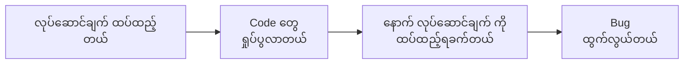
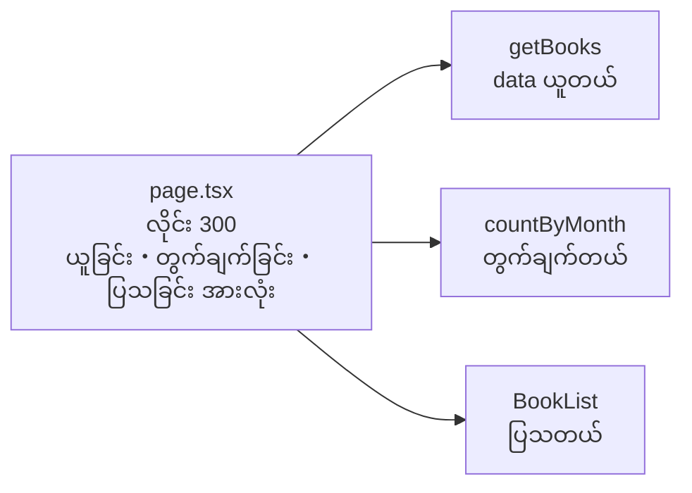
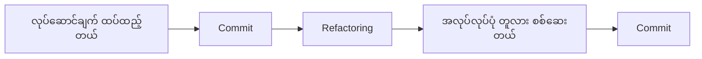

# Refactoring အကြောင်း

> 🇯🇵 မူရင်း (ဂျပန်ဘာသာဖြင့်): [リファクタリングについて.md](<../../../2年生_システム開発実践/後期/2026_12_04/リファクタリングについて.md>) <!-- original-ja-link -->

လုပ်ဆောင်ချက် တွေကို တစ်ခုပြီးတစ်ခု ထပ်ထည့်သွားရင် code တွေ ရှည်လာပြီး **ဘယ်နေရာမှာ ဘာရေးထားလဲ မသိတော့တဲ့** အခြေအနေ ဖြစ်လာပါတယ်။
အဲဒီလို အချိန်မှာ လုပ်ရတာက **Refactoring** ပါ။

[ကိုယ်ပိုင် ဖန်တီးမှုသို့ ပြန်သွားရန်](../2026_10_09/2026_10_09_資料1.md)

---

## 1. Refactoring ဆိုတာ ဘာလဲ

**Refactoring** ဆိုတာ **app ရဲ့ အလုပ်လုပ်ပုံကို မပြောင်းဘဲ** code ရဲ့ **အတွင်းပိုင်းကို ဖတ်ရလွယ်・ပြင်ရလွယ်အောင် စနစ်တကျ ပြန်စီတာ** ဖြစ်ပါတယ်။

| | အလုပ်လုပ်ပုံ (သုံးတဲ့သူ မြင်ရတာ) | Code ရဲ့ အတွင်းပိုင်း |
|---|---|---|
| လုပ်ဆောင်ချက် ထပ်ထည့်တာ | **ပြောင်းတယ်** | ပြောင်းတယ် |
| Bug ပြင်တာ | **ပြောင်းတယ်** (မှန်ကန်လာတယ်) | ပြောင်းတယ် |
| **Refactoring** | **မပြောင်းဘူး** | ပြောင်းတယ် (သပ်ရပ်လာတယ်) |

> 💡 **ဥပမာပေးရရင် "အခန်း ရှင်းလင်းတာ"**
> အခန်းကို ရှင်းလင်းလိုက်လည်း ကိုယ့်မှာရှိတဲ့ ပစ္စည်း (လုပ်နိုင်တာ) တွေက မပြောင်းပါဘူး။
> ဒါပေမဲ့ ဘယ်နေရာမှာ ဘာရှိလဲ သိလာလို့ **နောက်တစ်ခါ တစ်ခုခု ရှာတဲ့အခါ・ပစ္စည်းအသစ် ထားတဲ့အခါ လွယ်ကူ** လာပါတယ်။

---

## 2. ဘာကြောင့် Refactoring လုပ်တာလဲ?



- Code တွေ ရှုပ်ပွနေရင် **နောက် လုပ်ဆောင်ချက် ထပ်ထည့်ဖို့ အချိန်ကြာတယ်**
- တူညီတဲ့ code တွေ နေရာအနှံ့ ရှိနေရင် **တစ်နေရာကို ပြင်ဖို့ မေ့ကျန်ခဲ့ပြီး** bug ဖြစ်တတ်တယ်
- ခြောက်လကြာပြီးနောက်မှာ အခု ကိုယ်ရေးထားတဲ့ code ကို **မမှတ်မိသလောက် ဖြစ်နေမယ်**
- Portfolio မှာ ကုမ္ပဏီက လူတွေက **code ကိုလည်း ကြည့်ပါတယ်**။ ဖတ်ရလွယ်တဲ့ code ကို ကောင်းကောင်း အကဲဖြတ်ကြပါတယ်

---

## 3. ဒီလို code မျိုးက Refactoring လုပ်ဖို့ လက္ခဏာ

ရှုပ်ပွနေတဲ့ code မှာ မကြာခဏ တွေ့ရတဲ့ ပုံစံတွေ ရှိပါတယ်။ ဒီလို လက္ခဏာမျိုးကို **Code smell** လို့ ခေါ်ပါတယ်။

| လက္ခဏာ | ဥပမာ |
|-------|-----|
| **တူညီတဲ့ code တွေ နေရာအနှံ့ ရှိနေတယ်** | Header တစ်ခုတည်းကို စာမျက်နှာအားလုံးမှာ ကူးရေးထားတယ် |
| **Function တစ်ခု・file တစ်ခု အရမ်း ရှည်တယ်** | `page.tsx` က လိုင်း 300 ရှိတယ် |
| **နာမည်က နားလည်ရခက်တယ်** | `data`၊ `tmp`၊ `a`၊ `flg` |
| **ဘာလုပ်နေလဲ မသိရတဲ့ နံပါတ်** | `if (status === 2)` (2 ဆိုတာ ဘာလဲ?) |
| **မသုံးတော့တဲ့ code** | Comment out လုပ်ပြီး ဒီအတိုင်း ထားခဲ့တဲ့ code အဟောင်း |

---

## 4. မကြာခဏ လုပ်တဲ့ Refactoring

### ① နာမည်ကို နားလည်ရလွယ်အောင် လုပ်ပါ

```js
// ✕ ဘာတွေ ပါလဲ မသိရဘူး
const d = await getData();
const l = d.filter((x) => x.r >= 4);
```

```js
// ◯ နာမည်ကို ကြည့်ရုံနဲ့ သိတယ်
const books = await getBooks();
const favoriteBooks = books.filter((book) => book.rating >= 4);
```

အလွယ်ဆုံးနဲ့ အကျိုးသက်ရောက်မှု အရှိဆုံး Refactoring ပါ။

### ② Code တူတွေကို တစ်ခုတည်း ဖြစ်အောင် စုစည်းပါ

ပထမ semester ဒါမှမဟုတ် ပထမနှစ်တုန်းက လေ့လာခဲ့တဲ့ **အစိတ်အပိုင်း (Component・`@include`)** အဖြစ် ပြောင်းတာလည်း Refactoring ပါပဲ။

```jsx
// ✕ ပုံစံတူ card ကို စာမျက်နှာ အနှံ့မှာ ရေးထားတယ်
<div className="rounded border p-4">
  <h2 className="font-bold">{book.title}</h2>
  <p>{book.author}</p>
</div>
```

```jsx
// ◯ BookCard ဆိုတဲ့ အစိတ်အပိုင်း လုပ်ပြီး ဘယ်နေရာမှာမဆို သုံးတယ်
<BookCard book={book} />
```

ဒီလို လုပ်ထားရင် card ရဲ့ ပုံစံကို ပြောင်းချင်တဲ့အခါ **တစ်နေရာတည်း ပြင်ရုံ** နဲ့ ရပါတယ်။
တစ်ခုတည်းကို ထပ်ခါထပ်ခါ မလုပ်ဘူး ဆိုတဲ့ စဉ်းစားပုံကို **DRY (ဒရိုင်း)** (Don't Repeat Yourself) လို့ ခေါ်ပါတယ်။

### ③ အဓိပ္ပာယ်မသိရတဲ့ နံပါတ်ကို နာမည်ပေးပါ

```js
// ✕ 2 က ဘာကို ကိုယ်စားပြုလဲ မသိရဘူး
if (book.status === 2) { ... }
```

```js
// ◯ နာမည်ပေးတယ်
const STATUS_FINISHED = 2; // ဖတ်ပြီးသွားပြီ
if (book.status === STATUS_FINISHED) { ... }
```

### ④ ရှည်လျားတဲ့ function・file ကို ခွဲပါ

Function တစ်ခုက **အလုပ်အမျိုးမျိုး လုပ်နေတဲ့** အခါ အလုပ်တစ်ခုချင်းစီအလိုက် ခွဲပါ။



---

## 5. Refactoring ရဲ့ စည်းမျဉ်း

### စည်းမျဉ်း ① အရင်ဆုံး commit လုပ်ထားပါ

Refactoring မလုပ်ခင် **အလုပ်လုပ်နေတဲ့ အခြေအနေကို commit** လုပ်ထားပါ။
ပျက်သွားရင်တောင် ချက်ချင်း **မူလအတိုင်း ပြန်ယူနိုင်ပါတယ်**။

### စည်းမျဉ်း ② လုပ်ဆောင်ချက် ထပ်ထည့်တာနဲ့ တစ်ပြိုင်နက် မလုပ်ပါနဲ့

"လုပ်ဆောင်ချက် ထပ်ထည့်ရင်း ပြန်စီတာပါ လုပ်မယ်" ဆိုရင် အလုပ်မလုပ်တော့တဲ့အခါ **ဘယ်ဟာက အကြောင်းရင်းလဲ မသိတော့** ပါဘူး။



### စည်းမျဉ်း ③ နည်းနည်းချင်း လုပ်ပါ

တစ်ခါတည်းနဲ့ အားလုံး ပြင်ဖို့ မကြိုးစားဘဲ **တစ်ခု ပြင်ပြီးရင် စစ်ဆေး** ဆိုတာကို ထပ်ခါထပ်ခါ လုပ်ပါ။

### စည်းမျဉ်း ④ ပြီးရင် အလုပ်လုပ်ပုံ မပြောင်းသွားဘူးလား စစ်ဆေးပါ

Refactoring က **အလုပ်လုပ်ပုံကို မပြောင်းရဘူး** ဆိုတာ စည်းမျဉ်းပါ။
ပြင်ပြီးရင် **အရင်အတိုင်း အလုပ်လုပ်ရဲ့လား** ဆိုတာကို မဖြစ်မနေ စစ်ဆေးပါ။
ဒီစစ်ဆေးမှုကို အလိုအလျောက် လုပ်ပေးတာက နောက်တစ်ကြိမ်မှာ လေ့လာမယ့် **Test** ပါ။

---

## 6. AI ကို Refactoring ကူညီခိုင်းပါ

AI ကို "ဒီ code ကို ဖတ်ရလွယ်အောင် refactoring လုပ်ပေးပါ" လို့ တောင်းဆိုရင် စနစ်တကျ ပြန်စီထားတဲ့ code ကို ထုတ်ပေးပါတယ်။
ဒါပေမဲ့ အောက်ပါအချက်တွေကို သတိထားပါ။

- **အလုပ်လုပ်ပုံ မပြောင်းသွားဘူးလား** ဆိုတာ ကိုယ်တိုင် စစ်ဆေးပါ (AI ကလည်း မှားတတ်ပါတယ်)
- **ဘာကြောင့် ဒီလို ပြင်ခဲ့တာလဲ** ဆိုတာ နားလည်ပြီးမှ သုံးပါ။ ရှင်းမပြနိုင်တဲ့ code ဆိုရင် အင်တာဗျူးမှာ မေးခံရတဲ့အခါ ဒုက္ခရောက်ပါမယ်
- တစ်ခါတည်း အများကြီး မတောင်းဆိုဘဲ **file တစ်ခုချင်း・function တစ်ခုချင်း** တောင်းဆိုပါ

---

## 7. အနှစ်ချုပ်

- **Refactoring** ＝ **အလုပ်လုပ်ပုံကို မပြောင်းဘဲ** code ကို ဖတ်ရလွယ်・ပြင်ရလွယ်အောင် စနစ်တကျ ပြန်စီတာ
- လက္ခဏာတွေက **Code တူ နေရာအနှံ့・အရမ်းရှည်・နာမည် နားလည်ရခက်・အဓိပ္ပာယ်မသိရတဲ့ နံပါတ်**
- မကြာခဏ လုပ်တာက **နာမည်ပြောင်း・အစိတ်အပိုင်းအဖြစ် စုစည်း (DRY)・နံပါတ်ကို နာမည်ပေး・ခွဲ**
- **အရင် commit**・**လုပ်ဆောင်ချက် ထပ်ထည့်တာနဲ့ တစ်ပြိုင်နက် မလုပ်**・**နည်းနည်းချင်း**・**အလုပ်လုပ်ပုံ တူလား စစ်ဆေး**
- AI ကို သုံးတဲ့အခါမှာလည်း **နားလည်ပြီးမှ** သုံးပါ

[ကိုယ်ပိုင် ဖန်တီးမှုသို့ ပြန်သွားရန်](../2026_10_09/2026_10_09_資料1.md)
