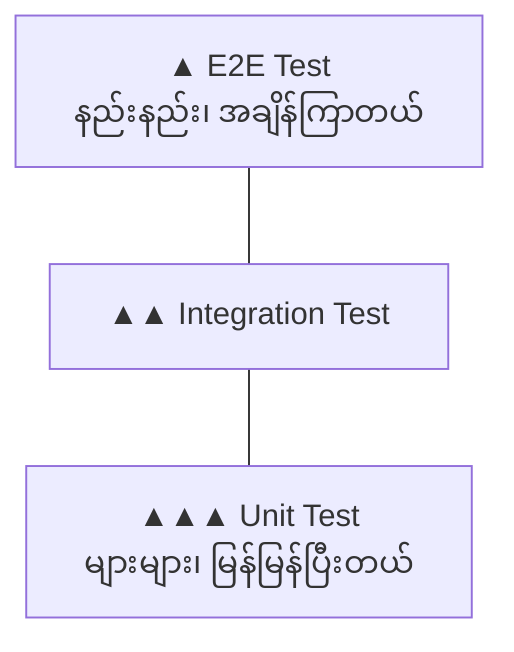

# Test အကြောင်း

> 🇯🇵 မူရင်း (ဂျပန်ဘာသာဖြင့်): [テストについて.md](<../../../2年生_システム開発実践/後期/2026_12_11/テストについて.md>) <!-- original-ja-link -->

App တစ်ခု ရေးပြီးရင် **မှန်မှန်ကန်ကန် အလုပ်လုပ်ရဲ့လား** ဆိုတာ စစ်ဆေးရပါတယ်။ ဒါကို **Test** လို့ ခေါ်ပါတယ်။
ဒီမှာတော့ Test အမျိုးအစားတွေနဲ့ Test ကို **အလိုအလျောက်** လုပ်ပေးတဲ့ စနစ်ကို လေ့လာကြည့်ပါမယ်။

[ကိုယ်ပိုင် ဖန်တီးမှုသို့ ပြန်သွားရန်](../2026_10_09/2026_10_09_資料1.md)

---

## 1. Test ဆိုတာ ဘာလဲ

**Test** ဆိုတာ ပရိုဂရမ်က **ကိုယ်ထင်ထားတဲ့အတိုင်း အလုပ်လုပ်ရဲ့လား** ဆိုတာ စစ်ဆေးခြင်း ဖြစ်ပါတယ်။

ကျောင်းသားတွေလည်း code ရေးပြီးတိုင်း **browser မှာ စာမျက်နှာကို ဖွင့်ပြီး ခလုတ်ကို နှိပ်ကြည့်ပြီး** စစ်ဆေးနေကြတယ် မဟုတ်လား။
ဒါလည်း Test လုပ်တာ တစ်မျိုးပါပဲ။ လူက ကိုယ်တိုင်လုပ်တာမို့ **Manual Test** လို့ ခေါ်ပါတယ်။

| | Manual Test | Automated Test |
|---|---|---|
| လုပ်ပုံ | လူက စာမျက်နှာကို ကိုင်တွယ်ပြီး စစ်ဆေးတယ် | **Test အတွက် ရေးထားတဲ့ ပရိုဂရမ်** က စစ်ဆေးတယ် |
| အချိန် | စစ်ရမယ့်အရာ များလာလေ **အချိန်ကြာလေ** | ရာနဲ့ချီ ရှိရင်တောင် **စက္ကန့်အနည်းငယ် ~ မိနစ်အနည်းငယ်** |
| စစ်ဖို့ မေ့တာ | ရှိတယ် | **မရှိဘူး** (အကြိမ်တိုင်း တူညီတာကို လုပ်တယ်) |

---

## 2. Automated Test က ဘာကြောင့် အရေးကြီးတာလဲ

လုပ်ဆောင်ချက် အသစ် ထည့်တာ၊ [Refactoring](../2026_12_04/リファクタリングについて.md) လုပ်တာ စတာတွေ လုပ်တဲ့အခါ **အရင်က ကောင်းကောင်း အလုပ်လုပ်ခဲ့တဲ့ နေရာက ပျက်သွား** တတ်ပါတယ်။
ဒါကို **Regression** (Degrade၊ နောက်ပြန်ဆုတ်ခြင်း) လို့ ခေါ်ပါတယ်။


လုပ်ဆောင်ချက် တွေ တိုးလာတိုင်း **လုပ်ဆောင်ချက် အားလုံးကို လက်နဲ့ ပြန်စစ်နေရတာ** က တော်တော် ပင်ပန်းပါတယ်။
Automated Test ရှိရင် command တစ်ခုတည်းနဲ့ **အားလုံးကို တစ်ခါတည်း ပြန်စစ်လို့ ရပါတယ်**။

> 💡 **ဥပမာပေးရရင် "စာမေးပွဲ အဖြေတိုက်စစ်တာ"**
> "ဒီမေးခွန်းရဲ့ အဖြေက 〇〇" ဆိုတဲ့ **အဖြေ (မျှော်လင့်ထားတဲ့ ရလဒ်)** ကို ကြိုသတ်မှတ်ထားရင်
> နောက်ပိုင်းမှာ **အဖြေနဲ့ ကိုက်ညီရဲ့လား** ဆိုတာကိုပဲ စက်က စစ်ပေးရုံပါပဲ။

---

## 3. Test အမျိုးအစားများ

Test တွေကို **စစ်ဆေးမယ့် အစိတ်အပိုင်းရဲ့ အရွယ်အစား** ပေါ်မူတည်ပြီး ခွဲခြားပါတယ်။

| အမျိုးအစား | စစ်ဆေးတဲ့အရာ | ဥပမာ |
|-----|-----------|-----|
| **Unit Test** (ယူနစ်တက်စ်) | **Function တစ်ခု၊ အစိတ်အပိုင်း တစ်ခု** က မှန်ကန်စွာ အလုပ်လုပ်ရဲ့လား | "အဆင့်သတ်မှတ်ချက် ပျမ်းမျှကို တွက်တဲ့ function" ထဲကို `[4, 5, 3]` ထည့်ရင် `4` ရရဲ့လား |
| **Integration Test** | **အစိတ်အပိုင်း အများအပြားကို ပေါင်းစပ်ပြီး** မှန်ကန်စွာ အလုပ်လုပ်ရဲ့လား | "စာအုပ် စာရင်းသွင်း API" ကို ခေါ်ရင် database ထဲမှာ သိမ်းဆည်းသွားရဲ့လား |
| **E2E Test** (End to End) | **အသုံးပြုသူ အသုံးပြုသလိုမျိုး** အစကနေ အဆုံးထိ အလုပ်လုပ်ရဲ့လား | Browser ကို အလိုအလျောက် ထိန်းချုပ်ပြီး login → စာအုပ် စာရင်းသွင်း → စာရင်းထဲမှာ ပေါ်လာရဲ့လား |



သေးငယ်တဲ့ Test (Unit Test) တွေက **မြန်ပြီး ရေးရလွယ်** လို့ များများ ရေးပါတယ်။
ကြီးတဲ့ Test (E2E Test) တွေက **အချိန်ကြာ** လို့ အရေးကြီးတဲ့ လုပ်ငန်းစဉ်တွေအတွက်ပဲ ရွေးရေးပါတယ်။
ဒီပုံစံကြောင့် **Test Pyramid** လို့ ခေါ်ကြပါတယ်။

---

## 4. Test ရေးပုံကို ကြည့်ကြရအောင်

### Unit Test (JavaScript၊ Vitest ဥပမာ)

```js
// average.js：အဆင့်သတ်မှတ်ချက် ပျမ်းမျှကို တွက်တဲ့ function
export function average(ratings) {
  if (ratings.length === 0) return 0;
  const total = ratings.reduce((sum, r) => sum + r, 0);
  return total / ratings.length;
}
```

```js
// average.test.js：Test
import { expect, test } from "vitest";
import { average } from "./average";

test("平均を計算できる", () => {
  expect(average([4, 5, 3])).toBe(4);
});

test("1つもないときは 0", () => {
  expect(average([])).toBe(0);
});
```

| အစိတ်အပိုင်း | အဓိပ္ပာယ် |
|-----|------|
| `test("စမ်းသပ်မှုအမည်", ...)` | Test ရဲ့ နာမည်နဲ့ စစ်ဆေးမယ့် အကြောင်းအရာ |
| `expect(A).toBe(B)` | **A က B ဖြစ်နေရမယ်** (မျှော်လင့်ထားတဲ့ ရလဒ်) |

### Integration Test (Laravel ဥပမာ)

Laravel မှာ Test လုပ်ဖို့ စနစ်က အစကတည်းက ပါပြီးသား ဖြစ်ပါတယ်။

```php
// tests/Feature/BookTest.php
public function test_本を登録できる(): void
{
    $response = $this->post('/books', [
        'title' => 'こころ',
        'author' => '夏目漱石',
    ]);

    $response->assertRedirect('/books');                      // စာရင်း စာမျက်နှာကို ပြန်သွားတယ်
    $this->assertDatabaseHas('books', ['title' => 'こころ']); // DB ထဲမှာ သိမ်းထားပြီးပြီ
}
```

```powershell
php artisan test
```

> 📝 Laravel ရဲ့ Test ရေးနည်းမှာ **PHPUnit** နဲ့ **Pest** ဆိုပြီး ၂ မျိုး ရှိပါတယ်။ အပေါ်က ဥပမာက PHPUnit ရေးနည်း ဖြစ်ပါတယ်။ Project ဖန်တီးတုန်းက ဘယ်ဟာကို ရွေးခဲ့လဲ ဆိုတာပေါ် မူတည်ပြီး ရေးနည်း ကွာသွားလို့ `tests` folder ထဲက ဥပမာတွေကို ကြည့်ကြည့်ပါ။

---

## 5. Test ရလဒ်

Test ကို run လိုက်ရင် ရလဒ်ကို ပြပေးပါတယ်။

| ပြသချက် | အဓိပ္ပာယ် |
|-----|------|
| ✅ PASS (အစိမ်း) | မျှော်လင့်ထားတဲ့အတိုင်း ဖြစ်တယ် |
| ❌ FAIL (အနီ) | မျှော်လင့်ထားတာနဲ့ မတူဘူး → ဘယ် Test မှာ ဘာက မတူလဲ ဆိုတာ ပြပေးတယ် |

> 💡 **CI မှာ Test ကို အလိုအလျောက် run ခိုင်းမယ်**
> [CI/CD အကြောင်း](../2026_10_09/CICDについて.md) မှာ လေ့လာခဲ့တဲ့ **GitHub Actions** ထဲကို Test command ကို ထည့်ထားရင်
> **Push လုပ်တိုင်း အလိုအလျောက် Test လုပ်ပေး** ပါတယ်။ ပျက်နေတဲ့ code ကို ချက်ချင်း သိနိုင်ပါတယ်။

---

## 6. ဘာတွေကို Test လုပ်သင့်လဲ

အားလုံးကို Test လုပ်ဖို့ မလိုပါဘူး။ ပထမဆုံး အောက်ပါလို နေရာတွေကနေ စတင်ကြည့်ပါ။

- **အရေးအကြီးဆုံး လုပ်ဆောင်ချက်** (MVP ရဲ့ လုပ်ဆောင်ချက်)
- **တွက်ချက်မှု လုပ်တဲ့ နေရာ** (စုစုပေါင်း၊ ပျမ်းမျှ၊ ရက်စွဲ တွက်ချက်ခြင်း စသည်)
- **အမှားဖြစ်လွယ်တဲ့ နေရာ** (data ၀ ခု ဖြစ်တဲ့အခါ၊ input အလွတ် ဖြစ်တဲ့အခါ၊ input အရမ်းရှည်တဲ့အခါ)
- **တစ်ခါ bug ထွက်ဖူးတဲ့ နေရာ** (bug တစ်ခုတည်း ထပ်မဖြစ်အောင်)

> 💡 **Portfolio မှာ ထူးထူးခြားခြား ပြသနိုင်တယ်**
> ကျောင်းသားတွေရဲ့ Portfolio မှာ Test အထိ ရေးထားတဲ့သူ သိပ်မများပါဘူး။
> အရေးကြီးတဲ့ လုပ်ဆောင်ချက် တွေမှာ Test အနည်းငယ် ရှိရုံနဲ့တောင် "**အရည်အသွေးကို ဂရုစိုက်ပြီး ဖန်တီးနိုင်တဲ့သူ**" ဆိုတာ သိသာစေပါတယ်။

---

## 7. အနှစ်ချုပ်

- **Test** ＝ ပရိုဂရမ်က **ကိုယ်ထင်ထားတဲ့အတိုင်း အလုပ်လုပ်ရဲ့လား** စစ်ဆေးခြင်း
- **Manual Test** က လူက စစ်တယ်၊ **Automated Test** က ပရိုဂရမ်က စစ်တယ်
- Automated Test ရှိရင် လုပ်ဆောင်ချက် ထည့်တာ၊ Refactoring လုပ်တာကြောင့် **ပျက်သွားတာ (Regression) မရှိဘူးလား** ဆိုတာ ချက်ချင်း စစ်လို့ရတယ်
- အမျိုးအစားက **Unit Test၊ Integration Test၊ E2E Test**။ သေးငယ်တဲ့ Test ကို များများ (**Test Pyramid**)
- `expect(A).toBe(B)` လိုမျိုး **မျှော်လင့်ထားတဲ့ ရလဒ်** နဲ့ နှိုင်းယှဉ်တယ်
- **GitHub Actions** နဲ့ ပေါင်းသုံးရင် Push လုပ်တိုင်း အလိုအလျောက် Test လုပ်ပေးတယ်

[ကိုယ်ပိုင် ဖန်တီးမှုသို့ ပြန်သွားရန်](../2026_10_09/2026_10_09_資料1.md)
